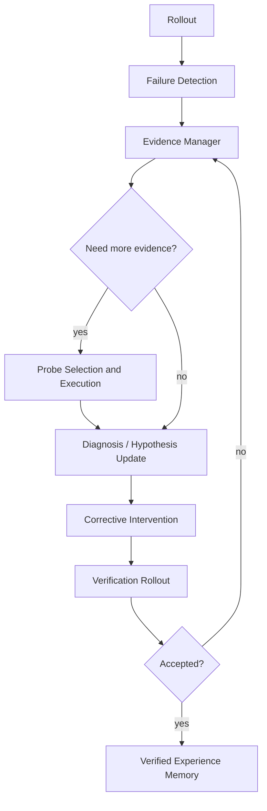

# Budgeted Evidence Acquisition for Embodied Agents

当前研究状态（2026-10-17，北京时间）：目标是达到可提交CCF A完整研究论文的水平，
**目前尚未建立新方法贡献；已补齐更强被动与历史查询参考，任务收益未建立**。这里保留可复现的
真实API闭环、连续仿真、明确费用和全部负结果，不把固定基线获胜称为新算法。

不熟悉缩写时，先看[方法名称的中文解释](docs/research/method_names_zh.md)。

最新完成[状态恢复工具v2资格](reports/state_capsule_qualification_v2.md)及
[累计费用与标签边界说明](reports/state_capsule_qualification_v2_interpretation_zh.md)：
12个新MetaWorld上下文、24对重复续跑通过独立9480事件审计；994项全量测试通过。
v2实际4032控制步、612全部重置、326160请求帧；API为0。
[v1记录失败](reports/state_capsule_qualification_v1_failure_notes_zh.md)另有51次重置／25500帧，
全部保留。它建立本机注册恢复合同，尚未建立条件任务价值、新方法收益或普遍隐藏状态资格。

最新完成[更强被动与历史查询参考](reports/strong_chronological_reference_development_v1.md)，
以及[中文结果解读](reports/strong_chronological_reference_interpretation_v1.md)：18个新开发流、
216任务单元、九种方法，共1944次实际MetaWorld仿真执行。滚动被动更新成功202/216，
每次重测8步为212/216；注册主截止损失差+24.796步，95%完整流区间[+17.426,+32.195]。
历史查询参考也是212/216，但平均专门探测7.944步，未建立相对其他检查方法的任务收益。
全部341失败、147停止和完整来源费用保留；记录审计867841事件、独立统计1233字段均通过。
实际控制233997步，API为0；967项全量测试通过。先前的
[软件资格](reports/passive_supported_reference_qualification_v1.md)仍单独保留，不与仿真结果混算。

此前完成[同一4步前缀的条件续接核对](reports/cache_continuation_alignment_development_v1.md)：
覆盖全部4752次源执行；462个实际刷新案例的后续42348个物理步骤与每次重测参考一致。
实际复用位置去重为538个决策，其中396个复用损失较低、118个重测较低、24个相等，
平均复用减重测的截止损失仍为+3.913步。输入、标签和全部来源费用分开保存，独立核对通过。
源记录没有完整隐藏状态资格；这些是已选择复用区域、单次共同未来的条件描述，
不是条件期望、全部状态的收益或新方法确认。新增环境步、重置和API均为0。

此前真实采集为[连续任务缓存参考](reports/chronological_cache_reference_development_v1.md)，
以及[中文结果解读](reports/chronological_cache_reference_interpretation_v1.md)：
36个时间流、432任务单元、十一方法，共4752次实际执行。4步不确定性检查成功
415/432，每次8步参考420/432；平均截止损失差+3.405步，95%流区间
[-4.239,+12.079]。专门探测平均少3.269步，但没有建立总任务收益。
全部602个失败、293个停止和费用保留；记录与独立统计审计通过，API为0。
这补齐了时序标准参考，没有建立新算法或CCF A贡献。

此前完成[起步响应的独立任务比较](reports/cold_start_task_bridge_development_v1.md)：
56个新扰动条件、三任务、两次未来噪声，共2688次实际执行。联合估计8步纠正
成功330/336，旧模型8步点纠正312/336；平均截止损失差为-32.119步，
95%扰动流区间[-46.863,-18.423]。完整开发组件门槛通过，全部失败和费用均保留。
这是标准估计器的任务收益证据；最早两步的额外收益尚未建立，也没有API参与或新算法结论。

此前还完成[跨任务旧估计预测检查](reports/cross_task_cache_validity_development_v2.md)：
事后复用168条独特轨迹，4032次评分。4步检查在扰动未变时，加入源参数不确定性
的误报为3/336，只用点估计为26/336；本轮人工循环配对的变化均被检出。
这是标准预测参考的压力检查，没有新增仿真或复用后的任务执行，尚不支持渐变、
新故障族、可靠性保证或新方法收益。两次程序失败和显式修复均保留。

此前完成[起步响应辨识资格检验](reports/cold_start_evidence_qualification_v1.md)：
384条名义校准后，96条新轨迹的联合响应模型平均参数分数0.202，同数据ARX为0.767；
辨识门槛通过。但全部8步与后6步响应的差异区间跨0，不能把改善归因于最早两步。
本轮没有纠正后的任务执行或API，尚未证明任务收益。

此前完成[8步点估计强基线比较](reports/point8_baseline_development_v1.md)：
16个新扰动条件、3任务、2未来，672次实际执行。8步点估计成功90/96、
平均截止损失113.250步；16步点估计94/96、94.604步。
主差异为+18.646步，95%算子流区间[-2.000, +45.417]。
报告用固定旧估计对照分开额外探测的运动与使用新数据的影响；区间包含0不代表等效。

其他已完成的关键结果：

- [在线GLM闭环](reports/online_calibrated_agent_development_v1.md)：15条真实API驱动的探测—纠正—执行链路；
  LLM成功14/16，两个校准基线均16/16。任务收益未建立，服务端总输出512-token上限也未验证。
- [剩余代价组件](reports/controller_tail_value_development_v1.md)：整扰动条件留组验证43,020个状态；
  总体预测误差下降，但离线选纠正器94/96低于固定更新95/96，晋级检验未通过。
- [探测后不纠正对照](reports/post_probe_identity_development_v1.md)：960次实际执行，
  固定循环16步点估计在该批为96/96。它是必须保留的标准强基线。

先读[中文研究状态与贡献缺口](docs/research/research_status_20261015_zh.md)，
再看[完整投稿要求](docs/research/publication_path_v1.md)。下面是较早阶段的记录，
任务范围、重置协议、校准假设和费用口径随版本不同，不能跨批次拼接成功率。

Earlier prospective utility result: [qualified continuous calibration](reports/calibrated_continuous_task_utility_v1.md)
succeeded on 64/64 task units versus 33/64 for the same probe without correction;
the same-data nearest-prior baseline obtained 62/64. Offline costs are disclosed
and state/RNG continuity is audited. This establishes a strong standard baseline
under fixed calibration assumptions; algorithm novelty remains unproven.

Earlier implementation foundation: [continuous probing and reset-cost accounting](docs/research/continuous_probe_baselines_v1.md).
The collector preserves one live trajectory and task budget. Its completed
[160-episode simulator comparison](reports/continuous_probe_development_v1.md)
failed the utility gate: dynamic OLS succeeded on 15/32 versus 13/32 for the
same probe without correction; the interval includes zero. State/RNG continuity
and all 160 decisions passed replay audit. This is not a novel-method claim.

> **Historical diagnostic — identifiable does not imply useful:** a separately
> frozen nonlinear stress test made three actuator contexts invisible to the
> old probe and distinguishable by an equal-cost alternative. Nevertheless,
> the unchanged policy succeeded on all 48 seed/context combinations; zero
> seeds required different successful actions. The task-relevance gate failed.
> See the [full result](reports/probe_support_identifiability_development_v1.md).
> This preserves a negative control and does not establish a new method.

> **Historical prospective result — prefix refresh rejected:** eight chronological
> streams (96 task states) compared eight frozen methods. Action-stability
> acquisition succeeded on 87/96 using 37.17 mean probe steps; fixed 16 steps
> succeeded on 88/96. The candidate failed its strong-baseline gate despite
> saving 41.9% against fixed 64. All 768 decisions and 205 accepted cache writes
> passed independent causal replay. See the
> [result and figure](reports/evidence_refresh_prefix_development_v1.md) and
> [contribution boundary](docs/research/evidence_refresh_prior_art_v1.md).
> This is a preserved negative development result, not publication readiness.

> **Earlier causal feasibility result:** a frozen
> crossed-context study holds probe/execution bias marginals identical and
> changes only their coupling. Probe compensation obtained 81.25% task success
> with aligned contexts versus 39.45% with independent contexts; the uncorrected
> control stayed at 34.38%. The interaction was +41.80 percentage points across
> 16 task seeds (95% cluster interval [38.67, 45.31]). This evaluator-only
> mechanism study includes all states and does not establish online recovery,
> a novel algorithm, or publication readiness. See the
> [report](reports/evidence_persistence_crossed_development_v1.md),
> [research path](docs/research/publication_path_v1.md), and
> [problem specification](docs/research/evidence_validity_problem_v1.md).

> **Earlier research snapshot — October 2026:** the latest frozen deterministic
> five-configuration study recovered 55/60 initial failures with evidence
> acquisition versus 51/60 for Baseline. Accepted-only memory and Full ProbeMem
> each recovered 52/60. A new read-only audit finds only four binary recovery
> wins for evidence acquisition and a memory contrast that reverses sign across
> the four already-collected evaluator realizations. These are development
> observations, not established superiority or general self-improvement.
> Start with the [research brief and CV wording](docs/application/probemem_research_brief.md),
> [robustness report](reports/probemem_additional_robustness_v1.md), and
> [reproducible tables](outputs/probemem_additional/robustness_audit_v1/report.md).

> **Earlier development result — Calibrated Verifier v2:** calibration scanned
> 100 fresh units (seeds 4800--4899), yielding 37 operational and 18 exclusive-
> recovery cases with zero integrity violations. None of the 4,800 frozen guard
> combinations could override because every default/alternative 95% posterior
> interval overlapped. Weighted pooled Brier was 0.167678 versus 0.166995 for
> unweighted v1. Calibration failed, so seeds 4900--5099 were not executed. See
> the [calibration report](reports/probemem_calibrated_verifier_calibration_v2.md)
> and [protocol](docs/protocols/probemem_calibrated_verifier_v2.md).

> **Earlier feasibility result — ProbeMem budgeted verifier:** the immutable
> 50-unit fresh-development Demo completed with zero chronology, leakage,
> counterfactual-write, budget, or invalid-Skill violations, but failed its
> performance gate. Budgeted recovery was 15/21 versus 16/21 for the frozen
> variance rule; its 11/21 verifier-call rate was 52.4%, and its two overrides
> were zero helpful, one harmful, and one tied. The guard blocked four harmful
> alternatives, but Memory applicability was not sufficiently calibrated to
> improve recovery. See the [report](reports/probemem_verifier_demo_v1.md),
> [protocol](docs/protocols/probemem_verifier_demo_v1.md), and immutable
> [case page](outputs/probemem_verifier_demo/runs/probemem_verifier_demo_20260804T092718Z_a158d7e53fbd/case_page.md).

The subsequent no-new-rollout [failure-localization audit](reports/probemem_verifier_failure_localization_audit.md)
found that excess admission was only part of the problem: the two authorized
overrides were one harmful and one tied, while the guard blocked one helpful,
four harmful, and four tied alternatives. It does not select a replacement
gate or authorize fresh execution.

Two-minute deterministic integration smoke:

```powershell
.\.venv\Scripts\python.exe scripts\run_probemem_verifier_demo.py `
  --config configs\probemem_verifier\demo_v1.json `
  --smoke --verifier deterministic
```

> **New development protocol:** [ProbeMem: Verification-Grounded Scientific
> Memory for Online Embodied Agents](docs/research/online_llm_scientific_memory_v2.md)
> studies whether a constrained online LLM Agent can reuse only freshly verified
> intervention experience over a chronological deployment stream. This v2 work
> is isolated from, and does not rewrite, the frozen budgeted-evidence v1 results.

ProbeMem Phase B now has a real five-failure development smoke in which all five
online decisions reached fresh verification: four probe-grounded compensation
attempts were accepted and one direct stochastic retry was rejected. This is an
integration result, not a memory or model-performance claim. See the
[Phase-B report](reports/probemem_v2_phase_b_promoted_smoke.md).

ProbeMem Phase C completed a 20-episode paired development comparison of
stateless, raw-episodic, and accepted-only retrieval. Ten episodes required an
online decision; every method obtained 5/10 accepted verifications and selected
the same intervention on every operational pair. Raw and verified memory were
actually cited in 9/10 and 8/10 cases, respectively, but retrieval changed no
intervention or outcome while increasing model-context cost. This is a real
negative result: chronological retrieval alone did not improve recovery. See
the [completed Phase-C report](reports/probemem_v2_phase_c_completed_run.md)
and [decision-trace audit](reports/probemem_v2_phase_c_decision_audit.md). The
audit refines the result: raw memory changed predicted verification status in
6/10 operational cases and verified memory changed confidence in 4/10, yet
neither changed an intervention. The failure is therefore at the
reasoning-to-action boundary, not simply a failure to retrieve or acknowledge
memory.

The follow-up [intervention-utility audit](reports/probemem_v2_phase_c_intervention_utility_audit.md)
converted the same immutable trace into 10 falsifiable records: 5 supported,
3 unresolved, and 2 contradicted executions, with 5 negative prediction
surprises. All records concern the same compensation skill, so they expose
prediction failures but cannot identify a better alternative. They are
explicitly non-actionable and ineligible for principle promotion.

A new immutable [paired intervention-utility development run](reports/probemem_v2_paired_utility_development.md)
then evaluated compensation and retry from the same failure and probe evidence
on seeds 740--759. Ten failures yielded complete pairs: compensation recovered
9/10, retry recovered 0/10. The sole retry utility winner was a both-rejected
case where retry merely avoided harmful compensation. No stochastic-noise case
entered the operational population. The result is therefore
`INSUFFICIENT_ACTION_UTILITY_DIVERSITY`; no selector or memory principle was fit.

A subsequent label-blind noise-coverage run scanned 58 fresh initial rollout
units and stopped after collecting 20 operational paired cases. Bounded planar
compensation was accepted in 10/20 cases, independent stochastic retry in
14/20, and an evaluator-only per-case Oracle could select an accepted candidate
in 16/20. The partitions were 2 compensation-only, 6 retry-only, 8 both
accepted, and 4 neither accepted. This establishes development action-utility
diversity, not a learned selector: the exploratory feature audit used only the
8 decisive cases and did not fit or freeze a threshold.

The resulting frozen development selector was then evaluated once on fresh
seeds 840--895. It recovered 13/20 operational cases, versus 11/20 for always
retry and 14/20 for always compensation. Because it lost one net recovery to
the stronger fixed baseline, its preregistered promotion gate failed. The
negative result is retained; the threshold was not revised and no memory
principle was created.

A no-new-rollout causal audit localized the failure: among 7 exclusive-recovery
cases, the selector chose the accepted skill in 4 and the wrong skill in 3.
The errors include both low-variation compensation-only cases and an extreme
high-variation retry-only case, so intervention utility is not monotonic in the
single registered feature. See the
[causal-audit figure](outputs/probemem_v2/figures/noise_selector_causal_audit.png).

A chronological, post-hoc nearest-reference audit then compared all 13
Agent-visible applicability features. Eight earlier decisive cases were used as
references for seven later decisive queries, with normalization fit on the
earlier cases only. Raw nearest-reference agreement was 2/7, below the frozen
single-feature rule's 4/7. This is evidence against naive episodic similarity,
not a memory benchmark: the historical preferred skills are evaluator-only
counterfactual labels and are prohibited from actionable memory. See the
[retrieval audit](outputs/probemem_v2/figures/applicability_retrieval_audit.png).

To prevent that evaluator-only audit from being mistaken for memory, the
repository now has a separate accepted-only post-probe episode schema. From the
frozen selector run, 13/20 actually selected interventions passed fresh
verification and entered a development snapshot (7 retry, 6 compensation); 3
inconclusive and 4 rejected outcomes were excluded, and no unselected
counterfactual was exported. Operational retrieval remains disabled until a
new protocol freezes applicability and abstention behavior.

The first frozen coverage-aware memory evaluation was also negative. On 20
fresh operational cases from seeds 980--1040, the gate used memory twice and
abstained 18 times (14 local skill conflicts, 4 outside historical coverage).
Both memory uses failed while the alternative intervention succeeded, so the
registered promotion gate failed. This shows that accepted-only storage and
geometric coverage are necessary hygiene but not sufficient evidence of
transferable intervention knowledge.

A post-hoc contradiction audit further found that the two memory uses produced
one inconclusive and one rejected fresh outcome, with no supported implicit
`ACCEPTED` prediction. Both queries were well inside the frozen coverage radius
and had unanimous local skill support. The 14 local-conflict cases also spanned
both-recover, single-skill-recovery, and neither-recovers outcomes. This audit
is evaluator-only and does not create actionable memory; it shows that
geometric similarity is not yet a reliable proxy for action-conditional
intervention utility.

ProbeMem-ACR v3 then tested the narrower deterministic hypothesis directly on
100 new development units (seeds 1100--1199). Exactly one registered condition
was assigned to each seed; 66 failed initial rollouts formed the operational
paired population. The collection contained 47 compensation-only recoveries,
4 retry-only recoveries, 2 both-recover cases, and 13 neither-recover cases.
The frozen action-conditional estimator recovered 46/66, compared with 48/66
for chronological state-only retrieval and 49/66 for always compensation. Its
decisive-status accuracy was 54/61 versus 56/61 for state-only retrieval, and
both methods caused 4 harmful transfers. The preregistered promotion gate
therefore failed; validation, held-out execution, LLM reasoning, and principle
generation remain unauthorized. This development-only counterfactual result is
documented in the [ACR report](reports/probemem_acr_development_v1.md) and is
not an online-learning or memory-benefit claim.

A no-new-rollout localization audit found that ACR selected compensation in all
four retry-only cases. Two existing Agent-visible features showed perfect
post-hoc rank separation, but all four cases belonged to `fault_05` and only
one same-condition compensation-only case existed. The signal is therefore
condition-confounded. A fresh [retry-utility replication protocol](docs/protocols/probemem_acr_retry_utility_replication_v1.md)
reserves seeds 1400--1499 to test only the two feature directions within
`fault_05`; it does not fit a threshold or authorize an LLM stage.

That prospective replication is now complete. Among 100 fresh initial units,
36 required paired evaluation: 11 were retry-only, 5 compensation-only, 14
both-recover, and 6 neither-recover. Probe residual retained the registered
direction (rank probability 0.727), but phase inconsistency did not reach the
frozen 0.70 criterion (0.673), and the compensation-only population missed its
minimum of eight cases. The replication gate failed. No selector, GLM stage,
validation, or held-out execution was authorized; see the
[replication report](reports/probemem_acr_retry_utility_replication_v1.md).

The next prospective study tested whether a single paired winner is itself a
stable action-utility label under stochastic execution. On 20 fresh `fault_05`
states, each candidate was independently verified six times. Candidate winner
reversed across realizations in 18/20 states. A single realization agreed with
the leave-one-realization-out expected winner in only 77/120 comparisons
(64.2%, cluster-bootstrap 95% CI 55.0%--73.3%), below the frozen 70% gate.
Independent retry was accepted in 82/120 executions versus 61/120 for bounded
compensation, but this population-level difference does not validate a
per-state selector. The result motivates distributional action-outcome memory
and abstention rather than storing a single verified winner. See the
[utility-stability report](reports/probemem_acr_utility_realization_stability_v2.md)
and [result figure](outputs/probemem_acr/figures/acr_utility_realization_stability.png).
An audited [same-state reversal manifest](outputs/probemem_acr/videos/stochastic_reversal/manifest.csv)
links four videos for seed 1805: compensation is accepted in one realization
and rejected in another, while retry shows the opposite ordering.

> Can an embodied agent recognize when a failed rollout is diagnostically
> ambiguous, acquire only the missing evidence, and verify a corrective
> intervention before treating it as reusable experience?

This repository is a research prototype for **active evidence acquisition after
robotic failure**. MetaWorld `push-v3` and the fixed `SawyerPushV3Policy` are the
experimental platform; the research object is the high-level agent that decides
whether its current evidence is sufficient, which diagnostic interaction is worth
its cost, and whether a proposed intervention is actually supported by a fresh
verification rollout.

The project is not a new manipulation policy, a reinforcement-learning baseline,
or a MetaWorld tutorial. Its intended research chain is:

```text
controlled failure
-> agent-visible trajectory
-> uncertainty about the failure mechanism
-> probe or diagnose directly
-> corrective intervention
-> verification rollout
-> verified experience only
```

## Research problem

A failed task trajectory often identifies a symptom without uniquely identifying
its cause. Similar lack of progress can arise from systematic action bias,
stochastic execution noise, weakened action scale, contact mismatch, delayed
response, or inaccurate perception. A passive diagnostic system must commit using
whatever motion the nominal policy happened to generate, even when those actions
do not sufficiently excite the relevant dynamics.

Active evidence acquisition instead asks:

1. What competing failure hypotheses remain plausible?
2. How uncertain is the current diagnosis?
3. Would a bounded probe distinguish those hypotheses?
4. Is the expected information worth the interaction cost?
5. Does the resulting intervention pass an independent verification rollout?

The immediate scientific target is not maximum Push success. It is improved
**diagnostic accuracy and evidence efficiency under a fixed interaction budget**.

See the canonical [problem definition](docs/problem_definition.md).

## Agent architecture



The low-level policy remains mostly fixed. The intelligent component operates over
rollouts and bounded probes rather than generating unconstrained continuous robot
actions. Full responsibilities and information flow are documented in
[agent architecture](docs/agent_architecture.md).

## Causal information boundary

Agent decisions consume only schema-v2 **Agent View** evidence:

- `observation_t`, `commanded_action_t`, and `observation_t+1`;
- reward, success, termination, and truncation;
- task-progress metrics and evidence provenance;
- declared environment-step and decision budgets.

Injected fault type, bias axis or magnitude, perturbed/executed actions, and
clipping fields are **Oracle View** information. They may configure the simulator
and score results after execution, but they may not enter diagnosis, probe
selection, or intervention planning.

## What is implemented

| Research role | Current implementation | Status |
|---|---|---|
| Rollout | MetaWorld episode execution, video, and task metrics | Implemented |
| Trajectory | Aligned schema-v2 transitions and Agent/Oracle projections | Implemented |
| Failure generation | Masked action bias, Gaussian noise, and action scaling | Implemented |
| Failure detection | Task success and progress-based outcome checks | Rule-based |
| Evidence manager | Uncertainty records, probe authorization, and bounded campaigns | Partial |
| Probe selection | Symmetric and repeated directional probe contracts | Partial |
| Diagnosis | Mechanism hypotheses and passive planar estimation | Partial |
| Correction | Bounded planar corrective skills | Implemented baseline |
| Verification | Fresh rollout and accepted/rejected/inconclusive contracts | Partial |
| Memory | Chronological raw/verified episodic development comparison | Completed negative result |

Fault injection and Oracle audit are experimental infrastructure, not powers
available to the Agent. Existing online-model adapters are retained as optional
historical comparisons; active evidence acquisition is the research contribution,
not the choice of language model.

## Current empirical evidence

The repository preserves positive and negative results rather than presenting
integration pilots as general performance claims.

### Preliminary frozen result: budgeted evidence allocation

The first preregistered Phase-2 run is complete on 50 rollout units (seeds
330--339 across five registered execution conditions); 33 failed initial
rollouts formed the operational decision population. The frozen
phase-conditioned gate matched Always-probe mechanism diagnosis (33/33) while
requesting 7 rather than 33 probes: 448 versus 2,112 diagnostic environment
steps, a 78.8% probe-cost reduction. The evaluator-only probe-need score achieved
ROC AUC 0.966 and PR AUC 0.830 with 4 positive and 29 negative cases.

This is an evidence-allocation result, not yet a recovery result. All positive
probe-need cases were stochastic-noise cases, and three of seven requested probes
were unnecessary under the strict label. The exact manifest, paired bootstrap,
runtime, leakage boundary, and limitations are in the
[Milestone-A report](reports/evidence_allocation_milestone_a.md). The next claim
must test whether the changed belief improves a corrective intervention under a
fresh matched verification rollout; no held-out threshold will be retuned.

That fresh-verification test is now complete and produced an important negative
result. Active evidence changed four mechanism beliefs and six executable
interventions among seven probe requests, but improved verification in 0/7.
Passive diagnosis-driven intervention recovered 30/33 cases, compared with 29/33
for active evidence; the active method also spent 25.3 more additional environment
steps per case. Even Oracle mechanism routing recovered only 29/33. The result
rejects a simple `mechanism label -> intervention family` design and motivates
candidate-specific intervention-utility evidence on a new development split. See
the [P1 negative-result report](reports/evidence_grounded_intervention_negative.md).

A subsequent development-only identifiability audit on seeds 400--409 found
that mechanism class is a strong but incomplete intervention prior. All 27
comparable stable-bias failures preferred compensation, while one of four
comparable stochastic-noise failures still preferred compensation over retry.
The complete result, including one unavailable compensation candidate, is in
the [identifiability report](reports/intervention_identifiability_development_v2.md).
No frozen held-out parameter was changed.

A preregistered noise-only extension on fresh seeds 410--429 produced seven
operational failures: four preferred compensation and three preferred retry,
despite all sharing the same stochastic-noise mechanism. Phase inconsistency,
temporal uncertainty, and relative probe variance each reached ROC AUC 0.75,
but n=7 is too small to freeze a selector. The result and paired videos are in
the [noise utility report](reports/noise_intervention_utility_development_v1.md).

- Controlled single-axis perturbation experiments established reproducible
  failures, schema-v2 trajectories, real CSV summaries, and representative videos.
- A bounded online GLM-5.2 pilot demonstrated that an external model can select a
  registered diagnostic probe without receiving Oracle fault fields.
- In a five-case development comparison, GLM-5.2 requested a probe for all 5/5
  cases, behaving like an always-probe policy rather than a selective evidence
  allocator.
- A frozen uncertainty gate reduced probe use on ten held-out single-axis cases,
  but passive correction already succeeded on 10/10. The extra probes produced no
  success gain.

The current conclusion is therefore deliberately modest: the experimental loop is
reproducible, but simple single-axis bias does not yet demonstrate a scientific
need for active evidence. The next benchmark must use **ambiguity pairs**, such as
stable bias versus stochastic noise, where passive trajectories can support
multiple mechanisms and probe consistency can resolve them.

A first tuning-only bias–noise manifest now pairs eight real failed rollouts using
only passive return, final distance, and progress. Post-selection audit shows that
the existing repeated probe separates these synthetic mechanisms on all eight
tuning cases, but deterministic bias has zero repeat variance and noise std is
large. This is benchmark-construction evidence, not a held-out active-agent claim;
see the [ambiguity benchmark report](reports/bias_noise_ambiguity_benchmark.md).

On the first four-case held-out manifest, passive diagnosis scored 2/4 and the
always-probe baseline scored 4/4, but the tuning-frozen uncertainty gate requested
no probes and remained at 2/4. The scientific conclusion is therefore not that the
selective Agent succeeds: repeated evidence is useful, while the current passive
uncertainty signal fails to allocate it. Exact costs and limitations are in the
[held-out active-evidence pilot](reports/ambiguity_agent_heldout_pilot.md).

A subsequent development study tested an Agent-visible temporal response residual
as the evidence-need signal. It reached 10/10 development diagnoses only by probing
9/10 cases; probe-need ROC AUC was 0.667. The candidate was rejected before another
held-out run because it behaved almost like always-probe. This negative result and
the phase-conditioned next hypothesis are documented in the
[temporal evidence-need study](reports/temporal_evidence_need_development.md).

A real ten-call GLM-5.2 development pilot then exposed the same evidence through a
bounded online research-agent interface. The model requested the registered probe
for all 10/10 cases, matching always-probe accuracy and evidence cost while adding
API latency. This validates the online integration but not selective reasoning;
see the [online temporal Agent pilot](reports/online_temporal_evidence_agent_pilot.md).

A preregistered phase-conditioned development study then separated approach,
contact/push, and near-goal response fits. Its transparent gate retained 10/10
development accuracy while reducing requests from 10 to 6 (384 versus 640 probe
steps), passing the declared promotion criteria. However, a bounded ten-call
GLM-5.2 comparison still requested all probes. The deterministic signal is now
eligible for one frozen held-out test; the online result remains negative. See the
[phase-conditioned evidence study](reports/phase_conditioned_evidence_development.md).

Reports containing the actual commands and artifacts are under `reports/`. The
[experiment plan](docs/experiment_plan.md) defines the next controlled comparisons.

## Repository map

```text
src/
  rollout/         execute episodes; no diagnosis
  trajectory/      causal transition records and data views
  diagnosis/       failure hypotheses and visible-state estimators
  uncertainty/     evidence sufficiency and probe decisions
  probe/           bounded diagnostic interaction contracts
  planner/         corrective-intervention contracts
  verification/    verification plans and outcomes
  memory/          verified-experience interface only
  evaluation/      resumable campaigns and research metrics
scripts/           reproducible experiment and visualization entrypoints
configs/           frozen campaign configurations
reports/           real experiment reports, including negative results
docs/              canonical research and reproduction documentation
```

## Reproduction

The project uses Python 3.10, MetaWorld 3.1.1, and MuJoCo on CPU by default.

```powershell
py -3.10 -m venv .venv
.\.venv\Scripts\Activate.ps1
python -m pip install -r requirements.txt
python scripts/check_install.py
python scripts/demo_push.py
python scripts/evaluate_push.py --num-episodes 10 --seed-start 100
```

The default demo writes `outputs/push_demo.mp4`. Exact baseline, perturbation,
active-evidence, validation, and optional online-comparison commands are in
[docs/reproduction.md](docs/reproduction.md). Installation details are in
[INSTALL.md](INSTALL.md).

## Scope and limitations

Current evidence is limited to one simulated manipulation task, a scripted
low-level policy, and controlled execution faults. It does not establish
open-world diagnosis, transfer to a real robot, learned manipulation, or
memory-based continual improvement. No reinforcement learning, behavior cloning,
VLA training, or new robot task is part of the current research milestone.

---

# 面向自改进具身智能体的主动证据获取

> 具身智能体能否在一次机器人 rollout 失败后，识别当前证据是否存在诊断歧义，
> 只获取真正缺失的信息，并在将纠正经验用于未来之前通过新的 rollout 验证它？

本仓库是一个研究**机器人失败后主动获取诊断证据**的原型系统。MetaWorld
`push-v3` 和固定的 `SawyerPushV3Policy` 是受控实验平台；真正的研究对象是高层
Agent：它需要判断现有证据是否充分、哪一种诊断性交互值得消耗预算，以及一个纠正方案
是否得到了新 verification rollout 的真实支持。

本项目不是新的机器人操作策略、强化学习 baseline 或 MetaWorld 教程。预期研究链条为：

```text
可控失败
-> Agent 可见轨迹
-> 对失败机制的不确定性
-> 主动 probe 或直接诊断
-> corrective intervention
-> verification rollout
-> 只保留经过验证的经验
```

## 研究问题

一次失败轨迹通常只能揭示失败症状，不能唯一确定失败原因。相似的任务停滞可能来自固定
动作偏差、随机执行噪声、动作幅度衰减、接触动力学不匹配、控制延迟或感知误差。被动
诊断器只能使用 nominal policy 恰好产生的动作和状态变化；当这些动作没有充分激励相关
动力学时，诊断结论可能缺乏可辨识性。

主动证据获取将问题改写为：

1. 当前仍有哪些相互竞争的失败机制假设？
2. 诊断不确定性有多大？
3. 一个有限步数的 probe 能否区分这些假设？
4. 预期信息增益是否值得额外交互成本？
5. 根据新证据生成的 intervention 能否通过独立 verification rollout？

当前科学目标不是单纯提高 Push 成功率，而是在固定交互预算下提高**诊断准确率和证据
效率**。规范定义见[问题定义](docs/problem_definition.md)。

## Agent 架构

```text
Rollout
-> Failure Detection
-> Evidence Manager
-> Probe Selection（必要时）
-> Diagnosis
-> Corrective Intervention
-> Verification
-> Verified Experience Memory
```

底层操作策略保持基本固定。Agent 在 rollout 与有限 probe 层面决策，不直接生成不受约束
的连续机器人动作。完整职责、输入输出和信息流见
[Agent 架构](docs/agent_architecture.md)。

## 因果信息边界

Agent 只能读取 schema-v2 **Agent View**：

- `observation_t`、`commanded_action_t` 和 `observation_t+1`；
- reward、success、terminated 和 truncated；
- 任务进度指标、证据来源和显式预算。

注入故障类型、bias 轴与幅度、perturbed/executed action 和裁剪审计字段属于
**Oracle View**。它们只允许用于配置仿真和事后评测，不能进入诊断、probe 选择或
intervention 规划。

## 当前实现

| 研究环节 | 当前实现 | 状态 |
|---|---|---|
| Rollout | MetaWorld episode、视频和任务指标 | 已实现 |
| Trajectory | schema-v2 状态转移和 Agent/Oracle View | 已实现 |
| 失败构造 | masked action bias、Gaussian noise、action scale | 已实现 |
| Failure Detection | success 与 task progress 规则 | 规则基线 |
| Evidence Manager | uncertainty、probe 授权和预算 campaign | 部分实现 |
| Probe Selection | 对称方向 probe 与重复 probe 合同 | 部分实现 |
| Diagnosis | 机制假设和被动平面漂移估计 | 部分实现 |
| Correction | 有限平面纠正 skill | 基线已实现 |
| Verification | 新 rollout 与三态验证合同 | 部分实现 |
| Memory | chronological raw/verified episodic development 对照 | 实验不完整，不宣称收益 |

故障注入和 Oracle audit 是实验基础设施，不是 Agent 能力。仓库保留已有在线模型适配器
作为可选历史对照，但项目的核心研究贡献是主动证据获取，而不是某一个语言模型。

## 当前真实证据

仓库明确保留正结果和负结果，不把 integration pilot 包装成通用性能结论。

- ProbeMem Phase C 已完成 20/20 个 paired development episodes。10 个 operational
  episodes 中，stateless、raw retrieval 和 verified retrieval 均为 5/10 accepted，
  且 10/10 的 intervention 与 outcome 完全相同。memory 确实被模型引用，但没有改变
  行为，并增加了上下文与 latency 成本；这是“简单 retrieval 不足”的真实负结果。

- 单轴可控扰动实验建立了可复现失败、schema-v2 轨迹、真实 CSV 和代表性视频。
- 一次受约束 GLM-5.2 pilot 证明外部模型可以在不知道 Oracle 故障字段的情况下选择已注册
  diagnostic probe。
- 在五个 development cases 中，GLM-5.2 对 5/5 全部请求 probe，实际表现更接近
  always-probe，而不是选择性证据分配策略。
- 冻结 uncertainty gate 在十个 held-out 单轴 cases 上减少了 probe，但 passive correction
  已经达到 10/10，额外 probe 没有增加成功数。

因此当前结论是：实验闭环已经可复现，但简单单轴 bias 尚不能证明 active evidence 的科学
必要性。下一步需要构造 **ambiguity pairs**，例如 stable bias 与 stochastic noise：二者的
被动失败现象相似，但重复 probe 的一致性能够帮助区分潜在机制。

真实命令、结果和限制位于 `reports/`；下一阶段对照与指标见
[实验计划](docs/experiment_plan.md)。

## 仓库结构

```text
src/rollout/       只负责执行 episode
src/trajectory/    因果轨迹和 Agent/Oracle View
src/diagnosis/     失败机制假设和可见状态估计
src/uncertainty/   证据充分性与 probe 决策
src/probe/         有限诊断性交互
src/planner/       corrective intervention 合同
src/verification/  verification 计划和结果
src/memory/        verified experience 接口
src/evaluation/    可续跑 campaign 与科研指标
scripts/           可复现实验和可视化入口
configs/           冻结实验配置
reports/           真实实验报告和负结果
docs/              规范研究文档与复现说明
```

## 快速复现

```powershell
py -3.10 -m venv .venv
.\.venv\Scripts\Activate.ps1
python -m pip install -r requirements.txt
python scripts/check_install.py
python scripts/demo_push.py
python scripts/evaluate_push.py --num-episodes 10 --seed-start 100
```

默认演示视频保存到 `outputs/push_demo.mp4`。完整 baseline、扰动、主动证据和可选在线对照
命令见[复现说明](docs/reproduction.md)，安装细节见 [INSTALL.md](INSTALL.md)。

## 范围与限制

当前证据只来自一个仿真操作任务、脚本底层策略和受控执行故障，尚不能证明开放世界诊断、
真实机器人迁移、学习型操作策略或基于 memory 的持续自改进。当前研究阶段不包含强化学习、
行为克隆、VLA 训练或新的机器人任务。
