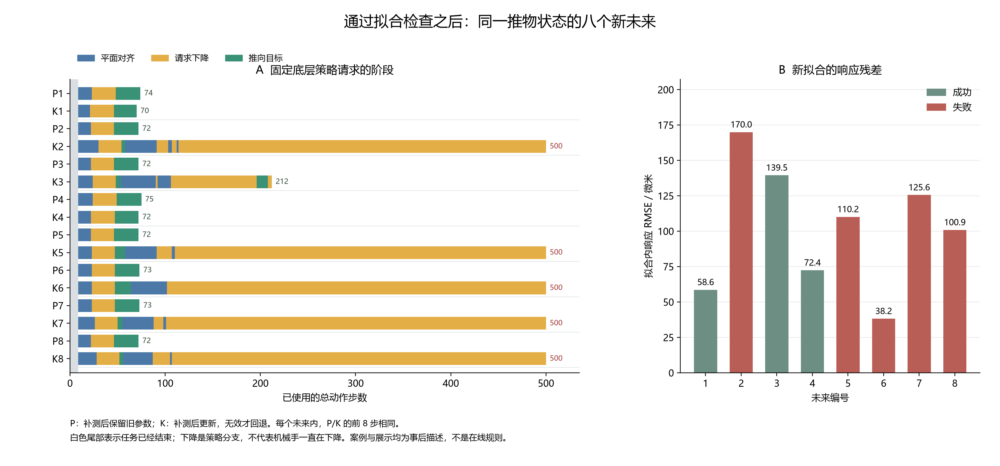

# 有效拟合之后的任务阶段停滞

已完成的同状态实验中，有一个推物状态在更新参数后由八次全部成功变为三次成功。逐步记录显示：五条失败轨迹的末尾都持续触发固定策略的“下降”分支，而相同补测后保留旧参数的轨迹均成功。这把后继方法的问题进一步限定为：参数更新是否仍允许任务进入并完成后续阶段，不能只检查短探测的拟合质量。

本页检查论文已经披露的两个极端状态，保留各自全部八个新未来与四个程序。案例按已观察到的平均效果选择，以下是探索性轨迹定位，不是总体发生率、在线检测器或新方法的确认实验。没有重跑这些种子，没有训练或调整任何阈值。

## 从记录定位控制变化

推物案例标识为 19493，仅供评价者检索。每个未来内，P“补测后保留旧参数”与 K“补测后更新，无效才保留”的共同八步实际轨迹一致；第九个动作前的观测和原始底层策略命令也一致。两者发送的纠正后命令从此分开。八个 K 拟合均有效，故这里不存在无效回退，U 与 K 的实际续跑完全一致。

提取器沿原始全局序号连接先保存的命令和后发生的环境步骤，检查连续观测、最终观测与原结果、实际后缀长度及共同前缀。两个案例共重建 64 条续跑、15,671 个实际后缀步骤；这只是重新读取已有记录，没有增加物理交互。[轨迹数据](../../outputs/reproduction_reviews/paired_probe_v1/case_traces_v1/case_traces.json)保留各步公共观测、原始命令、实际发送命令及来源序号，外层案例身份和未来结果只能用于评价。

## 推物阶段的具体表现

绑定版本的 `SawyerPushV3Policy` 先将物体位置沿 x 平移 −0.005 米作为对齐参考，再按当前观测选择目标位置：平面距离大于 0.02 米时先对齐；否则，当手与物体的高度差大于 0.04 米时请求下降；其余情况请求推向目标。图中的阶段来自每步动作前的观测和这套既有分支条件。“请求下降”不表示实际高度一定继续降低。



| 新未来 | P 完成步数 | K 结果与步数 | K 拟合内 RMSE／微米 | K 最长连续下降请求／步 | K 最终物体到目标距离／厘米 |
|---|---:|---|---:|---:|---:|
| 1 | 74 | 成功 70 | 58.6 | 25 | 4.90 |
| 2 | 72 | 失败 500 | 170.0 | 386 | 16.37 |
| 3 | 72 | 成功 212 | 139.5 | 90 | 4.78 |
| 4 | 75 | 成功 72 | 72.4 | 25 | 4.91 |
| 5 | 72 | 失败 500 | 110.2 | 390 | 7.98 |
| 6 | 73 | 失败 500 | 38.2 | 398 | 10.61 |
| 7 | 73 | 失败 500 | 125.6 | 399 | 13.85 |
| 8 | 72 | 失败 500 | 100.9 | 393 | 13.65 |

P 的下降请求总数为每次 24–25 步，随后均完成任务。五个失败 K 的最后 100 步全部请求下降：平面对齐条件一直满足，高度差仍高于 0.04 米。它们并非从未请求推向目标，而是先前短暂进入过该分支，之后长期停留在下降分支。轨迹能定位这种阶段停滞，尚不能把它唯一归因于死区、某个拟合系数或某种接触约束；区分这些原因需要实际干预实验。

拟合残差也不能直接作为这组结果的接受阈值。未来 6 的残差最小，为 38.2 微米，但任务失败；未来 3 的残差为 139.5 微米，却在 212 步成功。一个“残差越小就越可靠”的单阈值，无法同时接纳后者而拒绝前者。残差是同一短探测数据上的拟合内误差，并非完整任务预测误差。

阶段停留时间本身也不是失败标签。未来 3 曾连续请求下降 90 步，后来仍成功。不能根据本页的五条失败轨迹，直接设定一个停留阈值并把它当作通过验证的恢复策略。

## 决策前参考为何给出不同建议

该推物状态在前四步的预测检查统计量为 3.007，低于工作参考阈值 15.507，`UNCERTAINTY4` 保存的建议是继续旧参数。`TASK_IVR4` 的预计方差相对降低为 0.378，高于既有阈值 0.25，因此建议补测。这些值来自结果发生前保存的参考记录；协方差及阈值仍未获得物理概率保证。

这说明当前局部动作方差的降低，没有在这个状态上对应任务损失改善。它不是两套选择器在各自历史上的完整比较，也不能据此把 `TASK_IVR4` 的总体表现替换成这个案例。

另一已披露案例 19218 为到达任务。其预测检查统计量为 120.965，两个参考均建议补测。P 的八个未来均在预算内失败，K 全部成功；P 的最终手到目标距离为 6.51–7.26 厘米，K 为 1.63–2.52 厘米。因此，一律保留旧参数也会在这组续跑中错过更新收益；这两个案例没有给出能在执行前可靠区分两者的新规则。

## 一个阶段切换的解析例子

下面的标量递推只用于说明为什么小的响应偏差未必约束阶段切换时间；它不是 MetaWorld 的已辨识动力学，也不是新的定理。状态 x 在降至阈值 δ 时进入下一阶段，阶段内满足：

```text
xₜ₊₁ = (1−α)xₜ + αc + b，0<α<1，x₀>δ。
q = c + b/α，β = 1−α。
xₜ = q + βᵗ(x₀−q)。
```

当 q≥δ 时，每个有限时刻都仍有 xₜ>δ，无法切换。当 q<δ 时，首次切换步数为：

```text
T = ceil(log((δ−q)/(x₀−q)) / log β)。
```

若能建立严格余量 q≤δ−m、m>0，则有上界：

```text
T ≤ ceil(log(m/(x₀−δ+m)) / log β)。
```

该式直接由递推解及比例 (δ−q)/(x₀−q) 对 q 的单调性得到。它说明需要控制的是相对于阶段切换边界的余量，不能仅由参数协方差的迹或短探测残差代替。

取无量纲例子 α=1/5、δ=1/25、x₀=δ+ε、c=δ−ε、ε=1/1000。b=0 时第三步还在阈值上方，第四步到达 0.0398192，完成切换；改为 b=αε=1/5000 后，q=δ，任意有限步都不切换，500 步仍如此。对任意正 ε，名义切换时间保持四步，而扰动 αε 可以任意小。缺少切换余量时，因而没有仅由偏差绝对大小给出的统一完成时间保证。

这是一项明确假设下的结构解释。当前受控起步响应模型没有覆盖接触阶段，不能据此给真实轨迹估出 q 或给机器人输出完成时间证书。实际方法若使用阶段余量，需要另外建立可见证据、适用模型及误差说明。

## 后继设计需要检验的区别

现有记录给出两个具体约束。第一，接受新估计的依据应区分“解释探测响应”与“允许固定策略通过后续阶段”；单纯调小拟合残差阈值不能解决上面的排序反例。第二，若在执行后观察到阶段停滞，再恢复旧参数或重新获取证据，必须从当时的真实状态连续执行并支付剩余费用。不能把第八步保留参数的 P 成功结果，移植为经历 K 失败轨迹后的恢复结果。

任何阶段监测或接受规则还需要与普通执行监测、变化检测和任务相关获取比较，才能说明具体差异。这里只获得了可复核的任务失败定位和一个解析解释，尚未实现或验证新的获取方法；不根据案例结果修改当前冻结实验。

## 复核文件

[提取脚本](extract_paired_probe_case_trace_20261019.py)先核对历史交付的 Git 锚点及其绑定文件，再提取上述固定案例。[提取回执](../../outputs/reproduction_reviews/paired_probe_v1/case_traces_v1/receipt.json)保存来源事件、案例文件、脚本及输出的哈希。图的[生成脚本](plot_paired_probe_case_trace_20261019.py)、[英文 PNG](../../outputs/reproduction_reviews/paired_probe_v1/case_trace_figures_v1/case_trace_en.png)、[中文 SVG](../../outputs/reproduction_reviews/paired_probe_v1/case_trace_figures_v1/case_trace_zh.svg)、[英文 SVG](../../outputs/reproduction_reviews/paired_probe_v1/case_trace_figures_v1/case_trace_en.svg)和[回执](../../outputs/reproduction_reviews/paired_probe_v1/case_trace_figures_v1/receipt.json)使用相同轨迹。

上述入口只接受尚不存在的新输出子目录。完整人口结果仍见[论文工作稿](paired_probe_manuscript_20261019_zh.md)；本页的额外读取与绘图属于新计算费用，环境步、API 调用、拟合及新置信区间均为零。
