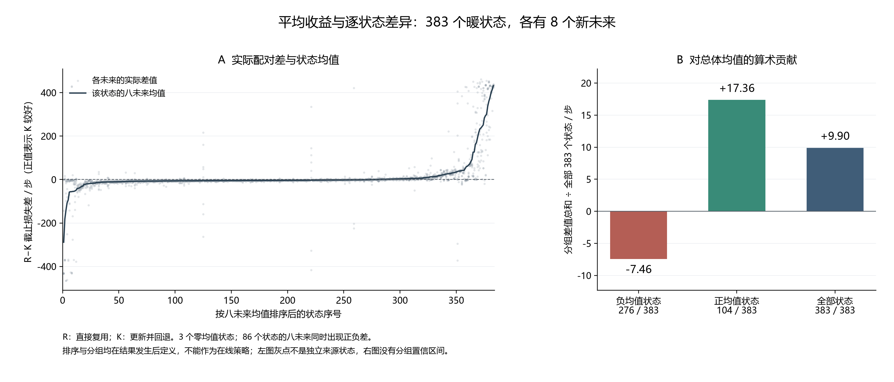

# 探测收益的状态差异与均值分解

在已经完成的同状态实验中，更新并回退 K 相对直接复用 R 的平均截止损失改善为 9.90 步，但 383 个状态中只有 104 个状态的八未来均值支持 K。下图保留每个配对未来的实际差值，并解释总体平均改善如何与多数状态的负差值同时出现。



图 A 的每个灰点是一条新未来噪声下的 R−K 损失差，曲线为该状态八个未来的均值。383 个状态按这个观测均值排序，横轴不是时间或执行顺序。灰点在同一状态内重复，状态又来自 36 条完整来源流，不能将全部 3,064 个灰点当作独立来源样本。

图 B 把各组的状态均值相加，再统一除以全部 383 个状态，得到该组对总体均值的贡献。它不是各组内部的平均效果。

| 按观测均值符号划分 | 状态数 | 对全部状态平均差值的贡献／步 |
|---|---:|---:|
| 负均值，直接复用 R 较好 | 276 | −7.46 |
| 正均值，更新并回退 K 较好 | 104 | +17.36 |
| 零均值 | 3 | 0.00 |
| 全部 | 383 | +9.90 |

负值意味着 K 的任务损失较高。部分正收益状态避免了较大的任务损失，抵消了数量更多的负收益状态。就这批固定来源状态的程序比较而言，按获胜状态数选择 R，会选择到平均截止损失更高的程序。这支持以损失大小评价决策，而不只统计正负分类是否正确。

分组与排序均是在观察结果后定义的。它们不能作为执行前可用标签或在线策略，图 B 也没有分组置信区间。86 个状态的八条未来中同时出现严格正差和负差，说明单个状态的有限重复均值仍有噪声。原注册主比较的完整流区间 [5.36, 14.59] 适用于总体平均 R−K，不是对图中各状态或事后分组的保证。

本图是既有结果的描述性展示，不增加假设检验、选择器训练或物理实验。它不证明公开证据能够预测大额收益，也不替代候选方法按自身历史运行的独立验证。原论文段落中的人口、成本和失败说明见[结果与讨论](paired_probe_measurement_results_20261019_zh.md)。

## 图表文件与复核

可用于中文讨论的 [PNG](../../outputs/reproduction_reviews/paired_probe_v1/heterogeneity_figures_v1/heterogeneity_zh.png) 和 [SVG](../../outputs/reproduction_reviews/paired_probe_v1/heterogeneity_figures_v1/heterogeneity_zh.svg)，以及英文论文的 [PNG](../../outputs/reproduction_reviews/paired_probe_v1/heterogeneity_figures_v1/heterogeneity_en.png) 和 [SVG](../../outputs/reproduction_reviews/paired_probe_v1/heterogeneity_figures_v1/heterogeneity_en.svg) 使用同一份数值。SVG 将字体转为路径，避免依赖读者安装中文字库。

[绘图数据](../../outputs/reproduction_reviews/paired_probe_v1/heterogeneity_figures_v1/figure_data.json)保留状态身份、所有配对差、排序、状态均值、Monte Carlo 标准误和算术贡献。[生成回执](../../outputs/reproduction_reviews/paired_probe_v1/heterogeneity_figures_v1/receipt.json)绑定原始 CSV、已审计统计、绘图程序、字库和导出文件的哈希。

[生成脚本](plot_paired_probe_heterogeneity_20261019.py)先核对交付提交及其绑定输入，再从原始执行 CSV 重建 R−K，逐状态比较保存的均值、标准误和正负混合标志。输出目录必须尚不存在；复现时指定一个新子目录，例如：

```powershell
C:\Python314\python.exe docs/paper/plot_paired_probe_heterogeneity_20261019.py --output outputs/reproduction_reviews/paired_probe_v1/heterogeneity_figures_replay_01
```

该入口使用现有绘图运行时和 Windows 微软雅黑字库，生成中文与英文两套图。已核对两张 PNG 的布局、标签和注释；图上的排序和事后分组限制应与图一起保留。
