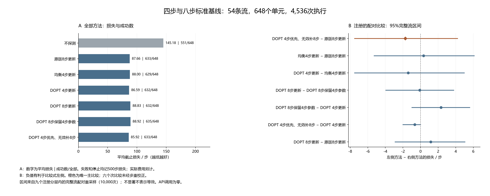

# 四步与八步探测：正式结果与研究含义

这轮正式实验已完成 54 条独立来源流、648 个任务单元、4,536 次方法执行，五阶段流水线和两类审计均通过。主要结论是：四步优先方案减少了探测步骤，但本轮没有证明它优于原版八步方案，也没有证明二者等效。在线 API 调用为零。

运行与全部原始数字见[正式报告](../../reports/short_probe_reference/main_v1.md)，操作说明见[复现入口](short_probe_reproduction_20261019_zh.md)。本页解释已有结果，不改动冻结协议、不追加样本，也不重新选择主比较。

## 方法名对应什么操作

探测是先发送几次固定动作，观察实际运动，再估计后续动作应该怎样纠偏。`UPDATE` 更新的是纠偏参数，底层策略保持固定；`DOPT` 是标准 D-optimal 实验设计，按名义模型的信息量准则提前选动作，不保证任务收益最大。

| 方法 | 直观操作 | 成功/全部 | 停止 | 平均截止损失 | 平均探测步数 |
|---|---|---:|---:|---:|---:|
| NO_PROBE | 不试探，直接做任务 | 551/648 | 0 | 145.1775 | 0.0000 |
| ORIGINAL8_UPDATE | 按原版方案试8步，再纠正 | 633/648 | 0 | 87.6559 | 8.0000 |
| BALANCED4_UPDATE | 沿x、y正反方向各试一次，再纠正 | 629/648 | 1 | 87.9969 | 4.0000 |
| DOPT4_UPDATE | 用设计好的4步探测，再纠正 | 632/648 | 1 | 86.5895 | 4.0000 |
| DOPT8_UPDATE | 四步动作做两轮，用全部8步估计 | 632/648 | 0 | 88.8272 | 8.0000 |
| DOPT4_KEEP_AT8 | 前4步算好纠正，再走4步，仍用旧估计 | 635/648 | 1 | 88.9167 | 8.0000 |
| DOPT4_FALLBACK8 | 四步估计有效就执行，无效才补到8步 | 633/648 | 0 | 85.9228 | 4.0062 |

成功按包含探测的实际总步数计分；失败和停止都记 500 步截止损失，越低越好。停止没有真的走满 500 步，实际费用另列。`KEEP_AT8` 用于区分额外运动与采用额外数据的效果；不能将最高成功数直接当作最低任务损失。

图右橙色是预先指定的唯一主比较；其余六项为未多重校正的次比较。可导出[中文 SVG](../../outputs/reproduction_reviews/short_probe_reference_v1/main_figures_v1/short_probe_reference_zh.svg)与[英文 SVG](../../outputs/reproduction_reviews/short_probe_reference_v1/main_figures_v1/short_probe_reference_en.svg)。

## 主比较没有证明额外收益

`DOPT4_FALLBACK8 − ORIGINAL8_UPDATE` 的平均截止损失差为 **−1.7330 步，95% 区间 [−7.5125, 4.1994]**。负值有利于四步优先方案，但区间包含零，也包含它较差的情况。两者成功数同为 633/648，并不证明逐单元表现相同。

四步优先方案的平均探测数从 8 降至 4.0062；任务总损失的差异则小得多，说明省下的探测步数不能直接当作总任务改善。样本量按历史方差和 20 步目标改善规划，本轮不具备“四步效果等效”或小效应非劣效保证。不能把未显著差异包装成已证明的性能保持。

## 全部停止和实际补测

共有 191 条失败执行，其中包括下列全部 3 条停止；其余失败同样保留在[完整失败表](../../outputs/short_probe_reference/development_v1/short_probe_reference_20261019T042309Z_39300e556379/main_analysis/all_failures.csv)中。

| 任务种子 | 方法 | 停止原因 | 实际控制步数 | 截止损失 |
|---|---|---|---:|---:|
| 20691，开门 | BALANCED4_UPDATE | 四步拟合未通过有效性检查 | 4 | 500 |
| 20794，到达 | DOPT4_UPDATE | 四步拟合未通过有效性检查 | 4 | 500 |
| 20794，到达 | DOPT4_KEEP_AT8 | 保留的四步拟合无效；按注册程序多走四步后停止 | 8 | 500 |

四步优先方案仅在种子 20794 真实补测：前四步拟合无效，再执行四步并用完整八步重估，最后在总计 68 步时成功。它与直接 DOPT 八步方案的注册共同前缀通过核对。与 DOPT 四步直接更新相比，另外 647 个单元的成功、停止、结束原因、截止损失及步骤计数一致。

这个案例证明备用分支实际被触发并执行。它不能单独证明稳定的总体收益；四步优先相对四步直接更新的次比较区间为 [−2.0000, 0.0000]，且未做多重校正。

## 任务差异与后续对照

三个任务各有 216 个单元。以下是已注册任务分组的描述统计，没有新增分组置信区间。

| 任务 | 不探测：成功数 / 平均损失 | 原版8步：成功数 / 平均损失 | 四步优先：成功数 / 平均损失 |
|---|---|---|---|
| 推物 push-v3 | 169 / 166.8657 | 212 / 81.5231 | 212 / 77.7176 |
| 到达 reach-v3 | 173 / 166.3102 | 214 / 66.9537 | 213 / 69.2639 |
| 开门 door-open-v3 | 209 / 102.3565 | 207 / 114.4907 | 208 / 110.7870 |

总体平均不能抹掉这些差异：开门任务里，不探测的平均损失比表中两种纠正方案低。后续方法必须保留不探测、便宜四步与原八步这些强对照；不能只与未校准或昂贵基线比较。这个分组观察也不是已经验证的按任务切换策略。

此前暖状态配对研究从同一个四步历史、旧参数和物理边界比较续跑；本轮七方法分别从受控初始重置开始，且没有跨单元缓存。两轮回答不同问题，不能用此前平均约 9.90 步的补测更新收益替本轮四步优先策略背书。

## 全部成本与复核范围

MAIN 实际执行 **433,380 个控制步、4,536 次受控重置、231,336 次全部重置、117,834,900 个请求仿真帧**。全部重置包含每次任务工厂的 50 次生成重置；采集主体耗时 8,583.70 秒。加上已完成预检，新增控制步合计 441,595，全部重置 234,549，请求帧 119,482,475。

六种使用名义模型的方法各计完整历史来源费用：3,840 步、480 次受控重置、24,480 次全部重置、12,259,200 帧；本轮按 648 单元摊销为每单元 5.9259 个历史控制步。不探测方法该项为零。历史数据物理上只采集过一次，并未在本轮重新收费为新增采集。

正式日志审计核对 1,817,244 条事件和全部 4,536 次执行，确认 2,588 条“四步拟合→保存选择→实际策略动作”链路、一次实际补测与零个未完成配对前缀。数值审计复算 1,082 项字段，最大绝对差约 2.58×10⁻¹⁴，并核对三份 CSV 合计 4,730 行。审计另耗 410,048 次政策查询、3,889 次拟合/nfev 和 373,248 个设计候选核对，没有新增物理执行。

日志审计共享已披露的估计器、设计和固定政策函数；状态见证来自执行进程。新的复现入口复用这些审计器，不把一次重放计作第三次独立实现或新的物理复现实验。API、名义训练、选择器训练和政策权重更新均为零。

## 对发表目标的实际推进

本轮补齐了后继获取方法必须面对的便宜标准基线，并保留了未证明优势的结果。D-optimal 设计、短前缀拟合和无效时补测本身均不作为算法创新。

当前中途干预原型已通过合成和小型 MuJoCo 软件测试，但还没有 MetaWorld 中途执行资格、接触阶段重新辨识资格或独立任务收益。下一阶段先验证真实当前状态下保存选择到实际执行的连续衔接，再建立可见历史支持的获取决策与独立验证；不能把旧固定分支的未来拼接成中途切换收益。新方法、完整强基线、消融、独立策略评估及投稿论证仍须继续完成。
