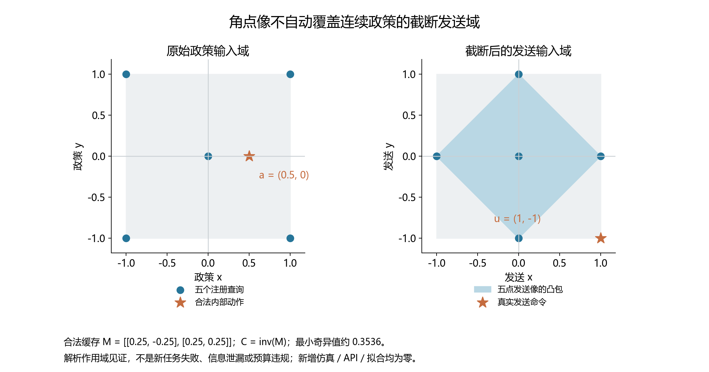

# 响应验证的有限查询作用域 只读核验

这项后处理在正式时变实验运行期间规定，不读取部分方法表现来改变
已冻结的选择器、预算或强对照。它不重新仿真、不拟合参数或阈值、不
更改当前案例，不把诊断导出为在线证据。所有原方法仍按原协议完成。

## 角点检查的几何边界

注册选择器对四个原始政策 xy 角点及零点，经缓存控制器截断后形成的
五个发送命令作响应查询。这不自动等于整个连续政策输入的发送像。
例如合法缓存矩阵 `M=[[.25,-.25],[.25,.25]]` 的逆为
`C=[[2,2],[-2,2]]`：原始角点截断后的像为 `(±1,0),(0,±1)`，其凸包
是菱形；原始合法内部动作 `(.5,0)` 却发送 `(1,-1)`，在该凸包之外。
矩阵最小奇异值约 0.3536，处于原数值逆稳定域内，不依赖恶意非法值。

整个发送像在这个例子中是正方形：任取发送命令 u∈[-1,1]²，令
原始动作 a=M u，则 a∈[-.5,.5]²，且 clip(C a)=u。故完整像面积为 4，
五点像凸包面积为 2。这个面积比例只描述解析例子，不代表实验的
任务风险、测量概率或实际外部查询占比。



图的矩阵、动作、散列与零新增采集成本保存在同目录的 figure.json；
v1 保留原图及原绘制源，v2 仅调整图例和页脚的间距。

这个解析例子证明有限角点像不构成完整发送域的证明，尚不表示新实验
中的某个真实任务失败或原协议泄漏／预算违规。继续使用有限查询的
原选择保持不变。实际影响必须从完成后的原始公开发送命令中核对。

对每个最终 REUSE 的有界／G／点／几何／成本方法案例，使用保存的
行动查询点构造精确有理数凸包，核对它后续实际 POLICY 发送命令是否
在包内。记录全部查询数、外部查询数及首个位置，不把 1e-12 的外部
分量按数值容差批准。数据是已保存命令；不需要实际扰动或加噪动作。

即使查询在凸包内，也不能自动得到注册相对阈值在整个包上的最坏
归一化风险：阈值和缓存预测信号随输入改变。此处只核对几何作用域，
不将通过凸包检查写成完整行动或置信认证。

## 后续四步的隐含均值区间

只对上述 REUSE 案例取之后最早四个 POLICY 步。它们的可见位移与
对应步骤执行前的缓存预测形成实测平均残差。使用**决策之前保存**的
残差设计，在后续真实发送命令的平均输入上重建该方法隐含的局部
均值区间，并加上原 `2*sigma/sqrt(4)` 的假设新测量尺度。

未来命令平均值是在事后已知的实现协变量，不是假装当时已知的未来
动作，也不是本次新生成的在线承诺。目标是检验原假设的事后适用性。
不使用这四步目标重新拟合设计，不换误差尺度，不过滤未覆盖结果。
不足四步或无法定义区间的案例单独计数，不补作覆盖。数据有选择和
依赖，覆盖率只是完整复用案例上的描述，不宣称名义置信概率成立。

源动力学误差、未来状态变化、输入截断、噪声依赖和局部残差线性化
均可能使隐含区间失效。本工具不从失败中判定唯一物理原因，也不
把不同情景标签或旧私有输入诊断用于策略学习。

## 决策时间记录的边界

原收集没有单独保存规划器／求解器起始时间。可以统计已经完成观察
到下一保存选择之间的滞后，含记录和一般主机处理开销；初始重置后
没有前一步时间戳的选择不在该统计中。不要把这个滞后写成精确算法
延迟或真实机器人实时保证。API 参与仍为零。

工具只在完整原审计 PASSED 且全部原文件散列匹配时运行，输出到新
目录并保存工具／主审计散列。它可以揭示下一版本需要怎样的完整
动作像和校准条件，不能回头修改当前开发协议、任务结果或竞争门。

完整主审计通过后，用虚拟环境执行只读诊断；输出目录必须是新的：

```powershell
.\.venv\Scripts\python.exe -X utf8 scripts/analyze_action_response_scope.py `
  --manifest outputs/action_response/development_v1/action_response_20261014T104928Z_1c3798544481/manifest.json `
  --audit outputs/action_response/analysis_v1/audit.json `
  --output outputs/action_response/scope_v1
```

本笔记与工具在收集过程中提交，尚无真实实验的作用域／覆盖结果。
