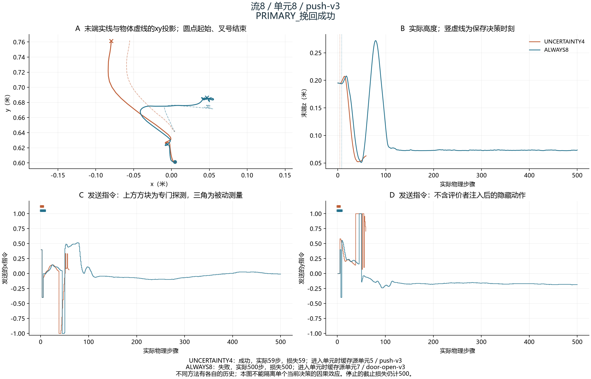
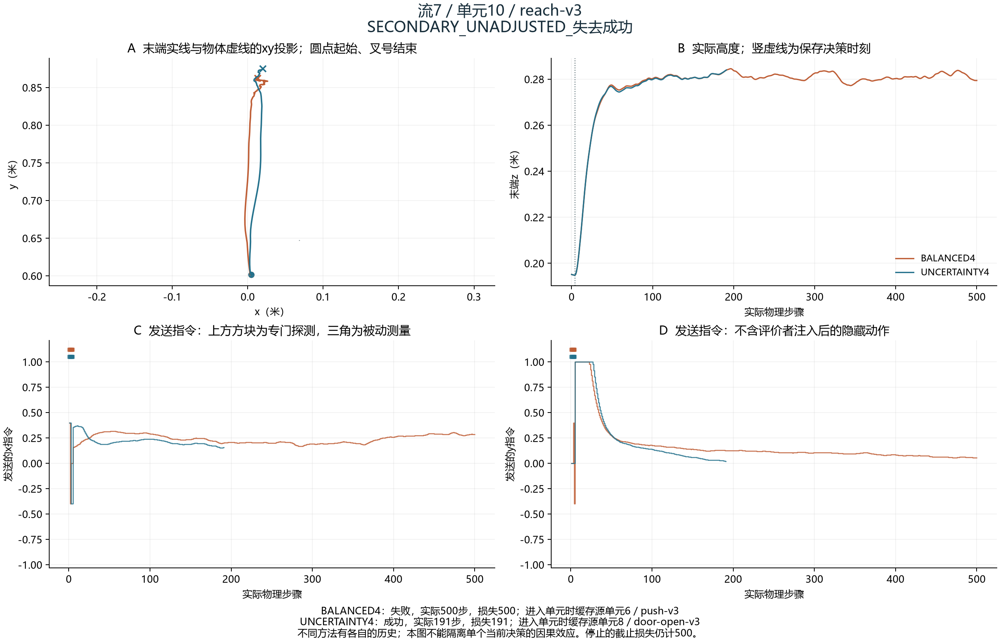
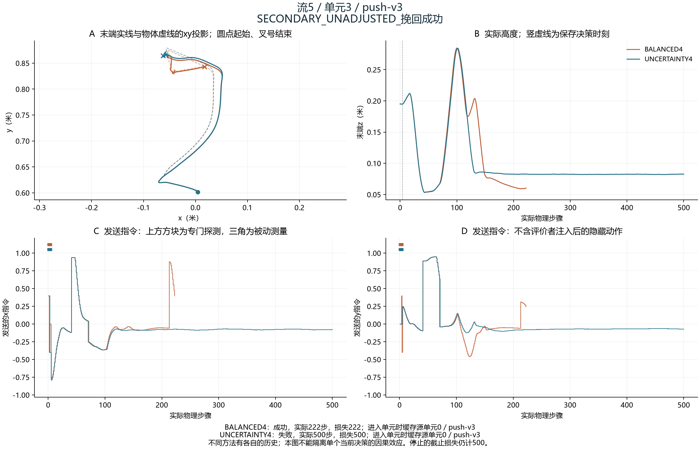
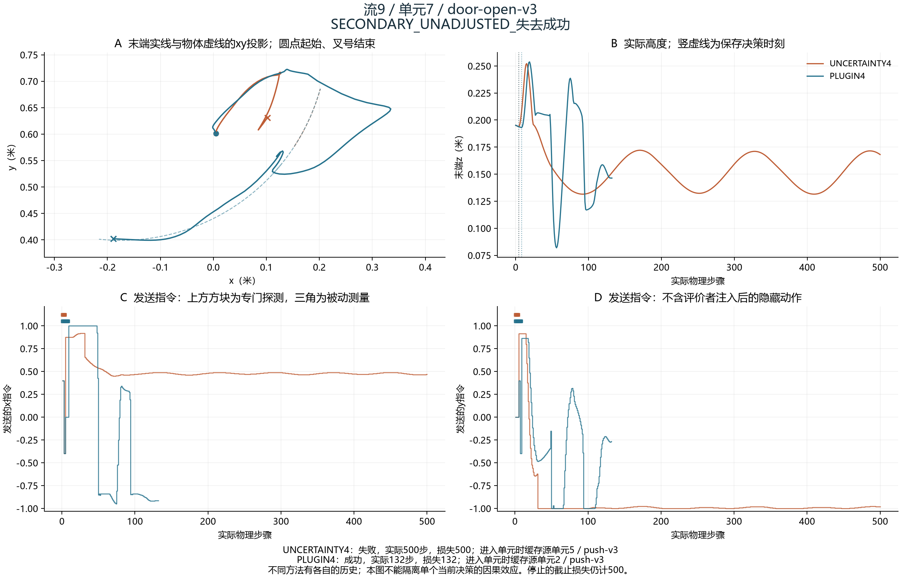
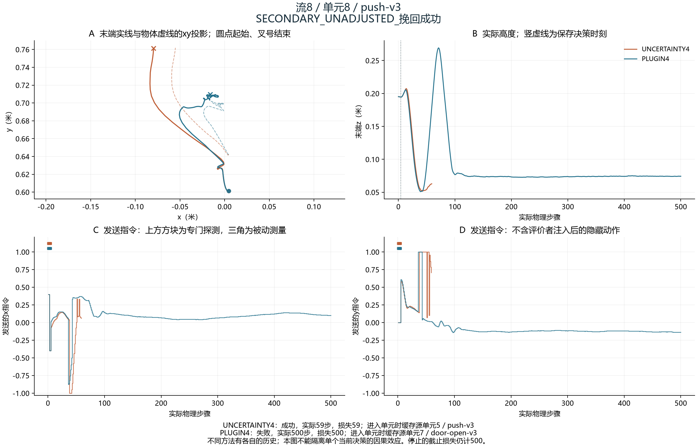
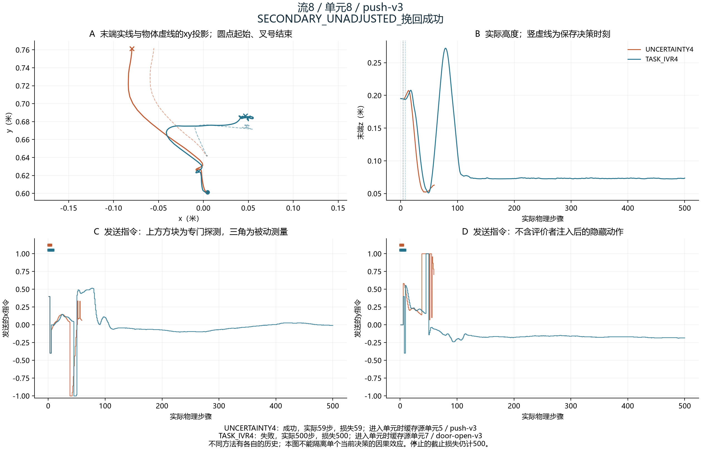
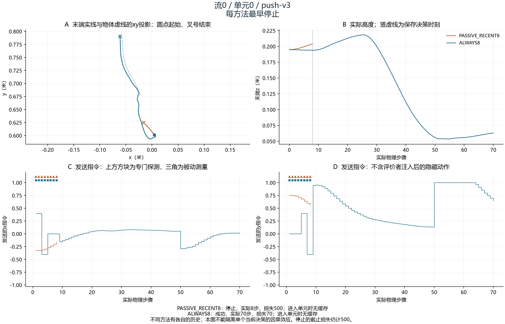
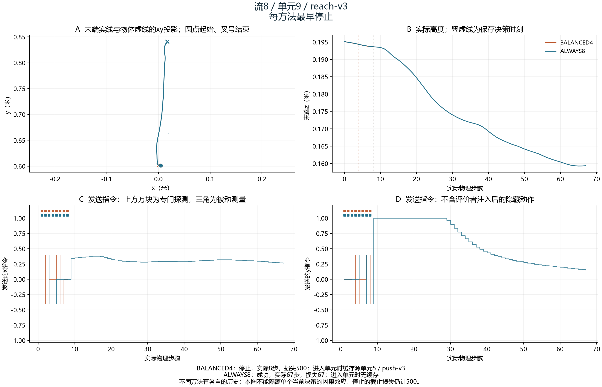

# 固定规则选择的实际案例

从完整审计结果中，对每个预注册比较选择按流、单元序号排列最早的失去／挽回成功案例；另列每方法最早停止。未出现的类别明确保留，全部失败另见上层CSV。

每条曲线均来自本方法实际执行；各方法自己的历史缓存可能不同，不能将两条轨迹差异全部归因于当前某个检查或更新。图中只用可见观测、发送指令和已保存决策，不重放仿真，不使用隐藏执行动作。

## 流9／单元7／door-open-v3
PRIMARY_失去成功

## 流8／单元8／push-v3
PRIMARY_挽回成功

## 流7／单元10／reach-v3
SECONDARY_UNADJUSTED_失去成功

## 流5／单元3／push-v3
SECONDARY_UNADJUSTED_挽回成功

## 流9／单元7／door-open-v3
SECONDARY_UNADJUSTED_失去成功

## 流8／单元8／push-v3
SECONDARY_UNADJUSTED_挽回成功

## 流9／单元7／door-open-v3
SECONDARY_UNADJUSTED_失去成功

## 流8／单元8／push-v3
SECONDARY_UNADJUSTED_挽回成功

## 流0／单元0／push-v3
每方法最早停止

## 流8／单元9／reach-v3
每方法最早停止

## 未出现的类别

- NO_PROBE 对 ALWAYS8：每方法最早停止，符合案例0。
- ALWAYS8 对 NO_PROBE：每方法最早停止，符合案例0。
- ALWAYS16_OLD 对 ALWAYS8：每方法最早停止，符合案例0。
- STALE 对 ALWAYS8：每方法最早停止，符合案例0。
- PERIODIC4 对 ALWAYS8：每方法最早停止，符合案例0。
- CUSUM4 对 ALWAYS8：每方法最早停止，符合案例0。
- PLUGIN4 对 ALWAYS8：每方法最早停止，符合案例0。
- UNCERTAINTY4 对 ALWAYS8：每方法最早停止，符合案例0。
- TASK_IVR4 对 ALWAYS8：每方法最早停止，符合案例0。
