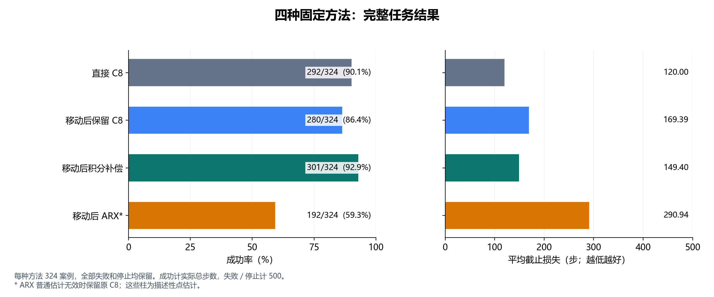
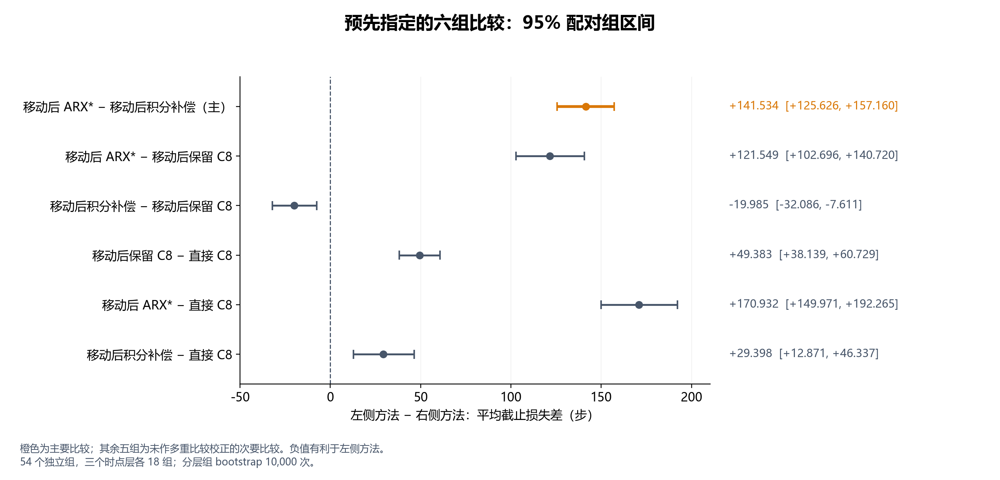
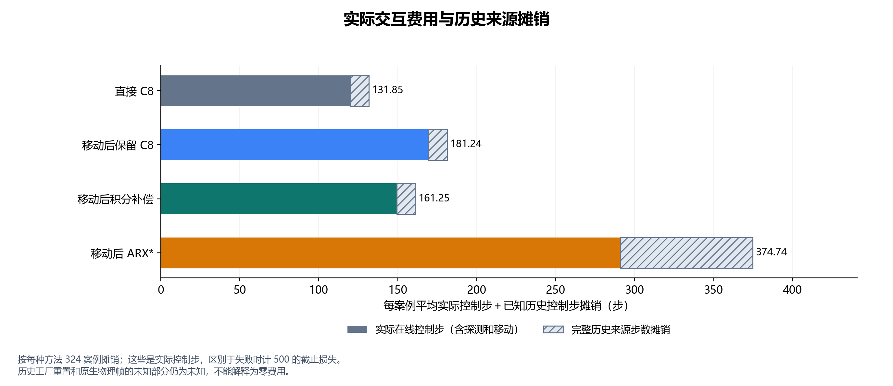

# 完整审计后的任务比较结果图

以下三幅图仅呈现来源中的指标，不新增统计比较。

## 任务结果

[矢量 SVG](task_outcomes.svg)

## 配对损失差及区间

[矢量 SVG](paired_loss_intervals.svg)

## 实际控制步及历史摊销

[矢量 SVG](actual_step_costs.svg)

[完整中文报告](../../../../../reports/movement_task_development_v1_zh.md)
