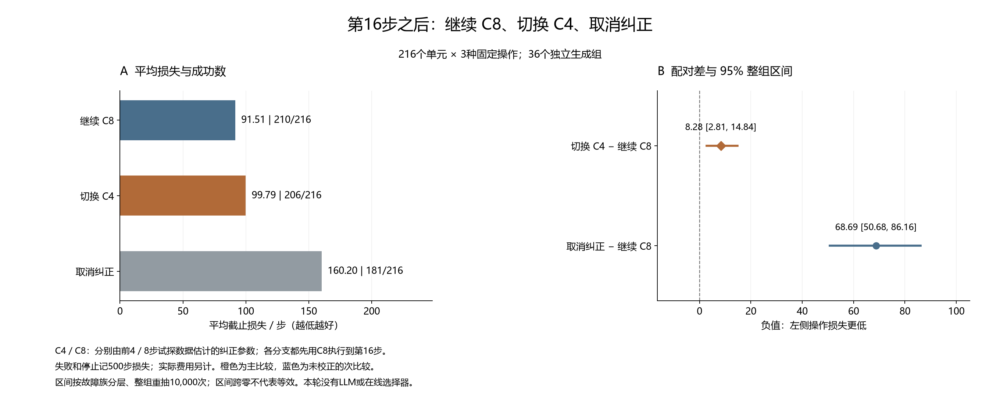

# 中途切换纠正：完整结果与失败案例

这轮测量三个固定操作的实际后果，没有训练在线选择器，也没有LLM调用。所有216个任务单元保留在每个方法的分母中。

机器人先试探4步并保存C4，累计试探8步得到C8，再用C8执行到第16步。随后继续C8、切换C4或取消纠正。C4没有被预先验证成功；切换参数不恢复机器人位置。

共同准备需要C4和C8都有效。因此这里的继续C8不能代替不要求C4有效的普通8步基线。准备无效和提前结束也保留。

|操作|成功/全部|失败|停止|边界不可用|平均截止损失|实际控制步|
|---|---:|---:|---:|---:|---:|---:|
|继续 C8|210/216|6|0|0|91.509259|19766|
|切换 C4|206/216|10|0|0|99.791667|21555|
|取消纠正|181/216|35|0|0|160.203704|34604|

失败或停止的截止损失为500；成功时为全部实际步骤。实际费用不使用失败罚值。

|比较|平均差/步|95%整组区间|改善/变差/相同|
|---|---:|---|---|
|切换 C4 − 继续 C8|8.282407|[2.810185, 14.842593]|57/89/70|
|取消纠正 − 继续 C8|68.694444|[50.679630, 86.157639]|63/132/21|

切换C4减继续C8是唯一主比较；取消纠正是未作多重校正的次比较。负差有利于左侧操作。区间沿用冻结审计结果，按故障族分层、完整生成组重抽10000次。每状态只有一次未来实现；改善/变差计数不是条件期望效应，也不能冒充一个已学会选择的策略成绩。

## 全部失败

以下列出全部失败执行，不按故障、任务或边界是否可用删选。停止是失败的子集。

|单元|任务|种子|操作|停止|到达决策边界|真实步数|截止损失|
|---:|---|---:|---|---|---|---:|---:|
|8|door-open-v3|21808|继续 C8|否|是|500|500|
|8|door-open-v3|21808|切换 C4|否|是|500|500|
|8|door-open-v3|21808|取消纠正|否|是|500|500|
|20|door-open-v3|21820|继续 C8|否|是|500|500|
|20|door-open-v3|21820|切换 C4|否|是|500|500|
|34|reach-v3|21834|取消纠正|否|是|500|500|
|36|push-v3|21836|取消纠正|否|是|500|500|
|37|reach-v3|21837|取消纠正|否|是|500|500|
|52|reach-v3|21852|取消纠正|否|是|500|500|
|56|door-open-v3|21856|继续 C8|否|是|500|500|
|56|door-open-v3|21856|切换 C4|否|是|500|500|
|56|door-open-v3|21856|取消纠正|否|是|500|500|
|72|push-v3|21872|取消纠正|否|是|500|500|
|73|reach-v3|21873|取消纠正|否|是|500|500|
|81|push-v3|21881|取消纠正|否|是|500|500|
|84|push-v3|21884|取消纠正|否|是|500|500|
|88|reach-v3|21888|继续 C8|否|是|500|500|
|88|reach-v3|21888|切换 C4|否|是|500|500|
|88|reach-v3|21888|取消纠正|否|是|500|500|
|93|push-v3|21893|取消纠正|否|是|500|500|
|98|door-open-v3|21898|切换 C4|否|是|500|500|
|106|reach-v3|21906|取消纠正|否|是|500|500|
|108|push-v3|21908|取消纠正|否|是|500|500|
|109|reach-v3|21909|取消纠正|否|是|500|500|
|117|push-v3|21917|取消纠正|否|是|500|500|
|124|reach-v3|21924|取消纠正|否|是|500|500|
|127|reach-v3|21927|取消纠正|否|是|500|500|
|132|push-v3|21932|切换 C4|否|是|500|500|
|132|push-v3|21932|取消纠正|否|是|500|500|
|138|push-v3|21938|切换 C4|否|是|500|500|
|138|push-v3|21938|取消纠正|否|是|500|500|
|141|push-v3|21941|继续 C8|否|是|500|500|
|141|push-v3|21941|切换 C4|否|是|500|500|
|141|push-v3|21941|取消纠正|否|是|500|500|
|144|push-v3|21944|取消纠正|否|是|500|500|
|145|reach-v3|21945|取消纠正|否|是|500|500|
|148|reach-v3|21948|取消纠正|否|是|500|500|
|160|reach-v3|21960|取消纠正|否|是|500|500|
|166|reach-v3|21966|取消纠正|否|是|500|500|
|178|reach-v3|21978|取消纠正|否|是|500|500|
|183|push-v3|21983|取消纠正|否|是|500|500|
|189|push-v3|21989|取消纠正|否|是|500|500|
|190|reach-v3|21990|取消纠正|否|是|500|500|
|192|push-v3|21992|切换 C4|否|是|500|500|
|195|push-v3|21995|继续 C8|否|是|500|500|
|195|push-v3|21995|切换 C4|否|是|500|500|
|196|reach-v3|21996|取消纠正|否|是|500|500|
|201|push-v3|22001|取消纠正|否|是|500|500|
|202|reach-v3|22002|取消纠正|否|是|500|500|
|213|push-v3|22013|取消纠正|否|是|500|500|
|214|reach-v3|22014|取消纠正|否|是|500|500|

## 成本与范围

新增控制步75925；受控重置648次；全部重置33048次；请求/完成仿真帧16903625/16903625。策略查询70741，参数拟合1296次。API、选择器拟合、名义模型重训和策略权重更新均为0。

每个方法承担完整历史名义来源：3840控制步、480受控重置、24480全部重置、12259200帧，按216单元摊销17.777778历史控制步/单元。历史设计3次枚举、432候选。先前执行资格与软件资格是已付开发费用，详见冻结协议和原审计报告；本页不把它们当成免费。

独立审计核对382756条主事件、1944份私有状态记录和432对匹配前缀。采集主体2648.012151秒，原审计309.072851秒；进程开销、审计重算及图表费用分别保存在各自回执。

本图表程序只复核已保存的身份、哈希、分母、均值及符号计数，展示已经冻结的区间；它没有重新执行物理审计或构成第二次实验。

当前只覆盖固定故障下的三种后续操作。尚缺获取新证据后重新估计的分支、任务内变化、自己形成历史的部署评价、完整强基线、消融和新方法；这些结果不能单独支持算法创新或CCF A投稿就绪。

冻结提交：`5193855b2123a17277c63c817529d3fe653422d0`。清单：`13e29ef1bf5f09dd8ea39f1f61f04293c091ed0d038293a7ea8475e13a806c3f`。
