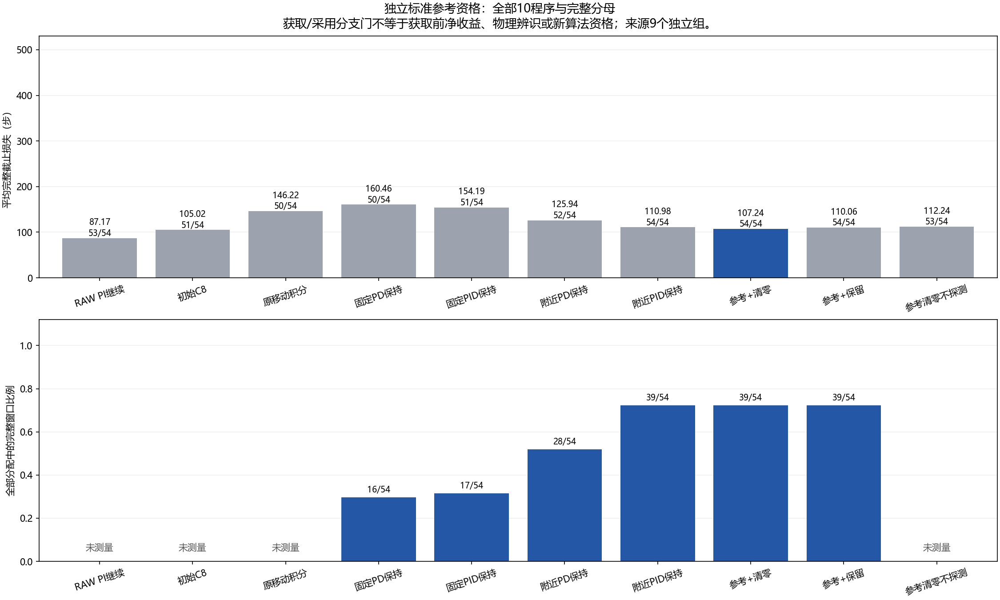

# 标准获取控制与参考纠正：独立资格报告

**本轮验证标准动作与参考分支，不是新学习算法、物理参数辨识资格或CCF A贡献。数值合法、窗口取得、采用后的任务效果及完整获取收益分别评价。**

冻结提交`dc7058a8f6d5f43baa4ddb0c2471827b5acacb20`。两阶段分别分配60项原生软件案例、540项独立资格案例；只有原生契约通过才执行后者，不能用未执行或缺失数据补全门槛。

## 方法含义

- `RAW_CONTINUE`：原始任务PI直接继续。
- `DIRECT_C8`：初始C8直接执行。
- `MOVE_INTEGRAL`：原C8移动积分补偿。
- `FIXED_PD_KEEP`：固定点PD，保留任务纠正。
- `FIXED_PID_KEEP`：固定点PID，保留任务纠正。
- `LOCAL_PD_KEEP`：附近点PD，保留任务纠正。
- `LOCAL_PID_KEEP`：附近点PID，保留任务纠正。
- `LOCAL_PID_REFERENCE_RESET`：附近点PID参考纠正，清零任务积分。
- `LOCAL_PID_REFERENCE_CARRY`：附近点PID参考纠正，保留任务积分。
- `LOCAL_PID_REFERENCE_RESET_NO_PROBE`：附近点PID参考纠正，清零积分且不探测。

四个移动控制使用已存在且参数不变的固定/附近目标与PD/PID实现。主参考分支RESET采用移动期间形成的有界偏移，任务积分显式清零；CARRY采用同一偏移并保留任务积分，属于固定次要比较，不得在RESET失败后替换。二者均不保证无扰切换或安全。

移动积分是移动已提供的信息，形成时间早于额外8步探测。NO_PROBE强对照在相同实际移动状态后直接采用参考，不再执行8步；其窗口记为未测量，不能计为测量失败。其他程序没有合格完整窗口时从当前状态保留原控制继续，不回滚或换基线。

DIRECT_C8/MOVE_INTEGRAL逐字调用原程序和旧初始重置模型；只有这些初始程序执行C4/C8推断。新参考不是M/b物理参数估计，SelectedAnchorWindow不进入ColdPrefix，新响应训练和在线LLM API均为0。

## 已完成阶段与完整费用

|阶段|实际/分配|控制步|全部重置|物理帧|初始C4/C8尝试|审计C4/C8复算|采集秒|审计秒|
|---|---:|---:|---:|---:|---:|---:|---:|---:|
|SOFTWARE_NATIVE|60/60|10633|3060|1583165|24|24|364.642|58.907|
|QUAL|540/540|65854|27540|14099270|216|216|2795.181|375.682|

实际总费用：`{'executions': 600, 'control_steps': 76487, 'all_resets': 30600, 'physical_frames': 15682435, 'C4_C8_attempts': 240, 'audit_C4_C8_refits': 240}`。上限600次执行、300,000控制步、30,600全部重置、16,800,000物理帧；采集初始C4/C8最多240次，审计最多另复算240次。一次受控初始重置/执行，全部工厂目标生成计费。新响应模型/底层策略训练及在线LLM API均0；不能把初始推断和审计复算隐去或称全部拟合为0。

完整历史来源另外披露：C8名义来源480执行/3,840控制步/24,480全部重置/12,259,200帧；RAW PI参数选择DEV720执行/90,626步/36,720全部重置/18,813,130帧；旧局部获取资格72执行/5,939步/3,672全部重置/1,865,695帧。旧研究有共享/重叠名义来源，不按程序重复加为新交互；完整来源哈希与费用由交付回执绑定。

## SOFTWARE_NATIVE 全部程序

|程序|成功/分配|平均截止损失|实际步|完整测量窗口|实际采用|
|---|---:|---:|---:|---:|---:|
|RAW_CONTINUE|6/6|81.000000|486|未测量|0|
|DIRECT_C8|3/6|289.166667|1735|未测量|0|
|MOVE_INTEGRAL|6/6|109.500000|657|未测量|0|
|FIXED_PD_KEEP|6/6|147.000000|882|3|0|
|FIXED_PID_KEEP|5/6|208.000000|1248|3|0|
|LOCAL_PD_KEEP|5/6|200.833333|1205|6|0|
|LOCAL_PID_KEEP|5/6|190.833333|1145|6|0|
|LOCAL_PID_REFERENCE_RESET|5/6|177.333333|1064|6|6|
|LOCAL_PID_REFERENCE_CARRY|5/6|191.166667|1147|6|6|
|LOCAL_PID_REFERENCE_RESET_NO_PROBE|5/6|177.333333|1064|未测量|6|

记录审计`PASSED`；原生软件契约`PASSED`。原生人口不用于选择增益、方法或替代独立资格。

## QUAL 全部程序

|程序|成功/分配|平均截止损失|实际步|完整测量窗口|实际采用|
|---|---:|---:|---:|---:|---:|
|RAW_CONTINUE|53/54|87.166667|4707|未测量|0|
|DIRECT_C8|51/54|105.018519|5671|未测量|0|
|MOVE_INTEGRAL|50/54|146.222222|7896|未测量|0|
|FIXED_PD_KEEP|50/54|160.462963|8665|16|0|
|FIXED_PID_KEEP|51/54|154.185185|8326|17|0|
|LOCAL_PD_KEEP|52/54|125.944444|6801|28|0|
|LOCAL_PID_KEEP|54/54|110.981481|5993|39|0|
|LOCAL_PID_REFERENCE_RESET|54/54|107.240741|5791|39|39|
|LOCAL_PID_REFERENCE_CARRY|54/54|110.055556|5943|39|39|
|LOCAL_PID_REFERENCE_RESET_NO_PROBE|53/54|112.240741|6061|未测量|39|

记录审计`PASSED`；原生软件契约`NOT_APPLICABLE`。原生人口不用于选择增益、方法或替代独立资格。

## 预登记资格判据与整组比较

获取可用性：**SUPPORTED_FOR_SEPARATE_MODEL_DESIGN**，检查`{'point_window_rate_at_least_half': True, 'each_task_context_at_least_three_full_windows': True, 'paired_window_rate_95_lower_above_zero': True}`。

主参考采用分支：**NOT_QUALIFIED**，检查`{'primary_full_population_loss_95_upper_below_zero': False, 'actual_reset_adoption_on_every_task': True}`。

以上两个门分开，不把窗口取得当作模型预测正确，也不把同获取状态下的参考采用效果当成获取前整体净收益。完整540项的9个独立组、每介入层3组，按整组分层bootstrap10,000次；不把相关步或同组任务当独立样本。区间是固定来源模型和固定参数条件下的描述，非物理保证；所有区间未作多重比较校正。

|左减右|指标|平均差|组bootstrap95%区间|
|---|---|---:|---|
|LOCAL_PID_KEEP − FIXED_PD_KEEP|WINDOW_RATE|+0.425926|[+0.351852, +0.500000]|
|LOCAL_PID_REFERENCE_RESET − LOCAL_PID_KEEP|DEADLINE_LOSS|-3.740741|[-10.259259, +0.222222]|
|LOCAL_PID_REFERENCE_CARRY − LOCAL_PID_KEEP|DEADLINE_LOSS|-0.925926|[-1.870370, +0.000000]|
|LOCAL_PID_REFERENCE_RESET − LOCAL_PID_REFERENCE_RESET_NO_PROBE|DEADLINE_LOSS|-5.000000|[-15.462963, +3.148148]|
|DIRECT_C8 − RAW_CONTINUE|DEADLINE_LOSS|+17.851852|[-1.129630, +32.222685]|
|MOVE_INTEGRAL − RAW_CONTINUE|DEADLINE_LOSS|+59.055556|[+37.629630, +82.277778]|
|FIXED_PD_KEEP − RAW_CONTINUE|DEADLINE_LOSS|+73.296296|[+61.518519, +84.537037]|
|FIXED_PID_KEEP − RAW_CONTINUE|DEADLINE_LOSS|+67.018519|[+50.703704, +81.481481]|
|LOCAL_PD_KEEP − RAW_CONTINUE|DEADLINE_LOSS|+38.777778|[+13.166667, +67.981481]|
|LOCAL_PID_KEEP − RAW_CONTINUE|DEADLINE_LOSS|+23.814815|[+7.907407, +44.111111]|
|LOCAL_PID_REFERENCE_RESET − RAW_CONTINUE|DEADLINE_LOSS|+20.074074|[+5.369444, +43.796296]|
|LOCAL_PID_REFERENCE_CARRY − RAW_CONTINUE|DEADLINE_LOSS|+22.888889|[+7.481481, +43.351852]|
|LOCAL_PID_REFERENCE_RESET_NO_PROBE − RAW_CONTINUE|DEADLINE_LOSS|+25.074074|[+5.903241, +47.851852]|

RESET减LOCAL_PID_KEEP是唯一预定主采用损失比较；CARRY和NO_PROBE为固定次要对照，没有结果后换主角。失败门槛不通过则保留负结果、不追加或微调本版本。即使分支门通过，最终新方法仍须在包含全部获取费用的独立自身历史上超过RAW PI、C8、积分、NO_PROBE等强参考。

## 资格人口全部任务×条件

|任务|条件|程序|成功/9|平均截止损失|完整窗口|实际采用|
|---|---|---|---:|---:|---:|---:|
|push-v3|UNCHANGED|RAW_CONTINUE|9/9|87.666667|未测量|0|
|push-v3|UNCHANGED|DIRECT_C8|9/9|73.777778|未测量|0|
|push-v3|UNCHANGED|MOVE_INTEGRAL|9/9|110.888889|未测量|0|
|push-v3|UNCHANGED|FIXED_PD_KEEP|9/9|144.777778|5|0|
|push-v3|UNCHANGED|FIXED_PID_KEEP|9/9|142.444444|4|0|
|push-v3|UNCHANGED|LOCAL_PD_KEEP|9/9|116.333333|7|0|
|push-v3|UNCHANGED|LOCAL_PID_KEEP|9/9|115.444444|6|0|
|push-v3|UNCHANGED|LOCAL_PID_REFERENCE_RESET|9/9|115.111111|6|6|
|push-v3|UNCHANGED|LOCAL_PID_REFERENCE_CARRY|9/9|113.444444|6|6|
|push-v3|UNCHANGED|LOCAL_PID_REFERENCE_RESET_NO_PROBE|9/9|113.444444|未测量|6|
|push-v3|CHANGED|RAW_CONTINUE|8/9|144.333333|未测量|0|
|push-v3|CHANGED|DIRECT_C8|7/9|171.666667|未测量|0|
|push-v3|CHANGED|MOVE_INTEGRAL|7/9|193.000000|未测量|0|
|push-v3|CHANGED|FIXED_PD_KEEP|9/9|138.222222|2|0|
|push-v3|CHANGED|FIXED_PID_KEEP|9/9|136.222222|4|0|
|push-v3|CHANGED|LOCAL_PD_KEEP|9/9|121.000000|2|0|
|push-v3|CHANGED|LOCAL_PID_KEEP|9/9|114.666667|6|0|
|push-v3|CHANGED|LOCAL_PID_REFERENCE_RESET|9/9|105.777778|6|6|
|push-v3|CHANGED|LOCAL_PID_REFERENCE_CARRY|9/9|110.666667|6|6|
|push-v3|CHANGED|LOCAL_PID_REFERENCE_RESET_NO_PROBE|9/9|107.888889|未测量|6|
|reach-v3|UNCHANGED|RAW_CONTINUE|9/9|57.111111|未测量|0|
|reach-v3|UNCHANGED|DIRECT_C8|9/9|54.888889|未测量|0|
|reach-v3|UNCHANGED|MOVE_INTEGRAL|9/9|72.666667|未测量|0|
|reach-v3|UNCHANGED|FIXED_PD_KEEP|9/9|92.333333|3|0|
|reach-v3|UNCHANGED|FIXED_PID_KEEP|9/9|94.000000|4|0|
|reach-v3|UNCHANGED|LOCAL_PD_KEEP|9/9|61.777778|5|0|
|reach-v3|UNCHANGED|LOCAL_PID_KEEP|9/9|61.888889|5|0|
|reach-v3|UNCHANGED|LOCAL_PID_REFERENCE_RESET|9/9|56.444444|5|5|
|reach-v3|UNCHANGED|LOCAL_PID_REFERENCE_CARRY|9/9|62.111111|5|5|
|reach-v3|UNCHANGED|LOCAL_PID_REFERENCE_RESET_NO_PROBE|9/9|49.888889|未测量|5|
|reach-v3|CHANGED|RAW_CONTINUE|9/9|58.888889|未测量|0|
|reach-v3|CHANGED|DIRECT_C8|8/9|140.444444|未测量|0|
|reach-v3|CHANGED|MOVE_INTEGRAL|8/9|128.111111|未测量|0|
|reach-v3|CHANGED|FIXED_PD_KEEP|9/9|69.000000|1|0|
|reach-v3|CHANGED|FIXED_PID_KEEP|9/9|71.222222|1|0|
|reach-v3|CHANGED|LOCAL_PD_KEEP|9/9|64.777778|3|0|
|reach-v3|CHANGED|LOCAL_PID_KEEP|9/9|62.222222|4|0|
|reach-v3|CHANGED|LOCAL_PID_REFERENCE_RESET|9/9|53.222222|4|4|
|reach-v3|CHANGED|LOCAL_PID_REFERENCE_CARRY|9/9|63.444444|4|4|
|reach-v3|CHANGED|LOCAL_PID_REFERENCE_RESET_NO_PROBE|9/9|49.555556|未测量|4|
|door-open-v3|UNCHANGED|RAW_CONTINUE|9/9|87.111111|未测量|0|
|door-open-v3|UNCHANGED|DIRECT_C8|9/9|93.222222|未测量|0|
|door-open-v3|UNCHANGED|MOVE_INTEGRAL|8/9|205.666667|未测量|0|
|door-open-v3|UNCHANGED|FIXED_PD_KEEP|7/9|270.888889|0|0|
|door-open-v3|UNCHANGED|FIXED_PID_KEEP|7/9|260.555556|2|0|
|door-open-v3|UNCHANGED|LOCAL_PD_KEEP|8/9|199.555556|6|0|
|door-open-v3|UNCHANGED|LOCAL_PID_KEEP|9/9|153.222222|9|0|
|door-open-v3|UNCHANGED|LOCAL_PID_REFERENCE_RESET|9/9|153.666667|9|9|
|door-open-v3|UNCHANGED|LOCAL_PID_REFERENCE_CARRY|9/9|150.888889|9|9|
|door-open-v3|UNCHANGED|LOCAL_PID_REFERENCE_RESET_NO_PROBE|8/9|192.888889|未测量|9|
|door-open-v3|CHANGED|RAW_CONTINUE|9/9|87.888889|未测量|0|
|door-open-v3|CHANGED|DIRECT_C8|9/9|96.111111|未测量|0|
|door-open-v3|CHANGED|MOVE_INTEGRAL|9/9|167.000000|未测量|0|
|door-open-v3|CHANGED|FIXED_PD_KEEP|7/9|247.555556|5|0|
|door-open-v3|CHANGED|FIXED_PID_KEEP|8/9|220.666667|2|0|
|door-open-v3|CHANGED|LOCAL_PD_KEEP|8/9|192.222222|5|0|
|door-open-v3|CHANGED|LOCAL_PID_KEEP|9/9|158.444444|9|0|
|door-open-v3|CHANGED|LOCAL_PID_REFERENCE_RESET|9/9|159.222222|9|9|
|door-open-v3|CHANGED|LOCAL_PID_REFERENCE_CARRY|9/9|159.777778|9|9|
|door-open-v3|CHANGED|LOCAL_PID_REFERENCE_RESET_NO_PROBE|9/9|159.777778|未测量|9|
## 全部分母和失败

all_cases.csv保留所有完成案例；失败任务、不完整测量、提前结束及采用/保留分别计数。接受与拒绝子集只作描述，不能比较为因果效果。软件错误/部分人口不进入统计，须单独保留失败记录，不能按小人口通过。

- SOFTWARE_NATIVE：任务失败9；获取结果计数`{'ZERO_ACQUISITION_CONTINUE': 6, 'LEGACY_NO_WARM_MEASUREMENT': 12, 'ANCHOR_NOT_REACHED': 6, 'COMPLETE_UNQUALIFIED': 30, 'RELOCATION_COMPLETE_UNQUALIFIED': 6}`；采用理由计数`{'NO_REFERENCE_PROGRAM': 30, 'LEGACY_CONTROL_NOT_RAW_REFERENCE_ARM': 12, 'COMPLETE_WINDOW_STANDARD_REFERENCE': 12, 'COMPLETE_RELOCATION_NO_PROBE_REFERENCE': 6}`。
- QUAL：任务失败18；获取结果计数`{'ZERO_ACQUISITION_CONTINUE': 42, 'LEGACY_NO_WARM_MEASUREMENT': 108, 'COMPLETE_UNQUALIFIED': 178, 'RELOCATION_COMPLETE_UNQUALIFIED': 39, 'ANCHOR_NOT_REACHED': 63, 'ENDED_DURING_REPOSITION': 14, 'None': 96}`；采用理由计数`{'NO_REFERENCE_PROGRAM': 270, 'LEGACY_CONTROL_NOT_RAW_REFERENCE_ARM': 108, 'COMPLETE_WINDOW_STANDARD_REFERENCE': 78, 'COMPLETE_RELOCATION_NO_PROBE_REFERENCE': 39, 'INCOMPLETE_ACQUISITION_KEEP': 3, 'EARLY_END_BEFORE_REFERENCE': 42}`。

## 后续与研究边界

所有程序都是既有控制器/固定脚本的标准参考，没有新价值模型、学出的获取策略、物理重辨识或安全证明。当前完整窗口仍需独立姿态/历史条件化响应资格，不能由类型名或几何通过认证。新算法还须建立获取改变实际状态、模型适用性和后继采用/拒绝时的具体机制，补齐标准变化检测/历史辨识/任务相关获取、独立自身历史和消融。

保留模型适用范围、Residual RL、OCCAM、GAUGE、Poke and Strike及后续查新。控制混合、积分记忆、局部目标、收益预测或标准DR本身均非新颖性；本轮标准基线或软件门不完成CCF A目标。全部失败、负结果、原始记录/分片和恢复副本保留，仅本地提交，不推送合并。

冻结manifest与源码/模型来源哈希：`C:/Users/Administrator/Desktop/embodied-agent-projects/outputs/acquisition_reference/qualification_v1/acquisition_reference_20261022T133659Z_dc7058a8f6d5/manifest.json`；各阶段原始事件、私有见证、账本及审计均在同运行目录。

## 名称与接口补充

PD中P按当前位置误差推动机器人，D用近期位移抑制运动；PID增加累计位置误差的I项。FIXED为固定目标点，LOCAL为按当前可见位置选择附近目标。KEEP表示获取后保留原任务控制器与积分记忆。RAW_CONTINUE仍运行原任务PI，并非完全没有反馈适应；DIRECT_C8则使用初始8步的旧C8推断。

REFERENCE是移动中形成的有界积分偏移。RESET采用该偏移后清零原任务积分，CARRY采用后保留原任务积分；NO_PROBE在相同移动结束状态直接采用，省去后来8步测量。代码中的ESTIMATED_AFFINE只是复用命令变换接口，本轮矩阵仍为单位阵，偏移来自移动积分；不能解释为已经辨识新物理矩阵或拥有前向预测模型。推物、到达和开门分别对应push-v3、reach-v3、door-open-v3。

RESET相对KEEP同时改变偏移和任务积分，主比较只检验整条分支。CARRY提供保留原积分的固定参照，但本轮缺少“偏移不变、只清零任务积分”的第四种尾部分支，不能完整分解两者交互。额外8步也不用于新参数估计；测量后RESET与NO_PROBE之差包含物理动作、时间和采用条件，不能单独称为信息价值。

## 交付补充：全部失败与事后配对描述

本节全部新增分项均为事后描述性分析，不改变预定主比较、资格门或控制参数。all_task_failures.csv逐项保留全部失败；all_availability_and_admission.csv登记全部完成案例的提前结束、缺失测量、保留/采用和初始拟合，不以采用子集改变分母。

- SOFTWARE_NATIVE完整分母60，失败9，采集网络尝试0。真实共同前缀对48、探测前共同状态对18、测量后共同状态对12均已核对。
- QUAL完整分母540，失败18，采集网络尝试0。真实共同前缀对432、探测前共同状态对162、测量后共同状态对108均已核对。

QUAL原v1审计在一次加载完整记录时MemoryError，耗时34.813秒，实际拟合尝试0；原失败日志/回执/空轨迹保留。修复提交`b90eee7c439458a8d97e471c2d2be136981a0731`仅改逐案例读取与当前单元缓存，复用原数值检查，原540项未重采。

新增5项存储回归通过，合计25项本轮新增唯一测试；旧1,772项按哈希复用。开发与最终两轮等价回归共读取96次已审计拟合缓存、额外查询固定策略35836次，总耗时237.949秒；优化/拟合/环境/网络守卫均0。它们不增加实际拟合、原生执行或独立样本数。成功/失败审计的完整额外费用见audit_attempt_costs.json。

|参考程序相对LOCAL_PID_KEEP|完整分母|实际采用|损失更差/相同/更好|成功转失败|失败转成功|平均损失差|
|---|---:|---:|---|---:|---:|---:|
|LOCAL_PID_REFERENCE_RESET|54|39|20/20/14|0|0|-3.740741|
|LOCAL_PID_REFERENCE_CARRY|54|39|12/26/16|0|0|-0.925926|
|LOCAL_PID_REFERENCE_RESET_NO_PROBE|54|39|11/16/27|1|0|+1.259259|

正损失差只描述这两个已执行配对程序的任务不利结果，不说明唯一物理原因。NO_PROBE与测量后KEEP的实际后继状态不同，其差异包括额外探测成本/位移，不能单独解释成参考更新作用；采用/拒绝子集也不是随机分配的因果比较。

完整任务代价的强参考比较（描述性均值，未新增或替换资格门）：

- 预定RESET − RAW_CONTINUE：+20.074074步；两边均保留全部54分配。
- 预定RESET − DIRECT_C8：+2.222222步；两边均保留全部54分配。
- 预定RESET − MOVE_INTEGRAL：-38.981481步；两边均保留全部54分配。
- 预定RESET − LOCAL_PID_REFERENCE_RESET_NO_PROBE：-5.000000步；两边均保留全部54分配。

后续判断：获取动作达到本轮窗口覆盖门；只支持单独设计响应模型训练/资格协议，不能直接训练在线采用规则。

标准RESET采用分支未达到预定任务效果门；保留负结果，不换成CARRY主角、不追加或围绕该版本叠加选择规则。

历史源费用包含原PI选择所实际执行的全部720项DEV（含对照和初始拟合）、480项C8名义来源、72项旧局部获取资格，来源完整哈希见historical_costs.json。原PI总1188项已包含720项DEV，旧局部获取和PI来源共享同一C8银行，不能把重叠银行再当新费用相加。新资格与历史来源的费用分别披露，失败罚至500的截止损失不等于实际步数。

冻结后另加的交付端审计包装只计数原审计的C4/C8复算并原样返回结果，逐次保存输入/输出哈希、结果及耗时；核心审计、控制、配置、种子与资格判据未改变。包装源码哈希及实际复算回执另行保存，不能把这些复算写成零拟合。文献HTTP阅读与实验进程分开记录；它不构成在线LLM API参与。

另一个来自冻结执行顺序的约束：只讨论实际到达变化边界的案例，同单元两条件此前使用相同初始环境/扰动与噪声；新变化在边界才由私有主机注入，尚未影响后续动作。因此决策前可见历史不能透露这次变化。此为协议结构的推论，不是变化检测效果的实测结论或新定理。后续方法若要区分这次变化，需要实际执行验证并保留随后当前状态，不能利用条件标签或未来结果。

冻结阶段曾因审计源码末尾一行空白而未通过差异检查；原文件、失败日志和前后语法树一致回执均保留，修复发生在任何原生交互之前。最终20项守卫测试、1,772项旧源码哈希回执、编译/依赖与两次秘密扫描的记录均保留。

最终图形仅扩充类别左右边距，保持原500步纵轴尺度、数值、颜色和方法顺序；原图、首次排版检查与一次根路径解析失败均保留，未重跑实验或统计。在线LLM API调用为0，请求/响应tokens为0，API延迟不适用；文献HTTP阅读单列。
