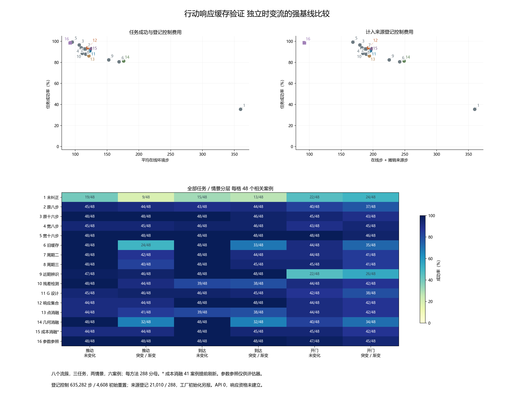

# 行动响应缓存验证与时变流：中文完整结果

本轮完整收集并审计了 4,608 次方法执行。候选 RESPONSE_SET 成功 270/288，停止 4；注册强基线竞争门未通过。该结果只回答本冻结开发候选的任务竞争性，方法新颖性、独立确认与概率／物理资格仍未建立。

候选复用缓存 0 次，平均在线 119.4236 步；宽十六步成功 286/288，平均 95.2604 步；宽八步成功 270/288，平均 109.4479 步。这轮没有建立候选的缓存复用与费用收益。

主审计通过的是已保存行为的执行重放。另有 41 个成本消融案例不符合先用满十六微步骤的行为，该消融不能作为完整去早停证据；初始化费用另作条件性推算，不将控制账本当作整个进程的全部物理工作量。

运行 `action_response_20261014T104928Z_1c3798544481`；清单 `579864fc921cbd15bb5222c8f7b127a49fc7c1c92fd2bdde6f38d62bb165e060`；冻结源 `1c37985444816ad9cca434d2fe38825678fc82dd`。

新种子 10800–10943；10944–11199 及历史保留范围未用于本轮。固定政策与源模型没有按这些结果调参或重跑。

## 完整方法与费用

| 方法 | 成功 / 288 | 停止 | 平均在线步 | 平均探测步 | 平均含来源步 | 复用案例 | 无效点拟合 |
|---|---:|---:|---:|---:|---:|---:|---:|
| NO_PROBE | 102 | 0 | 359.7292 | 0.0000 | 359.7292 | 0 | 0 |
| FIXED8 | 253 | 11 | 116.2743 | 8.0000 | 189.2257 | 0 | 11 |
| FIXED16 | 278 | 0 | 106.1493 | 16.0000 | 179.1007 | 0 | 0 |
| FIXED8_WIDE | 270 | 0 | 109.4479 | 8.0000 | 182.3993 | 0 | 0 |
| FIXED16_WIDE | 286 | 0 | 95.2604 | 16.0000 | 168.2118 | 0 | 0 |
| CACHE_ONLY | 232 | 0 | 168.8090 | 2.6667 | 241.7604 | 240 | 0 |
| PERIODIC2 | 267 | 0 | 115.9028 | 8.0000 | 188.8542 | 144 | 0 |
| PERIODIC3 | 267 | 0 | 114.5000 | 5.3333 | 187.4514 | 192 | 0 |
| RECENT_WINDOW | 237 | 0 | 152.4167 | 0.0000 | 225.3681 | 0 | 1692 |
| RESIDUAL_CUSUM | 255 | 16 | 110.9167 | 8.6111 | 183.8681 | 133 | 16 |
| G_OPTIMAL | 262 | 9 | 122.8681 | 20.7778 | 195.8194 | 13 | 9 |
| RESPONSE_SET | 270 | 4 | 119.4236 | 22.0278 | 192.3750 | 0 | 4 |
| RESPONSE_POINT | 248 | 19 | 121.2361 | 12.7778 | 194.1875 | 58 | 19 |
| RESPONSE_GEOMETRY | 234 | 0 | 175.9201 | 14.0556 | 248.8715 | 225 | 0 |
| RESPONSE_NO_COST | 268 | 3 | 124.9340 | 27.0556 | 197.8854 | 0 | 3 |
| ORACLE16 | 284 | 0 | 92.0521 | 16.0000 | 92.0521 | 0 | 0 |

本轮登记控制 635,282 次 Env.step／4,608 次控制环境初始重置。所有模型先验方法均承担已审计来源的登记控制费用 21,010 步／288 次控制重置，按 288 单元摊销为每单元 72.9513889 步及一次来源控制重置；在线初始重置另计。NO_PROBE 和 ORACLE16 无该模型来源费用。源数据物理上只采集一次，不重复计成十四次新采集。

平均探测步包括 MICRO_PROBE 和 FIXED_PROBE；六步政策前缀另外计入在线总步。停止留在分母，低步数不能单独当作效率改善。

| 方法 | 前缀总步 | 微探测总步 | 固定探测总步 | 任务总步 |
|---|---:|---:|---:|---:|
| NO_PROBE | 0 | 0 | 0 | 103602 |
| FIXED8 | 0 | 0 | 2304 | 31183 |
| FIXED16 | 0 | 0 | 4608 | 25963 |
| FIXED8_WIDE | 0 | 0 | 2304 | 29217 |
| FIXED16_WIDE | 0 | 0 | 4608 | 22827 |
| CACHE_ONLY | 0 | 0 | 768 | 47849 |
| PERIODIC2 | 0 | 0 | 2304 | 31076 |
| PERIODIC3 | 0 | 0 | 1536 | 31440 |
| RECENT_WINDOW | 0 | 0 | 0 | 43896 |
| RESIDUAL_CUSUM | 1440 | 0 | 2480 | 28024 |
| G_OPTIMAL | 1440 | 1584 | 4400 | 27962 |
| RESPONSE_SET | 1440 | 1736 | 4608 | 26610 |
| RESPONSE_POINT | 1440 | 0 | 3680 | 29796 |
| RESPONSE_GEOMETRY | 1440 | 3040 | 1008 | 45177 |
| RESPONSE_NO_COST | 1440 | 3184 | 4608 | 26749 |
| ORACLE16 | 0 | 0 | 4608 | 21903 |

## 初始化与控制费用的统计范围

上述登记计数没有覆盖 MT1 工厂在临时环境生成任务时的重置，也没有单独记录 reset_hand 的内部模拟器物理帧。它们对应原主审计的控制调用范围，不能写成整个进程的全部模拟器工作量。

| 来源 | 登记控制重置 | 推算临时任务生成重置 | 两项合计的推算 reset 入口调用 |
|---|---:|---:|---:|
| 本轮任务执行 | 4608 | 230400 | 235008 |
| 原前向来源 | 288 | 14400 | 14688 |

当前安装源码和无模拟器替身核验每次工厂生成 50 个任务向量，使用另一个临时环境。上述历史总数依赖相同源工厂与版本的结构性推算，未在当时记录完整生命周期。未知内部物理帧不补作零费用；初始化活动发生在控制轨迹之前，不据此改变原衔接审计或注册 500 个控制步骤。

## 预注册主比较

| RESPONSE_SET 相对基线 | 成功差（百分点） | 99% 流簇描述区间 | 平均在线步差 | 99% 描述区间 |
|---|---:|---|---:|---|
| FIXED16 | -2.7778 | [-6.9444, 0.6944] | 13.2743 | [-5.7431, 35.3791] |
| FIXED8_WIDE | 0.0000 | [-5.9028, 6.5972] | 9.9757 | [-28.0943, 43.0523] |
| FIXED16_WIDE | -5.5556 | [-9.0278, -2.0833] | 24.1632 | [6.1006, 42.6112] |
| PERIODIC2 | 1.0417 | [-3.4722, 4.5139] | 3.5208 | [-17.6042, 28.2748] |
| G_OPTIMAL | 2.7778 | [-1.0417, 7.9878] | -3.4444 | [-28.5105, 13.6493] |

支配候选的可用基线：FIXED16、FIXED8_WIDE、FIXED16_WIDE。

八个独立流簇保留其三任务、两情景、六案例和方法配对。固定 10,000 次 bootstrap 的 99% 区间来自主审计，不是本报告另行推导的置信保证，不把相关案例当独立样本，也不据开发竞争门宣布发表条件成立。

## 全部任务／情景

| 方法 | push-v3/STATIONARY | push-v3/MIXED | reach-v3/STATIONARY | reach-v3/MIXED | door-open-v3/STATIONARY | door-open-v3/MIXED |
|---|---:|---:|---:|---:|---:|---:|
| NO_PROBE | 19/48 | 9/48 | 15/48 | 13/48 | 22/48 | 24/48 |
| FIXED8 | 45/48 | 44/48 | 43/48 | 44/48 | 40/48 | 37/48 |
| FIXED16 | 48/48 | 48/48 | 48/48 | 46/48 | 45/48 | 43/48 |
| FIXED8_WIDE | 45/48 | 45/48 | 46/48 | 46/48 | 43/48 | 45/48 |
| FIXED16_WIDE | 48/48 | 48/48 | 48/48 | 48/48 | 48/48 | 46/48 |
| CACHE_ONLY | 48/48 | 24/48 | 48/48 | 33/48 | 44/48 | 35/48 |
| PERIODIC2 | 48/48 | 42/48 | 48/48 | 44/48 | 44/48 | 41/48 |
| PERIODIC3 | 48/48 | 40/48 | 48/48 | 45/48 | 45/48 | 41/48 |
| RECENT_WINDOW | 47/48 | 46/48 | 48/48 | 48/48 | 22/48 | 26/48 |
| RESIDUAL_CUSUM | 48/48 | 44/48 | 39/48 | 38/48 | 44/48 | 42/48 |
| G_OPTIMAL | 45/48 | 46/48 | 46/48 | 45/48 | 42/48 | 38/48 |
| RESPONSE_SET | 44/48 | 44/48 | 48/48 | 48/48 | 44/48 | 42/48 |
| RESPONSE_POINT | 44/48 | 41/48 | 39/48 | 38/48 | 44/48 | 42/48 |
| RESPONSE_GEOMETRY | 48/48 | 32/48 | 48/48 | 32/48 | 40/48 | 34/48 |
| RESPONSE_NO_COST | 44/48 | 44/48 | 48/48 | 45/48 | 45/48 | 42/48 |
| ORACLE16 | 48/48 | 48/48 | 48/48 | 48/48 | 47/48 | 45/48 |

## 评估器故障族

| 方法 | BIAS_SHIFT | GAIN_COUPLING | PARITY_CHANGE |
|---|---:|---:|---:|
| NO_PROBE | 48/108 | 36/108 | 18/72 |
| FIXED8 | 95/108 | 102/108 | 56/72 |
| FIXED16 | 105/108 | 106/108 | 67/72 |
| FIXED8_WIDE | 100/108 | 103/108 | 67/72 |
| FIXED16_WIDE | 106/108 | 108/108 | 72/72 |
| CACHE_ONLY | 81/108 | 103/108 | 48/72 |
| PERIODIC2 | 99/108 | 105/108 | 63/72 |
| PERIODIC3 | 97/108 | 105/108 | 65/72 |
| RECENT_WINDOW | 93/108 | 82/108 | 62/72 |
| RESIDUAL_CUSUM | 86/108 | 104/108 | 65/72 |
| G_OPTIMAL | 98/108 | 99/108 | 65/72 |
| RESPONSE_SET | 102/108 | 103/108 | 65/72 |
| RESPONSE_POINT | 80/108 | 102/108 | 66/72 |
| RESPONSE_GEOMETRY | 88/108 | 99/108 | 47/72 |
| RESPONSE_NO_COST | 98/108 | 104/108 | 66/72 |
| ORACLE16 | 106/108 | 106/108 | 72/72 |

故障族和算子只用于评估分层，不是代理证据。STATIONARY 与 MIXED 改变了物理任务分布，不能写成保持边际难度不变的纯耦合因果效应。

## 时间位置与消融

| 方法 | 案例 0 | 案例 1 | 案例 2 | 案例 3 | 案例 4 | 案例 5 |
|---|---:|---:|---:|---:|---:|---:|
| NO_PROBE | 20/48 | 20/48 | 18/48 | 14/48 | 14/48 | 16/48 |
| FIXED8 | 42/48 | 43/48 | 38/48 | 46/48 | 40/48 | 44/48 |
| FIXED16 | 48/48 | 46/48 | 43/48 | 47/48 | 47/48 | 47/48 |
| FIXED8_WIDE | 44/48 | 46/48 | 42/48 | 45/48 | 46/48 | 47/48 |
| FIXED16_WIDE | 48/48 | 48/48 | 48/48 | 48/48 | 47/48 | 47/48 |
| CACHE_ONLY | 48/48 | 41/48 | 42/48 | 33/48 | 35/48 | 33/48 |
| PERIODIC2 | 48/48 | 41/48 | 43/48 | 43/48 | 47/48 | 45/48 |
| PERIODIC3 | 48/48 | 41/48 | 42/48 | 47/48 | 44/48 | 45/48 |
| RECENT_WINDOW | 40/48 | 38/48 | 41/48 | 39/48 | 38/48 | 41/48 |
| RESIDUAL_CUSUM | 48/48 | 44/48 | 42/48 | 42/48 | 39/48 | 40/48 |
| G_OPTIMAL | 48/48 | 44/48 | 39/48 | 43/48 | 43/48 | 45/48 |
| RESPONSE_SET | 48/48 | 48/48 | 43/48 | 47/48 | 41/48 | 43/48 |
| RESPONSE_POINT | 48/48 | 44/48 | 41/48 | 42/48 | 37/48 | 36/48 |
| RESPONSE_GEOMETRY | 48/48 | 40/48 | 42/48 | 35/48 | 36/48 | 33/48 |
| RESPONSE_NO_COST | 48/48 | 46/48 | 44/48 | 45/48 | 42/48 | 43/48 |
| ORACLE16 | 48/48 | 48/48 | 46/48 | 48/48 | 47/48 | 47/48 |

RESPONSE_POINT 去区间；RESPONSE_GEOMETRY 在判断中去实测残差；RESPONSE_NO_COST 原拟去微探测早停。三者均保留在完整对照和所有分层中；任务差异不会自动证明误差模型或物理失效原因。

**成本消融语义检查：41 个已评估案例在未用满十六微探测步时开始固定刷新，累计少执行 656 个声明的微步骤。** 原数据和费用按实际执行保留，不补做或推测本应得到的结局。该实现不能作为完整移除早停的消融证据；主重放审计验证已保存行为与实际执行，未检验这一协议语义。主方法竞争失败的对照保持不变。明细保存在报告指标文件。

## 为什么验证后没有复用

| 方法 | 有响应评估的案例 | 首次兼容 | 首次超限 | 首次证据不足 | 首次模型不一致 | 首次数值失败 | 评估调用数 |
|---|---:|---:|---:|---:|---:|---:|---:|
| G_OPTIMAL | 240 | 0 | 57 | 183 | 0 | 0 | 636 |
| RESPONSE_SET | 240 | 0 | 9 | 231 | 0 | 0 | 674 |
| RESPONSE_POINT | 240 | 58 | 182 | 0 | 0 | 0 | 240 |
| RESPONSE_GEOMETRY | 240 | 0 | 0 | 240 | 0 | 0 | 1000 |
| RESPONSE_NO_COST | 240 | 0 | 6 | 234 | 0 | 0 | 1036 |

此表按每案例首次响应评估分类；同案例追加测量产生的多次调用单列，不能当作独立案例。冷启动或前缀已结束的案例可能没有响应评估。CONTRACT_REJECTED 表示注册局部残差模型和假设误差约束不一致，并不证明执行器改变或旧控制必然无用；INCOMPATIBLE 与 UNRESOLVED 分别表示注册查询的超限和证据不足。完整首次／末次／全部状态及微程序计数保存在报告指标文件。

## 有限查询与隐含未来区间

| 方法 | 复用案例 | 包外命令 / 全部后续命令 | 有包外命令的案例 | 首四步覆盖 / 可定义完整块 | 不完整／无法定义 |
|---|---:|---:|---:|---:|---:|
| G_OPTIMAL | 13 | 186/750 | 10 | 13/13 | 0 |
| RESPONSE_SET | 0 | 0/0 | 0 | 0/0 | 0 |
| RESPONSE_POINT | 58 | 2849/8244 | 52 | 2/58 | 0 |
| RESPONSE_GEOMETRY | 225 | 9912/39438 | 169 | 129/225 | 0 |
| RESPONSE_NO_COST | 0 | 0/0 | 0 | 0/0 | 0 |

此表覆盖保存查询图并最终复用的五种方法，标量 CUSUM 和周期复用等没有该查询图，未作相同区间比较。完整裁剪后的政策发送像不自动由五点查询覆盖。未来区间在已实现命令上用决策前设计事后重建；没有使用未来目标重新拟合，也不是当时已保存的新置信承诺。复用选择与轨迹依赖使该覆盖率仅具描述意义，数值兼容不是概率／物理认证。

## 失败与执行审计

全部 595 个失败／停止案例见[完整失败清单](../outputs/action_response/figure_v3/failure_cases.md)，停止保留在每方法 288 分母。

主审计重放 15,076 个保存选择与 635,282 个执行意图；核验 600 个冻结输入。选择、实际发送命令、持续 RNG、缓存归属和费用均被核对。规划、预测、LP、点优化与注册 bootstrap 复用原实现；动作注入算术和 RNG 另行核对。它不重新仿真动力学，也不声明完全独立算法。

本报告器另从完整轨迹统计步数／物理阶段、最终成功、停止、拟合与缓存计数，并重新计算所有方法点统计，与主审计一致。初始重置及来源费用绑定已通过的审计声明，统计独立核验不等于新的物理采集。

## API、主机时间与论文边界

本轮 API 调用为零。旧在线 API 阶段的 15 条实际闭环、LLM 14/16 和未保证的总输出 token 上限另见[原中文报告](online_calibrated_agent_development_v1.md)，不能把本轮结果当成 API／LLM 收益。

保存观察完成到下一选择的滞后包含主机开销及并行测试等负载；没有隔离求解器起止时间，不能当作算法实时延迟。初始选择没有前一步完成时间，不在该统计中；缺失数据不记为零毫秒。

| 方法 | 可核对滞后数 | 中位数 ms | P90 ms | 最大 ms |
|---|---:|---:|---:|---:|
| NO_PROBE | 0 | 未测 | 未测 | 未测 |
| FIXED8 | 288 | 1.9161 | 2.2109 | 3.2780 |
| FIXED16 | 288 | 2.8224 | 3.3541 | 5.0563 |
| FIXED8_WIDE | 288 | 1.9242 | 2.2317 | 9.6053 |
| FIXED16_WIDE | 288 | 2.8422 | 3.3375 | 11.4711 |
| CACHE_ONLY | 48 | 2.7990 | 3.1088 | 3.6257 |
| PERIODIC2 | 144 | 2.8369 | 3.3108 | 5.0301 |
| PERIODIC3 | 96 | 2.8031 | 3.1707 | 4.6167 |
| RECENT_WINDOW | 2604 | 6.0398 | 11.8551 | 49.7905 |
| RESIDUAL_CUSUM | 502 | 1.5978 | 3.0746 | 4.4273 |
| G_OPTIMAL | 1138 | 2.9241 | 3.7340 | 6.2205 |
| RESPONSE_SET | 1202 | 41.7866 | 151.6104 | 219.3160 |
| RESPONSE_POINT | 652 | 2.5909 | 3.0980 | 7.9829 |
| RESPONSE_GEOMETRY | 1078 | 145.9646 | 161.1533 | 245.1054 |
| RESPONSE_NO_COST | 1564 | 52.1054 | 155.7684 | 230.8540 |
| ORACLE16 | 288 | 0.1470 | 0.1670 | 0.3630 |

经验名义 RMS、相关分组均值、有限查询、局部仿射残差与点标签前瞻都有未验证条件。

[技术稿](../papers/action_response_development_draft_zh.md)和[原始文献比较](../docs/research/action_response_prior_art_v1.md)说明已有触发辨识与任务导向设计的重合范围。即使开发门通过，仍需实质贡献和新注册独立确认；若失败，保留负结果，不在当前任务上改方法重跑。
