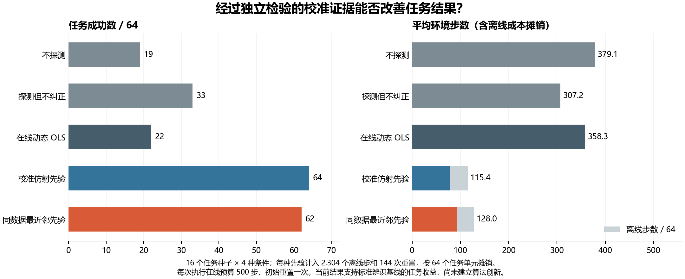

# 连续探测中的校准证据：任务收益验证报告

本次独立冻结、在收集任务结果前确定方案的实验，**通过了开发阶段的任务收益门槛**。已冻结的校准仿射模型在 64 个任务单元中全部成功；使用完全相同的连续探测、但不进行纠正的对照方法成功 33/64。配对成功率差为 **+48.44 个百分点**，以完整任务种子为重采样单位的 95% bootstrap 区间为 **[39.06, 57.81] 个百分点**。

这一结果支持：在本次开发环境和校准假设下，校准后的连续探测证据具有任务价值。目前仍未证明新的算法贡献或达到论文发表要求。原始[英文报告](calibrated_continuous_task_utility_v1_en.md)保留供对照。

## 相同在线预算下的完整对比

实验使用 16 个新任务种子（9100–9115），分别与四种加性偏置条件组合，并加入标准差为 0.05 的执行噪声，共 64 个任务单元。所有任务状态均纳入统计。每种方法的在线总预算为 500 个环境步，包含 16 步探测；每次执行只在开始时重置一次，探测与任务衔接时不重置环境，也不重新设置执行器随机数状态。

| 方法 | 成功数 / 64 | 平均在线步数 | 离线总步数 | 平均摊销后步数 | 平均偏置估计误差 |
|---|---:|---:|---:|---:|---:|
| 不探测 | 19 | 379.09 | 0 | 379.09 | 不适用 |
| 探测但不纠正 | 33 | 307.22 | 0 | 307.22 | 不适用 |
| 在线动态最小二乘（OLS） | 22 | 358.28 | 0 | 358.28 | 0.1785 |
| 通过独立检验的仿射先验 | 64 | 79.36 | 2,304 | 115.36 | 0.0170 |
| 使用相同校准数据的最近邻先验 | 62 | 92.05 | 2,304 | 128.05 | 0.0415 |



两种先验方法使用相同的 72 条训练校准轨迹，系统成本核算均计入完整的 72 次训练与 72 次独立校准检验。将 2,304 个离线步摊销到 64 个任务单元后，每个单元增加 36 步；144 次离线重置则增加平均 2.25 次重置。离线数据实际只采集一次，这些成本在方法比较中分别归属各方法，没有重复计为本次新增仿真执行。

辅助分析将所有方法的策略执行上限统一为 484 步，在本样本中仍得到相同的五组成功数。该分析允许额外的探测成本，不用于判断是否通过门槛；主要比较始终保持在线总预算一致。

仅执行连续探测、不进行纠正，就使成功数从不探测时的 19 增至 33。这说明探测动作本身及噪声序列的消耗方式也影响任务结果，不能把 64 对 19 的全部差距归因于信息价值。主要比较采用相同的探测轨迹和衔接状态，以隔离后续冻结纠正决策的作用。

仿射先验相对同数据最近邻先验仅提高 **3.12 个百分点**，区间为 **[0.00, 7.81] 个百分点**，尚不能确立仿射方法的优势。现有证据最充分支持的是经过独立检验的先验相对未校准方法及对照方法的价值。后续研究应继续保留同数据最近邻这一对照。

## 成本假设与适用范围

图表中的成本比较按预注册的 64 个任务单元摊销，只计算仿真环境步数，未测量人工校准时间、机器人重新定位、延迟或能耗。[审计记录](../outputs/calibrated_tasks/analysis_v1/audit.json)还给出了统一重置成本为 R 时，仿射先验与各基线的平均成本差；R 的单位为每次重置折合的环境步数。先验方法每个任务单元平均承担 3.25 次重置，其他方法为 1 次，因此离线重置足够昂贵时，步数成本优势可能逆转。

例如，在本次 64 单元摊销下，仿射先验减去“探测但不纠正”方法的平均成本为：

```text
-191.859375 + 2.25 R
```

当每次重置折合约 85.27 个环境步时，两者成本相同；超过该值，上述平均成本比较的方向将逆转。重置成本的改变不影响已观测到的任务成功数。

校准依赖**已知处于正常状态的执行器**，使用相同的机器人、控制器、机器人初始姿态分布和短时指令程序。新任务种子只随机化 push-v3 中的物体与目标配置，尚未检验跨任务、新机器人或运动学变化后的迁移。本次部署偏置为加性偏置，且位于训练指令范围内。开发实验的 64/64 成功不能保证总体成功率为 100%。

模型未根据本次任务结果重新拟合或筛选。此前的 72 条独立检验轨迹与训练数据分离，检验在本次任务方案冻结前完成并通过。历史在线拟合失败结果已保留。本实验未调用 API、写入自由文本记忆、更新策略权重或仅筛选初始失败任务。

## 对后续研究的意义

项目现在具备一个在明确校准假设下、能够改善任务成功率的连续证据基线，后续方法可以据此比较，避免依赖效果不稳定的在线拟合。要形成论文贡献，仍需提出相对这一较强先验基线及已有任务导向辨识方法具有优势的新机制，并补充更广泛的任务、校准失配与有效性判断，以及独立评估。

普通仿射辨识和最近邻方法本身不足以构成本项目的创新贡献。**CCF A 发表目标仍未完成**；本阶段提供了后续研究基础。

任务结果和种子 9100–9115 应完整保留，9116–9399 继续保留待用。后续若利用本次结果调整估计器、纠正方式、证据采集或有效性规则，就不能再把这批任务视为独立确认数据。

## 数据完整性与复现

- 实验运行标识：`calibrated_tasks_20261013T111017Z_972172259b89`。
- 实验源代码提交：`972172259b895a339b715da5e982fdba8d56cfa9`。
- 实验清单标识：`936159636dc62736b5ebd0001a55b55d0f943cfc83459c3f555c7110445f9ecc`。

审计使用冻结模型重放了全部 320 个基于可见输入的决策，验证了 256 次连续衔接，并检查了 73,728 个任务步的观测及随机数状态链接。任务结果、实际执行成本和预注册统计量均可从日志重建。审计没有重新仿真任务动力学，仅凭哈希也无法重建中间观测向量。篡改检测测试覆盖模型替换、伪造纠正、衔接时环境重置和随机数重设。

本次新增实际采集成本为 **77,824 步**，其中探测 4,096 步；初始重置 320 次。预注册最高预算为 160,000 步。全部 389 个源代码与模型输入的哈希均与对应 Git 对象一致。执行轨迹使用无损 gzip 压缩，并由产物哈希绑定。采集前通过了 617 项测试；针对完成日志新增的五项审计测试也通过，合计 622 项。

以下命令只重放审计，不重新执行仿真。请使用新的输出目录：

```powershell
.\.venv\Scripts\python.exe scripts/analyze_calibrated_tasks.py `
  --manifest outputs/calibrated_tasks/development_v1/calibrated_tasks_20261013T111017Z_972172259b89/manifest.json `
  --output outputs/calibrated_tasks/analysis_reproduction
```

[英文机器生成统计报告](../outputs/calibrated_tasks/analysis_v1/report.md)包含全部配对比较和成本。中文图表由同一审计结果生成，使用独立的 Matplotlib 运行环境；绘图命令为：

```powershell
python scripts/render_calibrated_tasks.py `
  --audit outputs/calibrated_tasks/analysis_v1/audit.json `
  --output outputs/calibrated_tasks/analysis_zh_v1/figure `
  --language zh
```

图表提供 [PNG](../outputs/calibrated_tasks/analysis_zh_v1/figure.png) 和 [PDF](../outputs/calibrated_tasks/analysis_zh_v1/figure.pdf) 两种格式。
