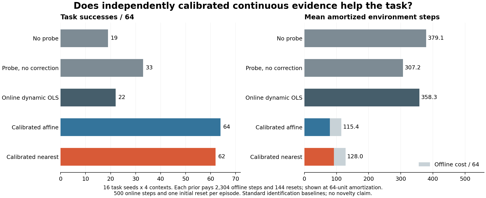

# Qualified calibration supplies useful continuous task evidence

The separately frozen prospective task bridge **passed its development utility
gate**. The immutable calibrated affine model succeeded on 64/64 tasks, versus
33/64 for the identical continuous probe without correction. The paired
success difference is +48.44 percentage points, with a 95% whole-task-seed
bootstrap interval [39.06, 57.81]. This establishes useful calibrated evidence
in this development setting, rather than a new algorithm or publication result.

## Full matched-budget comparison

Sixteen new seeds 9100--9115 are crossed with four additive bias contexts plus
execution noise std 0.05. All task states are included. Each method receives
500 online environment steps, including the 16-step probe; there is one initial
reset and no reset/reseed at the probe/task boundary.

| Method | Success / 64 | Mean online steps | Offline steps | Mean amortized steps | Mean offset error |
|---|---:|---:|---:|---:|---:|
| No probe | 19 | 379.09 | 0 | 379.09 | n/a |
| Probe, no correction | 33 | 307.22 | 0 | 307.22 | n/a |
| Online dynamic OLS | 22 | 358.28 | 0 | 358.28 | 0.1785 |
| Qualified affine prior | 64 | 79.36 | 2,304 | 115.36 | 0.0170 |
| Same-data nearest prior | 62 | 92.05 | 2,304 | 128.05 | 0.0415 |



The two priors share the same 72 calibration trajectories and pay the full
72-trial training plus 72-trial qualification cost in logical system accounting.
Amortizing 2,304 offline steps over the 64 task units adds 36 steps per unit.
Both also pay 144 offline resets, adding 2.25 resets per unit. Offline artifacts
were physically collected once; their costs are not double-counted as new
simulation during this research comparison.

The secondary equal-484-policy-step cap gives the same success counts for all
five methods in this sample. It permits additional probe cost and was not used
for promotion; the primary comparison retains the equal online total budget.

No-probe success increases from 19 to 33 when the continuous probe is performed
without correction. Probe motion and the different consumption of the noise
stream therefore matter; the full 64-versus-19 gap cannot be assigned wholly
to information. The primary contrast against the identical probe trajectory
and handoff state isolates the subsequent frozen correction decision.

Affine minus the same-data nearest prior is only +3.12 percentage points,
interval [0.00, 7.81]. That descriptive interval does not establish affine
superiority. The strongest supported result is the value of a qualified prior
over these uncalibrated/control baselines, not a uniquely better estimator.
The matched prior comparator must remain in subsequent studies.

## Resource and scope limits

The displayed cost advantage assumes the registered 64-unit amortization and
counts simulator steps. It does not measure human calibration time, robot
repositioning, latency, or energy. The [audit](../outputs/calibrated_tasks/analysis_v1/audit.json)
includes affine-minus-baseline mean costs as an affine function of a uniform
reset cost R in step-equivalent units. Priors have 3.25 amortized resets per
task unit versus one for nonprior methods. Thus sufficiently expensive offline
resets can reverse a step-cost advantage; calibration is not free.

For example, affine minus the probe control's mean amortized cost is
`-191.859375 + 2.25 R`, equal at R=85.27 step-equivalent units per reset for
this 64-unit amortization. Reset costs above that value reverse this particular
mean step-cost comparison, without changing the observed success counts.

Calibration required a known nominal actuator regime and used the same robot,
controller, initial robot-pose distribution, and short command program. The
new task seeds randomize object/goal configurations in push-v3; they do not
establish cross-task, new-robot, or changed-kinematics transfer. The deployment
offsets here are additive and within the training command range. A 64/64
development count is not a guarantee of perfect population success.

The model was neither refitted nor selected from task results. Its independent
qualification used 72 earlier held-apart trajectories and passed before this
task protocol was frozen. Historical failed online fits were preserved. No
API calls, free-form memory writes, policy-weight updates, or initial-failure
filters were used.

## Research consequence

The project now has a task-effective continuous-evidence baseline under explicit
calibration assumptions. It removes the need to build a novel selector on top
of an unreliable online fit. The remaining paper challenge is a new mechanism
with advantages over this strong prior baseline and established task-oriented
identification, including broader tasks, calibration mismatch/validity, and
independent evaluation. Neither ordinary affine identification nor nearest
centroids supply that contribution by themselves. The CCF A objective remains
unmet; this is a foundation for subsequent research rather than paper readiness.

Preserve all task outcomes and seeds 9100--9115, and keep 9116--9399 reserved.
Future estimator, correction, acquisition, or validity tuning must not use
this evaluation population as independent confirmation.

## Integrity and reproduction

Run: `calibrated_tasks_20261013T111017Z_972172259b89`.
Source: `972172259b895a339b715da5e982fdba8d56cfa9`.
Manifest: `936159636dc62736b5ebd0001a55b55d0f943cfc83459c3f555c7110445f9ecc`.

The audit replayed all 320 visible-input decisions against the immutable model,
verified 256 continuous handoffs, and checked 73,728 task-step observation/RNG
links. It reconstructed all outcomes, physical costs, and registered statistics
from the logs. Task dynamics are not resimulated, and intermediate observation
vectors cannot be reconstructed from hashes alone. Tampering tests reject a
different model, forged correction, state reset, and RNG reseed at handoff.

New physical collection cost: 77,824 steps, including 4,096 probe steps, and
320 initial resets; maximum 160,000 steps. All 389 source/model input hashes
match their Git blobs. Episode traces are losslessly gzip-compressed and bound
by artifact hashes. The implementation passed 617 tests before collection;
five additional immutable-log audit tests pass against the completed run.

```powershell
.\.venv\Scripts\python.exe scripts/analyze_calibrated_tasks.py `
  --manifest outputs/calibrated_tasks/development_v1/calibrated_tasks_20261013T111017Z_972172259b89/manifest.json `
  --output outputs/calibrated_tasks/analysis_reproduction
```

Use a new audit directory. Do not repeat simulator execution. The [generated
report](../outputs/calibrated_tasks/analysis_v1/report.md) contains all paired
contrasts and costs; plotting uses a separate Matplotlib runtime.
