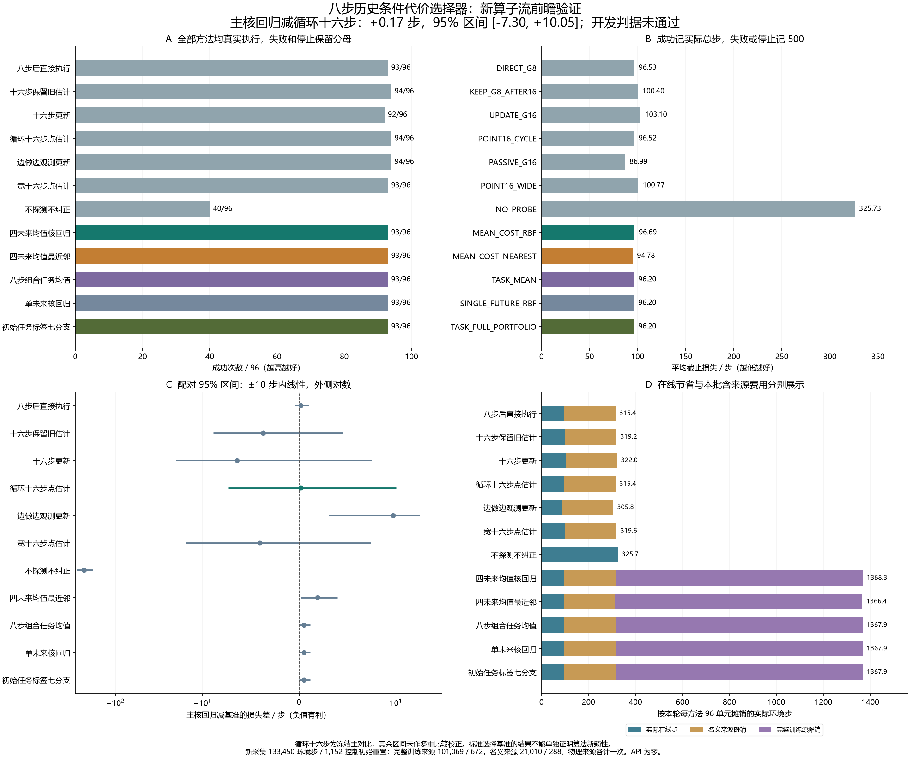

# 条件代价选择器的结果与研究结论

本轮确认了在线选择确实驱动实际动作，但主核回归选择器没有取得额外任务收益，冻结开发判据未通过。它在新算子流上成功 93/96，平均截止损失 96.69 步；固定循环十六步为 94/96、96.52 步，固定边做边观测更新为 94/96、86.99 步。当前版本不推进为具有竞争收益的新方法。

[完整中文报告](causal_continuation_selector_development_v1.md)保存全部十二方法、全部分层、480 条真实选择和所有失败。[完整审计](../outputs/continuation_selector/analysis_v1/audit.json)和[选择诊断](../outputs/continuation_selector/decision_diagnostic_v1/check.json)可核对下列结论。

## 方法与全部对照

RBF 是径向基函数核回归，这里用于从旧案例预测不同后续方案的任务代价。纠正器名字中的 G 则表示 Gaussian 参考，用于估计不确定性下的动作纠正。两者作用不同，均没有获得新的物理或概率保证。

| 方法 | 中文含义 | 成功 / 96 | 平均截止损失 / 步 |
|---|---|---:|---:|
| DIRECT_G8 | 八步探测后直接执行 | 93 | 96.53 |
| KEEP_G8_AFTER16 | 十六步探测，但保留第八步估计 | 94 | 100.40 |
| UPDATE_G16 | 十六步探测后更新 Gaussian 参考 | 92 | 103.10 |
| POINT16_CYCLE | 同一八步探测重复两遍，采用点估计 | 94 | 96.52 |
| PASSIVE_G16 | 探测八步，再边做任务边观测八步并更新 | 94 | 86.99 |
| POINT16_WIDE | 四方向各四步，采用点估计 | 93 | 100.77 |
| NO_PROBE | 不探测、不纠正 | 40 | 325.73 |
| MEAN_COST_RBF | 四个未来平均代价的核回归选择 | 93 | 96.69 |
| MEAN_COST_NEAREST | 相同平均代价监督的最近邻选择 | 93 | 94.78 |
| TASK_MEAN | 只按任务名称选择八步后的方案 | 93 | 96.20 |
| SINGLE_FUTURE_RBF | 相同核模型，但只用源未来 0 的代价 | 93 | 96.20 |
| TASK_FULL_PORTFOLIO | 在开始时只按任务名称选择七种完整方案 | 93 | 96.20 |

成功损失为包括探测的实际总步，失败或停止记 500；所有失败保留在分母。本轮停止数均为零。PASSIVE 的八步观测来自真实任务动作，也计入总预算。

训练源只有八个独立算子流、每任务八个前缀，共 24 个前缀上下文。四未来是同一前缀的后续噪声重复，不能当成四个独立算子。新测试使用十六个不重合算子流、三任务、两个未来，96 单元与十二方法共 1,152 次真实执行。

## 没有通过的原因

冻结主对比为主 RBF 减循环十六步：平均损失差 +0.17 步，算子流分层配对 95% 区间 [-7.30, +10.05]，未观察到改善；成功次数也低一例。主候选相对 PASSIVE 多 9.70 步，补充区间 [+3.05, +18.93]，且成功次数仍低一例。补充比较未做多重比较校正。

主 RBF 实际选择直接八步 54 次、PASSIVE 38 次、循环十六步 4 次。相对只按任务选择的基准，它只改变 10 次选择，损失改善 2 次、恶化 7 次、相同 1 次，没有新增成功。主模型相对单未来核回归和初始任务标签选择的选择差异，也分别为同样的 10 个案例。

TASK_MEAN、SINGLE_FUTURE_RBF、TASK_FULL_PORTFOLIO 在全部 96 单元上的实际分支选择完全一致：PASSIVE 32 次、直接八步 64 次。初始任务标签基准能在第零步选方案，但选中的纠正方案依然需要执行其探测；本批它没有选不探测方案。

因此，本候选既没有证明八步特征相对任务名称提供额外收益，也没有证明四未来平均监督相对单次监督带来收益。这不等于证明可见历史不可学习，或条件最优策略不存在；本轮只否定当前特征、标准模型和有限训练源构成的候选。

## 在线执行链路成立

五个监督选择基准共有 480 次真实选择：四个在实际八步之后选后续方案，一个在初始时刻按任务选完整方案。审计重建其可见输入和模型预测，再核对保存选择先于执行。补充核对把每次执行与相同单元、所选固定方案的独立执行逐步比较，480 对全部一致，共匹配 46,086 个列明步骤。

完整审计通过 391,498 条事件、658 个冻结 Git 输入、440 个库源或资产绑定、24 个训练核方程输出、864 对跨方法前缀和 576 对跨未来前缀。这里只核查列明字段和声明见证，不是完整隐藏状态证明；固定分支核对、部分配对和拟合数学的复用在审计中明确披露。

例如种子 12605 的开门任务、未来 0 中，主 RBF 选择直接八步后执行，500 步失败；PASSIVE 在同单元 98 步成功，循环十六步也成功。种子 12632 开门任务的两个未来中，主候选、PASSIVE 和循环十六步均失败。所有这些案例都保留，没有用对照方案替主候选执行或补造恢复结果。

## 在线节省与全部费用

本轮新采集消耗 133,450 个环境步、1,152 次控制初始重置，另有 57,600 次工厂临时重置，共 58,752 次顶层重置、30,043,250 个完成的模拟请求帧。全部在冻结上限以内；轨迹没有中途重置或重播种。

每个监督选择基准完整承担 101,069 步／672 次控制重置的旧监督源，并承担共同的 21,010 步／288 次控制重置名义模型来源。按本轮每方法 96 单元摊销，主 RBF 为 1,368.34 步／单元，PASSIVE 为 305.84 步／单元。旧来源在物理费用中各只计一次；来源费用不能通过只报告被选分支来隐去。帧数仅指新采集，旧名义来源内部初始化未在本轮补测。

## 旧源揭示的更新风险

另做的[旧源只读诊断](../outputs/continuation_selector/source_update_diagnostic_v1/check.json)核对了 96 对直接执行与被动更新案例：两者前十六步的列明轨迹相同；更新后参数协方差的迹在 96 对中均下降，但 30 对损失恶化，其中 4 对由成功变失败。这四对中，新估计对新增政策数据的拟合误差更小，下一步平面控制命令却改变了约 0.40–0.55 个归一化单位。

这说明未校准的协方差缩小和政策数据上的拟合改善，都不能直接保证换纠正器后的任务收益。[识别边界说明](../docs/research/passive_update_identification_gap_v1.md)用已有的闭环辨识思想和标准代数例子解释了需要区分的问题；200 组数值恒等式检查没有构成新定理或机器人保证，也没有单独证明本轮核模型失败的具体原因。

后续应研究额外政策反馈是否能帮助识别有害更新，并建立可区别于标准选择与闭环辨识的新机制。当前人口不再用于调核、调特征或改判据；12648–12999 与全部旧保留种子继续不用。本轮 API、自然经验记忆写入和固定政策权重更新均为零。新颖方法、独立确认、更广评价和完整论文仍未完成，CCF A 目标继续保留。
