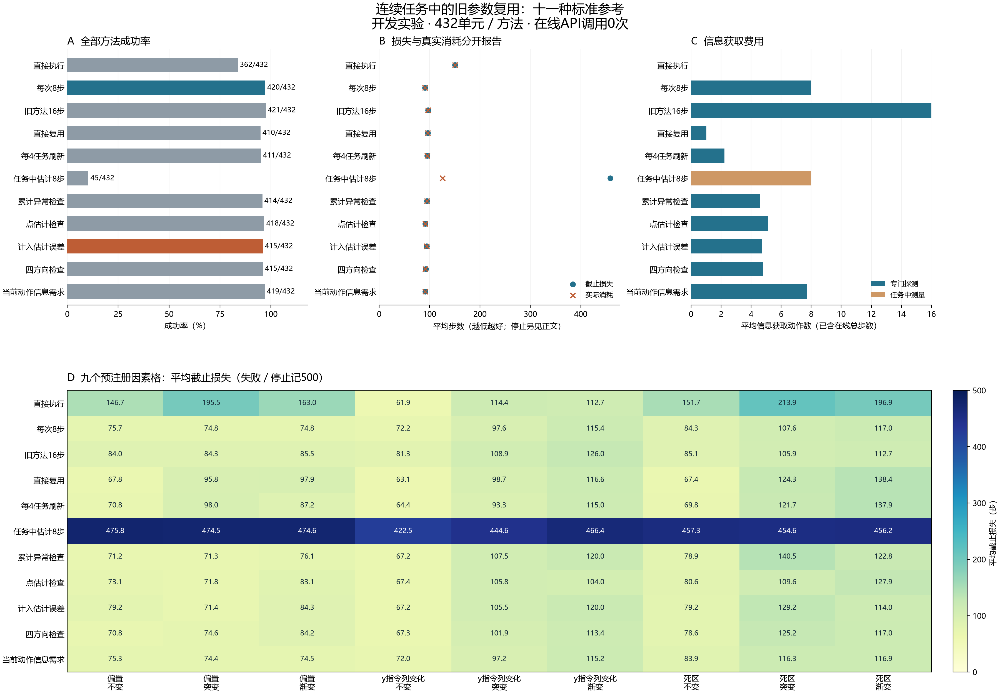

# 连续任务中的旧参数复用：标准参考实验

本轮比较什么时候复用旧纠正参数、什么时候重新探测。所有方法属于标准参考，没有在线LLM/API参与，也未建立新算法贡献。结果保留全部任务、失败和停止。

预注册主比较是计入旧估计误差检查（UNCERTAINTY4）减每次探测8步（ALWAYS8）：平均截止损失差为+3.405 [-4.239, +12.079]步，成功率差为-1.157 [-3.009, +0.463]个百分点。区间为预注册的完整流分层bootstrap 95%区间；本轮没有正式非劣效或算法晋级门槛。

## 数据与方法

36个独立时间流，432个任务单元，每单元11种方法，共4,752次实际执行。任务为push、reach、开门；主实验交叉三类扰动与不变、突变、渐变，每格四个流。扰动只在任务之间变化，同一任务途中保持固定。

每次执行仅一次受控初始重置，探测连续接入固定策略，总预算500步。失败和停止的截止损失记500，真实消耗步数另列；提前停止不能被解释成高效率。同一任务单元各方法共享按物理步时钟排列的噪声，不在探测结束后倒带。

方法的中文解释见[方法名称](../docs/research/method_names_zh.md)；具体阈值、程序和缓存事务见[冻结协议](../docs/protocols/chronological_cache_reference_development_v1.md)。

## 全部方法表现

下表每种方法使用全部任务单元作分母。截止损失越小越好；专门探测与被动测量均已包含在真实在线步数中。

| 方法 | 成功 | 停止 | 平均截止损失 | 平均真实步数 | 专门探测步 | 被动测量步 | 含完整来源摊销步数 |
|---|---:|---:|---:|---:|---:|---:|---:|
| 直接执行（NO_PROBE） | 362/432 | 0 | 150.745 | 150.745 | 0.000 | 0.000 | 150.745 |
| 每次探测8步（ALWAYS8） | 420/432 | 0 | 91.049 | 91.049 | 8.000 | 0.000 | 99.938 |
| 旧方法每次探测16步（ALWAYS16_OLD） | 421/432 | 0 | 97.069 | 97.069 | 16.000 | 0.000 | 145.704 |
| 直接复用旧参数（STALE） | 410/432 | 0 | 96.681 | 96.681 | 1.019 | 0.000 | 105.569 |
| 每4个任务刷新（PERIODIC4） | 411/432 | 0 | 95.361 | 95.361 | 2.222 | 0.000 | 104.250 |
| 前8步边做边估计（PASSIVE_RECENT8） | 45/432 | 292 | 458.500 | 125.944 | 0.000 | 8.000 | 174.579 |
| 累计异常后刷新（CUSUM4） | 414/432 | 0 | 95.062 | 95.062 | 4.583 | 0.000 | 103.951 |
| 只看点估计检查（PLUGIN4） | 418/432 | 0 | 91.475 | 91.475 | 5.102 | 0.000 | 100.363 |
| 计入旧估计误差检查（UNCERTAINTY4） | 415/432 | 0 | 94.454 | 94.454 | 4.731 | 0.000 | 103.343 |
| 四方向均衡检查（BALANCED4） | 415/432 | 1 | 92.551 | 91.412 | 4.778 | 0.000 | 100.301 |
| 按当前动作的信息需求检查（TASK_IVR4） | 419/432 | 0 | 91.755 | 91.755 | 7.704 | 0.000 | 100.644 |

## 预注册配对比较

差值统一为前者减后者；损失／费用负值表示前者更低，成功率正值表示前者更高。次比较未作多重比较校正，不能当独立确认结论。

| 比较 | 地位 | 截止损失差及95%区间 | 成功率差及95%区间（百分点） | 真实步数差及95%区间 | 探测步数差及95%区间 |
|---|---|---:|---:|---:|---:|
| UNCERTAINTY4 − ALWAYS8 | 主比较 | +3.405 [-4.239, +12.079] | -1.157 [-3.009, +0.463] | +3.405 [-4.239, +12.079] | -3.269 [-3.361, -3.176] |
| BALANCED4 − UNCERTAINTY4 | 未校正次比较 | -1.903 [-7.095, +2.632] | +0.000 [-0.926, +0.926] | -3.042 [-7.586, +0.951] | +0.046 [-0.028, +0.130] |
| UNCERTAINTY4 − PLUGIN4 | 未校正次比较 | +2.979 [-1.613, +8.317] | -0.694 [-2.083, +0.463] | +2.979 [-1.613, +8.317] | -0.370 [-0.509, -0.241] |
| UNCERTAINTY4 − TASK_IVR4 | 未校正次比较 | +2.699 [-5.544, +11.914] | -0.926 [-2.778, +0.926] | +2.699 [-5.544, +11.914] | -2.972 [-3.111, -2.833] |

| 比较 | 双方成功 | 双方失败 | 前者挽回成功 | 前者失去成功 |
|---|---:|---:|---:|---:|
| UNCERTAINTY4 − ALWAYS8 | 411 | 8 | 4 | 9 |
| BALANCED4 − UNCERTAINTY4 | 409 | 11 | 6 | 6 |
| UNCERTAINTY4 − PLUGIN4 | 413 | 12 | 2 | 5 |
| UNCERTAINTY4 − TASK_IVR4 | 410 | 8 | 5 | 9 |

## 三个任务与全部因素格

每格写为成功数/分母；平均截止损失见完整CSV。

| 方法 | 推物体 | 到达目标 | 开门 |
|---|---:|---:|---:|
| NO_PROBE | 115/144 | 110/144 | 137/144 |
| ALWAYS8 | 138/144 | 141/144 | 141/144 |
| ALWAYS16_OLD | 138/144 | 143/144 | 140/144 |
| STALE | 133/144 | 137/144 | 140/144 |
| PERIODIC4 | 136/144 | 136/144 | 139/144 |
| PASSIVE_RECENT8 | 42/144 | 3/144 | 0/144 |
| CUSUM4 | 135/144 | 139/144 | 140/144 |
| PLUGIN4 | 137/144 | 141/144 | 140/144 |
| UNCERTAINTY4 | 137/144 | 140/144 | 138/144 |
| BALANCED4 | 137/144 | 139/144 | 139/144 |
| TASK_IVR4 | 137/144 | 141/144 | 141/144 |

### 固定偏置 × 突变

| 方法 | 成功 | 平均截止损失 |
|---|---:|---:|
| NO_PROBE | 37/48 | 195.458 |
| ALWAYS8 | 48/48 | 74.812 |
| ALWAYS16_OLD | 48/48 | 84.271 |
| STALE | 45/48 | 95.792 |
| PERIODIC4 | 45/48 | 98.021 |
| PASSIVE_RECENT8 | 3/48 | 474.500 |
| CUSUM4 | 48/48 | 71.333 |
| PLUGIN4 | 48/48 | 71.750 |
| UNCERTAINTY4 | 48/48 | 71.417 |
| BALANCED4 | 48/48 | 74.583 |
| TASK_IVR4 | 48/48 | 74.438 |

### 固定偏置 × 渐变

| 方法 | 成功 | 平均截止损失 |
|---|---:|---:|
| NO_PROBE | 38/48 | 163.000 |
| ALWAYS8 | 48/48 | 74.771 |
| ALWAYS16_OLD | 48/48 | 85.542 |
| STALE | 45/48 | 97.938 |
| PERIODIC4 | 46/48 | 87.208 |
| PASSIVE_RECENT8 | 3/48 | 474.583 |
| CUSUM4 | 48/48 | 76.062 |
| PLUGIN4 | 47/48 | 83.083 |
| UNCERTAINTY4 | 47/48 | 84.333 |
| BALANCED4 | 47/48 | 84.188 |
| TASK_IVR4 | 48/48 | 74.458 |

### 固定偏置 × 不变

| 方法 | 成功 | 平均截止损失 |
|---|---:|---:|
| NO_PROBE | 41/48 | 146.667 |
| ALWAYS8 | 48/48 | 75.708 |
| ALWAYS16_OLD | 48/48 | 84.042 |
| STALE | 48/48 | 67.792 |
| PERIODIC4 | 48/48 | 70.750 |
| PASSIVE_RECENT8 | 3/48 | 475.750 |
| CUSUM4 | 48/48 | 71.229 |
| PLUGIN4 | 48/48 | 73.125 |
| UNCERTAINTY4 | 47/48 | 79.167 |
| BALANCED4 | 48/48 | 70.812 |
| TASK_IVR4 | 48/48 | 75.292 |

### 仅y指令列变化 × 突变

| 方法 | 成功 | 平均截止损失 |
|---|---:|---:|
| NO_PROBE | 45/48 | 114.438 |
| ALWAYS8 | 47/48 | 97.646 |
| ALWAYS16_OLD | 47/48 | 108.854 |
| STALE | 47/48 | 98.688 |
| PERIODIC4 | 47/48 | 93.312 |
| PASSIVE_RECENT8 | 7/48 | 444.625 |
| CUSUM4 | 46/48 | 107.458 |
| PLUGIN4 | 46/48 | 105.792 |
| UNCERTAINTY4 | 46/48 | 105.521 |
| BALANCED4 | 46/48 | 101.854 |
| TASK_IVR4 | 47/48 | 97.229 |

### 仅y指令列变化 × 渐变

| 方法 | 成功 | 平均截止损失 |
|---|---:|---:|
| NO_PROBE | 45/48 | 112.708 |
| ALWAYS8 | 45/48 | 115.438 |
| ALWAYS16_OLD | 44/48 | 125.958 |
| STALE | 44/48 | 116.604 |
| PERIODIC4 | 44/48 | 115.042 |
| PASSIVE_RECENT8 | 4/48 | 466.438 |
| CUSUM4 | 44/48 | 120.021 |
| PLUGIN4 | 46/48 | 104.000 |
| UNCERTAINTY4 | 44/48 | 120.021 |
| BALANCED4 | 45/48 | 113.375 |
| TASK_IVR4 | 45/48 | 115.250 |

### 仅y指令列变化 × 不变

| 方法 | 成功 | 平均截止损失 |
|---|---:|---:|
| NO_PROBE | 48/48 | 61.875 |
| ALWAYS8 | 48/48 | 72.229 |
| ALWAYS16_OLD | 48/48 | 81.292 |
| STALE | 48/48 | 63.104 |
| PERIODIC4 | 48/48 | 64.438 |
| PASSIVE_RECENT8 | 9/48 | 422.458 |
| CUSUM4 | 48/48 | 67.229 |
| PLUGIN4 | 48/48 | 67.438 |
| UNCERTAINTY4 | 48/48 | 67.229 |
| BALANCED4 | 48/48 | 67.292 |
| TASK_IVR4 | 48/48 | 71.958 |

### 死区 × 突变

| 方法 | 成功 | 平均截止损失 |
|---|---:|---:|
| NO_PROBE | 33/48 | 213.938 |
| ALWAYS8 | 45/48 | 107.562 |
| ALWAYS16_OLD | 45/48 | 105.875 |
| STALE | 43/48 | 124.333 |
| PERIODIC4 | 44/48 | 121.729 |
| PASSIVE_RECENT8 | 6/48 | 454.604 |
| CUSUM4 | 41/48 | 140.479 |
| PLUGIN4 | 45/48 | 109.604 |
| UNCERTAINTY4 | 43/48 | 129.167 |
| BALANCED4 | 42/48 | 125.250 |
| TASK_IVR4 | 44/48 | 116.333 |

### 死区 × 渐变

| 方法 | 成功 | 平均截止损失 |
|---|---:|---:|
| NO_PROBE | 35/48 | 196.938 |
| ALWAYS8 | 44/48 | 117.000 |
| ALWAYS16_OLD | 45/48 | 112.708 |
| STALE | 42/48 | 138.438 |
| PERIODIC4 | 41/48 | 137.917 |
| PASSIVE_RECENT8 | 5/48 | 456.208 |
| CUSUM4 | 44/48 | 122.833 |
| PLUGIN4 | 43/48 | 127.917 |
| UNCERTAINTY4 | 45/48 | 114.042 |
| BALANCED4 | 44/48 | 117.021 |
| TASK_IVR4 | 44/48 | 116.917 |

### 死区 × 不变

| 方法 | 成功 | 平均截止损失 |
|---|---:|---:|
| NO_PROBE | 40/48 | 151.688 |
| ALWAYS8 | 47/48 | 84.271 |
| ALWAYS16_OLD | 48/48 | 85.083 |
| STALE | 48/48 | 67.438 |
| PERIODIC4 | 48/48 | 69.833 |
| PASSIVE_RECENT8 | 5/48 | 457.333 |
| CUSUM4 | 47/48 | 78.917 |
| PLUGIN4 | 47/48 | 80.562 |
| UNCERTAINTY4 | 47/48 | 79.188 |
| BALANCED4 | 47/48 | 78.583 |
| TASK_IVR4 | 47/48 | 83.917 |

## 缓存、停止和刷新延迟

缓存只能来自本方法本流较早实际成功的新拟合。复用成功不把旧证据伪装成新证据；失败／停止会清空缓存。参数标签陈旧只表示真实映射改变，不能单独证明任务受到损害。

| 方法 | 新拟合次数 | 优化器函数求值 | 缓存写入 | 清除 | 复用案例 | 陈旧参数下任务步数（评价者） | 同映射刷新案例（评价者） |
|---|---:|---:|---:|---:|---:|---:|---:|
| NO_PROBE | 0 | 0 | 0 | 0 | 0 | 0 | 0 |
| ALWAYS8 | 432 | 432 | 420 | 11 | 0 | 0 | 0 |
| ALWAYS16_OLD | 432 | 432 | 421 | 11 | 0 | 0 | 0 |
| STALE | 55 | 55 | 54 | 21 | 377 | 20482 | 0 |
| PERIODIC4 | 120 | 120 | 117 | 19 | 312 | 14661 | 0 |
| PASSIVE_RECENT8 | 432 | 2062 | 45 | 43 | 0 | 80 | 0 |
| CUSUM4 | 63 | 63 | 61 | 16 | 369 | 15030 | 1 |
| PLUGIN4 | 119 | 119 | 113 | 12 | 313 | 10328 | 36 |
| UNCERTAINTY4 | 79 | 79 | 76 | 15 | 353 | 13538 | 10 |
| BALANCED4 | 84 | 84 | 81 | 16 | 348 | 11189 | 8 |
| TASK_IVR4 | 400 | 400 | 388 | 12 | 32 | 186 | 263 |

全量失败602例，其中停止293例；成功但拒绝缓存写入0例。每例的任务、种子、停止动作与拟合详情均导出。

| 方法 | 停止动作 | 案例数 |
|---|---|---:|
| BALANCED4 | STOP_POINT_FIT | 1 |
| PASSIVE_RECENT8 | STOP_POINT_FIT | 292 |

变化后的首次新拟合和首次成功缓存来源延迟按流导出，未观察到刷新者保留右删失标记。首次新拟合也可能来自任务失败清缓存后的重新启动，不能把它全部归因于检测器报警；不将删失时间当成已发生的刷新时间求平均。

## 完整费用与审计

主阶段实际受控交互484,275步、受控重置4,752次；工厂目标生成重置237,600次、全部重置242,352次，完成请求仿真帧123,597,375。

联合模型各方法计完整离线来源3,840步／480次受控重置，按本轮432单元摊销。两个旧ARX参考各计21,010步／288次受控重置；旧来源的工厂成本未知，不能填0。不探测方法无需来源模型。表中摊销指标仅合并受控步骤，不能称含所有工厂成本的总成本。共享离线来源实际收集一次，不能把十一种方法的名义来源费重复相加当实际新开销。

预检另花7,370步／66次受控重置，全部重置3,366次、完成请求帧1,719,850。本轮没有新名义模型拟合、策略权重训练或API调用；在线参数优化与缓存写入已另计。

记录审计通过：核对1,481,140条事件与710个冻结输入，重放保存选择、真实连续状态／噪声时钟、缓存来源和物理费用。独立统计审计通过：重建2,266个数值字段，最大绝对差1.78e-15。记录审计仍共享部分估计／优化数学实现，统计审计独立重建费用、分层与区间；不把审计通过解释为物理概率保证。

## 结论边界与后续贡献要求

本轮检验真实时序复用及故障变化下的标准参考。COLUMN_Y前四个x方向动作的解析盲区属于输入支持／可观测性事实，均衡动作也属于标准试验设计，均不直接构成新算法。任务收益必须依据实际任务表与预注册比较判断。

PASSIVE_RECENT8在缺少激励、拟合无效时停止，未实现跳过不支持更新并实际继续原控制的强参考。TASK_IVR4只看当前一个任务指令，不是完整规划查询分布或完整GAUGE复现。因此不能据本轮胜负宣称优于全部近期辨识／任务导向方法。

每因素格仅四独立流、变化时点预先固定，本轮属于开发机制比较，没有为小幅成功率差或正式非劣效检验保证功效。高斯预测与参数协方差仍是未获物理资格的工作近似。后续需要独立的新方法、同权限强基线、冻结新样本与完整论文；CCF A目标仍未完成。

## 可复核产物

- [全部方法及来源费用](../outputs/chronological_cache_reference/development_v1/chronological_cache_reference_20261016T114510Z_88c168320712/analysis_v1/methods.csv)
- [全部实际案例](../outputs/chronological_cache_reference/development_v1/chronological_cache_reference_20261016T114510Z_88c168320712/analysis_v1/case_outcomes.csv)
- [全部失败](../outputs/chronological_cache_reference/development_v1/chronological_cache_reference_20261016T114510Z_88c168320712/analysis_v1/failures.csv)
- [全部停止](../outputs/chronological_cache_reference/development_v1/chronological_cache_reference_20261016T114510Z_88c168320712/analysis_v1/stops.csv)
- [失败与停止详情](../outputs/chronological_cache_reference/development_v1/chronological_cache_reference_20261016T114510Z_88c168320712/analysis_v1/failure_details.csv)
- [预注册配对逐例差异](../outputs/chronological_cache_reference/development_v1/chronological_cache_reference_20261016T114510Z_88c168320712/analysis_v1/paired_outcomes.csv)
- [缓存来源与决策链](../outputs/chronological_cache_reference/development_v1/chronological_cache_reference_20261016T114510Z_88c168320712/analysis_v1/cache_lineage.csv)
- [成功后拒绝写入原因](../outputs/chronological_cache_reference/development_v1/chronological_cache_reference_20261016T114510Z_88c168320712/analysis_v1/cache_write_failures.csv)
- [刷新延迟及右删失](../outputs/chronological_cache_reference/development_v1/chronological_cache_reference_20261016T114510Z_88c168320712/analysis_v1/refresh_delays.csv)
- [全部因素格](../outputs/chronological_cache_reference/development_v1/chronological_cache_reference_20261016T114510Z_88c168320712/analysis_v1/factors.csv)
- [三任务分层](../outputs/chronological_cache_reference/development_v1/chronological_cache_reference_20261016T114510Z_88c168320712/analysis_v1/tasks.csv)
- [预注册区间](../outputs/chronological_cache_reference/development_v1/chronological_cache_reference_20261016T114510Z_88c168320712/analysis_v1/contrasts.csv)
- [完整费用账](../outputs/chronological_cache_reference/development_v1/chronological_cache_reference_20261016T114510Z_88c168320712/analysis_v1/costs.json)
- [冻结清单](../outputs/chronological_cache_reference/development_v1/chronological_cache_reference_20261016T114510Z_88c168320712/manifest.json)
- [完整原始汇总](../outputs/chronological_cache_reference/development_v1/chronological_cache_reference_20261016T114510Z_88c168320712/main/summary.json)
- [记录审计](../outputs/chronological_cache_reference/development_v1/chronological_cache_reference_20261016T114510Z_88c168320712/main_audit/audit.json)
- [统计审计](../outputs/chronological_cache_reference/development_v1/chronological_cache_reference_20261016T114510Z_88c168320712/main_audit/statistics.json)

实验：`chronological_cache_reference_20261016T114510Z_88c168320712`；清单：`040f916d3425043fe091fcbba8d79ab54b896701bc86b287da47b3f37317f8c5`；冻结提交：`88c168320712dab2db6a4f3de12f515e69e2a4fa`。
