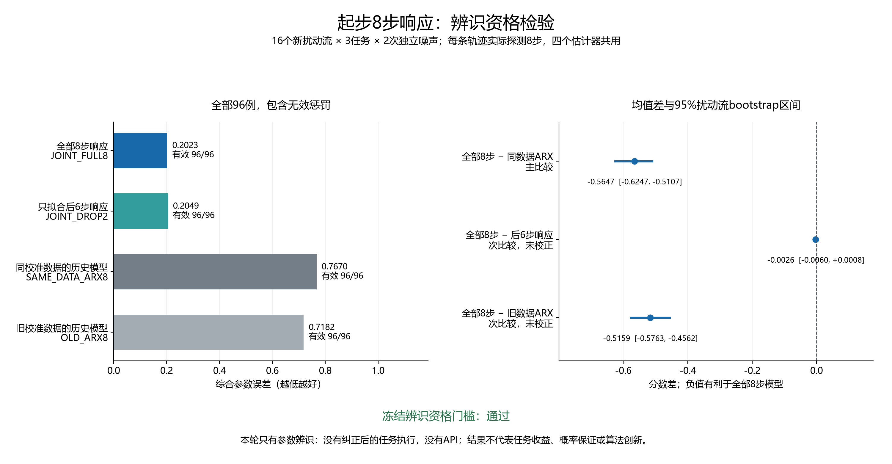

# 起步8步响应的辨识资格检验

本轮检查受控重置后的联合响应模型，能否比同批数据训练的历史响应模型更准确地估计动作偏差，并检验最早两步响应的额外价值。冻结资格门槛**通过**。主分数差为-0.564699，16个扰动流成组bootstrap的95%区间为[-0.624729, -0.510706]；负值有利于全部8步模型。

这是标准系统辨识组件检验。没有执行纠正后的恢复任务，没有API或记忆参与；参数误差不能替代任务成功率，也不能证明方法创新。本批改善主要体现在联合响应模型与历史ARX模型的比较；FULL8减DROP2的区间包含0，不能把主比较的改善归因于增加最早两步响应，也不能称这两种配置等效。冻结门槛对该消融只要求均值小于0，因此门槛通过比“早期响应收益得到确认”弱。



## 方法名称和共同数据

先在已知正常执行器上采集每任务128条起步轨迹，三任务共384条。保存全部训练数据后拟合并冻结模型，再执行16个新扰动流×三任务×两次独立前缀噪声，共96条资格轨迹。每条资格轨迹只实际执行一次8步探测，四个估计器读取完全相同的可见轨迹；没有执行四次环境轨迹。

联合使用全部8步响应（JOINT_FULL8）通过独立名义校准得到因果下三角响应矩阵，再拟合全部8个位移；联合模型只拟合后6步响应（JOINT_DROP2）使用相同模型，但不使用最早两步自身的响应项。早期发送命令的后续物理影响仍在模型中。

同校准数据的历史响应模型（SAME_DATA_ARX8）用同一批384条训练轨迹拟合标准LINEAR_ARX，用于区分校准数据来源与响应建模的影响。旧校准数据的历史响应模型（OLD_ARX8）保留此前冻结的基线。AR2模型要先有两步真实历史，所以8步中只有第3–8步作为响应目标；前两步仍作为历史协变量，不能说它们完全被丢弃。更多名称见[中文名词表](../docs/research/method_names_zh.md)。

## 全部资格结果

分数为矩阵误差的Frobenius范数加偏移误差的欧氏范数除以0.4。分数越小越好；无效或不完整拟合分别使用8和1的矩阵／偏移误差惩罚，综合分数10.5，仍计入96分母。

| 中文名称和代码 | 有效／全部 | 平均矩阵误差 | 平均偏移误差 | 平均综合分数 |
|---|---:|---:|---:|---:|
| 联合使用全部8步响应（JOINT_FULL8） | 96/96 | 0.145201 | 0.022840 | 0.202300 |
| 联合模型只拟合后6步响应（JOINT_DROP2） | 96/96 | 0.147665 | 0.022894 | 0.204901 |
| 同校准数据的历史响应模型（SAME_DATA_ARX8） | 96/96 | 0.527144 | 0.095942 | 0.766998 |
| 旧校准数据的历史响应模型（OLD_ARX8） | 96/96 | 0.557287 | 0.064379 | 0.718235 |

## 注册比较和资格门槛

16个扰动流是重采样单位，流内三任务与两次噪声保留在同一组。10000次普通成组bootstrap，随机源20261016；未使用旧点8研究的偶奇分层方案。

| 比较 | 地位 | 平均分数差 | 95%流区间 |
|---|---|---:|---|
| 全部8步 − 同校准数据的历史响应模型 | 主比较 | -0.564699 | [-0.624729, -0.510706] |
| 全部8步 − 联合模型只拟合后6步响应 | 次比较，未校正 | -0.002601 | [-0.006003, +0.000845] |
| 全部8步 − 旧校准数据的历史响应模型 | 次比较，未校正 | -0.515935 | [-0.576261, -0.456189] |

资格要求全部满足：FULL8有效率至少95%、主比较区间上端小于0、FULL8减DROP2平均分数小于0。实际判定如下：

- valid_fraction：通过。
- primary_upper_below_zero：通过。
- full_better_than_drop_two_mean：通过。

通过仅允许制定新的任务桥接协议，不能据此声称纠正任务获益。失败则保留组件负结果，不重调特征、协方差、阈值或本批种子后重新晋级。

## 任务分层和全部失败

下表是结果后的描述性分层，不另作多重显著性声明；含相同无效惩罚。

| 估计器 | 任务 | 有效／全部 | 平均分数 | 中位分数 |
|---|---|---:|---:|---:|
| 联合使用全部8步响应 | push-v3 | 32/32 | 0.188702 | 0.186072 |
| 联合使用全部8步响应 | reach-v3 | 32/32 | 0.199529 | 0.184431 |
| 联合使用全部8步响应 | door-open-v3 | 32/32 | 0.218668 | 0.229617 |
| 联合模型只拟合后6步响应 | push-v3 | 32/32 | 0.190070 | 0.190889 |
| 联合模型只拟合后6步响应 | reach-v3 | 32/32 | 0.203021 | 0.192275 |
| 联合模型只拟合后6步响应 | door-open-v3 | 32/32 | 0.221612 | 0.227121 |
| 同校准数据的历史响应模型 | push-v3 | 32/32 | 0.777002 | 0.751703 |
| 同校准数据的历史响应模型 | reach-v3 | 32/32 | 0.743383 | 0.763302 |
| 同校准数据的历史响应模型 | door-open-v3 | 32/32 | 0.780610 | 0.788265 |
| 旧校准数据的历史响应模型 | push-v3 | 32/32 | 0.468837 | 0.465912 |
| 旧校准数据的历史响应模型 | reach-v3 | 32/32 | 0.603345 | 0.570277 |
| 旧校准数据的历史响应模型 | door-open-v3 | 32/32 | 1.082522 | 1.064932 |

无效拟合为0。

逐例描述：全部8步比同数据ARX在96例中96例改善、0例变差；比只拟合后6步响应是49例改善、47例变差；比旧ARX是94例改善、2例变差。后者变差案例完整保留如下，不能把总体均值改善写成逐例优势：

| 实例 | 任务 | 全部8步分数 | 旧ARX分数 | 全部8步减旧ARX |
|---|---|---:|---:|---:|
| qual_14_1_1 | reach-v3 | 0.390155 | 0.330666 | +0.059489 |
| qual_15_0_0 | push-v3 | 0.251810 | 0.156518 | +0.095293 |

全部384条估计见[all_estimates.csv](../outputs/cold_start_evidence/report_v1/all_estimates.csv)，全部288条注册配对差见[all_paired_differences.csv](../outputs/cold_start_evidence/report_v1/all_paired_differences.csv)。原始轨迹保留了实际命令、观测、噪声承诺和完整账本。探测期间的成功标记仅是环境状态，未执行或评估纠正后的任务策略。

## 完整费用

新名义校准为3,072步／384次受控重置；资格测量为768步／96次受控重置。四种估计共享这些实际交互，不把同一轨迹乘四计算。新模型各自承担完整3072步／384次名义校准；资格集按96条摊销为每条32步／4次校准重置。旧ARX仍单独承担历史21010步／288次受控重置，不能伪装为零成本。不同估计器的数据来源不同，因此旧与新之差不是相同校准费的纯消融。旧来源没有本轮这种工厂内部全生命周期账本，21010／288仅为可核实的受控口径；不能把它与本轮仿真帧合计成同口径全成本。上游历史研究还另有旧legacy比较器2304步／144次离线重置，作为来源追溯另列；本次OLD_ARX8读取的是该前向研究新拟合的LINEAR_ARX参数。

全研究账本共有3,840次受控Env.step、480次受控初始重置，工厂目标生成临时重置24,000次；合计24,480次实际重置，完成12,259,200个请求仿真帧，低于13000000上限。三任务实际Env.step为0.0125秒仿真时间。没有中途重置、状态复制、回滚或重新播种。

新增均值回归27个（24个时刻响应回归、3个同数据ARX），联合残差协方差3个；资格阶段逆向参数拟合384次，记录的数值优化函数求值合计441次。两次记录审计都完成模型与参数重拟合，共额外54个均值回归／768次逆向拟合，增加数值计算，没有增加环境交互。API、策略训练、恢复任务执行、自然记忆写入均为0。完整账本见[costs.json](../outputs/cold_start_evidence/report_v1/costs.json)。

## 审计与结论边界

记录审计通过：核对480条前缀、58,657条事件、686个冻结Git输入；重新构造噪声、实际动作、时钟与费用，检查训练冻结先于资格，核对27个均值回归的正规方程及三份残差协方差，并独立重建分数与三个流区间。共享可见轨迹、工作均值、拟合／优化器和账本解析辅助函数，详见[audit.json](../outputs/cold_start_evidence/analysis_v2/audit.json)；这是独立重建代码，不是另一研究团队的外部复现。

冻结v1审计器在核对全部480条前缀后，因重新计算的NumPy布尔值无法被JSON序列化而中止，没有给出通过记录。[原错误日志](../outputs/cold_start_evidence/analysis_v1/failed_audit.log)已保留。v2入口只将比较中的NumPy布尔值转为Python布尔值，再完整重跑原审计；没有改动采集源码、轨迹、模型、数值结果或门槛。修复源码及散列见[工具记录](../outputs/cold_start_evidence/analysis_v2/audit_tooling.json)。

执行噪声仍为0.05。连续高斯裁剪期望只作为工作均值；真实执行含float32运算，不能宣称精确高斯定律、物理参数后验校准或任务代价保证。受控重置、开环xy起步8步和训练初始手位置范围也是模型作用域，不能推广成任意任务中途状态的辨识保证。有限时域响应、岭回归与广义最小二乘为标准方法。

[原在线GLM结果](online_calibrated_agent_development_v1.md)仍是15条完整API闭环、14/16任务成功，低于两个校准基线的16/16；本轮没有追加API，不能用当前参数结果改善历史LLM结论。此前点8、尾价值与RFF负结果也不改变。完整CCF A目标仍缺新方法贡献、独立任务收益、时变扰动评价和完整论文。

下一步已写出[新任务桥接设计](../docs/research/cold_start_task_bridge_design_v1.md)，保留同数据ARX、后6步联合响应、旧点8、Gaussian8、点16和不纠正对照；该设计尚待实现与冻结，没有执行新任务种子。

交付前全仓库881项测试通过（131.010秒），源码与报告辅助程序编译、项目依赖检查通过；另从原始估计独立核对384条估计、288条配对差和12行任务分层的1848个数值字段。最终秘密、差异及提交字节检查记录在[validation_v1](../outputs/cold_start_evidence/validation_v1)。

## 冻结身份与复现

- 实验：`cold_start_evidence_20261015T170124Z_c5b76fb5ddb6`。
- 清单：`efd4ecacfbbcdb36cbe8c2399d45a5d6ee2154aa263d0bb49b040c2448521715`。
- 冻结提交：`c5b76fb5ddb6602a7f632aa6193a025790e52df3`。
- 新资格种子13800–13847；名义校准种子14000–14383；13848–13999、14384–14599与所有旧保留范围未使用。
- 北京日期2026-10-16；运行ID按UTC写20261015。

```powershell
.\.venv\Scripts\python.exe -X utf8 scripts/audit_cold_start_evidence_v2.py --manifest outputs/cold_start_evidence/qualification_v1/cold_start_evidence_20261015T170124Z_c5b76fb5ddb6/manifest.json --output outputs/cold_start_evidence/analysis_reproduction_NEW
.\.venv\Scripts\python.exe -X utf8 outputs/cold_start_evidence/report_v1/create_report.py --manifest outputs/cold_start_evidence/qualification_v1/cold_start_evidence_20261015T170124Z_c5b76fb5ddb6/manifest.json --audit outputs/cold_start_evidence/analysis_v2/audit.json
```

采集为一次执行，既有目录不能重启或覆盖。复核使用新输出目录，原始数据保持不变；报告脚本也拒绝覆盖，复刻排版时需复制脚本到新的版本目录，并用`--report reports/NEW_REPORT.md`指定新的报告文件。
