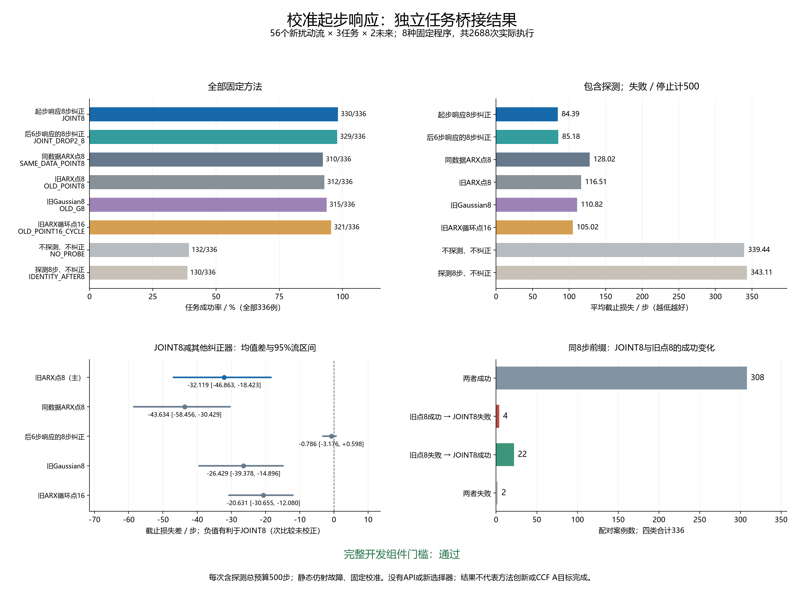

# 起步响应辨识的独立任务桥接

本轮把此前的参数估计改进接到实际任务执行上。校准起步响应8步纠正（JOINT8）成功330/336、平均截止损失84.390步；旧ARX的8步点纠正成功312/336、116.509步。主损失差为-32.119048步，56流95%区间[-46.863318,-18.422619]，负值有利于JOINT8。完整开发组件门槛**通过**。

本批最低平均截止损失的固定程序为校准起步响应8步纠正（JOINT8），属于观察结果。全部方法是冻结标准估计器与固定策略组合，没有新选择器、API或记忆；不能把任务结果直接称为新算法或CCF A贡献完成。



## 方法含义和全部对照

先把“探测”理解成做几个小动作、观察实际运动；“纠正”就是根据观察调整后续指令。例如想向右走却总偏向右上方，就需要估计并补偿偏差。

名字中的8／16是实际探测步数，POINT表示用一组参数值纠正，G表示纠正目标还考虑参数不确定性；OLD是沿用旧模型，SAME_DATA是控制校准数据来源，CYCLE是按预定方向循环探测。JOINT表示联合使用整段起步响应，DROP2表示估计时去掉最早两步自身的响应项。这些都是本项目的实验标签。

JOINT8可简称“联合估计8步”，JOINT_DROP2_8可简称“少用前两步响应”，SAME_DATA_POINT8可简称“同数据传统估计8步”。NO_PROBE是“不探测直接执行”，IDENTITY_AFTER8是“探测8步但不纠正”。ARX是根据过去动作和位移预测当前位移的历史响应模型；无需先掌握公式才能阅读结果。完整对照见[方法名称的中文解释](../docs/research/method_names_zh.md)。

本轮的“扰动流”指一组固定的新动作偏差；每组下执行三任务和两次未来噪声。它不是任务途中发生突变或渐变的时间序列。

所有需要探测的程序先实际执行同一轮8步。JOINT8使用独立校准的起步联合响应，JOINT_DROP2_8只去掉前两步自身的响应目标；两者都实际探测8步。SAME_DATA_POINT8读取同一批校准数据的ARX，OLD_POINT8读取旧ARX，点方法采用同一个逆补偿。OLD_G8沿用原Gaussian风险目标，正则化与约束方式也不同，不能称为只去掉不确定性的纯消融。OLD_POINT16_CYCLE再执行同样8步后更新旧ARX。身份对照不纠正指令，环境扰动仍然存在。

| 中文名称和代码 | 成功／全部 | 停止 | 平均截止损失 | 平均实际总步 | 平均探测步 | 完整来源步／受控重置 | 含来源摊销实际步 |
|---|---:|---:|---:|---:|---:|---|---:|
| 校准起步响应8步纠正（JOINT8） | 330/336 | 0 | 84.390 | 84.390 | 8.000 | 3,840／480 | 95.818 |
| 仅后6步响应的8步纠正（JOINT_DROP2_8） | 329/336 | 0 | 85.176 | 85.176 | 8.000 | 3,840／480 | 96.604 |
| 同数据ARX的8步点纠正（SAME_DATA_POINT8） | 310/336 | 0 | 128.024 | 128.024 | 8.000 | 3,840／480 | 139.452 |
| 旧ARX的8步点纠正（OLD_POINT8） | 312/336 | 2 | 116.509 | 113.580 | 8.000 | 21,010／288 | 176.110 |
| 旧Gaussian的8步纠正（OLD_G8） | 315/336 | 0 | 110.818 | 110.818 | 8.000 | 21,010／288 | 173.348 |
| 旧ARX循环16步点纠正（OLD_POINT16_CYCLE） | 321/336 | 0 | 105.021 | 105.021 | 16.000 | 21,010／288 | 167.551 |
| 不探测、不纠正（NO_PROBE） | 132/336 | 0 | 339.440 | 339.440 | 0.000 | 0／0 | 339.440 |
| 探测8步、不纠正（IDENTITY_AFTER8） | 130/336 | 0 | 343.110 | 343.110 | 8.000 | 0／0 | 343.110 |

成功的截止损失等于含探测总步数，失败与停止计500；实际费用按真实执行步数计算。摊销列为本方法真实交互加完整来源的已保存受控步数，再除336；它不等于含旧来源未知工厂费用的全成本。每方法336例，未筛除无效拟合或早期结束。本批没有在探测期间已成功、因而跳过纠正执行的案例。全部2688例见[all_cases.csv](../outputs/cold_start_task_bridge/report_v1/all_cases.csv)。

## 注册比较与竞争性门槛

56个独立扰动流为重采样单位，偶奇各28流分层bootstrap10000次，随机源20261017；流内三任务与两未来不充作独立样本。区间对固定校准模型下的新流变化作描述，不包含重新训练名义模型的变异，也不是物理误差保证。

| JOINT8减参考 | 地位 | 成功率差／百分点 | 截止损失差及95%区间／步 | 原成功变失败 | 原失败变成功 |
|---|---|---:|---|---:|---:|
| 起步响应8步 − 旧ARX的8步点纠正 | 主 | +5.357 | -32.119048 [-46.863318, -18.422619] | 4 | 22 |
| 起步响应8步 − 同数据ARX的8步点纠正 | 次，未校正 | +5.952 | -43.633929 [-58.455580, -30.428571] | 0 | 20 |
| 起步响应8步 − 仅后6步响应的8步纠正 | 次，未校正 | +0.298 | -0.785714 [-3.175670, +0.598214] | 0 | 1 |
| 起步响应8步 − 旧Gaussian的8步纠正 | 次，未校正 | +4.464 | -26.428571 [-39.378497, -14.895759] | 1 | 16 |
| 起步响应8步 − 旧ARX循环16步点纠正 | 次，未校正 | +2.679 | -20.630952 [-30.654985, -12.080357] | 1 | 10 |
| 起步响应8步 − 不探测、不纠正 | 次，未校正 | +58.929 | -255.050595 [-278.423065, -232.014807] | 2 | 200 |
| 起步响应8步 − 探测8步、不纠正 | 次，未校正 | +59.524 | -258.720238 [-282.021503, -236.068155] | 0 | 200 |

NO_PROBE是完整程序比较，不能解释成同一探测后状态上的效果。其余方法共同8步前缀已核对；16步程序还包含额外探测造成的状态和时间影响。

- 主损失差区间上端小于零（primary_loss_upper_below_zero）：通过。
- 成功数不低于旧点8（success_not_below_old_point8）：通过。
- 成功数不低于旧Gaussian8和旧循环点16（success_not_below_strong_controls）：通过。
- 平均截止损失不高于两项强对照（mean_loss_not_above_strong_controls）：通过。

主比较区间与四项完整门槛分别报告。两项对强控制器的观察成功数／平均代价要求不是非劣效置信界。通过或未通过均保留结果，不按本批结果重调或扩样。

## 任务分层与全部失败

| 程序 | 任务 | 成功／全部 | 平均截止损失 |
|---|---|---:|---:|
| 校准起步响应8步纠正 | push-v3 | 111/112 | 76.509 |
| 校准起步响应8步纠正 | reach-v3 | 112/112 | 57.036 |
| 校准起步响应8步纠正 | door-open-v3 | 107/112 | 119.625 |
| 仅后6步响应的8步纠正 | push-v3 | 111/112 | 76.562 |
| 仅后6步响应的8步纠正 | reach-v3 | 112/112 | 56.991 |
| 仅后6步响应的8步纠正 | door-open-v3 | 106/112 | 121.973 |
| 同数据ARX的8步点纠正 | push-v3 | 96/112 | 142.679 |
| 同数据ARX的8步点纠正 | reach-v3 | 110/112 | 88.312 |
| 同数据ARX的8步点纠正 | door-open-v3 | 104/112 | 153.080 |
| 旧ARX的8步点纠正 | push-v3 | 101/112 | 119.857 |
| 旧ARX的8步点纠正 | reach-v3 | 107/112 | 87.464 |
| 旧ARX的8步点纠正 | door-open-v3 | 104/112 | 142.205 |
| 旧Gaussian的8步纠正 | push-v3 | 100/112 | 124.054 |
| 旧Gaussian的8步纠正 | reach-v3 | 109/112 | 77.652 |
| 旧Gaussian的8步纠正 | door-open-v3 | 106/112 | 130.750 |
| 旧ARX循环16步点纠正 | push-v3 | 109/112 | 93.518 |
| 旧ARX循环16步点纠正 | reach-v3 | 112/112 | 69.839 |
| 旧ARX循环16步点纠正 | door-open-v3 | 100/112 | 151.705 |
| 不探测、不纠正 | push-v3 | 37/112 | 360.125 |
| 不探测、不纠正 | reach-v3 | 41/112 | 347.920 |
| 不探测、不纠正 | door-open-v3 | 54/112 | 310.277 |
| 探测8步、不纠正 | push-v3 | 36/112 | 367.205 |
| 探测8步、不纠正 | reach-v3 | 42/112 | 345.062 |
| 探测8步、不纠正 | door-open-v3 | 52/112 | 317.062 |

共有509条失败（含停止），其中停止2条，全部见[all_failures.csv](../outputs/cold_start_task_bridge/report_v1/all_failures.csv)。两条停止均为旧点8在扰动流20的开门任务中估计逆映射不稳定，分别对应两次未来噪声；实际仅执行8步，截止损失仍计500。停止没有基线代执行，原因见[all_stops.csv](../outputs/cold_start_task_bridge/report_v1/all_stops.csv)。相对旧点8，JOINT8出现4条原成功变失败，完整列出：

| 扰动流 | 任务 | 未来重复 | JOINT8损失 | 旧点8损失 |
|---|---|---:|---:|---:|
| 41 | push-v3 | 0 | 500 | 80 |
| 45 | door-open-v3 | 1 | 500 | 178 |
| 54 | door-open-v3 | 0 | 500 | 344 |
| 54 | door-open-v3 | 1 | 500 | 255 |

事后评价者诊断复用资格阶段的参数误差分数。与旧点8配对的336例中，334例两者均有有效参数；其中108例JOINT8参数更接近真实扰动但任务损失更高。该诊断不是注册主比较、不会给Agent真参数，也不确定唯一物理原因。其余缺失／无效估计仍保存在[parameter_task_diagnostic.csv](../outputs/cold_start_task_bridge/report_v1/parameter_task_diagnostic.csv)。

## 样本量与完整费用

历史点8减点16的配对流标准差51.20785步，以20步改善、双侧alpha0.05、功效0.8作正态规划需52流，取完整生成块56流。历史方差来自另一对照，只是新主比较的规划代理，不保证实际功效。样本量在新结果前冻结，没有中期效果停样或事后扩样。

本次实际受控交互440,012步、2688次受控初始重置，工厂目标生成重置134,400次，合计137,088次重置，完成70,744,060个请求仿真帧，低于80000000上限。每程序一次初始重置、总预算500步；没有复制、恢复或重新播种中途状态。

新三方法各承担完整来源3840步／480次受控重置，包括训练3072／384与资格768／96；来源的完整工厂／帧账本也保留。旧三方法各承担旧来源21010／288，旧工厂内部费用未知，不能算零或合成同口径全成本。两个不纠正对照不付名义拟合费用；共享数据的实际收集只计一次。各程序真实费用见[all_costs.csv](../outputs/cold_start_task_bridge/report_v1/all_costs.csv)，全部来源账本见[costs.json](../outputs/cold_start_task_bridge/report_v1/costs.json)。

保存的拟合记录2016条，所记录的优化函数求值合计2099次；这是决策中保存的求值数，不是CPU时间。独立审计与早期首流审计另做数值重建，没有重新执行机器人环境。新增名义训练、策略更新、API调用／tokens／延迟、自然记忆写入均0。

## 审计与研究边界

[记录审计](../outputs/cold_start_task_bridge/analysis_v1/audit.json)核对1,167,640条事件、706个冻结Git输入、全部2688次执行及2352条共同前缀（2016不同方法、336自检）和1344条跨未来前缀；独立重建噪声、实际动作、保存纠正器消费、时钟、重置与费用。优化器／命令数学、前缀检查和账本解析辅助有复用。

[独立统计审计](../outputs/cold_start_task_bridge/statistics_audit_v1/check.json)另重建1397个数值字段、七组配对区间、来源费用和完整门槛，没有调用主统计函数。首流48例的早期完整性检查不是全研究结果；其文件另存，未用于修改方法或样本量。

源辨识资格中0.202对0.767的参数分数、早期两步消融区间跨0的结论都保留。当前仍只覆盖固定三任务、静态A仿射故障、固定校准和0.05噪声。连续高斯均值与协方差仍是工作模型，不是浮点噪声定律或任务概率保证。没有验证时变上下文中的复用／重测决策、LLM额外能力或新方法新颖性；完整CCF A研究目标仍未完成。

另有[旧资格数据的条件参照诊断](../outputs/cold_start_task_bridge/rationale_v1/conditional_posthoc_note_zh.md)，用于解释边缘响应与历史条件项的区别。该分析是事后旧源复用，不是本批任务候选，没有用于修改当前方法或门槛。

## 冻结身份与复核

- 实验：`cold_start_task_bridge_20261015T175406Z_44d3e6864ac1`。
- 清单：`75b2ed1525dc62022d75e350a967361f5494968298fd437bc29eed375d2fa631`。
- 冻结提交：`44d3e6864ac1800393162760f24da7722f7c4bac`。
- 新任务种子14600–14767；14768–14999和全部旧冻结保留范围未使用。

```powershell
.\.venv\Scripts\python.exe -X utf8 scripts/audit_cold_start_task_bridge.py --manifest outputs/cold_start_task_bridge/development_v1/cold_start_task_bridge_20261015T175406Z_44d3e6864ac1/manifest.json --output outputs/cold_start_task_bridge/record_reproduction_NEW
.\.venv\Scripts\python.exe -X utf8 scripts/audit_cold_start_task_bridge_statistics.py --manifest outputs/cold_start_task_bridge/development_v1/cold_start_task_bridge_20261015T175406Z_44d3e6864ac1/manifest.json --record-audit outputs/cold_start_task_bridge/record_reproduction_NEW/audit.json --output outputs/cold_start_task_bridge/statistics_reproduction_NEW
```

采集一次执行，不能重启或覆盖；复核使用新目录，不重新仿真。交付前完整测试890项通过（133.762秒），编译和依赖检查通过。报告数据复核检查60,152个数值字段，最大绝对差3.331e-16，见[中文解释修订后的复核记录](../outputs/cold_start_task_bridge/report_v1/check_readability.json)；原check.json对应修订前报告。最终秘密扫描、差异和提交字节检查另存于validation_v1。
