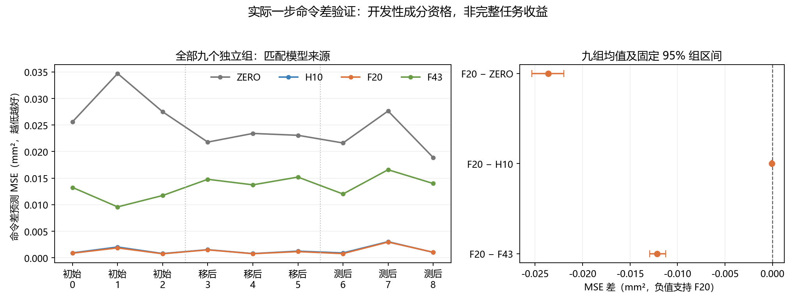
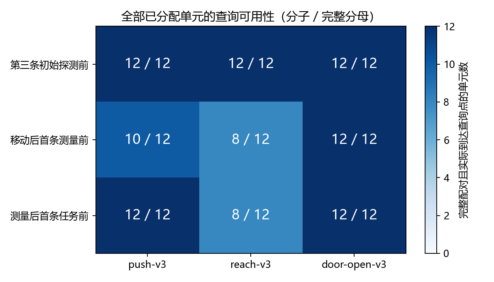

# 固定响应模型：独立实际命令差分资格结果

2026-10-22；冻结门槛结论：**PASSED_REALIZED_ELIGIBLE_CONTRASTS_ONLY**。
运行 `command_contrast_20261022T015501Z_339de06a3036`，manifest `964c6a089d16019307df4241e140b953f3384489ba1d1a791fac482fa30756aa`；源码快照 `339de06a303618837e98a63ecd9ab4b391844cfe`（实现冻结 `40a5842`，原生检查结果 `b2c0af0`）。

三任务、两种静态上下文、两种执行程序、三个查询阶段的 **540/540 次科学执行完成**，记录审计及独立数值复核通过。完整 108 单元中，98 个实际到达查询点并有五分支完整配对；其余保留缺失原因。

“实际／原生”指 MuJoCo 真实推进仿真，而非纯数组测试，也不是实机机器人实验。该试验独立于模型训练数据；它仍是开发性的局部预测成分资格，不是最终算法或完整恢复任务验证。

## 方法名字与问题

| 名称 | 含义 |
|---|---|
| C8 | 初始八步观测估计的固定执行器纠正；本轮保持原程序 |
| FEEDBACK8 | 移动后按固定策略与 C8 执行八步测量 |
| BALANCED8 | 移动后按预定平衡方向与 C8 执行八步测量 |
| H10 | 最近两段 XYZ 位移与当前发送命令，共 10 维 |
| F20 | 加入手位置、抓手及物体／目标相对位置的 20 维输入 |
| F43 | 当前 39 维观测与 4 维发送命令 |
| ZERO | 始终预测候选命令相对基准的响应差为零；是预测参考，不是另一控制程序 |

冻结的 18 个线性预测器来自上轮 FIT，仅加载权重，不再训练。每个单元实际执行 BASELINE 与 X/Y 正负四个偏移；基准命令和全部六个任务匹配预测器的五候选预测先于首个查询结果保存。其余分支真实重放相同前缀并消费同一计划，不能复制快照、在目标点重置或换噪声。

主目标为候选一步 XY 位移减 BASELINE 一步 XY 位移，比较其预测 MSE。每个单元平均四个方向及两坐标，组内平均完整配对单元，最后九个独立组等权。五个分支、相关步骤及两个坐标均不算独立样本。

## 全部预定比较

| 比较 | 九组平均 MSE 差（mm²） | 95% 整组区间（mm²） |
|---|---:|---|
| F20_MINUS_ZERO | -0.023621053 | [-0.025361999, -0.021990691] |
| F20_MINUS_H10 | -6.6335325e-05 | [-0.00010004926, -3.4119688e-05] |
| F20_MINUS_F43 | -0.012132387 | [-0.012916275, -0.011262337] |

| 匹配来源模型 | 九组平均 MSE（mm²） |
|---|---:|
| ZERO | 0.024917717 |
| H10 | 0.0013629995 |
| F20 | 0.0012966641 |
| F43 | 0.013429051 |

区间按冻结随机种子在三个查询阶段内，各重采样三个完整组，共 10,000 次；为未作多重比较调整的开发性区间，九组不构成充分统计功效或安全保证。全部原始数值以 m² 保存在 JSON／CSV；此表只作 ×10⁶ 单位换算。

## 可用性、提前结束与全部分母

缺失原因（单元数）：`{'EARLY_SUCCESS': 10}`。提前成功是目标点不可用的原因，不应解释成任务失败。对照分支仍保留全部实际执行及获取成本；未到达点的预测误差为空，不填零，不补采。

| 组 | 阶段 | 可用／分配单元 | ZERO | H10 | F20 | F43（均为 mm²） |
|---:|---|---:|---:|---:|---:|---:|
| 0 | COLD_STEP2 | 12/12 | 0.025616003 | 0.00091959658 | 0.00086115119 | 0.013247329 |
| 1 | COLD_STEP2 | 12/12 | 0.034706252 | 0.0020273208 | 0.0018564602 | 0.0095824352 |
| 2 | COLD_STEP2 | 12/12 | 0.027497399 | 0.00079324765 | 0.00075110406 | 0.011729074 |
| 3 | POST_MOVE_MEAS0 | 12/12 | 0.021788963 | 0.0015250545 | 0.0014941334 | 0.014781767 |
| 4 | POST_MOVE_MEAS0 | 12/12 | 0.023419672 | 0.00078987964 | 0.00076565656 | 0.013736824 |
| 5 | POST_MOVE_MEAS0 | 6/12 | 0.023071316 | 0.0012461825 | 0.0011589446 | 0.01519834 |
| 6 | POST_MEASURE_TASK0 | 12/12 | 0.021623262 | 0.00091135121 | 0.0007836634 | 0.012011527 |
| 7 | POST_MEASURE_TASK0 | 12/12 | 0.027645346 | 0.0030328304 | 0.0029605194 | 0.016583176 |
| 8 | POST_MEASURE_TASK0 | 8/12 | 0.018891242 | 0.0010215318 | 0.0010383444 | 0.013990986 |

## 完整分层与跨来源对照

下表覆盖三阶段 × 三任务 × 两静态条件 × 两执行程序 × 两模型来源，共 72 格；每格预先分配三个组的单元。缺失格没有资格结论，不能据总体结果宣称该格有效。

| 阶段 | 任务 | 条件 | 执行程序 | 模型来源 | 可用／分配 | ZERO | H10 | F20 | F43（mm²） |
|---|---|---|---|---|---:|---:|---:|---:|---:|
| COLD_STEP2 | push-v3 | NOMINAL | FEEDBACK8 | FEEDBACK8 | 3/3 | 0.029413211 | 0.00068212869 | 0.00066056601 | 0.010204979 |
| COLD_STEP2 | push-v3 | NOMINAL | FEEDBACK8 | BALANCED8 | 3/3 | 0.029413211 | 0.00080749512 | 0.00079242238 | 0.0062379156 |
| COLD_STEP2 | push-v3 | NOMINAL | BALANCED8 | FEEDBACK8 | 3/3 | 0.029413211 | 0.00068212869 | 0.00066056601 | 0.010204979 |
| COLD_STEP2 | push-v3 | NOMINAL | BALANCED8 | BALANCED8 | 3/3 | 0.029413211 | 0.00080749512 | 0.00079242238 | 0.0062379156 |
| COLD_STEP2 | push-v3 | RANDOM | FEEDBACK8 | FEEDBACK8 | 3/3 | 0.029132287 | 0.00096313877 | 0.00098916503 | 0.010152563 |
| COLD_STEP2 | push-v3 | RANDOM | FEEDBACK8 | BALANCED8 | 3/3 | 0.029132287 | 0.0011141926 | 0.0011734687 | 0.0060627075 |
| COLD_STEP2 | push-v3 | RANDOM | BALANCED8 | FEEDBACK8 | 3/3 | 0.029132287 | 0.00096313877 | 0.00098916503 | 0.010152563 |
| COLD_STEP2 | push-v3 | RANDOM | BALANCED8 | BALANCED8 | 3/3 | 0.029132287 | 0.0011141926 | 0.0011734687 | 0.0060627075 |
| COLD_STEP2 | reach-v3 | NOMINAL | FEEDBACK8 | FEEDBACK8 | 3/3 | 0.029415002 | 0.0013952252 | 0.0011886264 | 0.011948624 |
| COLD_STEP2 | reach-v3 | NOMINAL | FEEDBACK8 | BALANCED8 | 3/3 | 0.029415002 | 0.0011637056 | 0.00088270943 | 0.0093870379 |
| COLD_STEP2 | reach-v3 | NOMINAL | BALANCED8 | FEEDBACK8 | 3/3 | 0.029415002 | 0.0013952252 | 0.0011886264 | 0.011948624 |
| COLD_STEP2 | reach-v3 | NOMINAL | BALANCED8 | BALANCED8 | 3/3 | 0.029415002 | 0.0011637056 | 0.00088270943 | 0.0093870379 |
| COLD_STEP2 | reach-v3 | RANDOM | FEEDBACK8 | FEEDBACK8 | 3/3 | 0.029136148 | 0.0018905505 | 0.0017685344 | 0.012517037 |
| COLD_STEP2 | reach-v3 | RANDOM | FEEDBACK8 | BALANCED8 | 3/3 | 0.029136148 | 0.0016401127 | 0.0014051932 | 0.0097847979 |
| COLD_STEP2 | reach-v3 | RANDOM | BALANCED8 | FEEDBACK8 | 3/3 | 0.029136148 | 0.0018905505 | 0.0017685344 | 0.012517037 |
| COLD_STEP2 | reach-v3 | RANDOM | BALANCED8 | BALANCED8 | 3/3 | 0.029136148 | 0.0016401127 | 0.0014051932 | 0.0097847979 |
| COLD_STEP2 | door-open-v3 | NOMINAL | FEEDBACK8 | FEEDBACK8 | 3/3 | 0.029412071 | 0.00097444729 | 0.00081363413 | 0.01648407 |
| COLD_STEP2 | door-open-v3 | NOMINAL | FEEDBACK8 | BALANCED8 | 3/3 | 0.029412071 | 0.0011233305 | 0.00096052217 | 0.015205652 |
| COLD_STEP2 | door-open-v3 | NOMINAL | BALANCED8 | FEEDBACK8 | 3/3 | 0.029412071 | 0.00097444729 | 0.00081363413 | 0.01648407 |
| COLD_STEP2 | door-open-v3 | NOMINAL | BALANCED8 | BALANCED8 | 3/3 | 0.029412071 | 0.0011233305 | 0.00096052217 | 0.015205652 |
| COLD_STEP2 | door-open-v3 | RANDOM | FEEDBACK8 | FEEDBACK8 | 3/3 | 0.029130588 | 0.0015847905 | 0.0015441375 | 0.016036209 |
| COLD_STEP2 | door-open-v3 | RANDOM | FEEDBACK8 | BALANCED8 | 3/3 | 0.029130588 | 0.0016215428 | 0.0016958825 | 0.014213757 |
| COLD_STEP2 | door-open-v3 | RANDOM | BALANCED8 | FEEDBACK8 | 3/3 | 0.029130588 | 0.0015847905 | 0.0015441375 | 0.016036209 |
| COLD_STEP2 | door-open-v3 | RANDOM | BALANCED8 | BALANCED8 | 3/3 | 0.029130588 | 0.0016215428 | 0.0016958825 | 0.014213757 |
| POST_MOVE_MEAS0 | push-v3 | NOMINAL | FEEDBACK8 | FEEDBACK8 | 3/3 | 0.027778823 | 0.00077819125 | 0.00070966721 | 0.011324801 |
| POST_MOVE_MEAS0 | push-v3 | NOMINAL | FEEDBACK8 | BALANCED8 | 3/3 | 0.027778823 | 0.00084377837 | 0.00080030197 | 0.0071433894 |
| POST_MOVE_MEAS0 | push-v3 | NOMINAL | BALANCED8 | FEEDBACK8 | 3/3 | 0.027776027 | 0.0007777704 | 0.00070927358 | 0.011325839 |
| POST_MOVE_MEAS0 | push-v3 | NOMINAL | BALANCED8 | BALANCED8 | 3/3 | 0.027776027 | 0.00084325517 | 0.00079979996 | 0.0071439708 |
| POST_MOVE_MEAS0 | push-v3 | RANDOM | FEEDBACK8 | FEEDBACK8 | 2/3 | 0.023318741 | 0.0018419997 | 0.0018460285 | 0.015950534 |
| POST_MOVE_MEAS0 | push-v3 | RANDOM | FEEDBACK8 | BALANCED8 | 2/3 | 0.023318741 | 0.0015649289 | 0.0015535687 | 0.010717419 |
| POST_MOVE_MEAS0 | push-v3 | RANDOM | BALANCED8 | FEEDBACK8 | 2/3 | 0.023311938 | 0.0018386163 | 0.0018426243 | 0.015949882 |
| POST_MOVE_MEAS0 | push-v3 | RANDOM | BALANCED8 | BALANCED8 | 2/3 | 0.023311938 | 0.0015614335 | 0.001550036 | 0.010716125 |
| POST_MOVE_MEAS0 | reach-v3 | NOMINAL | FEEDBACK8 | FEEDBACK8 | 2/3 | 0.022707154 | 0.0014653372 | 0.0013476068 | 0.013143625 |
| POST_MOVE_MEAS0 | reach-v3 | NOMINAL | FEEDBACK8 | BALANCED8 | 2/3 | 0.022707154 | 0.0011390308 | 0.00095029009 | 0.010798816 |
| POST_MOVE_MEAS0 | reach-v3 | NOMINAL | BALANCED8 | FEEDBACK8 | 2/3 | 0.025555919 | 0.001603991 | 0.0015069432 | 0.016347284 |
| POST_MOVE_MEAS0 | reach-v3 | NOMINAL | BALANCED8 | BALANCED8 | 2/3 | 0.025555919 | 0.0012587888 | 0.0010758136 | 0.013256205 |
| POST_MOVE_MEAS0 | reach-v3 | RANDOM | FEEDBACK8 | FEEDBACK8 | 2/3 | 0.017146282 | 0.0004274169 | 0.00046281686 | 0.012282572 |
| POST_MOVE_MEAS0 | reach-v3 | RANDOM | FEEDBACK8 | BALANCED8 | 2/3 | 0.017146282 | 0.00036797512 | 0.00040628665 | 0.0096981447 |
| POST_MOVE_MEAS0 | reach-v3 | RANDOM | BALANCED8 | FEEDBACK8 | 2/3 | 0.020778292 | 0.00083876545 | 0.00095189987 | 0.014512989 |
| POST_MOVE_MEAS0 | reach-v3 | RANDOM | BALANCED8 | BALANCED8 | 2/3 | 0.020778292 | 0.00079425082 | 0.00088356017 | 0.011302236 |
| POST_MOVE_MEAS0 | door-open-v3 | NOMINAL | FEEDBACK8 | FEEDBACK8 | 3/3 | 0.019318946 | 0.00086979281 | 0.00081738776 | 0.015659436 |
| POST_MOVE_MEAS0 | door-open-v3 | NOMINAL | FEEDBACK8 | BALANCED8 | 3/3 | 0.019318946 | 0.0010373985 | 0.00095332561 | 0.015269073 |
| POST_MOVE_MEAS0 | door-open-v3 | NOMINAL | BALANCED8 | FEEDBACK8 | 3/3 | 0.02633865 | 0.0011128381 | 0.00095474952 | 0.019639866 |
| POST_MOVE_MEAS0 | door-open-v3 | NOMINAL | BALANCED8 | BALANCED8 | 3/3 | 0.02633865 | 0.0012346273 | 0.0010788585 | 0.018242028 |
| POST_MOVE_MEAS0 | door-open-v3 | RANDOM | FEEDBACK8 | FEEDBACK8 | 3/3 | 0.015877831 | 0.0014172953 | 0.0014305012 | 0.018525887 |
| POST_MOVE_MEAS0 | door-open-v3 | RANDOM | FEEDBACK8 | BALANCED8 | 3/3 | 0.015877831 | 0.001481771 | 0.0015315829 | 0.017722568 |
| POST_MOVE_MEAS0 | door-open-v3 | RANDOM | BALANCED8 | FEEDBACK8 | 3/3 | 0.021341344 | 0.0016847248 | 0.0016563054 | 0.02459749 |
| POST_MOVE_MEAS0 | door-open-v3 | RANDOM | BALANCED8 | BALANCED8 | 3/3 | 0.021341344 | 0.001709455 | 0.0017435929 | 0.022474057 |
| POST_MEASURE_TASK0 | push-v3 | NOMINAL | FEEDBACK8 | FEEDBACK8 | 3/3 | 0.027405411 | 0.00090521787 | 0.00082945061 | 0.011776751 |
| POST_MEASURE_TASK0 | push-v3 | NOMINAL | FEEDBACK8 | BALANCED8 | 3/3 | 0.027405411 | 0.00094195303 | 0.00089169589 | 0.0075237177 |
| POST_MEASURE_TASK0 | push-v3 | NOMINAL | BALANCED8 | FEEDBACK8 | 3/3 | 0.027586261 | 0.00079604093 | 0.0007277866 | 0.011438662 |
| POST_MEASURE_TASK0 | push-v3 | NOMINAL | BALANCED8 | BALANCED8 | 3/3 | 0.027586261 | 0.0008536344 | 0.00081224121 | 0.0072241892 |
| POST_MEASURE_TASK0 | push-v3 | RANDOM | FEEDBACK8 | FEEDBACK8 | 3/3 | 0.027549012 | 0.0022283791 | 0.0021707045 | 0.013793933 |
| POST_MEASURE_TASK0 | push-v3 | RANDOM | FEEDBACK8 | BALANCED8 | 3/3 | 0.027549012 | 0.002179784 | 0.002139589 | 0.0093253072 |
| POST_MEASURE_TASK0 | push-v3 | RANDOM | BALANCED8 | FEEDBACK8 | 3/3 | 0.027788619 | 0.0021265406 | 0.0020745863 | 0.013428108 |
| POST_MEASURE_TASK0 | push-v3 | RANDOM | BALANCED8 | BALANCED8 | 3/3 | 0.027788619 | 0.0021024445 | 0.0020701721 | 0.0090098744 |
| POST_MEASURE_TASK0 | reach-v3 | NOMINAL | FEEDBACK8 | FEEDBACK8 | 2/3 | 0.025580094 | 0.0018181134 | 0.0017338864 | 0.017015023 |
| POST_MEASURE_TASK0 | reach-v3 | NOMINAL | FEEDBACK8 | BALANCED8 | 2/3 | 0.025580094 | 0.0014360522 | 0.0012533343 | 0.013864004 |
| POST_MEASURE_TASK0 | reach-v3 | NOMINAL | BALANCED8 | FEEDBACK8 | 2/3 | 0.023172931 | 0.0015472757 | 0.0014524079 | 0.014762908 |
| POST_MEASURE_TASK0 | reach-v3 | NOMINAL | BALANCED8 | BALANCED8 | 2/3 | 0.023172931 | 0.0011990469 | 0.0010236381 | 0.012087951 |
| POST_MEASURE_TASK0 | reach-v3 | RANDOM | FEEDBACK8 | FEEDBACK8 | 2/3 | 0.028911884 | 0.0032595202 | 0.0030794022 | 0.013766825 |
| POST_MEASURE_TASK0 | reach-v3 | RANDOM | FEEDBACK8 | BALANCED8 | 2/3 | 0.028911884 | 0.0028660891 | 0.0025813072 | 0.011581647 |
| POST_MEASURE_TASK0 | reach-v3 | RANDOM | BALANCED8 | FEEDBACK8 | 2/3 | 0.027901683 | 0.003116774 | 0.0029314082 | 0.012462147 |
| POST_MEASURE_TASK0 | reach-v3 | RANDOM | BALANCED8 | BALANCED8 | 2/3 | 0.027901683 | 0.002758148 | 0.0024814005 | 0.010523807 |
| POST_MEASURE_TASK0 | door-open-v3 | NOMINAL | FEEDBACK8 | FEEDBACK8 | 3/3 | 0.018076751 | 0.0017886399 | 0.0018149748 | 0.022890136 |
| POST_MEASURE_TASK0 | door-open-v3 | NOMINAL | FEEDBACK8 | BALANCED8 | 3/3 | 0.018076751 | 0.0018880188 | 0.0019185747 | 0.021411814 |
| POST_MEASURE_TASK0 | door-open-v3 | NOMINAL | BALANCED8 | FEEDBACK8 | 3/3 | 0.013707829 | 0.0011994956 | 0.0011374942 | 0.01497072 |
| POST_MEASURE_TASK0 | door-open-v3 | NOMINAL | BALANCED8 | BALANCED8 | 3/3 | 0.013707829 | 0.0012682167 | 0.0012294116 | 0.014167532 |
| POST_MEASURE_TASK0 | door-open-v3 | RANDOM | FEEDBACK8 | FEEDBACK8 | 3/3 | 0.015886228 | 0.0012595808 | 0.001280548 | 0.019611199 |
| POST_MEASURE_TASK0 | door-open-v3 | RANDOM | FEEDBACK8 | BALANCED8 | 3/3 | 0.015886228 | 0.0013733615 | 0.0013866003 | 0.018268725 |
| POST_MEASURE_TASK0 | door-open-v3 | RANDOM | BALANCED8 | FEEDBACK8 | 3/3 | 0.019073238 | 0.0018730954 | 0.0018513212 | 0.018614562 |
| POST_MEASURE_TASK0 | door-open-v3 | RANDOM | BALANCED8 | BALANCED8 | 3/3 | 0.019073238 | 0.0020714788 | 0.0019925954 | 0.017618756 |

## 成本、审计和限制

| 阶段 | 实际执行 | 控制步 | 全部重置 | 请求物理帧 | 在线 C4/C8 估计尝试 |
|---|---:|---:|---:|---:|---:|
| 原生软件检查 | 15 | 45 | 765 | 382725 | 0 |
| 独立科学人口 | 540 | 24130 | 27540 | 13890650 | 720 |

两阶段共 555 执行、24175 控制步；完整工厂目标生成重置计费，不能只报每次一次受控重置。记录审计另有 720 次 C4/C8 复算；数值复核没有重拟合。新增响应预测器训练、策略训练和在线 LLM API 调用均为 0。

历史来源完整费用另列于 `costs_and_provenance.json`：父研究 756 执行／71,773 控制步／38,556 全部重置／19,636,865 帧，名义 C8 来源另有 480 执行／3,840 控制步／24,480 全部重置／12,259,200 帧。FIT144 是 TRAIN216 和父研究的子集，不能重复收费。旧受控训练的 162 次拟合及 720,000 次优化保留原账。

原生记录审计核对真实前缀、源生成状态见证、float32 仿射→实际噪声→最终裁剪顺序、保存时序、完整预算和参数。新增只读数值代码在采集期间、计算结果之前编写；它从原始查询响应与原始系数重算既定统计，不改变冻结统计器、模型、门槛或人口。其合成断言与独立复算回执另存。

相同完整噪声带只给出一个耦合随机实现，不等于条件期望或无噪声物理效果。这里只研究静态上下文，未检验执行中变化。线性 F20 虽有状态输入，其固定命令差矩阵仍为加性常量；总体误差较低也不证明状态依赖适用性或更新收益。

运行时保留了 Gymnasium Box 范围及固定策略超范围警告；没有据警告重采样、改观测或绕过执行器裁剪。源码／依赖哈希、原始记录与审计提供复核依据。软件测试通过不替代原生执行；原生审计不是独立物理引擎或实机验证。

## 后续判断

固定 F20 通过了预定的局部成分门槛，可以据此制定独立的控制接口资格协议；仍不能直接把条件预测器当名义植物求逆。
任务期间的标准被动适应仍是必要前置，原 MOVE_INTEGRAL 不能替代。信号单位、控制周期、抗饱和、参考切换和独立参数来源的要求已单列。当前失败 GRU／ARX 不追加选择规则。
本轮不生成完整任务截止损失或恢复成功率：每条分支在查询后结束，不能把未执行的任务未来补成成功或失败。后续必须实际验证含移动、验证、探测、回退及失败惩罚的完整任务损失，并保留 DIRECT_C8、积分、始终获取和获取不更新等强对照。
CCF A 目标仍未完成。局部响应预测、数值秩或标准工程基线均不是论文创新；获取改变状态及模型适用性时的新决策机制仍需查新、强对照、独立自身历史部署和消融。

完整 540 案例、108 单元和 72 分层格见本运行 `result_delivery` 的三份 CSV；空字段表示缺失而非零。所有原始日志、失败与负结果、分片及恢复副本继续保留。仅本地提交，不推送或合并。
