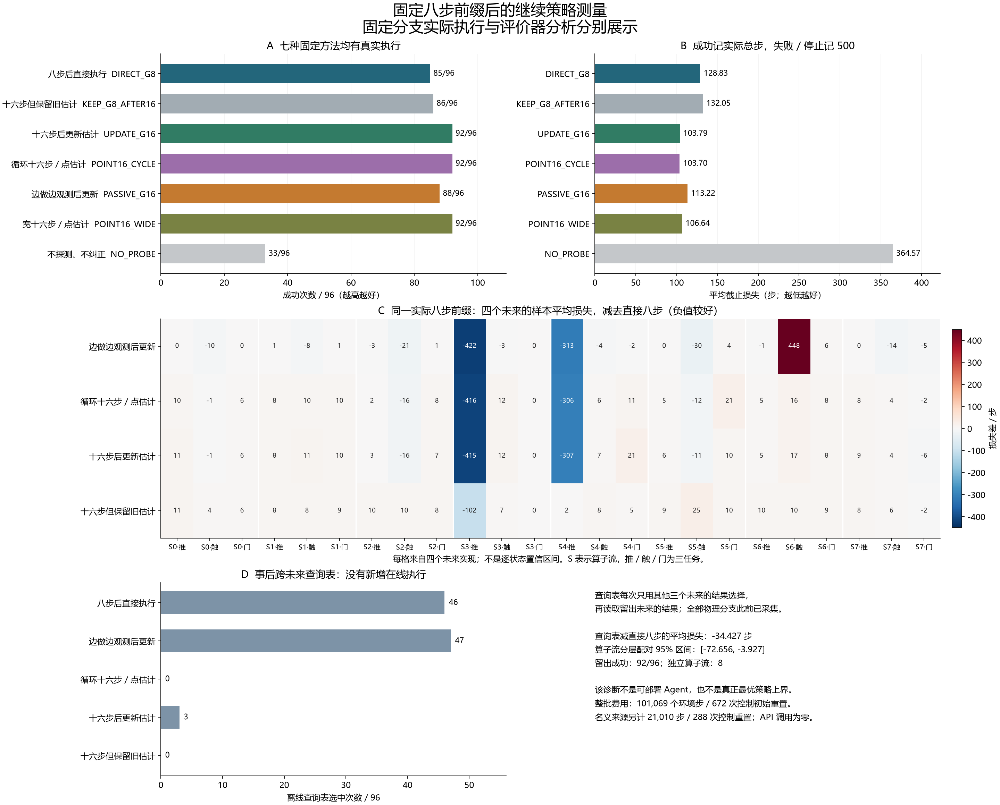

# 固定八步前缀实验的结果与下一步

固定同一段真实八步观察后，如何继续确实存在值得研究的代价差异。用其他三个未来结果作参考的离线查询表，在留出的第四个未来上成功 92/96，平均截止损失为 94.41 步；八步后直接执行为 85/96、128.83 步。但查询表依赖实际 Agent 无法获得的同前缀反事实结果，本轮还没有实现可部署的在线选择方法。

[完整中文报告](conditional_continuation_development_v1.md)保存全部对照、24 个前缀下的四次结果、96 次查询选择、分层和失败案例。[执行审计](../outputs/conditional_continuation/analysis_v1/audit.json)与[补充比较](../outputs/conditional_continuation/diagnostics_v1/comparison.json)可核对下列数字。

## 方法名字怎样读

共同思路是先试动，估计发出指令与实际运动的偏差，再纠正固定任务政策发出的指令。G 或 GAUSS 表示 Gaussian 高斯参考，纠正时也考虑参数估计的不确定性；POINT 表示采用一个点估计值。这里的 Gaussian 参考尚无实际概率或安全保证。

| 方法 | 中文简称及行为 | 成功 / 96 | 平均截止损失 / 步 |
|---|---|---:|---:|
| DIRECT_G8 | 八步后直接执行：试动八步，建立纠正器后做任务。 | 85 | 128.83 |
| KEEP_G8_AFTER16 | 十六步但保留旧估计：再试动八步，仍用第八步的纠正器。 | 86 | 132.05 |
| UPDATE_G16 | 十六步后更新：用全部十六步试动数据更新后做任务。 | 92 | 103.79 |
| POINT16_CYCLE | 循环十六步点估计：同一八步程序重复两遍，再做点估计纠正。 | 92 | 103.70 |
| PASSIVE_G16 | 边做边观测：试动八步后，实际做任务八步，再更新并继续。 | 88 | 113.22 |
| POINT16_WIDE | 宽十六步点估计：四个方向各试动四步，再做点估计纠正。 | 92 | 106.64 |
| NO_PROBE | 不探测、不纠正，直接做任务。 | 33 | 364.57 |

成功时，截止损失就是包含探测的实际总步数；失败或停止记 500。所有失败都保留在分母。PASSIVE 后八步属于真实任务动作，计入 500 步预算，不能算成免费观测。

## 这次怎样比较

八个新算子流、三个任务组成 24 个八步前缀上下文。每个上下文都实际重复同一段前八步，再接四种独立的后续噪声。每个分支只有一次初始重置，从探测连续执行到任务结束；没有复制模拟器状态或在中途重新播种。

这让比较针对“已经看到了这八步之后，继续是否划算”。前八步相同的五种可选继续方式是直接执行、保留旧估计、更新十六步估计、循环十六步点估计，以及边做边观测。原宽十六步和不探测是总体对照，不能被当成已经走完共同八步后还能选择的分支。

独立审计核对 274,522 条事件、650 个冻结 Git 输入和 440 个库源或资产绑定；480 对跨方法前缀、504 对跨未来前缀全部通过。补充核对中，UPDATE 与 KEEP、UPDATE 与循环点估计的前十六步列明字段共 192 对相同。这是对已声明观测、动作、噪声历史和见证的核查，不是全部隐藏物理状态的证明。

## 离线查询表发现了什么

评价器对每个留出未来，只把同一前缀另外三个未来的各分支损失交给选择函数，选训练平均损失最低的分支，再读取留出结果。所有物理分支在分析前已经采集，因此以下是数据复用诊断，没有新增的在线选择执行。

| 查询表减固定方案 | 平均损失差 / 步 | 算子流分层配对 95% 区间 |
|---|---:|---|
| 八步后直接执行 | -34.43 | [-72.66, -3.93] |
| 十六步后更新 | -9.39 | [-11.09, -7.65] |
| 循环十六步点估计 | -9.29 | [-11.10, -7.60] |
| 边做边观测 | -18.81 | [-56.78, +0.70] |

第一行是冻结的主诊断，其余是冻结后补充的描述性比较，区间未做多重比较校正。循环十六步是本批结果中平均损失最低的固定方案，其“最强”身份也来自事后比较。查询表与它都是 92/96，相差主要体现在步数；查询表相对 PASSIVE 的区间仍包含零，不能宣称全面优越。

96 次查询中，46 次选直接八步，47 次选边做边观测，3 次选十六步更新。独立单位是八个算子流，不能把 96 个重复单元当成 96 个独立算子。每前缀的四次结果均值和范围，也不足以给出逐状态概率保证。

## 收益和失败都在哪里

收益有明显的上下文差异。例如流 3 的推物体任务中，直接八步四次均失败，平均损失为 500；边做边观测四次均成功，平均 77.75 步。流 4 的推物体任务，二者平均损失分别为 398 和 85.25 步。

边做边观测也可能有害：流 6 的到达任务中，直接八步四次成功，平均 51.75 步；PASSIVE 四次均失败，损失为 500。流 3 的开门任务中，六种带纠正的方法四次均失败。上述失败全部保留，不能据此调整当前权重、筛除案例或补跑有利结果；失败原因还需要单独的机制检验。

相同十六步探测之后，UPDATE 相比 KEEP 的平均损失差为 -28.26 步，补充区间 [-61.99, -3.04]。KEEP 相比直接八步却多 3.22 步，区间 [-7.07, +10.09]。数据支持进一步研究信息更新的作用，也说明单纯增加试动并不自动带来收益。

## 费用与后续研究

本轮真实采集共 672 次执行、101,069 个环境步和 672 次控制初始重置；目标工厂另有 33,600 次临时重置，共 34,272 次顶层重置、17,641,345 个完成的模拟请求帧。六种名义模型方法各完整承担既有 21,010 步和 288 次控制重置来源；该来源物理采集只计一次。查询表依赖五分支源的 55,833 个环境步，选中分支的低损失不能被当成已经实现的部署成本节省。

本轮在线 API 调用、自然经验记忆写入和底层政策权重更新均为零。此前的在线 API 闭环与本轮是独立实验，不能把这里的收益归因于 LLM。

下一步需要让选择器只使用任务身份与实际可见的八步历史，在新算子流上真实做到先选择、后执行，并与直接八步、循环十六步、边做边观测等强固定方案竞争。当前查询表不能证明这些可见特征足以预测收益，也不是真正条件最优策略的上界。

本轮完成了连续条件收益的测量前提。新颖方法、独立在线确认、更广泛的故障与任务评估，以及完整论文仍待完成；这些结果不能单独作为 CCF A 水平已经达到的证据。种子 12224–12599 和全部旧保留范围继续不用。
