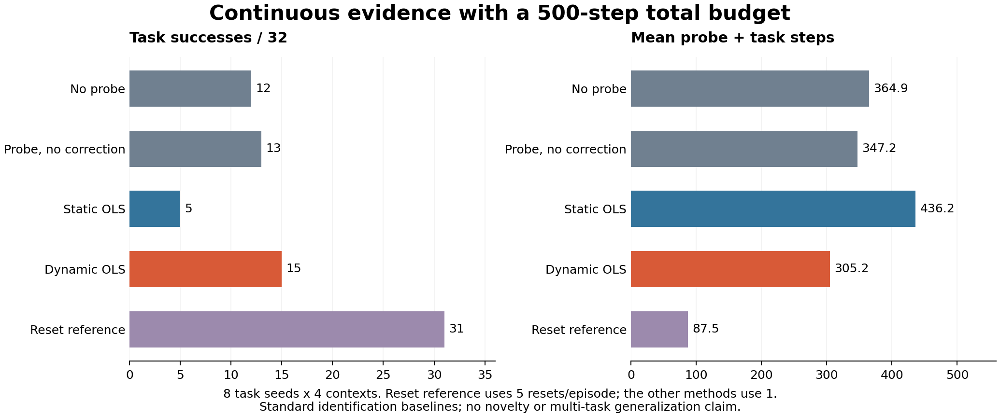

# Continuous identification does not yet establish useful task improvement

The matched-total-budget experiment completed 32 seed/context units and 160
physical method episodes. Its registered status is **COMPLETED_FEASIBILITY_FAILED**.
Dynamic local identification succeeded on 15/32 versus 13/32 for the same
continuous probe without correction; the registered interval includes zero.
Static identification was actively harmful in this sample. All continuity,
decision replay, cost, and provenance audits passed.

## Complete comparison

Each method receives at most 500 environment steps including its evidence
collection. A 16-step probe leaves 484 task steps. All task states are included;
this is not recovery conditional on initial failure. Eight independent task
seeds are crossed with four bias contexts and per-step Gaussian noise 0.05.

| Method | Success / 32 | Mean total steps | Explicit resets | Numerically valid fits | Mean offset error |
|---|---:|---:|---:|---:|---:|
| No probe | 12 | 364.88 | 32 | n/a | n/a |
| Continuous probe, no correction | 13 | 347.16 | 32 | n/a | n/a |
| Continuous static OLS | 5 | 436.19 | 32 | 32/32 | 0.7965 |
| Continuous dynamic OLS | 15 | 305.16 | 32 | 32/32 | 0.2087 |
| Matched-reset reference | 31 | 87.53 | 160 | 32/32 | 0.0950 |



Offset errors are evaluator-only Euclidean errors in command units. They never
enter decisions. All 32 static/dynamic fits passing numerical rank/response
checks does not establish accurate identification or calibrated confidence.
No method obtains a different success count under the separately reported
equal-484-task-step cap; that secondary budget allows extra probe cost and is
not the promotion criterion.

The two prespecified contrasts against continuous probe without correction are:

- Static OLS: -25.00 percentage points, 97.5% whole-seed bootstrap interval
  [-50.00, 0.00].
- Dynamic OLS: +6.25 percentage points, interval [-9.38, 21.88].

The intervals use eight clusters, retaining all four contexts within each.
They implement the registered two-comparison development screen, not a powered
superiority trial. Neither estimator passes its lower-bound requirement.

## Interpretation and next research decision

All three continuous methods have identical probe trajectories and noise
histories for each seed/context; their task actions then differ only through
the frozen correction decision. Thus the dynamic-versus-no-correction contrast
tests correction information after the same physical probe, rather than
conflating it with free resets. It is currently inconclusive for benefit.

The privileged reference has five resets per method episode, repeated noise
namespaces for directional probes, a different inference formula, and a fresh
task-start state. Its 31/32 result is not a clean estimate of the causal effect
of reset access alone. It also cannot be called equivalent physical-robot
interaction merely because environment-step budgets match.

The static response model ignores transient dynamics; the dynamic model fits
ten coefficients from only fifteen paired xy-increment samples. Their large
offset errors motivate examining transient-model mismatch and finite-sample
identification, but this study does not isolate the relative contributions of
those mechanisms. Do not retune model order, numerical thresholds, probe
duration, correction quantization, or noise on these evaluation seeds.

A substantive next baseline would estimate nuisance dynamics from a separately
registered calibration population and infer the smaller unknown offset online,
comparing with appropriate standard identification methods. Calibration cost,
known nominal conditions, and transfer assumptions must be explicit; an
offline model is not free evidence. It must be evaluated on fresh data against
the same no-probe and probe-motion controls. This is a proposed diagnostic
route, not a claim that calibration solves the problem or supplies novelty.

The present study establishes a functioning continuous-evidence evaluation
contract and a failure of these standard local fits to pass the utility gate.
It does not justify an adaptive selector, memory layer, LLM wrapper, or
publication-ready method. The CCF A objective remains open.

## Provenance and integrity

- Run: `continuous_probe_20261013T103104Z_1092996bcf4f`.
- Source: `1092996bcf4f` (full commit in manifest).
- [Frozen manifest](../outputs/continuous_probe/development_v1/continuous_probe_20261013T103104Z_1092996bcf4f/manifest.json).
- [Machine-readable audit](../outputs/continuous_probe/analysis_v1/audit.json).
- [Generated table](../outputs/continuous_probe/analysis_v1/report.md).

The audit reproduced all 160 decisions from visible evidence, verified 96
continuous handoffs, and replayed RNG consumption for all 47,261 task steps.
Each recorded task before-state hash matches the preceding after-state hash;
the first matches the actual probe-final observation. Actuator RNG digests
match uninterrupted sampling, including the probe's consumed draws. The audit
does not resimulate task dynamics or reconstruct unlogged intermediate state
vectors from hashes. Tests explicitly reject reseeding, a handoff reset,
restarted counters, and forged corrections.

Physical collection used 49,309 steps (including 2,048 probe steps) and 288
explicit environment resets, below the 80,000-step maximum. Every continuous
method uses one environment and one actuator initialization per episode.
All 381 frozen input hashes match their source Git blobs. API calls and memory
writes were zero. Preserve seeds 8700--8707; 8708--8899 remain reserved.

Replay without new simulator interaction, choosing a new audit directory:

```powershell
.\.venv\Scripts\python.exe scripts/analyze_continuous_probe.py `
  --manifest outputs/continuous_probe/development_v1/continuous_probe_20261013T103104Z_1092996bcf4f/manifest.json `
  --output outputs/continuous_probe/analysis_reproduction
```

The implementation passed 605 tests before collection. Five additional
immutable-log audit/tampering tests pass against this completed run; the full
610-test suite is checked before the result commit. Figure generation uses a
separate Matplotlib runtime and leaves the simulator environment unchanged.
