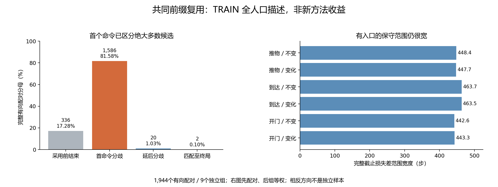

# 控制器共同前缀：TRAIN 全人口事后描述性分析

本报告全部新增分析均为**事后描述性分析**。它检查既有纠正程序能否共享真实前缀，不是独立资格、获取算法、无偏OPE或任务收益试验。

冻结源码 `0272551690b39902cdd275ac6f4f1aa0ae927f4a`；来源 A1 TRAIN 648次、9个独立组。完整保留三任务、两条件、三个干预时点、三获取和四速率；1,944个有向速率配对中，1608个有真实采用入口，336个在采用前结束。相反方向与相关时间步均未当独立样本。

## 主要观察

按独立组等权、完整配对分母：匹配至少1步 1.13%，至少8步 0.10%，完整匹配到终局 0.10%。有入口的组内平均匹配长度 0.094 步，保守截止损失差范围平均宽度 444.878 步。无入口的缺失长度没有填零；前述比例仍保留完整分母。

有入口的1,608个有向配对中，1,586个在首个任务命令立即分歧（98.63%）；仅22个至少匹配一步。两个至少八步且匹配到终局的记录，是同一door-open、不变、时点64、VALIDATE8案例中0.125与0.5速率的一对相反方向，不能称两个独立成功。最大共同前缀为8步。

状态计数：`{"FIRST_DISAGREEMENT": 1606, "MATCHED_TO_TERMINAL": 2, "NO_RATE_ENTRY_EARLY_END": 336}`。

## 全部任务与条件

|任务|条件|有入口／全部配对|≥1步，全分母|≥8步，全分母|终局相同，全分母|有入口平均长度|
|---|---|---:|---:|---:|---:|---:|
|push-v3|UNCHANGED|276/324|0.00%|0.00%|0.00%|0.000|
|push-v3|CHANGED|276/324|0.00%|0.00%|0.00%|0.000|
|reach-v3|UNCHANGED|216/324|0.00%|0.00%|0.00%|0.000|
|reach-v3|CHANGED|192/324|0.00%|0.00%|0.00%|0.000|
|door-open-v3|UNCHANGED|324/324|5.56%|0.62%|0.62%|0.377|
|door-open-v3|CHANGED|324/324|1.23%|0.00%|0.00%|0.062|

## 全部时点与获取联合分层

|任务|条件|时点|获取|有入口／全部|≥1步|≥8步|终局同|平均长度|
|---|---|---:|---|---:|---:|---:|---:|---:|
|push-v3|UNCHANGED|16|CONTINUE|36/36|0.00%|0.00%|0.00%|0.000|
|push-v3|UNCHANGED|16|VALIDATE8|36/36|0.00%|0.00%|0.00%|0.000|
|push-v3|UNCHANGED|16|MOVE_MEASURE|36/36|0.00%|0.00%|0.00%|0.000|
|push-v3|UNCHANGED|32|CONTINUE|36/36|0.00%|0.00%|0.00%|0.000|
|push-v3|UNCHANGED|32|VALIDATE8|36/36|0.00%|0.00%|0.00%|0.000|
|push-v3|UNCHANGED|32|MOVE_MEASURE|36/36|0.00%|0.00%|0.00%|0.000|
|push-v3|UNCHANGED|64|CONTINUE|36/36|0.00%|0.00%|0.00%|0.000|
|push-v3|UNCHANGED|64|VALIDATE8|12/36|0.00%|0.00%|0.00%|0.000|
|push-v3|UNCHANGED|64|MOVE_MEASURE|12/36|0.00%|0.00%|0.00%|0.000|
|push-v3|CHANGED|16|CONTINUE|36/36|0.00%|0.00%|0.00%|0.000|
|push-v3|CHANGED|16|VALIDATE8|36/36|0.00%|0.00%|0.00%|0.000|
|push-v3|CHANGED|16|MOVE_MEASURE|36/36|0.00%|0.00%|0.00%|0.000|
|push-v3|CHANGED|32|CONTINUE|36/36|0.00%|0.00%|0.00%|0.000|
|push-v3|CHANGED|32|VALIDATE8|36/36|0.00%|0.00%|0.00%|0.000|
|push-v3|CHANGED|32|MOVE_MEASURE|36/36|0.00%|0.00%|0.00%|0.000|
|push-v3|CHANGED|64|CONTINUE|36/36|0.00%|0.00%|0.00%|0.000|
|push-v3|CHANGED|64|VALIDATE8|12/36|0.00%|0.00%|0.00%|0.000|
|push-v3|CHANGED|64|MOVE_MEASURE|12/36|0.00%|0.00%|0.00%|0.000|
|reach-v3|UNCHANGED|16|CONTINUE|36/36|0.00%|0.00%|0.00%|0.000|
|reach-v3|UNCHANGED|16|VALIDATE8|36/36|0.00%|0.00%|0.00%|0.000|
|reach-v3|UNCHANGED|16|MOVE_MEASURE|36/36|0.00%|0.00%|0.00%|0.000|
|reach-v3|UNCHANGED|32|CONTINUE|36/36|0.00%|0.00%|0.00%|0.000|
|reach-v3|UNCHANGED|32|VALIDATE8|36/36|0.00%|0.00%|0.00%|0.000|
|reach-v3|UNCHANGED|32|MOVE_MEASURE|36/36|0.00%|0.00%|0.00%|0.000|
|reach-v3|UNCHANGED|64|CONTINUE|0/36|0.00%|0.00%|0.00%|缺失|
|reach-v3|UNCHANGED|64|VALIDATE8|0/36|0.00%|0.00%|0.00%|缺失|
|reach-v3|UNCHANGED|64|MOVE_MEASURE|0/36|0.00%|0.00%|0.00%|缺失|
|reach-v3|CHANGED|16|CONTINUE|36/36|0.00%|0.00%|0.00%|0.000|
|reach-v3|CHANGED|16|VALIDATE8|36/36|0.00%|0.00%|0.00%|0.000|
|reach-v3|CHANGED|16|MOVE_MEASURE|36/36|0.00%|0.00%|0.00%|0.000|
|reach-v3|CHANGED|32|CONTINUE|36/36|0.00%|0.00%|0.00%|0.000|
|reach-v3|CHANGED|32|VALIDATE8|24/36|0.00%|0.00%|0.00%|0.000|
|reach-v3|CHANGED|32|MOVE_MEASURE|24/36|0.00%|0.00%|0.00%|0.000|
|reach-v3|CHANGED|64|CONTINUE|0/36|0.00%|0.00%|0.00%|缺失|
|reach-v3|CHANGED|64|VALIDATE8|0/36|0.00%|0.00%|0.00%|缺失|
|reach-v3|CHANGED|64|MOVE_MEASURE|0/36|0.00%|0.00%|0.00%|缺失|
|door-open-v3|UNCHANGED|16|CONTINUE|36/36|0.00%|0.00%|0.00%|0.000|
|door-open-v3|UNCHANGED|16|VALIDATE8|36/36|0.00%|0.00%|0.00%|0.000|
|door-open-v3|UNCHANGED|16|MOVE_MEASURE|36/36|0.00%|0.00%|0.00%|0.000|
|door-open-v3|UNCHANGED|32|CONTINUE|36/36|0.00%|0.00%|0.00%|0.000|
|door-open-v3|UNCHANGED|32|VALIDATE8|36/36|0.00%|0.00%|0.00%|0.000|
|door-open-v3|UNCHANGED|32|MOVE_MEASURE|36/36|44.44%|0.00%|0.00%|2.944|
|door-open-v3|UNCHANGED|64|CONTINUE|36/36|0.00%|0.00%|0.00%|0.000|
|door-open-v3|UNCHANGED|64|VALIDATE8|36/36|5.56%|5.56%|5.56%|0.444|
|door-open-v3|UNCHANGED|64|MOVE_MEASURE|36/36|0.00%|0.00%|0.00%|0.000|
|door-open-v3|CHANGED|16|CONTINUE|36/36|0.00%|0.00%|0.00%|0.000|
|door-open-v3|CHANGED|16|VALIDATE8|36/36|0.00%|0.00%|0.00%|0.000|
|door-open-v3|CHANGED|16|MOVE_MEASURE|36/36|0.00%|0.00%|0.00%|0.000|
|door-open-v3|CHANGED|32|CONTINUE|36/36|0.00%|0.00%|0.00%|0.000|
|door-open-v3|CHANGED|32|VALIDATE8|36/36|0.00%|0.00%|0.00%|0.000|
|door-open-v3|CHANGED|32|MOVE_MEASURE|36/36|5.56%|0.00%|0.00%|0.333|
|door-open-v3|CHANGED|64|CONTINUE|36/36|0.00%|0.00%|0.00%|0.000|
|door-open-v3|CHANGED|64|VALIDATE8|36/36|5.56%|0.00%|0.00%|0.222|
|door-open-v3|CHANGED|64|MOVE_MEASURE|36/36|0.00%|0.00%|0.00%|0.000|

完整12个有向速率面板、逐组指标、缺失原因、每个影子命令与实际另一分支核对均保存在同目录汇总和逐行文件，不选择有利任务/速率。

## 方法、独立核对与限制

从真实获取返回后的公开观测、携带积分和原始固定政策动作开始复算。命令逐项float32精确一致才消费该步事实回执；首次不同不读取其后继观测或下一行。完整匹配到终局才说明同一已保存初态/噪声耦合上的结果相同。标量PI公式独立重建；实际另一速率的真实公共前缀、第一分歧命令与保存的原生状态/游标见证逐对核对。见证不构成新的物理复现或一般安全证明。

尚未结束的前缀只给出剩余截止损失的宽范围，不插补未来轨迹。该范围不是置信区间。实际两个分支的结果差只在评估端验证范围；不得用后见结果训练/选择。实际成功转失败和失败转成功的有向配对分别为 61 和 61，分母为全部1,944配对（其中有入口1608）。两方向相关且重复计同一对，不是独立因果样本或新方法错误更新率。

控制器当前命令相同仍不能推出延后获取最优：移动可能在命令分歧前改变接触、可观测性、验证费用或以后可访问的位置。本次没有估计这些机会，不能因此部署“等到分歧才获取”的规则。公共观测也没有被证明为充分Markov状态。

## 费用与后续判断

新增环境/重置/控制步/物理帧/固定政策查询/拟合/在线LLM API全部为0。实测主规划入口 48315 次、独立标量公式 48315 次。主入口还会为序列化/哈希/回执重复计算PI数值，按冻结实现静态复算为 236757 次（不是运行时逐函数计数）。这些均无拟合。主分析 91.147 秒，独立汇总审计另记。历史TRAIN实际来源648次、77,563控制步、33,048全部重置、16,911,815物理帧单列，未当本次新增费用。

**后续决定：当前证据不足以支持依靠共同前缀节省采集，将本版路线封存，不追加该路线的机器人样本、动作容差或选择器。**这是对全人口描述结果与已有方法边界的研究判断，不是假装预注册显著性门失败；非零前缀确实存在，不能报告为完全没有结构。若未来提出不同机制，仍需超越标准重放/DR的具体资源差别、获取机会变化的可检验解释和独立自身历史完整任务试验。本次不训练模型、调整旧QUAL阈值、改变原六项比较或新增机器人采集。灰箱及其他失败预测器继续封存；A主线及CCF A完整目标保持，尚未完成。

冻结检查：20项新增纯数组测试通过，原2,428项按源码/回执哈希复用，共2,448项唯一检查。第一次开发检查11项错误来自元组/列表结构比较，未读取实际轨迹；原失败日志与修正前代码保留。编译、依赖、秘密、差异及实际索引字节回执随阶段交付。

来源：[冻结协议](../docs/protocols/controller_agreement_v1_zh.md)、[决定与查新](../docs/research/controller_agreement_decision_v1_zh.md)、[完整汇总](../outputs/controller_agreement/feasibility_v1/summary.json)、[独立统计审计](../outputs/controller_agreement/feasibility_v1/presentation/independent_statistics_audit.json)。

结果交付首次索引字节检查检出了PowerShell日志CRLF被Git规范化。原始日志字节以确定性gzip和SHA保留，规范日志转LF；失败记录及两个交付脚本保留。未改科学数据、统计、冻结方法或重复分析。
