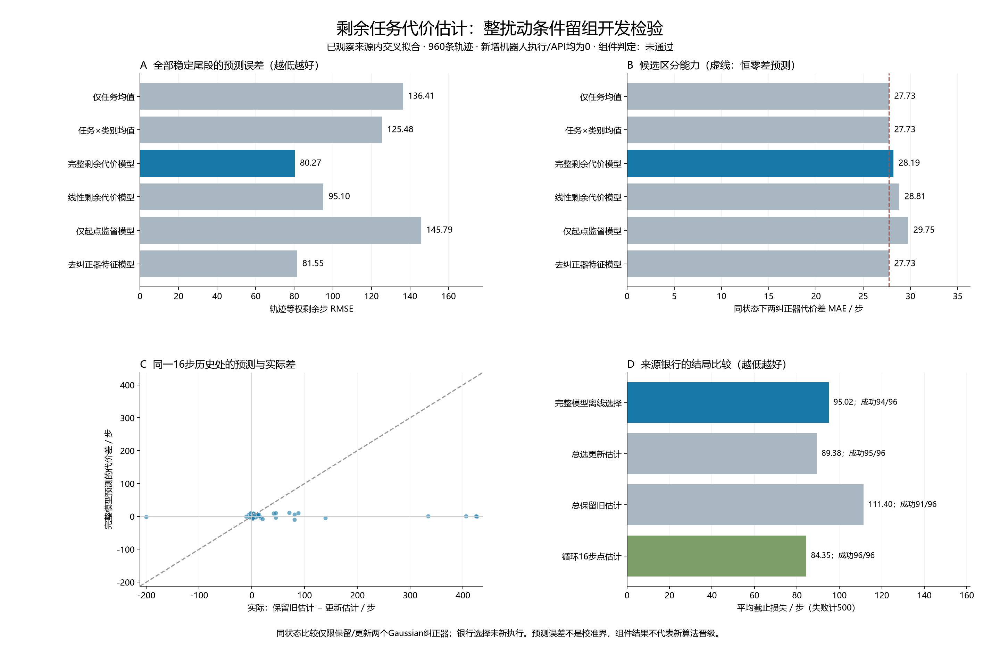

# 纠正方式与剩余任务代价：开发检验

本轮训练了一个预测‘继续使用某个纠正器，还要付出多少任务代价’的标准回归组件。它使用已完成的轨迹做整扰动条件留组交叉拟合；没有新增机器人执行，也没有在线API参与。

冻结组件检验结果：**未通过**。这只是已观察来源内的开发结果，不构成新算法、独立确认或CCF A成果。预测误差和离线选择收益在下文分开报告。

完整模型的全轨迹剩余步RMSE为80.27，优于任务×类别均值的125.48；但稳定尾段起点误差反而为178.18对151.72。按模型离线选择为94/96、95.02步，未达到固定更新的95/96、89.38步。因此不把这个冻结候选接入在线控制，也不在本来源上调整阈值或重拟合。

## 数据与方法名字

完整来源含960条轨迹、16个扰动条件、3个任务与2个未来重复；960条提供稳定纠正尾段，共43,020个非终止状态。同一扰动条件的全部轨迹同时留出，每条轨迹的采样权重合计1；相邻状态不当成独立样本。

‘完整模型’同时看当前观测、最近8步请求与响应、候选纠正器的动作行为和剩余预算。RFF是固定随机特征加岭回归；它不是LLM，也不更新底层机器人政策。‘仅起点监督’只用每条轨迹最早一个样本训练；‘去掉纠正器特征’检查收益是否来自区分候选。

标签是最终截止损失减已执行步数。成功按总步计分，失败或停止按500计分；失败处罚与实际执行成本分别保留。训练中可用终局标签，但预测输入不含标签、种子、真实扰动或未来状态。

## 预测与离线选择结果

下表RMSE越低越好。配对MAE衡量预测的‘保留旧估计减更新估计’代价差与实际差的偏差。离线选择只在这两种Gaussian纠正器之间进行；相等时选更新。

| 方法 | 剩余步RMSE | 起点RMSE | 配对差MAE | 选旧估计／96 | 离线成功／96 | 离线平均截止损失 |
|---|---:|---:|---:|---:|---:|---:|
| 仅任务均值（TASK_CONSTANT） | 136.405 | 187.008 | 27.729 | 0 | 95 | 89.375 |
| 任务与纠正器类别均值（TASK_KIND_CONSTANT） | 125.483 | 151.721 | 27.729 | 0 | 95 | 89.375 |
| 完整剩余代价模型（DENSE_RFF） | 80.270 | 178.180 | 28.190 | 38 | 94 | 95.021 |
| 线性剩余代价模型（LINEAR_DENSE） | 95.099 | 170.125 | 28.814 | 41 | 93 | 98.833 |
| 仅起点监督模型（PREFIX_ONLY_RFF） | 145.788 | 160.162 | 29.755 | 42 | 93 | 99.500 |
| 去掉纠正器特征模型（NO_CONTROLLER_RFF） | 81.547 | 197.231 | 27.729 | 0 | 95 | 89.375 |

恒零配对差的MAE为27.729步。总选更新估计为95/96、89.375步；总保留旧估计为91/96、111.396步。

任务均值、任务×类别均值和去纠正器特征模型在同一历史处给出零候选差，审计已验证。这使配对检验能区分‘知道哪类纠正通常好’与‘判断这两个具体纠正器哪个更好’。

这些选择直接读取已执行银行中的结局，没有重新执行一个在线选择器。所有来源已被观察，留组交叉拟合也不是新的独立机器人确认；没有用结果调整特征或参数。

## 冻结判定与强基线

| 组件条件 | 结果 |
|---|---|
| 剩余步RMSE优于任务×类别均值 | 通过 |
| 同状态配对差MAE优于恒零预测 | 未通过 |
| 离线所选代价不高于总选更新 | 未通过 |
| 离线成功数不低于总选更新 | 未通过 |

同批已执行的强固定基线‘循环16步点估计纠正’（POINT16_CYCLE）仍为96/96、平均84.354步。组件判定不是对这一强基线的算法晋级门；不能只与较弱对照比较后宣称新方法收益。

## 失败与误判

来源全部240条任务失败／停止均保存在[source_failures.json](../outputs/controller_tail_value/report_v1/source_failures.json)。完整模型相对总选更新有13次代价改善、20次代价变差；全部配对结局、改善和伤害均保留，不只展示有利例子。

以下是完整模型剩余步预测RMSE最大的10条轨迹，失败仍属于评估总体。

| 扰动条件 | 任务 | 重复 | 来源方法 | 实际成功 | 截止损失 | 预测RMSE |
|---:|---|---:|---|---|---:|---:|
| 10 | door-open-v3 | 1 | NO_PROBE | False | 500 | 237.384 |
| 10 | door-open-v3 | 0 | NO_PROBE | False | 500 | 237.271 |
| 10 | door-open-v3 | 1 | IDENTITY_AFTER8 | False | 500 | 235.238 |
| 10 | door-open-v3 | 0 | DIRECT_G8 | False | 500 | 235.033 |
| 10 | door-open-v3 | 1 | DIRECT_G8 | False | 500 | 234.237 |
| 10 | door-open-v3 | 0 | UPDATE_G16 | False | 500 | 233.074 |
| 10 | door-open-v3 | 0 | PASSIVE_G16 | False | 500 | 232.092 |
| 10 | door-open-v3 | 1 | KEEP_G8_AFTER16 | False | 500 | 230.700 |
| 10 | door-open-v3 | 0 | KEEP_G8_AFTER16 | False | 500 | 229.995 |
| 5 | push-v3 | 0 | KEEP_G8_AFTER16 | False | 500 | 225.166 |

关键伤害案例：扰动条件4、push-v3、重复1。模型预测保留旧估计会少花0.855步，因而选择旧估计；实际旧估计500步失败，更新估计74步成功。这是一次已保存配对结局中的误选，不能用事后改选或确定性方法替换掩盖。

## 成本与审计

新增环境步／重置／API调用均为0。标准价值回归拟合为192个留组模型和3个全来源非部署参考，提取耗时83.56秒、拟合耗时1.90秒，模型归档498,118字节。常数模型另为训练统计。控制器拟合和政策权重训练为0。

复用轨迹的完整采集费用是180,930个环境步、960次受控重置，另有48,000次工厂等重置，共48,960次、25,384,650个完成的请求仿真帧。已有名义模型来源21,010步／288次受控重置另列。两者均为之前已支付的物理费用，不能把本轮零新增仿真说成免费数据或自然在线记忆。

独立重建审计通过：43,020个状态、3,871,800个特征数值、195次回归正规方程与96对实际16步共同前缀。来源绑定36个文件与671个冻结输入。审计复用旧公共纠正器命令数学、来源认证与NumPy，未声称独立物理模型。

[起点与全轨迹误差为何不同](../outputs/controller_tail_value/report_v1/decision_weighting_note.md)给出本轮权重下的标准换测度解释。

经验预测误差不是价值误差上界。固定纠正器一直执行的尾价值也不同于‘有限新动作后回旧基准’的价值；后继历史支持、误差适用域、收益证明和独立前瞻实验仍未完成。政策表示进入价值函数与RFF都是已有方法，见[问题与原文对照](../docs/research/controller_tail_value_question_v1.md)。

[冻结协议](../docs/protocols/controller_tail_value_development_v1.md)、[机器可读结果](../outputs/controller_tail_value/report_v1/report.json)、[独立审计](../outputs/controller_tail_value/audit_v1/audit.json)、[全部轨迹误差](../outputs/controller_tail_value/report_v1/episode_errors.json)。

运行 `controller_tail_value_20261015T145802Z_66d8e210a9f5`；清单 `ed24ee4f184e47fdfc90da040b27f0a1557ac2d04a43d0aae23063431fd0c9d6`；冻结提交 `66d8e210a9f52bfd90263ecce17c2406cbcfd9dd`。
