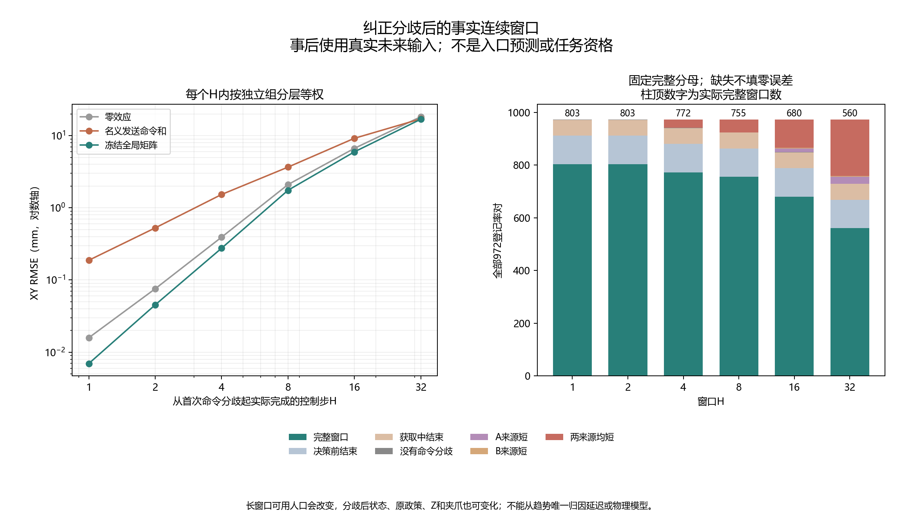

# A线：真实纠正后果的时间尺度诊断 v1

本报告**全部新增分析为事后描述性**。来源是已运行的MetaWorld仿真，不是实机测量。检查的是两条实际执行程序的后续命令与净位移一致性；**使用了实际未来命令，不是入口时的多步预测，不提供模型、任务收益或新颖性资格**。原成对上下文版本负结果保持关闭，原生资格仍FAILED_RETAINED。

## 完整结果与读表边界

冻结提交 `e5a3c3c155037fb446eed8c20cc2c87c93ac1d6e`；运行 `outputs/correction_scope/effect_horizon_v1/run_20261027T072057Z_e5a3c3c15503`。来源仅A1 TRAIN648执行、9独立组、54任务条件单元、162获取节点。四个已执行率构成972对，固定六窗共5832行；全部保留，其中每个H都有相同972登记分母。没有重新拟合或查询旧成对上下文模型，冻结全局矩阵只作标准一致性参考。

| 窗口H | 完整窗口／972 | 可用组 | 零效应RMSE mm | 名义发送和RMSE mm | 冻结矩阵RMSE mm | Z/夹爪发生差异权重 |
| --- | --- | --- | --- | --- | --- | --- |
| 1 | 803/972 | 9 | 0.0158723 | 0.187825 | 0.00697127 | 0.000% |
| 2 | 803/972 | 9 | 0.0756416 | 0.527091 | 0.0452961 | 61.626% |
| 4 | 772/972 | 9 | 0.39225 | 1.53104 | 0.276009 | 58.951% |
| 8 | 755/972 | 9 | 2.09822 | 3.66276 | 1.75042 | 57.716% |
| 16 | 680/972 | 9 | 6.66645 | 9.18513 | 5.95874 | 68.179% |
| 32 | 560/972 | 9 | 18.2672 | 17.0627 | 16.8694 | 92.747% |

最直接的证据是：首步矩阵RMSE约 **0.00697127 mm**；第2步窗口为 **0.0452961 mm**，两行均有803对，尚不存在这两行之间的短轨迹分母变化。但第2步已有 **61.626%** 的层级加权案例发生Z/夹爪差异，因此不能把误差增加唯一归因延迟或同一XY增益。32步窗口只有560/972对，冻结矩阵RMSE **16.8694 mm**；名义和参考为 **17.0627 mm**。这些数值都来自实际未来输入条件下的检查，未证明入口预测能力。

RMSE是先按组→可用任务条件→获取节点→率对等权的XY平均MSE再开根，归一化位移乘10换算mm。每H完整窗口的人口不同，不能把这些行当作相同对象的时间趋势或唯一延迟证据。全部1944任务×条件×时点×获取×率对×H单元及2214面板已导出；无完整窗口的误差保留null/CSV空白。

| H | ACQUISITION_TERMINAL | BEFORE_DECISION_TERMINAL | BOTH_SOURCES_SHORT | COMPLETE_FACTUAL_WINDOW | NO_SENT_DIFFERENCE | SOURCE_A_SHORT | SOURCE_B_SHORT |
| --- | --- | --- | --- | --- | --- | --- | --- |
| 1 | 60 | 108 | 0 | 803 | 1 | 0 | 0 |
| 2 | 60 | 108 | 0 | 803 | 1 | 0 | 0 |
| 4 | 60 | 108 | 31 | 772 | 1 | 0 | 0 |
| 8 | 60 | 108 | 48 | 755 | 1 | 0 | 0 |
| 16 | 60 | 108 | 106 | 680 | 1 | 14 | 3 |
| 32 | 60 | 108 | 214 | 560 | 1 | 26 | 3 |

决策前结束、获取结束、始终没有命令分歧，以及A/B/两来源不足H步均分开；没有用短轨迹冒充长窗口，也没有将成功后的状态虚拟延长。H=1与原803对零效应/名义/全局矩阵保存结果核对通过。未来输入目的为ENTRY_FORECAST时接口拒绝。

## 计算的物理意义

从共同首分歧前状态起，以两个实际末端位置差除0.01为D_H，以两条实际XY发送命令差逐步累加为U_H，比较0、U_H和U_H J_g。J_g是旧训练时未使用当前组g的冻结全局矩阵。两个位置均真实发生，无未执行后缀、环境恢复或新动作。

H>1时，U_H里的后续动作在入口处尚不可知；这是**事后给定实际输入的一致性检查**。即使误差很小，也不能宣称事前已预测未来政策动作、后继状态或纠正效果；误差很大，也不能唯一归因物理增益、瞬态、接触、噪声或其他隐藏状态。分歧后原政策、状态、Z与夹爪均可能不同，完整差异步数已保存。Z/夹爪与原策略差异按保存的float32字节比较；该比例只表示至少一处字节不同，没有度量变化幅度或其因果效应。更长窗是两个真实闭环程序的实现后果，不能当作每步相同状态下的局部命令效果。

当前没有接触力/接触对，未做无噪声物理对照，不能将剩余误差称无噪声物理误差。私有实际施加动作/真实扰动不进入模型；没有改变原命令的加噪/裁剪顺序。三个参考输出不作反演、稳定性或安全保证。

## 三任务完整展示

下表误差是归一化XY位移平方MSE；全部组、条件、时点、获取及六率对见 `presentation/all2214_panels.csv` 和 `full1944_strata.json`，全部5832行见 `all5832_windows.csv`。不按窗口、任务或是否成功筛掉负结果。

| 任务 | H | 完整窗口／登记 | 可用组 | ZERO_EFFECT | NOMINAL_SENT | FROZEN_GLOBAL_MATRIX |
| --- | --- | --- | --- | --- | --- | --- |
| door-open-v3 | 1 | 323/324 | 9 | 3.4903626e-06 | 0.00049741673 | 8.4623969e-07 |
| door-open-v3 | 2 | 323/324 | 9 | 8.4832041e-05 | 0.0039235383 | 4.0371418e-05 |
| door-open-v3 | 4 | 322/324 | 9 | 0.0017528991 | 0.030546258 | 0.00093317004 |
| door-open-v3 | 8 | 317/324 | 9 | 0.046685893 | 0.15414149 | 0.033882814 |
| door-open-v3 | 16 | 294/324 | 9 | 0.3678266 | 0.91171771 | 0.31168023 |
| door-open-v3 | 32 | 258/324 | 9 | 3.8072971 | 4.3928544 | 3.4112668 |
| push-v3 | 1 | 276/324 | 9 | 1.3689481e-06 | 0.00020393031 | 2.0313906e-07 |
| push-v3 | 2 | 276/324 | 9 | 3.0808434e-05 | 0.0016339617 | 6.9664663e-06 |
| push-v3 | 4 | 264/324 | 8 | 0.001080152 | 0.015600224 | 0.00049466083 |
| push-v3 | 8 | 252/324 | 7 | 0.032883972 | 0.048457358 | 0.022705999 |
| push-v3 | 16 | 247/324 | 7 | 0.55964412 | 0.21522385 | 0.44564614 |
| push-v3 | 32 | 205/324 | 7 | 3.9907768 | 0.83985548 | 3.3296344 |
| reach-v3 | 1 | 204/324 | 6 | 2.5146613e-06 | 0.00029713079 | 1.4792187e-07 |
| reach-v3 | 2 | 204/324 | 6 | 5.1926653e-05 | 0.002368421 | 1.0506275e-05 |
| reach-v3 | 4 | 186/324 | 6 | 0.001564789 | 0.021052187 | 0.00068219077 |
| reach-v3 | 8 | 186/324 | 6 | 0.041873032 | 0.15982764 | 0.025766629 |
| reach-v3 | 16 | 139/324 | 5 | 0.52073908 | 0.6688952 | 0.37124677 |
| reach-v3 | 32 | 97/324 | 4 | 1.8366606 | 1.4120434 | 1.3879549 |

相关率对不当独立样本，不用时间步增加独立组数，也不根据这些事后指标作显著性或新的通过门槛。原六项比较只检查来源字节未变，CAL/TEST/旧QUAL内容未用于本轮分析、选择或拟合。

## 审计、费用与复算

主窗口、面板、来源组装与首分歧函数在独立实现中禁用；独立流读取、struct字节首差、标量累计、矩阵方向、全5832行、2214面板、组权重和缺失核对通过。共享旧JSON解析、NumPy来源权重参考/容差及模拟源记录，属于第二实现审计，不是独立实验机构或物理重模拟。

主/独立各读取冻结矩阵9次，各评价 **4373** 个完整窗口及 **8746** 次零/名义确定性参考。主分析 25.348秒，独立 24.397秒。新增环境创建、重置、控制步、物理帧、机器人种子、固定政策查询、模型拟合和在线LLM API均 **0**，守卫计数和完整来源SHA随receipt保存。

历史来源648次/77,563步/33,048全部重置/16,911,815物理帧，以及旧36科学拟合和36独立重拟合另列已付费用。12新增纯数组测试、2次开发运行均0拟合/物理/API，重复不增唯一项；按源码哈希复用旧2216项，合计2228唯一，旧六张量组另列。原始记录、分片、失败和恢复副本保留。

复算入口 `scripts/run_correction_effect_horizon_v1.py`，主/独立源码、配置和冻结协议均提交。每阶段意图先保存，失败保留、不自动重跑。结果提交前核对编译/依赖、全仓秘密和新增实际索引补充扫描、普通/暂存差异以及Git/磁盘字节；归档仅是保存习惯，不计研究成果。

## 后续决定与查新

本轮没有设置方法通过门槛，也不产生晋升资格。**不能从首分歧一步预测进步直接解锁纠正控制；也不能从事后输入条件检查通过，跳过真正入口预测与独立自身历史任务评价。** 若长窗出现失配，尚需区分状态/反馈/Z与夹爪/接触/时间效应，不能据此调旧ridge或宣称某个唯一新响应模型必要。保持成对上下文、ARX、F20、旧响应/原生失败关闭。

付费获取空间此前已有完整TRAIN事后包络：P优于免费家族F仅4/54，且415/433步正向差集中在组4。本轮不重复估算或把未来最优当可部署策略。后续必须同时超过完整免费反馈、廉价固定率、DIRECT_C8、积分、始终获取/不更新、标准检测/历史辨识、任务相关获取及完整成本Q/DR参考；不能缩小强对照来通过。

新增查新：联合物理状态与未知参数的信息获取规划已有[MIAC rho-POMDP](https://arxiv.org/html/2505.09119v1)；任务相关实验设计已有[NeurIPS2023 Optimal Exploration](https://papers.neurips.cc/paper_files/paper/2023/hash/31e018f43ab9c7065c058cc2c5848128-Abstract-Conference.html)。只读官方摘要和指定方法段，未完整复现或移植保证。原MDE/Residual RL/OCCAM/GAUGE/Poke/TOM与stateful performativity/VoSI/SPO等对照继续有效，不能把“获取改变状态”或改变预测尺度本身当新贡献。

新训练/采集仍须先形成具体可证伪机制、与同权限强组合参考的区别，以及独立TRAIN/CAL/自身时序资格、全部失败处理和费用协议。本轮既不解锁新采集，也不把完整研究目标缩成诊断。算法新颖性、独立完整成本任务优势、消融与CCF A目标均未完成。
