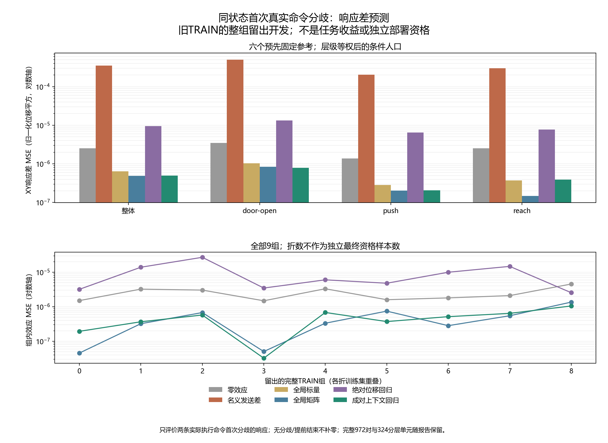

# A线：真实命令分歧响应差与标准回归开发 v1

本报告全部新增分析属于**旧 TRAIN 上的事后描述性分析和标准构件开发**。结论：**未通过预先固定的开发点比较，封存本版本负结果**。这不改变旧响应资格、ARX/F20负结果或原六项统计比较，也没有建立独立部署收益、算法新颖性或 CCF A 论文贡献。

## 来源、目标及完整分母

仅使用 A1 TRAIN 的648次已执行轨迹、9独立组、54任务/条件单元、162获取节点；CAL、TEST、旧QUAL和最新54次原生数据均未用于本次拟合。冻结提交 `db04aa83cabc68336ffff5f334db9528de70a55c`，运行 `outputs/correction_scope/effect_learning_v1/run_20261027T064624Z_db04aa83cabc`。每节点四个已执行积分率0.125/0.5/2/8构成六对，完整登记972对。

| 972 对完整分母中的状态 | 对数 |
| --- | --- |
| ACTUAL_DIVERGENCE | 803 |
| BEFORE_DECISION_TERMINAL | 108 |
| ACQUISITION_TERMINAL | 60 |
| NO_SENT_DIFFERENCE | 1 |

只有首次实际float32发送命令不同且共同历史完整的 **803对** 有一步效应目标。其余对没有定义该目标，不补零，也不解释为预测失败或成功。表中MSE仅针对这部分条件人口。完整972行及全部324个任务×条件×时点×获取×率对单元分别见 `presentation/all972_pair_register.csv`、`full_strata_324.csv`；零可用单元误差留空，所有组与缺失原因保留。

核对四率的初始native/Python/RNG见证、同外生扰动与噪声承诺、共同获取返回点、相同发送命令和真实响应前缀、首分歧时物理时钟、同原始策略动作和Z/夹爪命令。只比较两个确实发生的下一观测，不生成未执行后缀。历史只取时点前两次已完成的真实转移。

目标是 Δd=(nextB−current)/0.01−(nextA−current)/0.01。它是保存的共同随机量实现下的有限命令响应差，不是无噪声物理误差、总体平均处理效果或任务收益。数值单位为归一化位移平方；换算XY平均mm²需乘100。此目标与旧绝对响应资格、F20名义跟踪评分的目标和条件人口不同，不能横向比较误差数值宣称旧问题解决。

## 六个标准参考及固定比较

ZERO_EFFECT预测零变化；NOMINAL_SENT直接用发送命令差Δu，代表未资格名义映射的动作差。GLOBAL_SCALAR和GLOBAL_MATRIX分别是全局一个增益及2×2矩阵；ABSOLUTE_CONTEXT在同一公开数据上回归两端绝对位移再相减；PAIRED_CONTEXT以公开上下文和Δu交互直接回归响应差。后两者分别48/32列，成对回归本身是标准构件，不称新算法。

固定16维公开上下文、ridge=0.01；只用训练折列RMS，不调参。9折逐整组留出，每折用其余8组训练，覆盖三个任务。每折四种拟合共36次；独立实现用增强lstsq重拟合36次。拆分和统计用组号，模型数值输入不含组、种子、任务名、条件、真实扰动、实际噪声、私有状态或任务结局。响应差标签来自公开观察，真实参数/噪声/实际施加动作隔离在诊断文件。

权重为组→可用任务/条件→获取节点→率对逐层等权。六对相关比较不当独立样本，重叠训练的9个LOO折也不当独立最终资格。不提供由这些重叠折伪造的最终置信保证。

| 方法 | 整体效应 MSE↓ | door-open-v3 | push-v3 | reach-v3 |
| --- | --- | --- | --- | --- |
| ZERO_EFFECT | 2.51930204e-06 | 3.49036264e-06 | 1.3689481e-06 | 2.51466127e-06 |
| NOMINAL_SENT | 0.000352781274 | 0.000497416728 | 0.000203930315 | 0.000297130789 |
| GLOBAL_SCALAR | 6.45806991e-07 | 1.03260248e-06 | 2.8321245e-07 | 3.73355576e-07 |
| GLOBAL_MATRIX | 4.85985932e-07 | 8.46239685e-07 | 2.03139061e-07 | 1.47921871e-07 |
| ABSOLUTE_CONTEXT | 9.54855866e-06 | 1.32081915e-05 | 6.45695836e-06 | 7.72595959e-06 |
| PAIRED_CONTEXT | 4.93326986e-07 | 7.91377213e-07 | 2.05738726e-07 | 3.90505655e-07 |

固定主规则要求PAIRED_CONTEXT整体及每个任务均严格低于ZERO_EFFECT、GLOBAL_MATRIX和ABSOLUTE_CONTEXT。判定为 `NO_DEV_PREDICTIVE_ADVANTAGE`；没有按其他指标、子任务或最佳折替代门槛。

成对上下文整体MSE相对全局矩阵为 **+1.511%**。这是固定点比较的失败，不据此宣称总体统计显著劣势。明显优于名义映射或同数据绝对回归，不能替代超过指定简单强参考的要求。

| 整组 | 有分歧／登记 | ZERO_EFFECT | NOMINAL_SENT | GLOBAL_SCALAR | GLOBAL_MATRIX | ABSOLUTE_CONTEXT | PAIRED_CONTEXT |
| --- | --- | --- | --- | --- | --- | --- | --- |
| 0 | 108/108 | 1.50785e-06 | 0.000150711 | 1.87019e-07 | 4.54745e-08 | 3.19552e-06 | 1.94189e-07 |
| 1 | 108/108 | 3.24167e-06 | 0.000351459 | 5.85978e-07 | 3.22612e-07 | 1.39651e-05 | 3.66894e-07 |
| 2 | 48/108 | 3.03916e-06 | 0.00076382 | 1.04829e-06 | 6.78564e-07 | 2.71044e-05 | 5.76887e-07 |
| 3 | 108/108 | 1.49105e-06 | 0.000170595 | 1.82585e-07 | 5.03862e-08 | 3.48474e-06 | 3.23881e-08 |
| 4 | 96/108 | 3.32157e-06 | 0.000540836 | 3.72928e-07 | 3.33375e-07 | 6.02556e-06 | 6.8305e-07 |
| 5 | 47/108 | 1.59995e-06 | 0.000243836 | 9.77534e-07 | 7.46599e-07 | 4.80955e-06 | 3.72338e-07 |
| 6 | 108/108 | 1.80748e-06 | 0.000229588 | 4.2084e-07 | 2.83356e-07 | 1.00043e-05 | 5.16778e-07 |
| 7 | 108/108 | 2.10471e-06 | 0.000301656 | 7.08592e-07 | 5.4899e-07 | 1.47928e-05 | 6.43893e-07 |
| 8 | 72/108 | 4.56028e-06 | 0.00042253 | 1.3285e-06 | 1.36452e-06 | 2.55506e-06 | 1.05353e-06 |

完整任务/条件/时点、获取动作和率对统计保存在机器可复算表中，包括无数据的全部单元。所有36个权重文件、逐对六方法预测、独立参数核验和全人口登记均保留。

## 名义动作语义与噪声诊断

按同一层级权重，名义发送差误差 **0.000352781274**，实际施加动作差代入误差 **0.000316480655**，零效应误差 **2.51930204e-06**。独立核对原float32仿射/死区→实际XYZ噪声→最终裁剪链及游标。实际施加动作只用于评估，未用于拟合或模型输入。

实际动作代入改变了输入语义；共同噪声在非线性动力学和裁剪后不必被完全消去。剩余误差不能称物理无噪声误差，误差变化也不唯一识别模型失配、接触、移动瞬态或噪声的贡献。比值分布及零分母缺失见 `diagnostic_summary.json`；比值按相关率对描述，不当独立证据。

另作事后尺度检查：首次分歧发送差L2的中位数/90分位/最大值为 0.0109367/0.0502351/0.112852；对应真实响应差L2为 0.00710111/0.0408654/0.120079 mm。留组全局标量参考为 0.0655798–0.0725276。这只提示当前条件下名义单位增益并不合适，不能把小幅首分歧上的回归斜率称为全局植物参数、全动作域资格或可反演增益。完整九折标量/矩阵与五个尺度分位数均保存。

该实验能检查名义控制差与真实有限响应差是否一致，以及一个简单公开预测器在留组条件人口上是否有预测能力。反证包括全局矩阵、零效应或同数据直接位移参考可能同样好；不能从低误差推出绝对偏置已识别、纠正可安全反演或包含获取成本的任务收益。没有逐步接触力/接触对，不能唯一归因接触过程。

## 审计、费用与旧失败保留

主提取/主特征/主训练/主预测在独立相应审计中被禁用，分别重建首分歧、历史、特征、组权重、增强lstsq权重、留组预测与统计。独立数学和数组复算通过；共享旧执行器公式、NumPy与来源解析明确披露，不称不同机构审计或新的物理重模拟。

新增环境创建、重置、控制步、物理帧、机器人种子、在线LLM API均 **0**。新增36次科学ridge、36次独立重拟合、0神经更新。主与独立各 **4818** 次留出成对模型预测；主保存权重读取 **3212** 次，独立参数核验读取36次，按冻结循环单列。提取/拟合/统计分别耗时 23.791/7.632/0.031秒；对应独立审计 22.145/0.859/0.292秒。完整费用与来源哈希见 `costs.json`、manifest及各阶段receipt。

纯数组测试14项唯一；3次开发测试各自1次合成solve和1次合成lstsq单列，重复运行不增加唯一测试数。源码绑定复用旧2202项，合计2216；旧六张量组另列，不重复仿真。来源648次/77,563控制步/33,048全部重置/16,911,815物理帧为已付历史费用，不隐去也不重复计为本轮。

原生资格仍为 `FAILED_RETAINED`，原审计软件失败及其只读修复记录保留，完整MOVE→测量→保存模型选择→连续执行链仍为0。原ARX/F20/旧响应版本不重开，原始文件、分片、恢复副本、全部缺失和负结果保留。提交前另核对编译、依赖、秘密与补充实际索引扫描、普通及暂存差异、Git/磁盘字节，并记录本地提交及紧凑归档回执。

## 后续判断与查新边界

停止该版成对上下文回归；不调整ridge、特征、子任务或样本量挽救。当前证据不足以支持将此构件用于纠正或解锁新采集。后续研究须提出独立机制，并先对简单全局作用模型与状态历史参考作同权限比较。

当前仍分别缺少绝对响应资格、把纠正后模型适用性用于获取决策的明确机制、与强对照相同预算的独立自身时序历史、全任务成本优势和消融。保持DIRECT_C8、积分、固定廉价率、始终获取/不更新、标准检测与历史辨识、任务相关获取及完整成本Q/DR等参考。标准回归预测进步不能代替这些要求。

已有[MDE模型适用范围学习](https://arxiv.org/html/2401.04007v2)、[Residual RL](https://arxiv.org/abs/1812.03201)、[OCCAM](https://arxiv.org/html/2406.17620v1)、[GAUGE](https://arxiv.org/html/2609.32154v1)、[Poke and Strike](https://proceedings.mlr.press/v305/aoyama25a.html)及[策略相关模型TOM](https://proceedings.mlr.press/v211/ma23a.html)限制可主张范围：门控、残差混合、控制器表现预测、任务相关校准与探测、策略分布匹配均不能仅改名。共享随机量、成对回归、约束线性作用或重加权也不作为本轮新颖性。这里只作官方来源的部分阅读对照，没有声称完整复现或移植保证。

完整CCF A研究目标继续活跃，本次交付不是目标完成。
