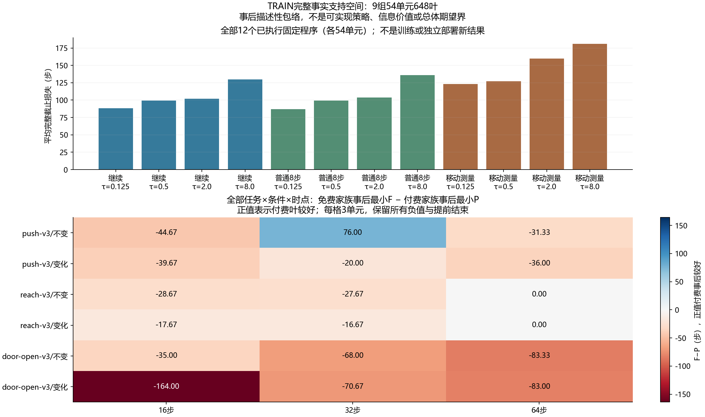

# A线完整事实程序支持审计 v1

**全部新增分析为事后描述性。** 本轮不训练、选择或部署新方法；新增环境创建/重置/控制步/物理帧、原政策查询、机器人种子、模型拟合和在线LLM API均为0。

实现、配置、预算与审计协议先在 `54295d2a7dd9e13c575a5f27f5e474c2f2e33a12` 冻结提交，之后才读取TRAIN计算这些统计。来源为全部9组54单元648个真实已执行程序，没有解析CAL/TEST数值，旧统计和原资格结论保持不变。原始大记录及恢复副本保留。

## 这次回答的问题与主要数字

对每个单元，B是固定CONTINUE/0.5；F0是四个CONTINUE叶的事后最小，F8是四个VALIDATE8叶的事后最小；F取这八个免费家族叶的最小，P取四个移动测量叶的最小，H取全部12叶的最小。所有并列最小索引均保存。VALIDATE8正常任务步骤实际收费，“免费”指没有额外移动测量；成功损失为全部实际步数，失败为500，获取费用已计一次。

|事后包络（不是部署策略）|平均完整损失|等损失最小叶成功数范围|
|---|---|---|
|CONTINUE|85.0741|53–53/54|
|VALIDATE8|81.2037|53–53/54|
|FREE|80.9074|53–53/54|
|MOVE|119.259|53–53/54|
|ALL|72.8889|54–54/54|

固定B平均完整损失99.4259步。P优于F／差于F／相同为 **4／42／8（全部54）**；F−P平均-38.3519步（正值表示付费事后最小较好）。加入付费候选后F−H平均8.01852步。

确有4个单元存在付费叶降低免费家族事后最小的例子，故不能把前轮接收者失败解释为所有付费候选都不可能有作用。这些例子由未来结果选出，尚未证明能在行动前识别；也不能据此挑有利任务或对旧人口增加门控。

### 全部付费事后较好的案例（仍以54为总分母）

|组|任务|条件|时点|免费最小F|付费最小P|实现差F−P|
|---|---|---|---|---|---|---|
|0|reach-v3|CHANGED|16|86|70|16|
|4|push-v3|CHANGED|32|203|140|63|
|4|push-v3|UNCHANGED|32|500|148|352|
|6|reach-v3|CHANGED|16|82|80|2|

正向差集中在组0/4/6：16/415/2步，组4占全部433步正向差的415步。其中一个免费家族全部失败的案例贡献352步。该集中现象是事后描述，不能把同组两条件当独立复现；全部42个负向、8个平局和所有18格仍完整保留。

## 全部12个固定程序

|程序|速率τ|成功/54|平均完整损失|实际来源步数|移动步数|测量/普通验证步数|
|---|---|---|---|---|---|---|
|CONTINUE|0.125|52/54|88.2037|4763|0|0|
|CONTINUE|0.5|51/54|99.4259|5369|0|0|
|CONTINUE|2.0|52/54|101.926|5504|0|0|
|CONTINUE|8.0|49/54|129.722|7005|0|0|
|VALIDATE8|0.125|52/54|86.8519|4690|0|368|
|VALIDATE8|0.5|51/54|99.4259|5369|0|368|
|VALIDATE8|2.0|52/54|103.759|5603|0|368|
|VALIDATE8|8.0|48/54|136.056|7347|0|368|
|MOVE_MEASURE|0.125|53/54|123.278|6657|1439|320|
|MOVE_MEASURE|0.5|53/54|127.315|6875|1439|320|
|MOVE_MEASURE|2.0|49/54|159.648|8621|1439|320|
|MOVE_MEASURE|8.0|47/54|180.741|9760|1439|320|

## 全部9组，组内单位等权

|组|单元|F均值|P均值|H均值|F−P|F−H|P优/差/同|
|---|---|---|---|---|---|---|---|
|0|6|79.3333|116.833|76.6667|-37.5|2.66667|1/5/0|
|1|6|59.3333|119.167|59.3333|-59.8333|0|0/6/0|
|2|6|64.5|93.3333|64.5|-28.8333|0|0/4/2|
|3|6|73.5|113.167|73.5|-39.6667|0|0/6/0|
|4|6|156.5|118.333|87.3333|38.1667|69.1667|2/4/0|
|5|6|60.8333|88.1667|60.8333|-27.3333|0|0/2/4|
|6|6|74.8333|162.5|74.5|-87.6667|0.333333|1/5/0|
|7|6|83.3333|125.167|83.3333|-41.8333|0|0/6/0|
|8|6|76|136.667|76|-60.6667|0|0/4/2|

## 全部三任务×两条件×三时点

|任务|条件|时点|单元|F−P|F−H|P优/差/同|
|---|---|---|---|---|---|---|
|push-v3|UNCHANGED|16|3|-44.6667|0|0/3/0|
|push-v3|UNCHANGED|32|3|76|117.333|1/2/0|
|push-v3|UNCHANGED|64|3|-31.3333|0|0/2/1|
|push-v3|CHANGED|16|3|-39.6667|0|0/3/0|
|push-v3|CHANGED|32|3|-20|21|1/2/0|
|push-v3|CHANGED|64|3|-36|0|0/2/1|
|reach-v3|UNCHANGED|16|3|-28.6667|0|0/3/0|
|reach-v3|UNCHANGED|32|3|-27.6667|0|0/3/0|
|reach-v3|UNCHANGED|64|3|0|0|0/0/3|
|reach-v3|CHANGED|16|3|-17.6667|6|2/1/0|
|reach-v3|CHANGED|32|3|-16.6667|0|0/3/0|
|reach-v3|CHANGED|64|3|0|0|0/0/3|
|door-open-v3|UNCHANGED|16|3|-35|0|0/3/0|
|door-open-v3|UNCHANGED|32|3|-68|0|0/3/0|
|door-open-v3|UNCHANGED|64|3|-83.3333|0|0/3/0|
|door-open-v3|CHANGED|16|3|-164|0|0/3/0|
|door-open-v3|CHANGED|32|3|-70.6667|0|0/3/0|
|door-open-v3|CHANGED|64|3|-83|0|0/3/0|

## 既有接收者的实现差距

下表只读取前轮已审计保存的540行实际选择，不新查询或重放模型。同家族差为所选叶减同一获取家族的事后最小；全部家族差为所选叶减H。与F之差可以为负。均为单次实现描述，不是新模型的期望后悔值或可部署信息价值。

|既有选择器|成功/54|平均完整损失|同家族事后差|全部家族事后差|减免费包络F|
|---|---|---|---|---|---|
|CONTINUE_FULL_LINEAR|52/54|94.4815|9.40741|21.5926|13.5741|
|CONTINUE_FULL_RBF|51/54|96.1667|11.0926|23.2778|15.2593|
|FIXED_CONTINUE_05|51/54|99.4259|14.3519|26.537|18.5185|
|FIXED_MOVE_05|53/54|127.315|8.05556|54.4259|46.4074|
|MOVE_FULL_LINEAR|50/54|149.407|30.1481|76.5185|68.5|
|MOVE_FULL_RBF|50/54|147.259|28|74.3704|66.3519|
|MOVE_MASK_LINEAR|51/54|136.556|17.2963|63.6667|55.6481|
|MOVE_MASK_RBF|53/54|121.722|2.46296|48.8333|40.8148|
|VALIDATE8_FULL_LINEAR|52/54|100.593|19.3889|27.7037|19.6852|
|VALIDATE8_FULL_RBF|53/54|87.6111|6.40741|14.7222|6.7037|

## 提前结束、并列成功与全部失败

有6个入口提前结束；CONTINUE/VALIDATE8/MOVE不可用返回数分别为6/11/11。全部保留，没有用零损失或假输入补齐。一个成本最小集合若同时含成功500步与失败500罚损，不任意挑较好的成功标签；包络成功数以所有并列最小的下/上范围披露。原648个来源执行中39个任务失败全部登记。144个程序对（7776个单元配对）的正反差、平局及成功变化均保留。

首次10项构造检查中5项因测试期待RuntimeError而实际使用的校验器抛ValueError记为错误；仅修正异常类型断言后10项全部通过。第一次失败、日志和8个源码快照保留，未采集真实新数据或调整科学公式。

## 独立复算、成本与严格边界

主实现从冻结事实图读表，第二实现从原始TRAIN cases/examples重建，禁用主读图、校验、包络、分组和汇总等函数，以整数/Fraction核对20227个字段。这些字段和7776个配对都不是新测试或新样本。10项新数组检查加2093项源码绑定复用检查，共2103项独特检查；旧六组张量另列，不重跑旧仿真。

本轮分析含I/O墙钟1.62204秒、独立审计3.54199秒；新科学拟合0、独立模型复拟合0。复用来源费用为648次执行、77563控制步、33048全部重置、16911815物理帧；费用未再次发生。原完整A1及其他历史成本见旧报告。

有限保存表内只选这些叶的选择器不可能低于H，这是代数事实。它不证明总体期望界，不证明信息可辨识，不证明观测历史充分，也不证明低H可被新方法实现。F也不是实际执行的自适应控制器。共同物理状态/RNG/积分依靠绑定的来源审计，不能仅靠公开观测相等。P与F的差同时包含真实获取位移、花费、控制状态与候选差，不能归因为纯信息作用。

本表未包含同入口新DIRECT_C8/MOVE_INTEGRAL及更多验证动作的事实尾部，不能从其他政策历史借尾部填补。未来独立部署仍必须包括DIRECT_C8、积分补偿、完整免费历史、始终获取/不更新、标准变化检测/历史辨识、任务相关获取及SPO/CPC/MDE等适用的同权限强参考。

## 后续判断

确有4个单元存在付费叶降低免费家族事后最小的例子，故不能把前轮接收者失败解释为所有付费候选都不可能有作用。这些例子由未来结果选出，尚未证明能在行动前识别；也不能据此挑有利任务或对旧人口增加门控。 下一阶段需先建立可以区别于普通SPO/两阶段Q、MDE/表现预测和风险控制的具体机制。真实短时采用候选再验证是尚未被此事实表执行的新动作，其结果不能由当前叶推造；若研究它，必须先冻结真正连续执行的采集、完整成本、强组合参考、训练/校准/最终独立自身历史和消融。不得用本次正差案例筛样或调整旧资格。

本轮包络不自动触发新采集，也不救回FULL_RBF、旧ARX/SS、固定接收者或已关闭草案。论文贡献、独立任务收益及完整CCF A目标均仍未完成。

- [全部54单元](../outputs/correction_scope/program_support_v1/run_20261026T113335Z_54295d2a7dd9/presentation/all_54_units.csv)
- [全部648来源与失败索引](../outputs/correction_scope/program_support_v1/run_20261026T113335Z_54295d2a7dd9/presentation/all_648_source_cases.csv)
- [全部来源失败](../outputs/correction_scope/program_support_v1/run_20261026T113335Z_54295d2a7dd9/presentation/all_source_failure_cases.csv)
- [全部144程序对](../outputs/correction_scope/program_support_v1/run_20261026T113335Z_54295d2a7dd9/presentation/all_144_program_pairs.csv)
- [既有540行的实现差距](../outputs/correction_scope/program_support_v1/run_20261026T113335Z_54295d2a7dd9/presentation/all_540_existing_selector_rows.csv)
- [完整结果](../outputs/correction_scope/program_support_v1/run_20261026T113335Z_54295d2a7dd9/results.json)
- [独立审计](../outputs/correction_scope/program_support_v1/run_20261026T113335Z_54295d2a7dd9/audit.json)
- [冻结协议](../docs/protocols/correction_program_support_v1_zh.md)
- [技能筛选、查新与决定](../docs/research/correction_program_support_decision_v1_zh.md)
