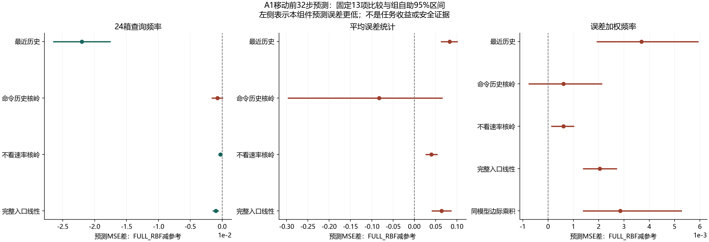
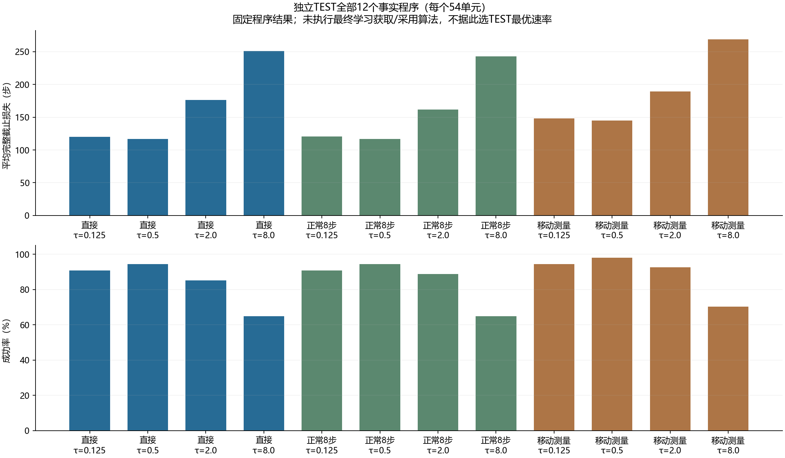
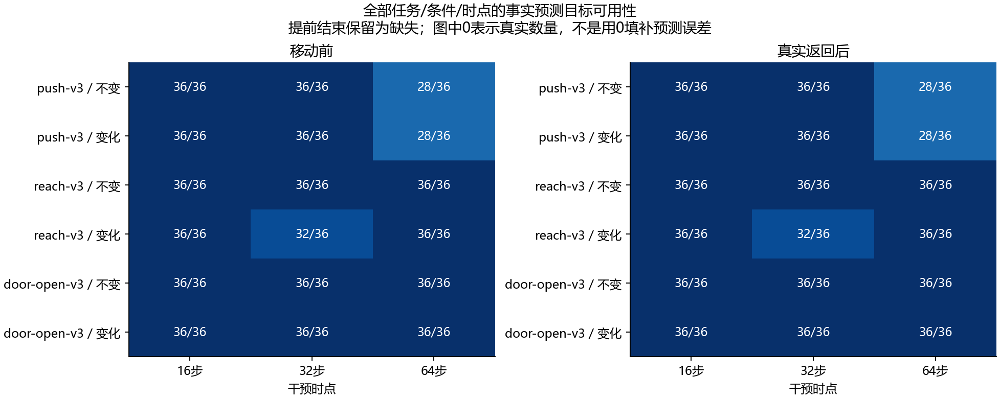

# 纠正后适用性变化：A1预测基础独立开发报告

本轮结论：**FULL_RBF未通过冻结的A1组件门。** 这是标准预测工具的检验；本轮没有让学习器选择实际控制，不能据此宣称完整获取算法、任务收益、新颖性或CCF A目标完成。

用户已选择A。实现先在本地提交 `d74cba1945e283a6c9c2c92b43d400813a8df404` 冻结，再采集新TRAIN/CAL/TEST；旧ARX、SS、记忆清零与闭合DR草案保持原样，未重采旧人口或调旧资格参数。实验在线LLM API调用为**0**。

## 三个不可替换的判断

|层次|本轮证据|边界|
|---|---|---|
|数值/时序合法|记录、字面PI、执行链、全部费用和共同状态核对通过|不是物理安全保证或唯一失配原因识别|
|当前预测能力|NOT_QUALIFIED；主要对象是移动前32步24箱频率及误差矩|不是完整状态分布、合格物理响应模型或可逆控制器|
|完整任务收益|未检验新学习机制的部署收益|下表为预定事实程序，未执行最终获取/采用算法与完整强对照|

## 方法名字及执行含义

|名字|含义|
|---|---|
|CONTINUE|立即从当前状态继续；随后使用指定PI速率|
|VALIDATE8|先正常继续原任务8步，再采用指定速率；不是一种新的物理探测|
|MOVE_MEASURE|同一LOCAL_PID移动及实际测量，然后从真实后状态继续|
|时间常数τ|只改变积分更新速度；较小通常更新更快，积分保留，底层政策固定|
|PERSISTENCE|沿用最近8步的查询/误差统计|
|COMMAND_RBF|用命令/响应历史摘要的核岭预测参考|
|RATE_BLIND_RBF|另看当前公开观测、积分和预算，但不看候选速率|
|FULL_LINEAR / FULL_RBF|相同完整入口特征的线性/核岭预测器；标准工具，不是新算法|

完整入口特征使用当前39维观测、控制积分/预算和最近8步固定摘要；接口虽保留完整真实历史，本版没有穷尽利用长历史。工作模型是明示的 `XY位移=.01×发送XY命令`，未获得物理预测资格、未用于求逆。误差包含噪声、瞬态、接触及模型条件错误，不能解释为物理无噪声误差。24箱只包含命令象限/幅值和公开手物距离代理。

## 冻结主要比较：PRE、32步

差值为FULL_RBF预测MSE减参考；负值表示本组件预测误差更低。95%区间按独立组、时点内整组重抽10,000次，不把相关时间步或程序当作独立样本。9个TEST组，每时点3组；这是探索规模，不宣称充分统计功效。

|误差族|参考|平均差|95%区间|上界<0|
|---|---|---|---|---|
|occupancy_32|PERSISTENCE|-0.0219927|[-0.0265133, -0.017491]|是|
|occupancy_32|COMMAND_RBF|-0.000764818|[-0.00170948, 0.000142188]|否|
|occupancy_32|RATE_BLIND_RBF|-0.000297972|[-0.000620487, -7.20059e-06]|是|
|occupancy_32|FULL_LINEAR|-0.00102818|[-0.00151563, -0.000545991]|是|
|error_32|PERSISTENCE|0.0827453|[0.0616955, 0.101638]|否|
|error_32|COMMAND_RBF|-0.0826731|[-0.297676, 0.0661091]|否|
|error_32|RATE_BLIND_RBF|0.0397702|[0.0257857, 0.0544965]|否|
|error_32|FULL_LINEAR|0.0638507|[0.0405199, 0.0871815]|否|
|joint_32|PERSISTENCE|0.00369022|[0.00191335, 0.00595144]|否|
|joint_32|COMMAND_RBF|0.000605669|[-0.000773799, 0.00213847]|否|
|joint_32|RATE_BLIND_RBF|0.000608411|[0.000124159, 0.0010355]|否|
|joint_32|FULL_LINEAR|0.00204191|[0.00138009, 0.00273053]|否|
|joint_32|MARGINAL_PRODUCT|0.00285425|[0.00137338, 0.00529402]|否|

全部13项及所有PRE分层有事实目标的要求均在采集前冻结。没有用POST、8步、次优模型或有利任务替代。访问频率MSE是频率单位；误差/加权矩MSE是按0.01m归一化后的统计预测误差，不能标作物理位移RMSE。边际乘积只是明确的矩分解参考，不是完整的纠正后重加权、MDE或OCCAM复现。

本轮3/13项的组区间支持FULL_RBF误差更低，7项支持其误差更高，3项区间跨零。较好的结果仅出现在访问频率预测；工作模型误差大小及其在访问箱中的加权矩没有通过主要比较。这说明本版较丰富的公开输入和非线性工具没有形成稳定的预测优势，不能把“看见了候选速率”直接解释为模型适用性或获取收益。这些是各项冻结95%区间的描述，不另作多重比较后显著性或充分统计功效宣称。当前证据不能区分有限开发数据、特征/目标设计、估计误差和动力学条件各自造成多少损失；不据此确定唯一失败原因。

## 独立TEST的全部事实程序

每程序54个任务/条件单元。截止损失为成功时整段实际控制步数，失败为500；移动/验证/测量已在实际步数中计一次。这些程序使用各自实际到访的状态；没有推算未执行轨迹、按TEST挑选速率或跨旧人口比较优劣。

|获取|τ（秒）|成功/全部|平均截止损失|
|---|---|---|---|
|CONTINUE|0.125|49/54|120.148|
|CONTINUE|0.5|51/54|116.926|
|CONTINUE|2.0|46/54|176.315|
|CONTINUE|8.0|35/54|251.056|
|VALIDATE8|0.125|49/54|120.37|
|VALIDATE8|0.5|51/54|116.926|
|VALIDATE8|2.0|48/54|161.759|
|VALIDATE8|8.0|35/54|242.852|
|MOVE_MEASURE|0.125|51/54|147.87|
|MOVE_MEASURE|0.5|53/54|144.87|
|MOVE_MEASURE|2.0|50/54|189.407|
|MOVE_MEASURE|8.0|38/54|268.852|

新方法对DIRECT_C8、MOVE_INTEGRAL、完整被动适应、始终获取/不更新、检测/历史辨识及任务相关获取等的独立优势仍未检验。本版没有完成这些方法的同人口对照，不能把组件参考称为完整强基线胜出。

## 固定速率改变的实际不利/改善案例

同一单元、同一获取下，相对τ=0.5比较完整实际损失。全部单元保留；这是预定程序的配对描述，不是学习器的错误更新率，也不能据单次差值认定稳定期望或唯一原因。

|获取|τ|分母|损失增/减/同|平均损失差|成功→失败|失败→成功|
|---|---|---|---|---|---|---|
|CONTINUE|0.125|54|10/25/19|3.22222|2|0|
|CONTINUE|2.0|54|28/4/22|59.3889|5|0|
|CONTINUE|8.0|54|27/4/23|134.13|16|0|
|VALIDATE8|0.125|54|8/21/25|3.44444|2|0|
|VALIDATE8|2.0|54|25/2/27|44.8333|3|0|
|VALIDATE8|8.0|54|26/3/25|125.926|16|0|
|MOVE_MEASURE|0.125|54|15/32/7|3|2|0|
|MOVE_MEASURE|2.0|54|31/12/11|44.537|3|0|
|MOVE_MEASURE|8.0|54|35/12/7|123.981|15|0|

## 全部分层和未完成窗口

以下分母是分配的逻辑预测位置；实际提前结束不补观测/标签、不填零。短尾部按真实长度归一化并保存长度比例。MSE仅对有事实目标的预测计算，不是全部执行的任务收益率。

|任务|条件|时点|PRE有目标/全部|POST有目标/全部|
|---|---|---|---|---|
|push-v3|UNCHANGED|16|36/36|36/36|
|push-v3|UNCHANGED|32|36/36|36/36|
|push-v3|UNCHANGED|64|28/36|28/36|
|push-v3|CHANGED|16|36/36|36/36|
|push-v3|CHANGED|32|36/36|36/36|
|push-v3|CHANGED|64|28/36|28/36|
|reach-v3|UNCHANGED|16|36/36|36/36|
|reach-v3|UNCHANGED|32|36/36|36/36|
|reach-v3|UNCHANGED|64|36/36|36/36|
|reach-v3|CHANGED|16|36/36|36/36|
|reach-v3|CHANGED|32|32/36|32/36|
|reach-v3|CHANGED|64|36/36|36/36|
|door-open-v3|UNCHANGED|16|36/36|36/36|
|door-open-v3|UNCHANGED|32|36/36|36/36|
|door-open-v3|UNCHANGED|64|36/36|36/36|
|door-open-v3|CHANGED|16|36/36|36/36|
|door-open-v3|CHANGED|32|36/36|36/36|
|door-open-v3|CHANGED|64|36/36|36/36|

缺失原因总表：

|阶段/原因|数量|
|---|---|
|PRE/FACTUAL_TARGET|628|
|POST/FACTUAL_TARGET|628|
|PRE/NO_EXECUTED_TAIL|20|
|POST/EARLY_END_DURING_ACQUISITION|20|

CAL只形成各误差族90%经验误差半径，没有选模型或超参数；它不参与实际控制。全部覆盖率/半径/MSE保存在逐项指标CSV，不宣称时序交换性、概率安全保证或新自适应策略下的覆盖。

## 实际成本和独立复算

|阶段|执行|控制步|全部仿真重置|物理仿真帧|实际政策查询|审计政策重放查询|
|---|---|---|---|---|---|---|
|NATIVE|108|13376|5508|2820880|12298|12298|
|TRAIN|648|77563|33048|16911815|70527|70527|
|CAL|216|20286|11016|5609430|18218|18218|
|TEST|648|111097|33048|17079485|104093|104093|

总计 **1620次执行、222322控制步、82620全部重置、42421610物理仿真帧**。每执行1次受控初始重置与50次工厂重置；所有获取/停止均保留真实状态、RNG游标与时钟，没有中途重置/回退位移。

墙钟耗时另列，包含各自I/O与审计实现开销；并行操作的墙钟时间不能相加冒充CPU核时。500步截止损失是仿真控制步目标，不是硬件实时延迟保证。

|阶段|采集墙钟秒|记录审计墙钟秒|
|---|---|---|
|NATIVE|735.776|108.827|
|TRAIN|4425.18|584.563|
|CAL|1364.91|196.684|
|TEST|5113.31|943.863|

预测拟合墙钟13.3931秒，独立模型复算23.5059秒；组统计独立复算1.16753秒，补充报表核对7.07055秒。完整细分保存在各回执。

实际拟合为8个142输出预测模型；另有8次独立增广最小二乘复算。新响应/逆模型训练、低层政策训练、实验在线LLM调用及API tokens均为0。合成测试解另计，不冒作真实训练或新样本。本版没有使用旧机器人记录训练；历史研究来源费用另保留在原报告。

代码/记录审计通过不代表算法贡献。冻结验证23项新数组/保存记录检查加2022项源码绑定复用检查，共2045项独特检查；重复开发运行不再累计，旧六组张量检查另列。最初开发运行的接口归一化/语法失败日志保留。组统计主审计核对130159个标量，补充报表审计核对793个字段；这些不是新单元测试或独立样本。

独立复算指第二实现，不是独立机构评审或独立物理重现。主记录重放共享不可变获取原语，字面PI/执行链另算。私有见证只能核对记录字节/相等，不能证明所有隐藏状态充分。补充核对覆盖所有组的共同状态与控制记忆，以及未知变化前公开入口相等；零步继续不会提前看到真实变化。

## 失败、文件与来源

全部147个实际任务失败及完整分母保留。原始事件/见证/案例gz、预测输入输出、速率计划与执行轨迹位于 `outputs/correction_scope/development_v1/correction_scope_20261026T042133Z_d74cba1945e2`。数据分片及实际恢复字节检查见本地结果交付索引；大原始文件与恢复副本保留，不按成败筛选。

- [全部案例](../outputs/correction_scope/development_v1/correction_scope_20261026T042133Z_d74cba1945e2/presentation/all_cases.csv)
- [全部任务失败](../outputs/correction_scope/development_v1/correction_scope_20261026T042133Z_d74cba1945e2/presentation/all_task_failures.csv)
- [完整预测指标](../outputs/correction_scope/development_v1/correction_scope_20261026T042133Z_d74cba1945e2/presentation/all_prediction_metrics.csv)
- [冻结manifest](../outputs/correction_scope/development_v1/correction_scope_20261026T042133Z_d74cba1945e2/manifest.json)
- [主要统计](../outputs/correction_scope/development_v1/correction_scope_20261026T042133Z_d74cba1945e2/results/statistics.json)
- [独立统计审计](../outputs/correction_scope/development_v1/correction_scope_20261026T042133Z_d74cba1945e2/results/statistics_audit.json)
- [冻结协议](../docs/protocols/correction_scope_development_v1_zh.md)
- [查新补充](../docs/research/correction_scope_prior_art_addendum_v1_zh.md)

## 后续判断

封存此版FULL_RBF预测器和负结果，不据TEST叠加门控、换次优模型为主方法、挑任务/速率或补样本。本版没有支持进入据此选择控制的新采集；这也不证明A方向或所有预测工具不可行。先形成新的可证伪机制与独立资格设计。

TOM、模型适用范围学习、GAUGE、Residual RL、OCCAM、Poke and Strike、DISaM/VoSI等近邻继续约束贡献主张。门控/混合/重加权/普通收益预测已存在；同权限组合参考若解释全部收益，应关闭该区别。**本次交付没有完成CCF A目标。**
