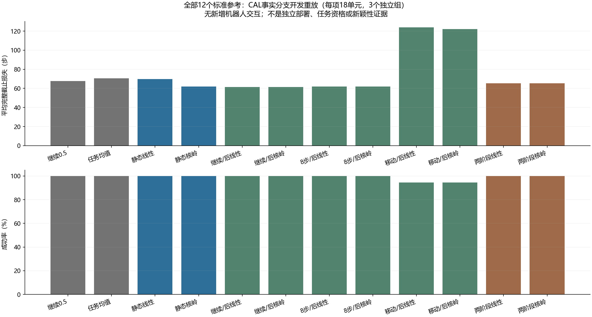
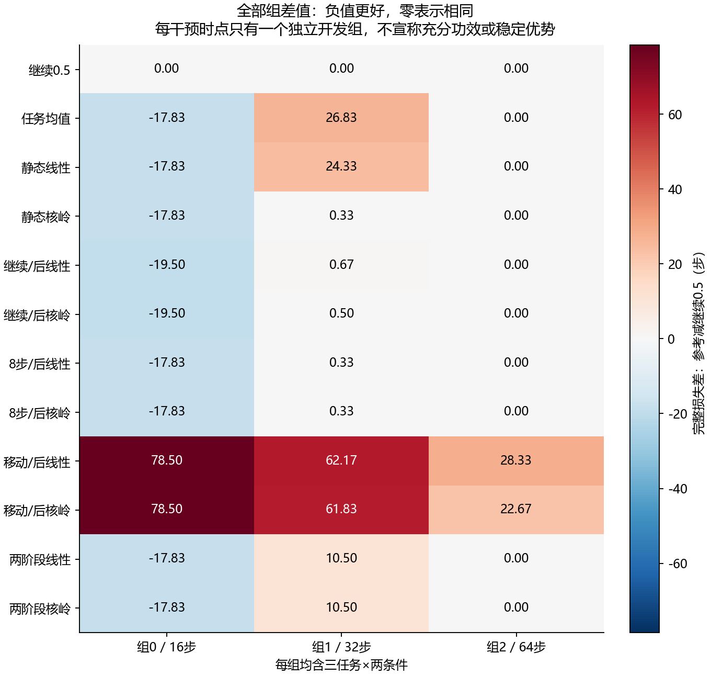

# A方向：标准完整风险参考与事实分支开发重放 v1

本轮完成了标准参考训练和独立复算。**本报告是离线开发重放，不是新机器人执行、最终资格、算法新颖性或CCF A成果。** 原A1的FULL_RBF仍为NOT_QUALIFIED，原13项比较及记录不变。

实现/配置/协议先在 `82a3873cdf1ba0de59cf359c98db996202d60b5c` 提交冻结，再读取真实TRAIN进行8个标准风险模型拟合；CAL不参与拟合或参数选择。本轮新增环境交互、重置、物理帧、旧政策查询、新机器人种子、在线LLM API及tokens均为**0**。

## 为什么做这个参考

误差或访问频率预测没有通过，并不能证明没有值得适应的任务机会。下一机制还必须超过直接预测完整任务成本、以及在真实获取返回后选择纠正的标准参考。两阶段Q、核岭和完整成本目标本身不作为新贡献。新阅读进一步确认，任务后悔值驱动的探索和显式适应器进入闭环优化已有先例；见[本轮决定及查新边界](../docs/research/correction_scope_reference_decision_v1_zh.md)。

## 名字是什么意思

|名字|实际含义|
|---|---|
|CONTINUE_05|保持原0.5秒PI速率，从当前状态继续|
|TASK_TIME_MEAN|只按公开任务和时点的训练平均完整风险，预选一个已有程序|
|STATIC_LINEAR / STATIC_RBF|在移动前，一次预选获取与随后速率；线性核/高斯核岭是标准回归|
|CONTINUE_POST_*|零步获取后选速率；没有新观测，不冒称信息收益|
|VALIDATE8_POST_*|正常任务继续8步后，用真实新增历史选速率；不是新物理探测|
|MOVE_MEASURE_POST_*|按旧固定移动/测量原语实际返回后选速率|
|SEQUENTIAL_*|移动前选获取，真实返回后再选速率；标准两阶段风险参考|

速率只取已执行的0.125/0.5/2/8秒，不重置积分，不重训底层政策。完整公开历史都进入核特征；上限500步的空计算槽有显式mask，未补造观测。所有核参数与数值同值容差在拟合前固定，没有根据本轮开发结果挑选模型/速率/阈值。

## 三个证据层次

|层次|已取得证据|仍不能声称|
|---|---|---|
|数值和分支支持|主/第二实现核、模型、选择及事实结果核对通过|不是物理安全或独立机构认证|
|风险预测|下表列出全部8模型的开发MSE与3组结果，无事后通过阈值|不能用低MSE代替任务收益|
|任务开发表现|完整18单元、12个预定选择器的实际来源叶成本|未形成新方法独立自身历史部署或超过完整强基线的最终证据|

## 全部开发选择器

每行18个任务/条件单元，属于3个独立组。差值相对CONTINUE_05，负值更好；三个组分别对应16/32/64步干预时点，每组均含三任务×两条件。只有每时点一个组，不给出精细功效或显著性宣称。成功时损失是整段来源步数，失败为500，获取成本已经计入一次。

|选择器|成功/全部|平均完整截止损失|组0差|组1差|组2差|
|---|---|---|---|---|---|
|CONTINUE_05|18/18|67.6667|0|0|0|
|TASK_TIME_MEAN|18/18|70.6667|-17.8333|26.8333|0|
|STATIC_LINEAR|18/18|69.8333|-17.8333|24.3333|0|
|STATIC_RBF|18/18|61.8333|-17.8333|0.333333|0|
|CONTINUE_POST_LINEAR|18/18|61.3889|-19.5|0.666667|0|
|CONTINUE_POST_RBF|18/18|61.3333|-19.5|0.5|0|
|VALIDATE8_POST_LINEAR|18/18|61.8333|-17.8333|0.333333|0|
|VALIDATE8_POST_RBF|18/18|61.8333|-17.8333|0.333333|0|
|MOVE_MEASURE_POST_LINEAR|17/18|124|78.5|62.1667|28.3333|
|MOVE_MEASURE_POST_RBF|17/18|122|78.5|61.8333|22.6667|
|SEQUENTIAL_LINEAR|18/18|65.2222|-17.8333|10.5|0|
|SEQUENTIAL_RBF|18/18|65.2222|-17.8333|10.5|0|

本轮的描述性信号是：保持原速率的均值为67.6667步；仅用已有历史、零步获取的POST_RBF为61.3333步；两个SEQUENTIAL均为65.2222步，未胜过这个不增加观测的标准参考。两阶段的三组差分别为−17.8333、+10.5、0步，没有跨组三组一致的改善。两个固定移动参考为124/122步且均17/18成功，不能忽略获取后的状态与完整成本。这是冻结12个方法的全表描述，不是新增显著性比较、CAL选模或最终资格门。后续须证明获取相对完整免费反馈参考的额外价值。

## 同获取下的不利与改善

对各选择器已选获取，比较它选择的速率与同获取0.5秒真实来源叶。全部18单元保留，包括未改速率与已提前结束。这是保存的配对事实成本差，不是新部署错误更新概率，也不据单次差值判断期望因果效果或唯一物理原因。

|选择器|不利/改善/相同|平均损失差|不利步数总和|最坏不利差|成功→失败|失败→成功|
|---|---|---|---|---|---|---|
|CONTINUE_05|0/0/18|0|0|0|0|0|
|TASK_TIME_MEAN|2/6/10|-6.27778|2|1|0|0|
|STATIC_LINEAR|3/4/11|-5.94444|4|2|0|0|
|STATIC_RBF|4/3/11|-5.83333|5|2|0|0|
|CONTINUE_POST_LINEAR|5/2/11|-6.27778|6|2|0|0|
|CONTINUE_POST_RBF|5/3/10|-6.33333|6|2|0|0|
|VALIDATE8_POST_LINEAR|3/2/13|-5.83333|4|2|0|0|
|VALIDATE8_POST_RBF|3/2/13|-5.83333|4|2|0|0|
|MOVE_MEASURE_POST_LINEAR|4/6/8|0.722222|34|19|0|0|
|MOVE_MEASURE_POST_RBF|2/7/9|-1.27778|4|2|0|0|
|SEQUENTIAL_LINEAR|4/3/11|-5.88889|4|1|0|0|
|SEQUENTIAL_RBF|4/3/11|-5.88889|4|1|0|0|

## 全部风险预测指标

MSE以完整截止损失/500为标签单位，每节点先对该模型的候选输出平均，再按组等权组织。SEQUENTIAL标签使用固定接收者对真实返回的选择，从未以未来真实最佳速率代替。缺少活决策的终止节点不填零误差。

|模型|有事实节点|终止缺失节点|组平均MSE|组0|组1|组2|
|---|---|---|---|---|---|---|
|static_LINEAR|14|4|0.026292|0.0491399|0.0132764|0.0164598|
|static_RBF|14|4|0.020403|0.0478697|0.0117702|0.00156906|
|post_all_LINEAR|40|14|0.0318769|0.0655207|0.0166181|0.013492|
|post_all_RBF|40|14|0.0271567|0.063851|0.0136629|0.00395632|
|receiver_LINEAR|40|14|0.027097|0.0597031|0.0171725|0.00441552|
|receiver_RBF|40|14|0.0234025|0.0610245|0.00885057|0.000332406|
|sequential_LINEAR|14|4|0.0207639|0.0310398|0.0303404|0.000911309|
|sequential_RBF|14|4|0.0204082|0.0315237|0.0280497|0.00165116|

## 数据分工、信息和重放边界

STATIC和POST_ALL用9个TRAIN组；两阶段接收者用组0–5，冻结后获取风险学习只用组6–8，接收者版本和全部标签映射已保存。CAL原本用于A1标定且其历史结果已报告，本轮只作开发重放；没有读取TEST案例/预测来训练、评价或调参。旧13项比较文件只校验字节哈希，旧总费用只读取审计元数据。

每个单元有12个已实际执行的完整叶。所有PRE公开历史一致，每个获取的四速率在相同真实返回处才分叉；旧共同物理状态/RNG/控制记忆审计的来源字节也核对。RETURN投影只去掉零物理时长的候选速率元数据，不撤销观测或积分。任何缺分支、不同返回或来源变化均拒绝。这不授权重放未执行的混合/中途切换控制器，也不证明仅公开观测足以描述隐藏状态。

选择接口只接收公开节点和训练银行，不接收组、种子、变化条件、真扰动、实际噪声或未来结果。输入/选择先持久化，再公开所选来源叶结果。主特征、预测、选择和图组装函数禁用后，第二实现重新读取来源核对。独立复算是第二实现，不是独立实验机构或新的物理复现。

## 全部来源费用与本轮新增费用

|来源阶段|原始程序执行|原始控制步|原始全部重置|原始物理帧|
|---|---|---|---|---|
|TRAIN|648|77563|33048|16911815|
|CAL|216|20286|11016|5609430|

上述864次来源执行是已有数据，本轮没有再发生一次。整个历史A1仍为1620次执行、222322控制步、82620全部重置、42421610物理帧，历史8次预测拟合与8次独立复算也保留原账。不得把本轮216次分支重放说成216次新机器人执行，或把重复引用的来源步数当新交互费用。

本轮实际标准风险拟合8次，独立lstsq复算8次，经验均值表1个。训练含事实树构建/保存的墙钟19.1861秒；独立模型审计14.2715秒；开发重放11.5496秒；独立重放审计10.5208秒。它们不是硬件实时控制时限。

28项新数组/构造记录检查，加2045项源码绑定复用检查，共2073项独特检查；旧六组张量检查另列，没有重跑旧仿真。开发重复运行不累计为新测试；全部合成检查实际解25次solve与8次lstsq，另列于科学拟合之外。整条合成流程曾因测试夹具漏input_sha256失败，失败日志/源码快照保留，修复后完整流程通过；没有发生真实数据重采或结果修补。

## 完整记录与后续判断

TRAIN/CAL原始来源共45个任务失败继续保留；本轮选择器重放产生2个失败行，可能重复引用相同来源叶，不能当新增独立失败样本。全部选择、风险值、模型、接收者标签、来源索引、阶段/失败回执都保留，不只保存有利方法。

- [全部重放结果](../outputs/correction_scope/risk_reference_v1/run_20261026T094817Z_82a3873cdf1b/presentation/all_offline_replays.csv)
- [全部失败行](../outputs/correction_scope/risk_reference_v1/run_20261026T094817Z_82a3873cdf1b/presentation/all_offline_failure_rows.csv)
- [全部864来源案例索引](../outputs/correction_scope/risk_reference_v1/run_20261026T094817Z_82a3873cdf1b/presentation/all_source_cases_index.csv)
- [结果及全指标](../outputs/correction_scope/risk_reference_v1/run_20261026T094817Z_82a3873cdf1b/development_results.json)
- [独立模型审计](../outputs/correction_scope/risk_reference_v1/run_20261026T094817Z_82a3873cdf1b/model_audit.json)
- [独立重放审计](../outputs/correction_scope/risk_reference_v1/run_20261026T094817Z_82a3873cdf1b/replay_audit.json)
- [冻结协议](../docs/protocols/correction_scope_risk_reference_v1_zh.md)

本版只是标准风险参考，不把其中表现较好的回归器提升为论文方法，也不把其结果救回已失败的A1预测器。后续具体机制须在相同公开信息和完整费用下，与静态完整风险、真实返回后选择和标准两阶段风险等同权限强组合比较；同时保留DIRECT_C8、MOVE_INTEGRAL、完整被动适应、始终获取/不更新、变化检测/历史辨识及任务相关获取。A1没有这些方法的同人口完整对照，本轮也没有补做，不跨旧人口拼表宣称胜出。

下一步先给出能被这些标准参考反驳的具体适用性机制、区别和消融，再冻结新的TRAIN/标定/独立自身历史任务评价。若同权限标准参考解释全部收益，关闭该区别；不能据CAL/TEST调阈值、追加样本、挑最佳任务/速率或换名重启旧ARX/SS。**完整任务优势、新颖性和CCF A目标仍未完成。**
