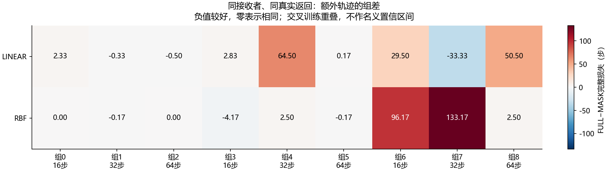
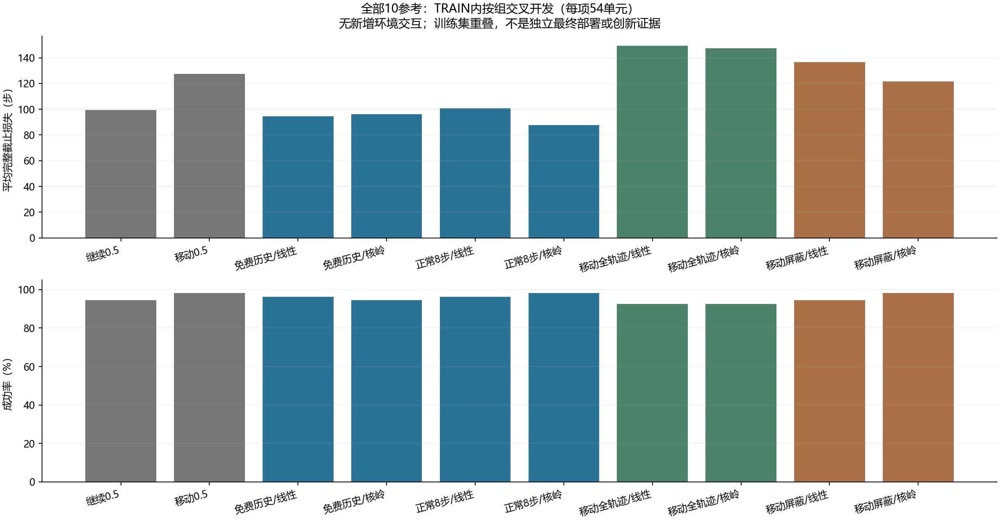
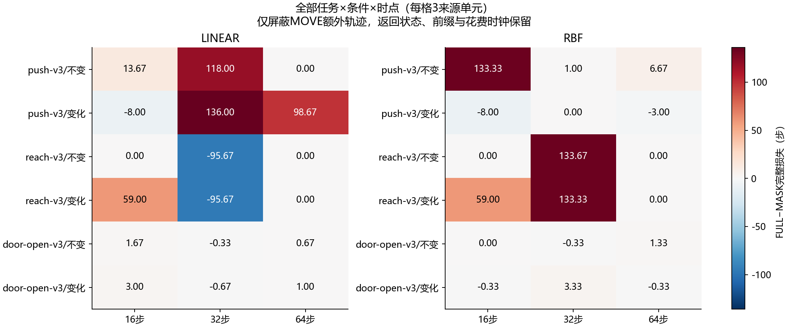

# 获取后额外轨迹：同接收者TRAIN交叉开发对照 v1

**本轮全部结果是事后描述性开发分析。** 在已执行的同一获取返回处，固定同一个接收模型，只改变额外获取轨迹是否提供。新增环境交互/重置/控制步/物理帧/旧政策查询/机器人种子/在线LLM API与tokens均为0。不是新的机器人部署、信息论最优价值或CCF A成果。

源码/协议/配置在 `3875955b51d532d2812a123c32bef28c78a61aa1` 先提交冻结，再用既有TRAIN拟合6个标准风险模型并作6次独立复算。只解析TRAIN；CAL/TEST没有用于新训练、评价、阈值或模型选择。原A1的NOT_QUALIFIED及13项比较不变，旧M/D等价草案及5940次未执行预算保持关闭。

## 重点对照：额外轨迹是否改变采用，以及是否改善完整任务

FULL提供付费移动/测量期间的全部真实额外轨迹；MASK只屏蔽这一段。两者拥有完全相同的原任务前缀、真实返回观测、积分、已执行获取和已花费步数，使用同一个折内冻结接收模型。差值为FULL完整截止损失减MASK，负值表示该接收者利用额外轨迹后损失更低。

|核|FULL成功/54|MASK成功/54|FULL平均损失|MASK平均损失|FULL−MASK|速率选择变化/54|FULL不利/改善/相同|
|---|---|---|---|---|---|---|---|
|LINEAR|50/54|51/54|149.407|136.556|12.8519|22/54|12/7/35|
|RBF|50/54|53/54|147.259|121.722|25.537|19/54|9/5/40|

必须把预测变化、采用选择变化和任务成本变化分别检查；预测MSE降低不能替代任务收益。正负差都保留，不据结果选核、删组、换阈值或追加样本。

**本轮为负结果。** FULL额外轨迹使线性/核岭接收者的完整损失分别增加12.851852/25.537037步，成功数分别减少1/3。核岭FULL的平均归一化MSE为0.075593，低于MASK的0.082280，但完整任务表现更差。该固定接收者没有证明能够把这些信息转成更好的决策；这也不能排除有限样本、共享容量、表示或排序误差等解释，更不能证明所有接收者都无法利用额外轨迹。

### 保存选择的补充核对（事后描述性）

以下只读取已保存的预测和选择，不新查询、拟合或设置门限。对FULL与MASK选择不同速率的单元，在FULL预测中比较两个速率，再核对其两个真实来源叶的完整成本差。负预测差却得到正实际差，表示这次保存排序过于乐观；不是唯一物理原因或校准后的错误概率。每核54单元全部登记，11个提前终止单元没有预测，明确记为缺失。

|核|全部/可查询/终止缺失|选择变化|FULL乐观而实际不利|不利且预测数值平局|
|---|---|---|---|---|
|LINEAR|54/43/11|22|12|0|
|RBF|54/43/11|19|9|0|

[全部108组核配对，包括未变选择、改善、不利及缺失](../outputs/correction_scope/trace_value_v1/run_20261026T104715Z_3875955b51d5/posthoc_choice_diagnosis_v2/all_108_pairs.csv)。补充检查与原冻结主要对照分开，未据它挑选新模型、风险阈值或实验样本。第一次补充读表误把明文日志当gzip读取，在读表处失败；失败回执及修改前源码保留，修复后使用新输出目录，不涉及科学拟合、查询、交互或原始记录改写。

## 全部9组，避免总体均值掩盖分歧

组0/3/6为16步，1/4/7为32步，2/5/8为64步；每组含三任务×两条件。每次留出3组、训练另6组，三个折的训练集相互重叠。以下是组差的完整描述，不给未经重训/推导的独立置信区间或显著性宣称，也不把复制视图当新增独立样本。

|核|0|1|2|3|4|5|6|7|8|
|---|---|---|---|---|---|---|---|---|---|
|LINEAR|2.33333|-0.333333|-0.5|2.83333|64.5|0.166667|29.5|-33.3333|50.5|
|RBF|0|-0.166667|0|-4.16667|2.5|-0.166667|96.1667|133.167|2.5|

## 包含完整免费反馈的全部10参考

CONTINUE_FULL保留原免费历史，VALIDATE8_FULL保留正常任务继续8步的全部反馈，不为消融削弱它们。两个固定0.5参考不拟合。成功时损失为来源执行的全部实际控制步，失败为500；移动、测量及失败费用已经计入一次。提前结束保留在54分母里，不创建假查询。

|选择器|成功/全部|平均完整损失|
|---|---|---|
|FIXED_CONTINUE_05|51/54|99.4259|
|FIXED_MOVE_05|53/54|127.315|
|CONTINUE_FULL_LINEAR|52/54|94.4815|
|CONTINUE_FULL_RBF|51/54|96.1667|
|VALIDATE8_FULL_LINEAR|52/54|100.593|
|VALIDATE8_FULL_RBF|53/54|87.6111|
|MOVE_FULL_LINEAR|50/54|149.407|
|MOVE_FULL_RBF|50/54|147.259|
|MOVE_MASK_LINEAR|51/54|136.556|
|MOVE_MASK_RBF|53/54|121.722|

## 所有任务、条件与干预时点

|核|任务|条件|时点|单元|FULL−MASK平均完整损失|
|---|---|---|---|---|---|
|LINEAR|push-v3|UNCHANGED|16|3|13.6667|
|LINEAR|push-v3|UNCHANGED|32|3|118|
|LINEAR|push-v3|UNCHANGED|64|3|0|
|LINEAR|push-v3|CHANGED|16|3|-8|
|LINEAR|push-v3|CHANGED|32|3|136|
|LINEAR|push-v3|CHANGED|64|3|98.6667|
|LINEAR|reach-v3|UNCHANGED|16|3|0|
|LINEAR|reach-v3|UNCHANGED|32|3|-95.6667|
|LINEAR|reach-v3|UNCHANGED|64|3|0|
|LINEAR|reach-v3|CHANGED|16|3|59|
|LINEAR|reach-v3|CHANGED|32|3|-95.6667|
|LINEAR|reach-v3|CHANGED|64|3|0|
|LINEAR|door-open-v3|UNCHANGED|16|3|1.66667|
|LINEAR|door-open-v3|UNCHANGED|32|3|-0.333333|
|LINEAR|door-open-v3|UNCHANGED|64|3|0.666667|
|LINEAR|door-open-v3|CHANGED|16|3|3|
|LINEAR|door-open-v3|CHANGED|32|3|-0.666667|
|LINEAR|door-open-v3|CHANGED|64|3|1|
|RBF|push-v3|UNCHANGED|16|3|133.333|
|RBF|push-v3|UNCHANGED|32|3|1|
|RBF|push-v3|UNCHANGED|64|3|6.66667|
|RBF|push-v3|CHANGED|16|3|-8|
|RBF|push-v3|CHANGED|32|3|0|
|RBF|push-v3|CHANGED|64|3|-3|
|RBF|reach-v3|UNCHANGED|16|3|0|
|RBF|reach-v3|UNCHANGED|32|3|133.667|
|RBF|reach-v3|UNCHANGED|64|3|0|
|RBF|reach-v3|CHANGED|16|3|59|
|RBF|reach-v3|CHANGED|32|3|133.333|
|RBF|reach-v3|CHANGED|64|3|0|
|RBF|door-open-v3|UNCHANGED|16|3|0|
|RBF|door-open-v3|UNCHANGED|32|3|-0.333333|
|RBF|door-open-v3|UNCHANGED|64|3|1.33333|
|RBF|door-open-v3|CHANGED|16|3|-0.333333|
|RBF|door-open-v3|CHANGED|32|3|3.33333|
|RBF|door-open-v3|CHANGED|64|3|-0.333333|

## 同获取下相对保留0.5的不利与改善

这是保存的配对事实叶成本差，不是新的在线错误更新概率；不由单次差值推断长期期望或唯一原因。全部54单元包括未改变速率及提前结束。

|选择器|不利/改善/相同|平均差|不利步数和|最坏不利差|成功→失败|失败→成功|
|---|---|---|---|---|---|---|
|FIXED_CONTINUE_05|0/0/54|0|0|0|0|0|
|FIXED_MOVE_05|0/0/54|0|0|0|0|0|
|CONTINUE_FULL_LINEAR|13/15/26|-4.94444|480|405|1|2|
|CONTINUE_FULL_RBF|12/15/27|-3.25926|477|405|1|1|
|VALIDATE8_FULL_LINEAR|13/11/30|1.16667|286|251|0|1|
|VALIDATE8_FULL_RBF|15/13/26|-11.8148|38|9|0|2|
|MOVE_FULL_LINEAR|13/12/29|22.0926|1323|372|3|0|
|MOVE_FULL_RBF|9/14/31|19.9444|1262|400|3|0|
|MOVE_MASK_LINEAR|5/13/36|9.24074|772|361|2|0|
|MOVE_MASK_RBF|3/16/35|-5.59259|53|28|0|0|

## 当前风险预测能力

标签是完整损失/500，每节点对四速率的平方误差平均。各组/逐节点值全保留；终止节点按缺失登记，不填零。模型共享容量、有限数据和核归纳偏置均可能影响结果，本轮度量的是该固定接收者利用信息的效果，不能把零收益解释为额外轨迹完全不含信息或任何更好接收者也无法利用。

|选择器|活节点|终止缺失|节点平均归一化MSE|
|---|---|---|---|
|CONTINUE_FULL_LINEAR|48|6|0.0824202|
|CONTINUE_FULL_RBF|48|6|0.0821658|
|VALIDATE8_FULL_LINEAR|43|11|0.0864297|
|VALIDATE8_FULL_RBF|43|11|0.0898416|
|MOVE_FULL_LINEAR|43|11|0.100632|
|MOVE_FULL_RBF|43|11|0.0755926|
|MOVE_MASK_LINEAR|43|11|0.0831888|
|MOVE_MASK_RBF|43|11|0.0822803|

## 信息、物理状态和支持边界

MASK仍有返回位置/物体状态代理、积分、花费时钟与完整原任务前缀；它不是“无信息”。本轮不是全部物理效应/信息效应的自然中介分解。受控变化发生在获取完成、采用速率之前；原获取控制器在两条件中始终使用完整观测执行同一原语，没有通过关闭传感器改变获取路径。

每折、每核的FULL/MASK共用同一模型文件。MOVE视图复制各分原节点权重一半，组平衡后总权重等于原节点数，保留原正则强度。空额外轨迹输入必须相同；没有额外release标志让同一证据产生不同输出。缺失轨迹为None和显式可用性mask，不伪造零观测；时钟不退款。

选择器只读合法公开查询与冻结模型，不能读组/折、种子、条件、真扰动、实际噪声、私有状态或未来结果。折号只用于实验分配模型，不是在线政策特征。查询/预测/选择持久化先于结果公开。每个已选速率都对应一个原本真实执行的来源叶；没有在旧记录上捏造混合控制或未执行轨迹。

独立审计禁用主特征、查询、拟合、预测和汇总实现，重新从原TRAIN记录构建事实树、特征、权重、核矩阵、参数与全部选择/结果。共同物理状态/RNG/控制记忆另绑定原始完整审计，不能只靠公开观测相等推断全部隐藏状态充分。第二实现不是独立机构或新的物理复现。

## 来源成本、拟合与检查

|来源执行|已有控制步|已有全部重置|已有物理帧|
|---|---|---|---|
|648|77563|33048|16911815|

以上648次TRAIN执行是复用数据，未再次发生。本轮540次是分支重放，不能标成540次新机器人执行；重复引用的来源步数不计为新交互。整个A1及其他历史费用/失败继续见[原报告](correction_scope_development_v1_zh.md)和[风险参考报告](correction_scope_risk_reference_v1_zh.md)。

实际科学拟合6、独立lstsq复算6，均无新响应/逆模型或低层政策训练。训练含I/O墙钟8.99042秒，独立模型审计10.4612秒；重放14.4127秒，独立重放审计14.6478秒。代码/记录检查不是物理安全或任务资格保证。

20项新数组/构造记录检查加2073项源码绑定复用检查，共2093项独特检查，旧六组张量检查另列；没有重复老仿真。合成检查的10次solve和6次lstsq单列，不冒作真实训练或新增样本。独立参数核对5099016字段、重放核对8604字段，也不是新增测试数。

## 全部失败和后续判断

原TRAIN来源39个任务失败保留；本轮重放24个失败行可能重复引用同一实际叶，不能当新增独立失败。全部核、组、任务/条件/时点、模型/视图/选择与失败均保存。

- [全部540重放](../outputs/correction_scope/trace_value_v1/run_20261026T104715Z_3875955b51d5/presentation/all_offline_replays.csv)
- [全部失败行](../outputs/correction_scope/trace_value_v1/run_20261026T104715Z_3875955b51d5/presentation/all_offline_failure_rows.csv)
- [全部648来源案例索引](../outputs/correction_scope/trace_value_v1/run_20261026T104715Z_3875955b51d5/presentation/all_source_TRAIN_cases.csv)
- [完整结果/逐节点指标](../outputs/correction_scope/trace_value_v1/run_20261026T104715Z_3875955b51d5/results.json)
- [独立模型审计](../outputs/correction_scope/trace_value_v1/run_20261026T104715Z_3875955b51d5/model_audit.json)
- [独立重放审计](../outputs/correction_scope/trace_value_v1/run_20261026T104715Z_3875955b51d5/replay_audit.json)
- [冻结协议](../docs/protocols/correction_trace_value_v1_zh.md)
- [查新与决定边界](../docs/research/correction_trace_value_decision_v1_zh.md)

明确后续判断：封存这一版共享线性/核岭接收者的负结果，不据旧人口叠加采用门控，也不以预测MSE改善作为新采集资格。下一步须先定义区别于标准任务风险/决策导向学习的可证伪机制，并说明它为何应改善采用后的完整任务；独立冻结后才能采集。任何新方案仍须超过完整免费反馈和其他强参考，并在新方法自身形成的独立时序历史验证；不能用CAL/TEST调参、选核、删任务、换接收者或扩样本使本轮通过。

“信息剥离”“保留后续选择”“任务后悔风险”均已有近邻，本轮不作新算法主张。潜在方法仍需可证伪的具体区别、同权限标准VOI/两阶段风险/适用性组合、DIRECT_C8、积分、完整被动历史、始终获取/不更新、变化检测/历史辨识和任务相关获取等对照及消融。**新采集的机制与独立冻结协议尚缺，CCF A目标保持未完成。**
