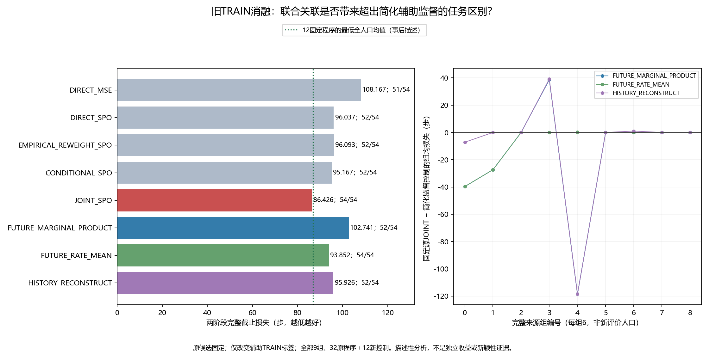

# 纠正后适用性：匹配辅助监督消融中文报告 v1

**仅显示这一固定学习设置的辅助监督区别；尚不证明机制、新颖性或独立收益。** 本轮全部新增分析为**事后描述性开发分析**。原候选、旧原始来源、负结果及主标准保持不变，未新增物理执行或在线LLM。

运行 `run_20261026T135712Z_ccf762941c9d`；冻结 `ccf762941c9dfb0ca2b8be6573215f6c7e3c5f3f`。54单元、9来源组、三任务×不变/变化×三个时点全部保留。32原程序1728行原样复用，12新程序648行新离线支持选择，共44程序2376行；这些不是2376次新机器人运行。

## 方法与预定主判断

源JOINT学习每种纠正之后未来32步的访问分布p、误差加权访问j、平均误差g与实际长度；SPO+关心程序选择造成的完整成本差。所有新控制沿用同一网络、完整公开历史旁路、损失、初始化、RBF基底、折分及1000步优化，只改辅助TRAIN标签。完整任务成本监督不变。

|控制名|简单含义|
|---|---|
|FUTURE_MARGINAL_PRODUCT|仍预测未来访问和平均误差，但用p×g替代j，删除“误差在什么查询处出现”的额外关联|
|FUTURE_RATE_MEAN|将四个纠正候选的未来目标取平均，去掉辅助标签中纠正方式的差别|
|HISTORY_RECONSTRUCT|重建已经看过的真实历史，检验一般辅助学习是否足以解释收益|

时间常数0.125/0.5/2/8控制PI积分适应速度，不是新ARX的混合百分比。所有新版本和源候选保留同样的TRAIN全局未来误差尺度gamma；历史控制并不缺完整成本后续标签或这个全局尺度，只不使用查询相关的未来辅助目标。派生目标不是新实测轨迹，四候选平均不是一条实际轨迹。

主判断：固定源候选在全部54单元的整数总损失，须严格低于三个新两阶段控制各自总损失；不筛任务、不改阈值或权重。任何一个控制持平/更好即关闭本版特定主张，次指标不救活。

|源JOINT − 新控制|均损失差（步）|九组改善/变差/相同|
|---|---|---|
|FUTURE_MARGINAL_PRODUCT/TWO_STAGE|-16.314815|3/1/5|
|FUTURE_RATE_MEAN/TWO_STAGE|-7.425926|2/1/6|
|HISTORY_RECONSTRUCT/TWO_STAGE|-9.500000|2/2/5|

## 全部主要两阶段参考

|程序|成功/54|完整均损失↓|对CONTINUE0.5有害/有利/同|成功转失败/反向改善|已有获取步数|
|---|---|---|---|---|---|
|DIRECT_MSE/TWO_STAGE|51/54|108.166667|16/10/28|1/1|649|
|DIRECT_SPO/TWO_STAGE|52/54|96.037037|10/15/29|0/1|522|
|EMPIRICAL_REWEIGHT_SPO/TWO_STAGE|52/54|96.092593|11/14/29|0/1|506|
|CONDITIONAL_SPO/TWO_STAGE|52/54|95.166667|8/12/34|0/1|503|
|JOINT_SPO/TWO_STAGE|54/54|86.425926|13/12/29|0/3|694|
|FUTURE_MARGINAL_PRODUCT/TWO_STAGE|52/54|102.740741|15/11/28|0/1|716|
|FUTURE_RATE_MEAN/TWO_STAGE|54/54|93.851852|18/11/25|0/3|939|
|HISTORY_RECONSTRUCT/TWO_STAGE|52/54|95.925926|8/13/33|0/1|522|

以上对照都读同一完整因果公开历史；所有原12固定程序及固定获取学习程序仍在全表。每个precritic仅以其确切冻结receiver的真实选择结局作为目标；没有在新控制之间跨接不匹配critic和receiver，也没有拿事后最优叶子训练获取决策。

## 九组完整结果

|组|时点|源JOINT|访问×均误差|四纠正平均|历史重建|
|---|---|---|---|---|---|
|0|16|80.167|119.833|119.833|87.333|
|1|32|59.667|87.000|87.000|59.667|
|2|64|64.667|64.667|64.667|64.667|
|3|16|113.667|75.000|113.667|74.500|
|4|32|88.000|206.500|87.833|206.500|
|5|64|60.833|60.833|60.833|60.833|
|6|16|100.500|100.500|100.500|99.500|
|7|32|97.833|97.833|97.833|97.833|
|8|64|112.500|112.500|112.500|112.500|

每组6单元；三折训练集重叠，旧TRAIN已用于开发，因此不报名义显著性、置信区间或独立泛化优势。全部44×18=792个任务/条件/时点分格见CSV，均每格3来源组；不能把相关时间步当独立样本。上一轮相对最低固定程序23总步的优势及单组集中现象不因本轮消融自动消失。

## 全部44程序

|程序|成功/54|完整均损失↓|对CONTINUE0.5有害/有利/同|成功转失败/反向改善|已有获取步数|
|---|---|---|---|---|---|
|DIRECT_MSE/CONTINUE|52/54|91.333333|11/12/31|0/1|0|
|DIRECT_MSE/VALIDATE8|52/54|87.685185|11/12/31|0/1|368|
|DIRECT_MSE/MOVE_MEASURE|52/54|135.611111|41/5/8|2/3|1759|
|DIRECT_MSE/TWO_STAGE|51/54|108.166667|16/10/28|1/1|649|
|DIRECT_SPO/CONTINUE|52/54|88.018519|8/24/22|0/1|0|
|DIRECT_SPO/VALIDATE8|52/54|86.796296|4/20/30|0/1|368|
|DIRECT_SPO/MOVE_MEASURE|53/54|122.500000|38/8/8|1/3|1759|
|DIRECT_SPO/TWO_STAGE|52/54|96.037037|10/15/29|0/1|522|
|EMPIRICAL_REWEIGHT_SPO/CONTINUE|52/54|88.462963|8/22/24|0/1|0|
|EMPIRICAL_REWEIGHT_SPO/VALIDATE8|51/54|95.259259|5/16/33|0/0|368|
|EMPIRICAL_REWEIGHT_SPO/MOVE_MEASURE|53/54|122.648148|38/8/8|1/3|1759|
|EMPIRICAL_REWEIGHT_SPO/TWO_STAGE|52/54|96.092593|11/14/29|0/1|506|
|CONDITIONAL_SPO/CONTINUE|51/54|96.222222|4/17/33|0/0|0|
|CONDITIONAL_SPO/VALIDATE8|51/54|96.018519|3/14/37|0/0|368|
|CONDITIONAL_SPO/MOVE_MEASURE|53/54|123.666667|40/6/8|1/3|1759|
|CONDITIONAL_SPO/TWO_STAGE|52/54|95.166667|8/12/34|0/1|503|
|JOINT_SPO/CONTINUE|52/54|88.259259|7/18/29|0/1|0|
|JOINT_SPO/VALIDATE8|52/54|86.944444|3/18/33|0/1|368|
|JOINT_SPO/MOVE_MEASURE|53/54|122.074074|38/8/8|1/3|1759|
|JOINT_SPO/TWO_STAGE|54/54|86.425926|13/12/29|0/3|694|
|FIXED/CONTINUE/0.125|52/54|88.203704|9/25/20|0/1|0|
|FIXED/CONTINUE/0.5|51/54|99.425926|0/0/54|0/0|0|
|FIXED/CONTINUE/2.0|52/54|101.925926|24/1/29|0/1|0|
|FIXED/CONTINUE/8.0|49/54|129.722222|26/4/24|4/2|0|
|FIXED/VALIDATE8/0.125|52/54|86.851852|6/20/28|0/1|368|
|FIXED/VALIDATE8/0.5|51/54|99.425926|0/0/54|0/0|368|
|FIXED/VALIDATE8/2.0|52/54|103.759259|20/2/32|0/1|368|
|FIXED/VALIDATE8/8.0|48/54|136.055556|25/1/28|4/1|368|
|FIXED/MOVE_MEASURE/0.125|53/54|123.277778|38/8/8|1/3|1759|
|FIXED/MOVE_MEASURE/0.5|53/54|127.314815|43/3/8|1/3|1759|
|FIXED/MOVE_MEASURE/2.0|49/54|159.648148|42/2/10|3/1|1759|
|FIXED/MOVE_MEASURE/8.0|47/54|180.740741|42/3/9|6/2|1759|
|FUTURE_MARGINAL_PRODUCT/CONTINUE|52/54|89.462963|4/17/33|0/1|0|
|FUTURE_MARGINAL_PRODUCT/VALIDATE8|52/54|88.074074|3/16/35|0/1|368|
|FUTURE_MARGINAL_PRODUCT/MOVE_MEASURE|53/54|124.166667|40/6/8|1/3|1759|
|FUTURE_MARGINAL_PRODUCT/TWO_STAGE|52/54|102.740741|15/11/28|0/1|716|
|FUTURE_RATE_MEAN/CONTINUE|52/54|89.537037|6/13/35|0/1|0|
|FUTURE_RATE_MEAN/VALIDATE8|52/54|88.277778|2/14/38|0/1|368|
|FUTURE_RATE_MEAN/MOVE_MEASURE|53/54|124.037037|40/6/8|1/3|1759|
|FUTURE_RATE_MEAN/TWO_STAGE|54/54|93.851852|18/11/25|0/3|939|
|HISTORY_RECONSTRUCT/CONTINUE|52/54|87.925926|6/21/27|0/1|0|
|HISTORY_RECONSTRUCT/VALIDATE8|52/54|86.796296|3/19/32|0/1|368|
|HISTORY_RECONSTRUCT/MOVE_MEASURE|53/54|122.185185|38/8/8|1/3|1759|
|HISTORY_RECONSTRUCT/TWO_STAGE|52/54|95.925926|8/13/33|0/1|522|

获取费用已经在原完整截止损失内包含一次，表内步数是所选旧事实路径的物理费用，不是新增执行。失败仍为截止损失500；实际已耗步数按来源记录。提前结束保留分母；终止单元中程序名和默认时间常数是分配/终止元数据，不表示终止后执行了新动作。

## 缺失、失败与不利更新

完整162个RETURN位置中134个有效，28个按原提前任务结束/获取结束登记；完整54例可用性见 `source_availability.json`。空历史不造零误差标签；所有训练目标文件及哈希在 `training_labels/`，保留事实源目标哈希与派生规则。

2376行选择里96行选到原失败叶子（新648行中19行），775行比同单元CONTINUE0.5损失更高（新行中183行）。全部失败和不利选择分别在CSV中，不删困难子集。它们会重复引用相同来源叶子，不能算成独立新物理失败；源TRAIN648次中的39个任务失败仍全部保留。

有害更新是配对完整损失更高的描述，包含获取和后续状态变化，不能单靠接受/拒绝分项认定因果；同获取0.5对照也逐行保留。控制的标签监督难度、熵和梯度大小不同，即便相同权重也不意味着相同优化难度，胜负不能唯一归因为某种物理机制。

## 数值、预测与收益分开

派生张量的p归一化、j总量=g、有限非负、真实历史窗口及短窗口登记是数值/数据资格，不是模型预测或任务收益。32步目标中的误差仍是未资格化工作模型dXY=.01sentXY的观测残差，包含噪声/瞬态/接触；p×g是人为零协变监督，不能称为实测无噪声误差。没有使用真扰动、实际噪声或私人接触力训练。

源候选预测MSE及未覆盖质量保留在上一轮报告，本轮新控制目标语义各异，不将历史重建误差冒作未来预测质量。排名分数不作概率校准或安全保证，完整任务损失才是本轮主判断。

## 完整拟合和来源成本

新增科学拟合9个辅助风险网络×1000SGD=9000更新、9个RBF前置模型；独立另9网络9000更新、9个lstsq。原候选和其余旧32程序未重训；旧学习科学15神经/15000更新+15RBF、独立同量费用另列。新主拟合28.400秒，独立模型审计52.561秒，重放审计18.288秒，全管线119.764秒；报告/作图耗时另有回执。

新增独立审计核对3415296个字段，最大参数绝对差6.61970478433e-15，预定容差5e−8且实际选择完全一致。禁用主标签、网络/优化及特征/选择/统计入口；共享NumPy库，不能叫独立机构或独立框架审计。原152224个未来标签字段的事件复算沿用不可变来源审计哈希，未把其重复计算成新增证据。

19项新数组测试与2139项哈希未变旧检查合计2158唯一项，旧6组张量另列；开发两轮合成训练计数 `{"fit_attempts": 6, "optimizer_steps": 18, "independent_fit_attempts": 6, "independent_optimizer_steps": 18}`，重复不增加唯一测试数。编译/依赖/全仓秘密、新索引字节补充扫描、普通/暂存差异及实际Git与磁盘字节核对见验证目录。

新增环境创建、全部重置、控制步、物理帧、原策略查询、机器人种子、响应/逆模型、底层策略训练、在线LLM API均0。历史物理TRAIN648次、77563控制步、33048全部重置、16911815帧单列；无旧人口重采，无CAL/TEST用于本轮学习/评价，无回滚/重置撤回位移。

## 后续判断与查新

三个简化监督都没有在此固定学习设置匹配源候选，可保留“值得进一步区分”的有限证据；它不是普遍必要性证明，也可能有辅助优化路径和单组来源解释。下一协议必须具有超出普通辅助任务/完整风险预测的实际决策区别，再考虑独立自身历史部署；本轮不授权新增物理采集。

[UNREAL](https://arxiv.org/abs/1611.05397)已有共享表示的辅助任务；[Discovery of Useful Questions](https://proceedings.neurips.cc/paper_files/paper/2019/hash/10ff0b5e85e5b85cc3095d431d8c08b4-Abstract.html)研究学习辅助问题；[Continual Auxiliary Task Learning](https://proceedings.neurips.cc/paper_files/paper/2021/hash/68331ff0427b551b68e911eebe35233b-Abstract.html)已联合考虑辅助预测与收集其数据的行为。新增阅读限官方摘要，未声称全文复现或迁移其定理。

此前SF、VaGraM、SPO、MDE、OCCAM、TOM以及用户要求Residual RL、GAUGE、Poke and Strike查新继续保留。辅助任务有用、探测改变后续状态、门控/混合/收益预测本身都不足以构成创新。真实状态耦合算子目前仍只是构造软件，未分配实际训练/校准/评价人口。

DIRECT_C8和原积分完整强基线不在本来源树同入口叶子中，不能跨历史拼接宣称超过它们。未来独立评价须包含这些、始终探测/不更新、标准变化检测、历史辨识、任务获取及同预算MDE/OCCAM/TOM等组合参考；须有候选自身真实时序、完整费用、组/流统计与消融。本轮未完成CCF A目标。

## 文件与追溯

`manifest.json`绑定科学冻结、原候选模型及源结果；`bank.json`/`models/`/`training_labels/`保留末步模型和全部派生监督；`fit_attempts.jsonl`/两个独立审计/`replay.jsonl`保留全程。`selected_rows.json`/`results.json`及四个CSV保留全部2376行、失败、不利选择和792分格。原1728行以SOURCE_ROW_REUSED带原日志哈希继承，未伪造新决策。`mechanism_decision.json`是本轮固定主标准结论，原始大文件和全部实际恢复副本保留。

