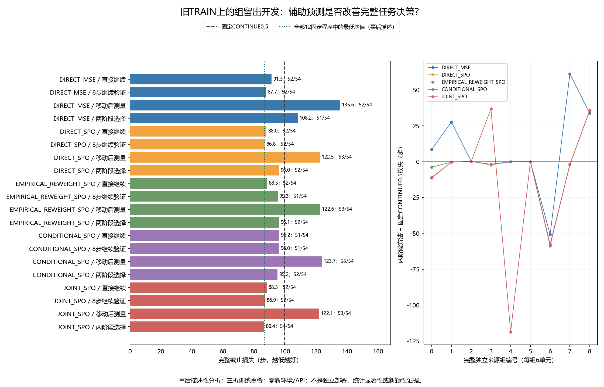

# 纠正后适用性辅助学习：中文开发报告 v1

**仅满足本轮开发必要条件，不能宣称独立收益。** 本报告新增分析全部为**事后描述性分析**。候选两阶段成功54/54，平均完整截止损失86.425926步。旧TRAIN来源用于开发留出重放；没有新的真实在线部署或独立资格人口。

运行 `run_20261026T132315Z_7a8c4c50b420`；科学冻结 `7a8c4c50b4205e00b1f4ea0df5cd30c321bb99ff`。完整32程序×54单元=1728次离线选择；9组、3任务×2条件×3时点全部保留。所有科学拟合、参数独立复算和日志/统计审计已完成。

## 方法名字与问题

DIRECT 表示直接用完整任务损失训练，MSE为均方误差；SPO+表示训练时关心选错程序的代价。EMPIRICAL_REWEIGHT把候选纠正之后预测会访问的查询，用已有历史条件误差重新加权。CONDITIONAL学习各查询条件下误差；JOINT直接学习“在哪里访问、在那里误差多大”的加权分布。TWO_STAGE先选是否继续/验证/移动，再在真实返回节点选PI时间常数；时间常数越小积分适应越快，0.125/0.5/2/8并不是采用新ARX的百分比。

候选只检验辅助监督是否帮助完整任务决策。p和条件误差可代数分解成j，没有自动的信息优势；有限参数和损失函数的不同至多说明学习偏置。所有版本保留相同完整公开历史及直接风险旁路，经验重加权未覆盖箱保留缺失质量。没有把更低模型残差当成任务收益，也没有反演工作模型。

## 预定主标准及结果

|候选JOINT两阶段 − 对照|平均损失差（步）|
|---|---|
|DIRECT_MSE/TWO_STAGE|-21.740741|
|DIRECT_SPO/TWO_STAGE|-9.611111|
|EMPIRICAL_REWEIGHT_SPO/TWO_STAGE|-9.666667|
|CONDITIONAL_SPO/TWO_STAGE|-8.740741|
|FIXED/CONTINUE/0.125|-1.777778|
|FIXED/CONTINUE/0.5|-13.000000|
|FIXED/CONTINUE/2.0|-15.500000|
|FIXED/CONTINUE/8.0|-43.296296|
|FIXED/VALIDATE8/0.125|-0.425926|
|FIXED/VALIDATE8/0.5|-13.000000|
|FIXED/VALIDATE8/2.0|-17.333333|
|FIXED/VALIDATE8/8.0|-49.629630|
|FIXED/MOVE_MEASURE/0.125|-36.851852|
|FIXED/MOVE_MEASURE/0.5|-40.888889|
|FIXED/MOVE_MEASURE/2.0|-73.222222|
|FIXED/MOVE_MEASURE/8.0|-94.314815|

严格按全部54个单元整数总损失比较，不用四舍五入后差值筛选；候选必须低于其余四个两阶段学习参考和全部12个固定程序。成功率不作隐藏筛选，完整披露。三折训练集重叠且旧来源已经用于研究开发，因此本表不提供名义显著性、置信区间或独立泛化主张。

必要条件虽满足，证据很弱：相对12固定程序中最低全人口均值的 `FIXED/VALIDATE8/0.125`，候选总损失仅少23步，即平均少0.425926步。该固定程序是事后描述中的最小者，原主标准仍逐一比较全部12个；不将它替换为新的调参目标。九组中仅组4改善，四组变差、四组相同，正负抵消后只剩微小均值差。54/54不能作为独立成功率证据。

## 全部学习程序

|程序|成功/54|平均完整损失↓|相对CONTINUE0.5有害/有利/相同|成功→失败/失败→成功|已有获取步数|
|---|---|---|---|---|---|
|DIRECT_MSE/CONTINUE|52/54|91.333333|11/12/31|0/1|0|
|DIRECT_MSE/VALIDATE8|52/54|87.685185|11/12/31|0/1|368|
|DIRECT_MSE/MOVE_MEASURE|52/54|135.611111|41/5/8|2/3|1759|
|DIRECT_MSE/TWO_STAGE|51/54|108.166667|16/10/28|1/1|649|
|DIRECT_SPO/CONTINUE|52/54|88.018519|8/24/22|0/1|0|
|DIRECT_SPO/VALIDATE8|52/54|86.796296|4/20/30|0/1|368|
|DIRECT_SPO/MOVE_MEASURE|53/54|122.500000|38/8/8|1/3|1759|
|DIRECT_SPO/TWO_STAGE|52/54|96.037037|10/15/29|0/1|522|
|EMPIRICAL_REWEIGHT_SPO/CONTINUE|52/54|88.462963|8/22/24|0/1|0|
|EMPIRICAL_REWEIGHT_SPO/VALIDATE8|51/54|95.259259|5/16/33|0/0|368|
|EMPIRICAL_REWEIGHT_SPO/MOVE_MEASURE|53/54|122.648148|38/8/8|1/3|1759|
|EMPIRICAL_REWEIGHT_SPO/TWO_STAGE|52/54|96.092593|11/14/29|0/1|506|
|CONDITIONAL_SPO/CONTINUE|51/54|96.222222|4/17/33|0/0|0|
|CONDITIONAL_SPO/VALIDATE8|51/54|96.018519|3/14/37|0/0|368|
|CONDITIONAL_SPO/MOVE_MEASURE|53/54|123.666667|40/6/8|1/3|1759|
|CONDITIONAL_SPO/TWO_STAGE|52/54|95.166667|8/12/34|0/1|503|
|JOINT_SPO/CONTINUE|52/54|88.259259|7/18/29|0/1|0|
|JOINT_SPO/VALIDATE8|52/54|86.944444|3/18/33|0/1|368|
|JOINT_SPO/MOVE_MEASURE|53/54|122.074074|38/8/8|1/3|1759|
|JOINT_SPO/TWO_STAGE|54/54|86.425926|13/12/29|0/3|694|

## 全部固定程序

|程序|成功/54|平均完整损失↓|相对CONTINUE0.5有害/有利/相同|成功→失败/失败→成功|已有获取步数|
|---|---|---|---|---|---|
|FIXED/CONTINUE/0.125|52/54|88.203704|9/25/20|0/1|0|
|FIXED/CONTINUE/0.5|51/54|99.425926|0/0/54|0/0|0|
|FIXED/CONTINUE/2.0|52/54|101.925926|24/1/29|0/1|0|
|FIXED/CONTINUE/8.0|49/54|129.722222|26/4/24|4/2|0|
|FIXED/VALIDATE8/0.125|52/54|86.851852|6/20/28|0/1|368|
|FIXED/VALIDATE8/0.5|51/54|99.425926|0/0/54|0/0|368|
|FIXED/VALIDATE8/2.0|52/54|103.759259|20/2/32|0/1|368|
|FIXED/VALIDATE8/8.0|48/54|136.055556|25/1/28|4/1|368|
|FIXED/MOVE_MEASURE/0.125|53/54|123.277778|38/8/8|1/3|1759|
|FIXED/MOVE_MEASURE/0.5|53/54|127.314815|43/3/8|1/3|1759|
|FIXED/MOVE_MEASURE/2.0|49/54|159.648148|42/2/10|3/1|1759|
|FIXED/MOVE_MEASURE/8.0|47/54|180.740741|42/3/9|6/2|1759|

表内获取步数、执行步数是所选择**已有真实事实路径**的累计，不能算作本轮新增环境开销；原完整截止损失已经包含获取一次，不再重复加费。失败时损失500，实际交互步数仍按原记录；提前成功/获取结束保留在54分母。终止单元中的固定程序名称是分配标记，不表示结束后又执行动作。

## 按来源组检查

|组|时点|DIRECT_MSE|DIRECT_SPO|经验重加权|条件误差|JOINT|
|---|---|---|---|---|---|---|
|0|16|99.667|87.333|87.333|79.833|80.167|
|1|32|87.667|59.667|59.667|59.667|59.667|
|2|64|64.667|64.667|64.667|64.667|64.667|
|3|16|75.000|74.500|75.000|75.000|113.667|
|4|32|206.667|206.500|206.500|206.500|88.000|
|5|64|60.833|60.833|60.833|60.833|60.833|
|6|16|107.333|100.500|100.500|99.500|100.500|
|7|32|161.000|97.833|97.833|98.000|97.833|
|8|64|110.667|112.500|112.500|112.500|112.500|

|来源组|JOINT两阶段 − 最低全人口均值固定程序（步）|
|---|---|
|0|+0.000000|
|1|+0.000000|
|2|+0.000000|
|3|+38.666667|
|4|-118.500000|
|5|+0.000000|
|6|+25.000000|
|7|+14.500000|
|8|+36.500000|

每组含三个任务×不变/变化共6单元。完整576个任务/条件/时点分格见 `all_task_condition_boundary_panels.csv`，每格3组，不按步当独立样本。没有筛除困难任务或只报告有利时点。

## 预测能力与任务收益分别报告

|版本|有效/全部RETURN|成本分数MSE|访问分布平方L2|joint平方L2|均值误差MSE|历史未覆盖质量|
|---|---|---|---|---|---|---|
|DIRECT_MSE|134/162|0.053612|0.578758|0.182371|0.256576|0.766880|
|DIRECT_SPO|134/162|0.128385|0.578778|0.182385|0.256887|0.766864|
|EMPIRICAL_REWEIGHT_SPO|134/162|0.132158|0.575344|0.180104|0.319449|0.765826|
|CONDITIONAL_SPO|134/162|0.117258|0.568582|0.175760|0.234694|0.763715|
|JOINT_SPO|134/162|0.116138|0.573340|0.175208|0.233513|0.765195|

预测指标先在真实RETURN轨迹内对四个候选求均值，再组内汇总、九组均权。全部810个节点×版本位置逐项登记；有效RETURN134个/版本，其余28个按提前任务结束或获取结束保留缺失，绝不补零。预测的长度误差、各组指标及逐节点p/j/g/长度/未覆盖质量保存在 `forecast_diagnostics.json`。

工作模型dXY=.01sentXY仍未资格化；残差包含噪声、控制瞬态、接触和尺度失配，不能视为物理无噪声误差。p=0的条件误差没有标签；经验未观测箱的0是带显式缺失质量的数值编码。风险输出是未裁剪排名分数，MSE不能当校准证据。有效数值、当前预测和完整任务收益是三个分别检验的判断。

反证和未区分解释：JOINT的访问分布预测误差没有全面超过CONDITIONAL，成本MSE也高于DIRECT_MSE；其平均预测未覆盖历史质量约0.765，不能称模型在这些查询上已验证。候选的任务差异可能来自有限样本辅助正则、优化路径或来源组4的特殊结局；本轮没有匹配伪辅助目标/普通未来特征控制来区分这些解释，不能归因为“解决纠正后适用性”。

## 所有失败与不利更新

1728次支持重放选择中，77行选择了原有失败事实叶子；592行完整损失高于同单元CONTINUE0.5。一个源失败可能被多个离线程序选择，这些行不是新的独立物理失败。全部选择、全部失败、全部不利选择分别见 `all_selections.csv`、`all_selected_failures.csv`、`all_harmful_choices.csv`；逐行包含来源案例哈希及同获取0.5对照。不能把接受/拒绝或有害分项当作机制因果效果。

旧TRAIN物理来源648次执行共39个任务失败，全部原记录保留。此次科学管线没有自动重训、额外样本、挑选检查点或替换结果；依赖探测发现Torch未安装，冻结前选择NumPy实现，未安装/改变项目依赖。三轮数组开发检查均通过，重复检查不增加唯一测试数。

## 独立复算与完整成本

科学拟合：15个风险/辅助网络×1000次全批SGD＝15000次更新，15个固定receiver绑定的前置RBF风险拟合；另15次独立数组反向微分重训＝15000次更新、15次lstsq独立复算。主训练耗时36.699秒，独立模型审计95.516秒，重放审计26.517秒；全管线205.623秒，报告/作图时间另记。

独立模型审计核对5562160个数值字段、从原TRAIN事件重建152224个标签字段，最大参数绝对差1.02140518266e-14≤预定5e−8，实际纠正选择完全一致。主网络/初始化/梯度/训练、特征和基底入口禁用后进行独立复算；两实现共享NumPy数值库，不能称独立机构/框架审计。

本轮新增24个数组检查通过，与哈希未变的2115个历史检查回执合计2139项唯一检查，另保留旧6组张量检查；未重跑旧物理测试。三次开发检查合计的合成训练开销为 `{"fit_attempts": 15, "optimizer_steps": 45, "independent_fit_attempts": 15, "independent_optimizer_steps": 45}`，与科学拟合分别登记。编译、依赖、全仓秘密扫描、索引字节补充扫描和普通/暂存差异检查见交付验证目录。

本轮新环境创建/重置/控制步/物理帧、策略查询、机器人种子、响应或逆模型训练、底层策略训练、在线LLM API均为0。旧TRAIN来源成本另列：648次执行、77563控制步、33048次全部重置、16911815物理帧；不能用离线重放把来源物理采集称作免费。旧CAL/TEST没有用于本轮学习或评价；旧统计字节哈希保持不变。

## 查新、限制与后续判断

[SPO](https://arxiv.org/abs/1710.08005)已经研究决策导向的成本预测；[Successor Features](https://arxiv.org/abs/1606.05312)提供策略相关未来特征表示；[VaGraM](https://arxiv.org/abs/2204.01464)讨论预测误差与下游价值目标失配。因此“未来特征＋任务成本”本身不构成新颖性。本轮新增核对主要是官方摘要，未完成这些工作的全文复现；不把其理论保证转移到本系统。

完整查新表见冻结决策文档，继续覆盖MDE、Residual RL、OCCAM、GAUGE、Poke and Strike、TOM及任务相关获取/停止路线。状态相关响应也可属于固定MDP，不能因此宣称超出既有未来特征方法。

本轮仅满足开发必要条件。建议先单独冻结区分真实纠正相关辅助信息与普通辅助正则的同权限消融；不在本结果上调整权重、步数或任务。当前组间集中和微小优势不足以支持大规模采集。机制区别成立后，仍须另行冻结真实状态耦合训练、校准及独立自身历史部署；不可直接宣布收益资格或追加采集。

原DIRECT_C8和MOVE_INTEGRAL完整强对照不在此来源树的同入口叶子中；没有跨历史拼接它们的结局。本轮不能声称超过这两个原强基线。未来独立完整实验必须补齐它们、始终探测/不更新、标准变化检测、历史辨识、任务相关获取及同预算无LLM对照。

还需训练/校准/最终评价分离、候选自身形成的真实时序历史、完整成本优势和消融。此次交付没有完成CCF A目标，也不提供安全或物理稳定保证。

## 可追溯文件

- `manifest.json`：冻结源、输入哈希、零新增物理范围。
- `bank.json` 与 `models/`：全部末步模型与训练摘要；`fixed_receiver_labels.json`保存前置目标绑定。
- `fit_attempts.jsonl`、`model_audit.json`、`replay.jsonl`、`replay_audit.json`：全部尝试、独立复算和决策先于事实叶子读取的日志。
- `results.json`、`forecast_diagnostics.json`、`selected_rows.json`：全量结果、缺失和预测；`development_decision.json`：固定标准结论。
- `presentation/`：四个完整CSV和PNG/SVG图。所有原始大文件、失败及旧实际恢复副本继续保留。

