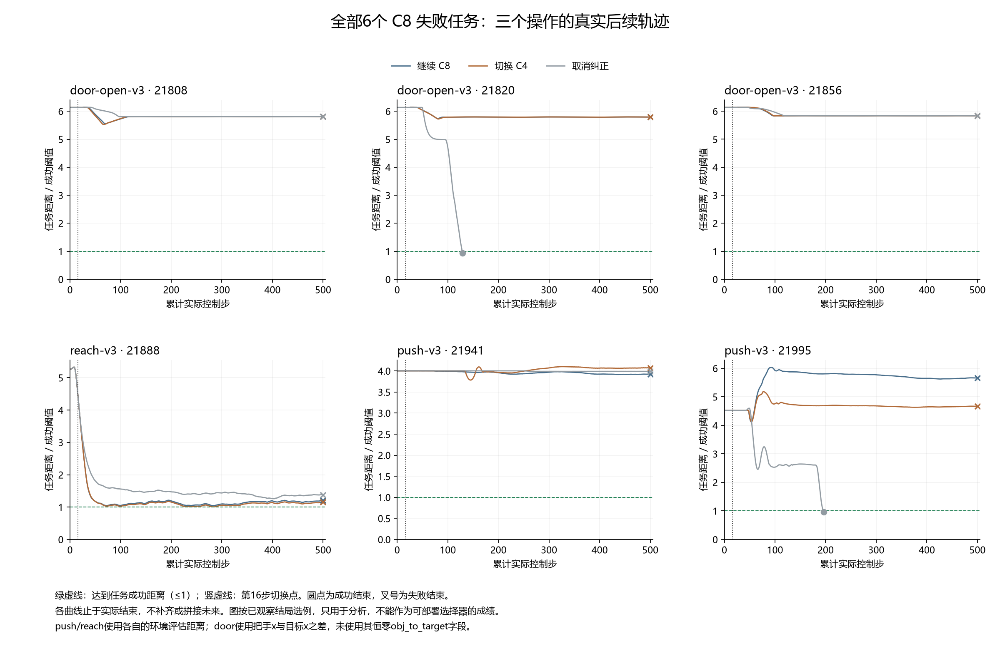
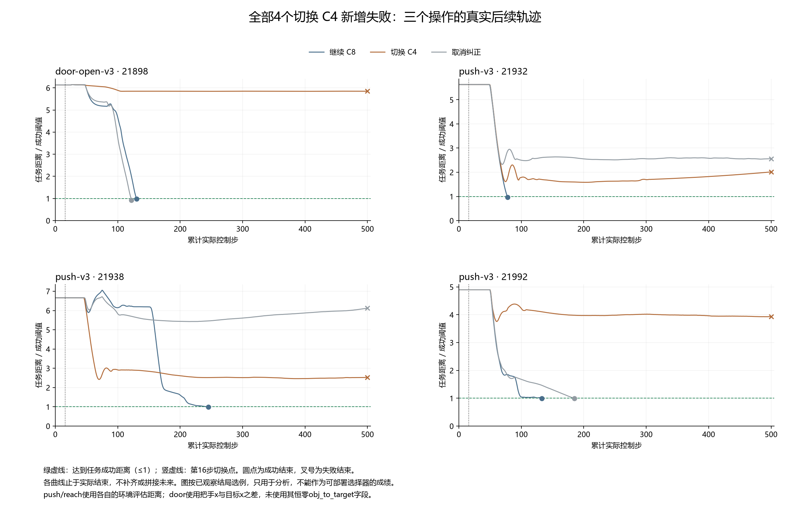

# 中途切换纠正：名字解释与失败分解

这份报告复查已经完成的216个任务单元，不增加机器人执行或API调用。最关键的结果是：**切换C4没有救回继续C8失败的任务，却新增4个失败；取消纠正救回2个任务，同时新增31个失败。** 这是观察结果后的描述性分析，没有训练新选择器，也不构成算法创新证据。

## 方法名字是什么意思

“纠正”可以理解成给动作加补偿。例如机器人本来想直走，实际却总向右偏，就调整指令来抵消偏差。这里的底层策略负责产生原始动作，纠正参数负责调整动作；策略本身没有重新训练。

|名字|通俗解释|
|---|---|
|C4|用最初4步实际探测数据估计出的纠正参数；数字表示用了多少步数据|
|C8|用累计8步实际探测数据估计出的纠正参数|
|CONTINUE_CURRENT／继续C8|第16步后继续用当前的C8纠正|
|SWITCH_SAVED／切换C4|第16步后改用早先保存的C4纠正|
|RUN_UNCORRECTED／取消纠正|第16步后取消补偿，直接使用固定策略输出的动作|

C4和C8是两套参数，不是两个大模型。C4只是保存过，并不表示已经验证成功。切换时机器人继续从当下的位置行动，不会退回过去的位置，也不会重置环境。

三种方法有相同的前16步：先探测4步并保存C4，继续探测到8步得到C8，再使用C8执行到第16步。之后才比较“继续C8、切换C4、取消纠正”。因此，这里的“取消纠正”仍然付过前面的探测费用，与“从一开始就不探测”不同。

本轮没有在线LLM参与。此前的在线API方法是在上层选择是否探测、采用哪个候选纠正或停止，具体纠正数值由主机程序计算。当前实验先测量几种固定操作的实际后果，尚未证明LLM或其他选择器能提前选对。

## 完整结果怎样拆开

与[原始固定操作报告](delayed_switch_effects_development_v1_zh.md)使用同一批216个任务单元、648次执行。成功时损失等于累计实际控制步，失败记500步；下表的差值都是“替代操作减继续C8”，正数表示更差。

|替代操作|结果类别|单元数|损失差之和／步|对全体216单元平均差的贡献／步|
|---|---|---:|---:|---:|
|切换C4|两者均成功|206|+375|+1.736111|
|切换C4|C8失败、替代成功|0|0|0|
|切换C4|C8成功、替代失败|4|+1,414|+6.546296|
|切换C4|两者均失败|6|0|0|
|取消纠正|两者均成功|179|+2,461|+11.393519|
|取消纠正|C8失败、替代成功|2|−675|−3.125000|
|取消纠正|C8成功、替代失败|31|+13,052|+60.425926|
|取消纠正|两者均失败|4|0|0|

四类互斥且覆盖全部单元。分别相加得到原报告的平均损失差：切换C4为+8.282407步，取消纠正为+68.694444步。没有新增统计区间。原报告中C4表现更好的57个单元，全部是成功完成时间上的改善，没有新增成功任务。

“两者均失败”的损失差为零来自统一500步惩罚，不意味着两条物理轨迹相同。所有单元的分类及原始配对损失保存在[完整分解记录](../outputs/reproduction_reviews/delayed_switch_mechanisms_v1/analysis_v1/composition.json)，包含全部31个取消纠正新增失败，未作筛除。

## 全部6个C8失败任务

|单元|任务／种子|继续C8|切换C4|取消纠正|
|---|---|---|---|---|
|8|开门／21808|失败500步|失败500步|失败500步|
|20|开门／21820|失败500步|失败500步|成功129步|
|56|开门／21856|失败500步|失败500步|失败500步|
|88|到达／21888|失败500步|失败500步|失败500步|
|141|推物／21941|失败500步|失败500步|失败500步|
|195|推物／21995|失败500步|失败500步|成功196步|

其中4个任务在三个分支下均失败。这只说明现有三个操作在这些已实现轨迹上没有完成任务，不证明所有未来或其他操作都不可能成功。

到达任务21888的C4轨迹最近达到成功阈值的1.008063倍，仍未进入成功范围。开门21808、21856及推物21941则在较远处停滞。它们不能仅凭一条“失败”标签归为同一物理原因；这些曲线也不足以确定接触、摩擦或估计误差的因果贡献。

## 全部4个切换C4新增失败

|单元|任务／种子|继续C8|切换C4|损失增加／步|
|---|---|---|---|---:|
|98|开门／21898|成功130步|失败500步|370|
|132|推物／21932|成功78步|失败500步|422|
|138|推物／21938|成功245步|失败500步|255|
|192|推物／21992|成功133步|失败500步|367|

推物21938尤其说明短期进展与最终成功不同：切换C4后物体曾更快接近目标，但最终仍未成功；继续C8在245步成功。不能用这条事后曲线直接设计阈值，再把同批数据当独立验证。

## 图怎样读、怎样核对

横轴是从初始执行起累计的实际控制步，包含探测。纵轴是各任务的距离除以自己的成功阈值，越低越接近目标；绿色横线为1。竖线标记第16步；圆点表示成功结束，叉号表示失败结束。每条曲线止于实际结束，不补齐未来，也不拼接分支。不同面板的纵轴范围不同，不能直接比较线条的视觉高度。

推物使用环境记录的物体到目标距离，并逐步核对观测坐标；到达使用环境记录的工具中心点到目标距离，不能以手掌位置代替；开门使用把手x位置与目标x位置之差，因为该环境的`obj_to_target`字段恒为0。全部75,925个控制步的距离判据均与两个已保存成功标记一致。选出的10个单元均保留完整三个分支，前16步距离完全一致。

图使用完整结局及评估器信息选例，只用于事后诊断，不能作为在线决策输入。每个状态只有一次未来实现；“救回”和“新增失败”是本次匹配轨迹的结果，不是单个状态的条件期望效果。

分析脚本为[decompose_delayed_switch_outcomes_20261019.py](../docs/paper/decompose_delayed_switch_outcomes_20261019.py)，核对983个来源绑定，包括原始冻结输入和原始记录；保存全部648次执行的距离摘要及选中30条轨迹。[生成回执](../outputs/reproduction_reviews/delayed_switch_mechanisms_v1/analysis_v1/receipt.json)记录软件、源文件、环境判据和产物哈希，[视觉复核](../outputs/reproduction_reviews/delayed_switch_mechanisms_v1/analysis_v1/visual_review.json)另存，不改写生成回执。

本次新增环境步、重置、API调用、模型拟合、策略查询和科学种子均为0。来源实验已支付75,925控制步；原始模型的3,840控制步等完整费用继续由原报告保留，本次只复查，不将历史成本抹为零。实现和测试输入未改变，沿用已通过的1,146项冻结测试；本次另做产物重建核对、编译、依赖、秘密扫描和差异检查，见[交付检查](../outputs/reproduction_reviews/delayed_switch_mechanisms_v1/validation_v1/delivery_review_v1.json)。

来源运行：`delayed_switch_effects_20261019T093447Z_5193855b2123`；清单：`13e29ef1bf5f09dd8ea39f1f61f04293c091ed0d038293a7ea8475e13a806c3f`；冻结实现提交：`5193855b2123a17277c63c817529d3fe653422d0`。

这次分解支持继续保留C8强对照，并认真评估现有操作是否足够。它既没有证明一个选择器无用，也没有证明某个新操作有效；新决策机制仍需要在合法历史、匹配成本和独立数据上验证。完整论文目标仍未完成。
