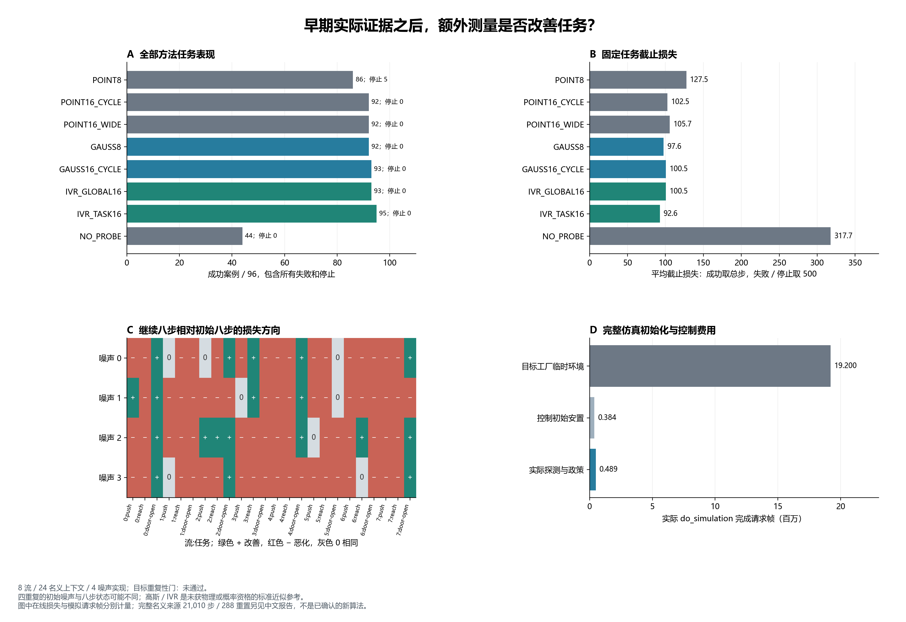

# 早期测量实验：结果解读与研究取舍

768 次真实方法执行和全量执行记录审计均已完成。任务加权 IVR 标准参考达到
95/96 成功，但预登记的“额外八步收益方向重复性”门未通过。当前得到的是
更强的标准基线和一个保留的负结果，尚未形成可投稿的新方法贡献。

[中文完整报告](early_evidence_development_v1.md)包含全部八方法、任务／流／噪声分层及全部失败和停止。
[冻结协议](../docs/protocols/early_evidence_development_v1.md)、
[完整审计](../outputs/early_evidence/analysis_v1/audit.json)、
[事后描述性分解](../outputs/early_evidence/diagnostics_v1/results.json)与
[高斯参考数学说明](../docs/research/gaussian_response_reference_math_v1.md)可核查以下结论。

## 全部方法与费用口径

每方法 96 次执行；成功取实际总步，失败或停止取 500 作为截止损失。
探测和任务共享 500 步预算。下表没有排除停止或失败。

| 方法 | 成功 / 96 | 停止 | 平均探测步 | 平均在线步 | 平均截止损失 |
|---|---:|---:|---:|---:|---:|
| POINT8 | 86 | 5 | 8 | 101.8958 | 127.5208 |
| POINT16_CYCLE | 92 | 0 | 16 | 102.5208 | 102.5208 |
| POINT16_WIDE | 92 | 0 | 16 | 105.6771 | 105.6771 |
| GAUSS8 | 92 | 0 | 8 | 97.6354 | 97.6354 |
| GAUSS16_CYCLE | 93 | 0 | 16 | 100.5000 | 100.5000 |
| IVR_GLOBAL16 | 93 | 0 | 16 | 100.5000 | 100.5000 |
| IVR_TASK16 | 95 | 0 | 16 | 92.5833 | 92.5833 |
| NO_PROBE | 44 | 0 | 0 | 317.6875 | 317.6875 |

每个使用名义模型的方法还完整承担旧来源的 21,010 个控制步／288 次控制重置，
按 96 单元摊销为 218.8542 步／3 次重置；物理来源只采集一次。
IVR_TASK16 含来源的平均步数为 311.4375，NO_PROBE 为 317.6875。
这个摊销比较不包含统一重测的旧来源内部初始化，也不代表真实机器人或计算时间费用。

本轮新增 97,824 个 Env.step／768 次控制初始重置。仪器另记录目标工厂
38,400 次临时重置，合计顶层重置 39,168 次；do_simulation 完成请求帧
20,073,120，其中目标工厂 19,200,000、控制初始安置 384,000、实际控制
489,120。每个控制步为五帧、0.0125 秒；费用账和在线控制步分别报告。
API 调用、自然经验记忆写入与策略权重更新均为零。

## 主重复性门为何失败

POINT16_CYCLE 对 POINT8 的全部 96 对案例均有匹配的初始八步见证。
继续测量新增 7 次成功、失去 1 次成功，平均截止损失降低 25 步；但只有
19 对损失改善，69 对恶化，8 对相同。总体平均改善不等于每个上下文的
收益方向都稳定，也不意味着值得对所有案例继续探测。

24 个名义上下文均完整、均有非平局，其中 8 个在四次噪声实现之间方向
反转，比例 33.33%，超过冻结上限 25%。留一重复已预测方向的一致率
73/84 = 86.90%，非零覆盖 84/88 = 95.45%，这两项通过仍不能替代反转门。
四次实现的初始噪声不同，前八步状态也可能不同；该门描述名义上下文的
重复性，不能解释成完全相同隐状态下的条件收益分布。

## 强基线改变了什么判断

以下分解在完整结果之后制作，只作描述，没有新增假设检验、显著性、门槛或选择器。
损失差均为“候选 − 对照”，负数表示候选平均损失较低；新增／失去成功是匹配案例计数。

| 候选 / 对照 | 新增成功 | 失去成功 | 损失改善 / 恶化 / 相同 | 平均损失差 |
|---|---:|---:|---|---:|
| POINT16_CYCLE / POINT8（预登记主比较） | 7 | 1 | 19 / 69 / 8 | −25.0000 |
| GAUSS8 / POINT8 | 7 | 1 | 29 / 44 / 23 | −29.8854 |
| GAUSS16_CYCLE / GAUSS8 | 2 | 1 | 10 / 79 / 7 | +2.8646 |
| IVR_GLOBAL16 / GAUSS16_CYCLE | 0 | 0 | 0 / 0 / 96 | 0.0000 |
| IVR_TASK16 / IVR_GLOBAL16 | 2 | 0 | 35 / 18 / 43 | −7.9167 |
| IVR_TASK16 / POINT16_WIDE | 3 | 0 | 64 / 24 / 8 | −13.0938 |
| IVR_TASK16 / GAUSS8 | 4 | 1 | 11 / 81 / 4 | −5.0521 |

GAUSS8 与 POINT8 使用同样八步测量，整体成功数已达到固定十六步点估计的
92/96，平均截止损失也较低。因此，先前点估计控制器下继续测量的收益，
不能直接解释为比强有界控制器更高的信息价值。Gaussian 允许有限但直接逆
不稳定的点参数进入严格凸有界目标；这些案例的点逆无效不等于没有可执行控制。

IVR_GLOBAL16 的 96 个案例都选择 X4/Y4。对每案例核对全部步骤的命令、
原政策、前后观测、执行输入及 RNG，均与 GAUSS16_CYCLE 相同；它在本轮
没有形成不同于固定循环探测的实际分支。这个相同结论只覆盖列明的轨迹字段，
没有验证完整隐状态。

IVR_TASK16 的四种保存程序序列为 X4/Y4 29 次、Y4/Y4 32 次、X4/X4 16 次、
Y4/X4 19 次，相对 GLOBAL 有 67/96 次序列变化。新增的两次成功均在
door-open-v3；两者共同成功的 93 对平均仅节省 0.1075 步。任务加权的总体
均值改善主要由少数失败避免贡献，不能写成三个任务全面加速。

相对更便宜的 GAUSS8，IVR_TASK16 多成功三例，但失去一例原成功，81/96
对的损失更高，共同成功的 91 对平均多用 7.6813 步。这使是否继续测量成为
有实际代价的问题；本轮并没有得到可靠的在线继续／停止决策器。

## 对申请材料与后续研究的含义

可以据实展示：连续闭环的可复核执行、保存决策驱动动作、强基线比较、完整费用
和失败保留。这轮没有在线 LLM；此前的
[GLM 闭环报告](online_calibrated_agent_development_v1.md)单独保存，不能把本轮
标准控制结果写成 LLM 带来的收益。

任务加权 IVR、有界逆和 Gaussian 矩控制都有既有方法来源，见
[原始文献边界](../docs/research/gaussian_reference_prior_art_v1.md)。95/96 只是
这批开发上下文中的结果，没有独立确认、合格概率模型或新颖性证明。
24 名义上下文及四噪声重复也不应写成 96 个独立扰动上下文。

后续机制需要在 GAUSS8、两种固定十六步和 IVR_TASK16 的共同对照下，明确
怎样使用当前证据避免不必要测量，同时保留少数救回失败的收益。重新拟合旧
标签或调一个停止阈值不足以解决这个贡献缺口。若设计新机制，必须先界定
与已有任务实验设计的差别，再冻结新协议并独立执行；当前保留种子未动用。

运行 `early_evidence_20261015T015710Z_a9ec09feaf24`；冻结源
`a9ec09feaf2499420a17015f3aed379d14199de0`；清单
`35439398e20fc761b51355c6b9833aad899c1dff4aa9fd4d27a778a46ddbb414`。
