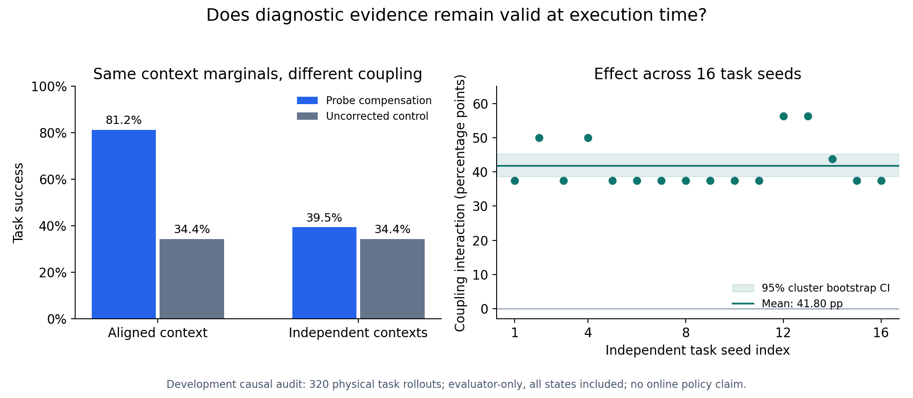

# Evidence persistence: matched-marginal causal feasibility

Run: `evidence_persistence_20261013T085037Z_6b88d1b48e41`

Manifest: `4eb8ad74c102163067a6f6b294854a3d74c362c8a63f6cd8903c262aec7c6b8a`

Source commit: `6b88d1b48e41162d252b49653b06041b52f30dfb`

Status: **COMPLETED_FEASIBILITY_PASS**. This is a development mechanism result,
not a paper-readiness certificate, online policy evaluation, or recovery claim.

## Question and design

Can evidence accurately describe the probe-time execution mechanism yet be
poorly applicable to the intervention-time context? For every one of 16 fresh
task seeds (8000--8015), we crossed all four registered bias conditions during
probing with all four conditions during task execution. The policy, probe,
bounded compensation construction, and conditions were unchanged. Source and
target context marginals were exactly uniform in both comparisons.

The aligned comparison averages diagonal source=target cells. The independent
comparison averages the full 4x4 table, including its diagonal. All task states
are included, without initial-failure filtering. Both methods execute from the
same seed-specific initial state; all four probe-grounded plans are recorded
before any target outcome for that seed.



## Registered results

| Method | Aligned context success | Independent context success | Mean logical steps, aligned / independent |
|---|---:|---:|---:|
| Probe compensation | 52/64 (81.25%) | 101/256 (39.45%) | 211.48 / 393.86 |
| Uncorrected | 22/64 (34.38%) | 88/256 (34.38%) | 368.86 / 368.86 |

The registered difference-in-differences is **+41.80 percentage points**,
with a **[38.67, 45.31]** 95% task-seed cluster-bootstrap interval. Aligned
probe benefit is +46.88 points. The frozen thresholds were interaction >=10
points, aligned benefit >=10 points, and a positive lower interval bound.
All 16 clusters completed; all registered feasibility requirements passed.

The 512 table rows are not 512 independent trials. Collection performed 320
physical task rollouts and 64 probes, using 108,052 task steps plus 4,096 probe
steps. Uncorrected outcomes are reused across source contexts with explicit
branch IDs, yielding 192 cached logical rows. Their zero coupling effect is a
negative control enforced by source independence and balanced weighting, not
additional empirical evidence from independent repeated controls.

Logical path cost includes the 64 probe steps for compensation and the actual
task steps until success or the fixed horizon. Independent-context compensation
had only +5.08 points of task success over control while using more steps on
average; this contrast is descriptive and was not a second promotion test.

## Scientific interpretation

The results support that probe-to-execution context persistence affects
bounded compensation utility in this matched-marginal development setting.
The high aligned performance cannot be explained solely by different frequencies
of easy target conditions, because target marginals are identical. The same
probe-grounded decisions were evaluated in both coupling comparisons.

This experiment does not explain every historical memory failure: those used
different noise processes, case selection, and chronological histories. It
isolates a prospective mechanism worth studying. It also does not establish
novelty: compensation for a bias is expected to work best when that bias
persists. The paper-level challenge remains estimating action-relevant evidence
validity and making cost-effective reacquisition decisions under unknown change.

The first practical next step is a separately frozen method-development study
with a strong prior-action baseline, periodic refresh, recent-history system
identification, and cost-aware change detection. A cheap measurement should be
selected for whether it distinguishes action-relevant contexts, not merely
because a generic mechanism label is uncertain. Independent streams and broader
tasks remain necessary before submission.

## Integrity and reproduction

The [independent audit](../outputs/evidence_persistence/analysis_v1/audit.json)
verified all 80 decision records, 512 outcome records, source and artifact
hashes, contiguous event sequences, all-plans-before-outcomes chronology,
decision/outcome association, reset identity, cache provenance, exact factorial
population, physical and logical budgets, and reproduction of frozen statistics.
No API calls, memory writes, threshold tuning, or historical-seed execution
occurred. The original run is immutable and must not be rerun or extended.
The frozen source-file byte hashes also match the original Git blobs. A scoped
`.gitattributes` rule preserves the exact output bytes across checkout platforms
so line-ending conversion cannot silently invalidate artifact hashes.

```powershell
.\.venv\Scripts\python.exe scripts/analyze_evidence_persistence.py `
  --run-dir outputs/evidence_persistence/development_v1/evidence_persistence_20261013T085037Z_6b88d1b48e41 `
  --output outputs/evidence_persistence/analysis_reproduction
```

Use a new output directory. Plotting is optional and runs separately with
Matplotlib 3.10.8; the experiment virtual environment remains unchanged:

```powershell
python scripts/render_evidence_persistence.py `
  --audit outputs/evidence_persistence/analysis_v1/audit.json `
  --output outputs/evidence_persistence/analysis_v1/figure.png
```

The full suite passed 565 tests, including synthetic causal-estimand tests,
complete mocked execution, and deliberate chronology/cache/provenance failures.
Synthetic tests are engineering checks only and contribute no scientific result.
