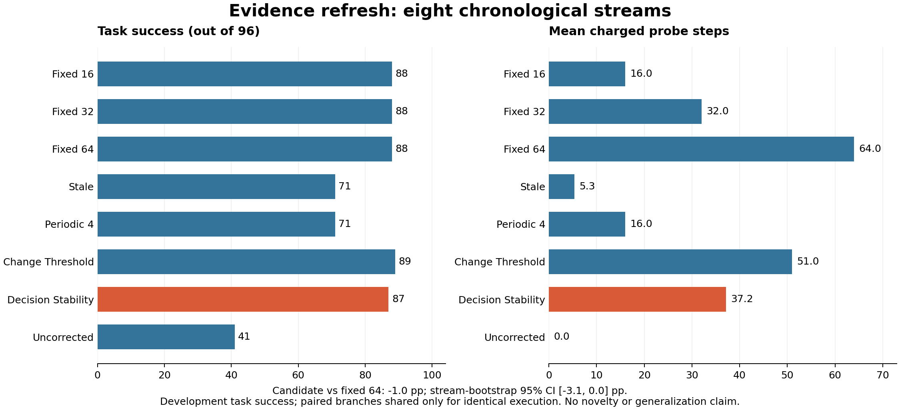

# Prefix evidence refresh fails the strong-baseline gate

The completed frozen study rejects the current action-stability acquisition
candidate as a competitive development method. It saved probe steps relative
to fixed 64-step acquisition, but fixed 16 and 32 steps both obtained one more
successful task at lower probe cost. This is an observed Pareto-dominance gate,
not a statistical proof that the candidate is worse in the underlying population.

## Registered result

Eight independent chronological streams contain 96 new task seeds, 8200--8295.
Four streams retain one bias context and four change context every three
episodes. All states are included; these are task successes, not recoveries
conditioned on initial failure. Each method has its own accepted-only cache.

| Method | Success / 96 | Mean probe steps | Mean total path steps | Stationary / 48 | Abrupt / 48 |
|---|---:|---:|---:|---:|---:|
| Fixed 16 | 88 | 16.00 | 116.93 | 44 | 44 |
| Fixed 32 | 88 | 32.00 | 131.89 | 43 | 45 |
| Fixed 64 | 88 | 64.00 | 163.56 | 43 | 45 |
| Stale cache | 71 | 5.33 | 183.53 | 48 | 23 |
| Periodic 4 | 71 | 16.00 | 194.41 | 43 | 28 |
| Change threshold | 89 | 51.00 | 146.06 | 43 | 46 |
| **Decision stability** | **87** | **37.17** | **141.41** | **43** | **44** |
| Uncorrected | 41 | 0.00 | 333.27 | 22 | 19 |



The candidate-minus-fixed-64 difference is -1.04 percentage points, with a
95% whole-stream bootstrap interval [-3.12, 0.00]. It saves 41.9% of probe
steps relative to fixed 64, satisfying those two development gates. However,
fixed 16 and fixed 32 dominate its observed success/probe-cost pair, so the
registered status is **COMPLETED_FEASIBILITY_FAILED**. Eight streams are not
a powered noninferiority trial. Equal aggregate counts for the three fixed
budgets do not mean identical actions or paired outcomes.

## What the diagnostics change

The candidate stops after one repetition on 45 episodes, two on 11, three on
four, and four on 36. Eight full acquisitions are cache bootstraps; 24 hit the
maximum with unresolved leave-one-out disagreement. Its execution differs
from fixed 64 on six episodes, giving zero wins, one loss, and five ties.
Thus the stopping rule sometimes reduces measurement, but there is no observed
task advantage compensating for its cost over the cheap baseline.

Stale reuse obtains 48/48 in stationary streams and 23/48 in abrupt streams.
This descriptive contrast motivates refreshing evidence when context changes,
but it does not establish that our candidate is the right refresh method.
The stratum comparison is not a matched causal estimate: different task seeds
and context sequences occur in each stratum. Change-threshold's 89/96 is only
one extra success over fixed 16 at 51 rather than 16 probe steps, not an
established superior algorithm.

The next contribution cannot be justified solely by saving against fixed 64,
adding memory, or wrapping the selector in an LLM. A successor first needs a
specified ambiguity that a cheap current observation cannot resolve, an
action-relevant observation model, and an independently justified acquisition
criterion. See the [primary-source comparison and baseline gaps](../docs/research/evidence_refresh_prior_art_v1.md).
These requirements do not authorize tuning this completed population or
executing the reserved seeds 8296--8499.

## Integrity, costs, and reproducibility

Run: `evidence_refresh_20261013T092539Z_ac3fa90f6d20`.
Source: `ac3fa90f6d20f433675ebbf497af281a814807c5`.
Manifest: `2cf32cb330906f2df423b24800d7fe5fb1389c8f94456aeb5da062569891a96b`.

The [independent audit](../outputs/evidence_refresh/analysis_v1/audit.json)
reproduced all 768 decisions from exactly charged prefixes and strictly prior,
method-owned accepted evidence, together with 205 cache writes. It recomputed
probe estimates from transitions and checked source hashes, event chronology,
reset identity, branch references, population, physical/logical costs, and all
registered statistics. All 373 frozen input hashes also match their original
Git blobs. The source run is immutable; the audit runs in a separate directory.

Physical collection used 332 task rollouts, 68,593 task steps and 6,144 probe
steps (74,737 total, below 390,144 maximum). Identical executable plans share
one explicitly referenced matched outcome; their rows are not independent
replications. The full probe was collected as evaluator infrastructure, while
each method receives only its charged prefix. Reported acquisition savings
are logical policy costs, not a reduction in this experiment's physical probe
collection. Reset access remains a simulator assumption. API calls were zero.

```powershell
.\.venv\Scripts\python.exe scripts/analyze_evidence_refresh.py `
  --run-dir outputs/evidence_refresh/development_v1/evidence_refresh_20261013T092539Z_ac3fa90f6d20 `
  --output outputs/evidence_refresh/analysis_reproduction
```

Choose a new output directory; do not rerun collection. Full tables and prefix
diagnostics are in the [generated report](../outputs/evidence_refresh/analysis_v1/report.md).
Optional figure generation uses Matplotlib 3.10.8 separately from the simulator
environment via `scripts/render_evidence_refresh.py`.

Engineering validation: 584 tests pass, including synthetic stream replay and
deliberate suffix, cache, chronology, inference, shared-outcome, and cost
tampering. Compilation, dependency, whitespace, and staged-secret checks are
required before the result commit. Synthetic tests contribute no scientific
outcomes. This study does not meet the ongoing CCF A publication objective.
