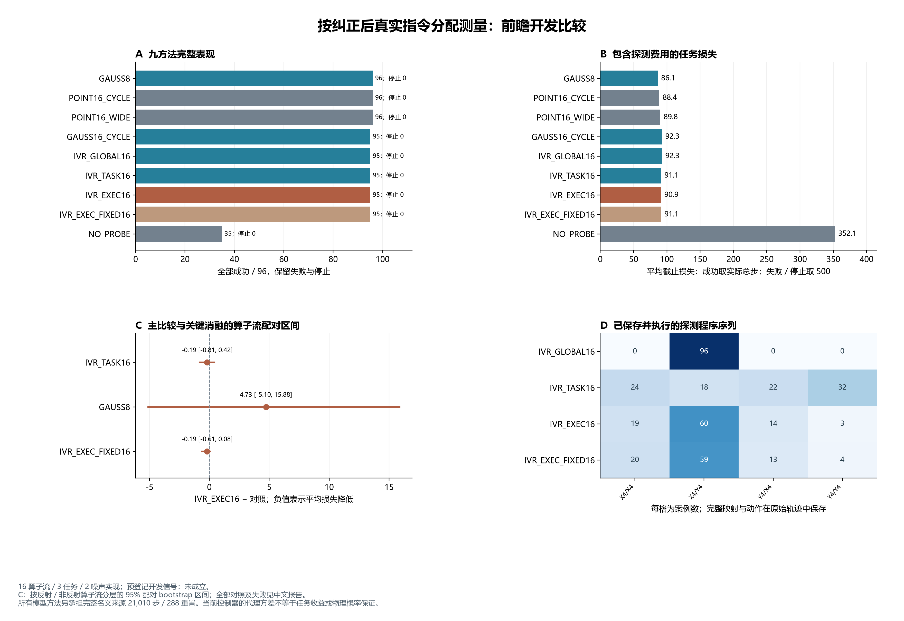

# 执行指令支持实验：结果与研究取舍

新候选 IVR_EXEC16 的前瞻开发门未通过。它确实改变了探测选择，但没有
提高相对原 TASK 的成功数；八步 Gaussian 强基线更便宜且全部成功。
本轮不支持把“纠正后指令重映射”提升为有任务优势的新方法。

[完整中文报告](executable_support_development_v1.md)保存全部九方法、分层与失败；
[冻结协议](../docs/protocols/executable_support_development_v1.md)、
[全量执行审计](../outputs/executable_support/analysis_v1/audit.json)、
[事后配对与支持分解](../outputs/executable_support/diagnostics_v1/results.json)和
[共同失败案例核查](../outputs/executable_support/failure_case_v1/check.json)提供证据。

## 主要结果

同一批 16 个新算子流、三任务、两噪声实现；每方法 96 次。失败截止损失取
500，成功取实际总步，包含探测步。九方法均无停止。

| 方法 | 成功 / 96 | 平均探测步 | 平均在线步／截止损失 |
|---|---:|---:|---:|
| GAUSS8 | 96 | 8 | 86.1354 |
| POINT16_CYCLE | 96 | 16 | 88.3542 |
| POINT16_WIDE | 96 | 16 | 89.8125 |
| GAUSS16_CYCLE | 95 | 16 | 92.3438 |
| IVR_GLOBAL16 | 95 | 16 | 92.3438 |
| IVR_TASK16 | 95 | 16 | 91.0521 |
| IVR_EXEC16 | 95 | 16 | 90.8646 |
| IVR_EXEC_FIXED16 | 95 | 16 | 91.0521 |
| NO_PROBE | 35 | 0 | 352.1458 |

新候选减原 TASK 的平均截止损失差为 −0.1875 步，按反射／非反射算子流
分层配对 bootstrap 的 95% 区间为 **[−0.8125, +0.4167]**。成功数相同，
且没有彼此独有的成功案例；96 对中 19 对损失改善、27 对恶化、50 对相同。
该结果没有排除零差。成功率差的重采样区间为 [0,0]，原因是这批配对成败
全部相同，不能据此证明总体等效、非劣或没有罕见风险。

候选还被 GAUSS8 和两种固定十六步点估计在本批的成功数与平均截止损失
共同支配。这是观察人口中的支配，不能提升为所有环境上的普遍排序。
相对 GAUSS8，候选损失差 +4.7292 步，区间 [−5.1042, +15.8766]，也不能
宣称总体统计显著更差。这里有 16 个独立算子流，不是 96 个独立算子。

## 输入支持确实变了，任务收益仍没有成立

候选与原 TASK 的两次四步程序序列在 57/96 单元不同。对候选自身每次
已经保存的相同 Gaussian 矩重新计算原支持评分，192 个决策中有 58 个
会选不同程序。前者比较两条实际分支，后者固定相同矩比较目标坐标，
两种计数不能混用。

候选查询点的平均加权移动距离为 0.6155（归一化命令单位），平均约 30.26%
的权重改变了局部饱和掩码。因此，这不是代码没有执行映射导致的“零差”。
但是响应参考方差的变化不等于实际任务收益，不能把坐标变化当作方法有效性。

固定第八步映射的消融同为 95/96。相对它，持续重映射只使四个案例的
截止损失发生变化：两次改善、两次恶化，92 次相同；平均差 −0.1875 步，
区间 [−0.6146, +0.0833]。没有证据表明每四步重映射提供了稳定额外收益。

## 共同失败更接近控制器问题，不能简单归因于额外探测

唯一的模型方法失败上下文是流 11、push-v3、重复 0、任务种子 11833。
GAUSS16_CYCLE、GLOBAL、TASK、EXEC、固定映射五组都到 500 步失败；
GAUSS8 用 78 步成功，POINT16_CYCLE 用 132 步成功，POINT16_WIDE 用 84 步成功。
五个十六步 Gaussian 组在这里的程序都为 X4/Y4。

只读核查确认：POINT16_CYCLE 与 GAUSS16_CYCLE 的前十六步观测、命令、
原政策、执行输入与 RNG 字段完全一致，保存的点拟合也相同。第一步政策
的观测和原政策要求相同，但两种纠正器发送了不同动作。之后前者成功、
后者失败。因此不能将这个失败单纯解释为“多探测八步导致失败”。

这只是一个事后匹配前缀案例，没有完整隐状态资格，也没有单独隔离有界
优化、正则或协方差项。它不授权在本例上修改 λ、ρ 或拟合一个新控制选择门。

## 理论补充的实际边界

[条件理论说明](../docs/research/executable_support_theory_v1.md)给出当前固定
纠正器响应方差的恒等式、原／执行支持评分差的范数界，以及排序不变的
充分条件。[独立矩阵核查](../outputs/executable_support/theory_v1/checks.json)
通过 1,500 个随机评分差界检查，并核对 132 个满足条件的排序案例。
这是标准矩阵代数在本问题中的应用，不是新定理或真实任务保证。

在本轮真实保存的候选 192 个决策上，加入 $10^{-18}$ 数值余量的充分条件
实现，其排序认证覆盖为 **0/192**；
固定映射消融也是 0/192。不能只报告随机矩阵核查通过，而隐藏实际覆盖为零。
这个界没有进入线上执行，更不能用作停止探测或物理安全证书。

## 完整费用与下一步取舍

新增 864 次方法执行、103,114 个 Env.step／864 次控制初始重置。
另外实测目标工厂 43,200 次临时重置，合计顶层重置 44,064 次；完成
do_simulation 请求帧 22,547,570，其中工厂 21,600,000、控制初始安置
432,000、真实探测与政策控制 515,570。控制步五帧／0.0125 秒。

每个名义模型方法完整承担旧 21,010 步／288 次控制重置，按 96 单元
摊销为 218.8542 步／3 次重置。候选含来源平均步为 309.7188，GAUSS8
为 304.9896；旧物理源只采集一次，旧来源内部初始化没有重新测量。
本轮 API、自然经验记忆写入、策略训练均为零。没有计算效率优势结论。

全量审计核对 300,308 个事件、644 个冻结 Git 输入及 440 个库源码绑定。
它重放保存的动作、选择、支持映射与费用；明确复用数学辅助函数，没有
重新仿真动力学。全部 66 个失败执行保留，其中 NO_PROBE 61 个，其余五个
来自上述同一名义上下文，不能写成五个独立失败场景。

应当停止在这一人口上微调 IVR 查询坐标或 Gaussian 权重。下一步需要处理
任务损失与纠正器选择共同决定的测量价值，同时保留 GAUSS8 和点估计强基线。
现有名义上下文噪声重复并非完全固定可见前缀的独立未来重复；后继若研究
条件测量价值，须先核对旧固定状态重复实验已回答的范围，再另行冻结设计。
本轮不追加样本、不动 11848–12199 或任何旧保留种子。

新颖性、竞争性方法、独立确认和完整论文仍未完成。原始文献与候选边界见
[冻结机制说明](../docs/research/executable_support_mechanism_v1.md)。

运行 `executable_support_20261015T082955Z_48a3e433af85`；冻结源
`48a3e433af851fb8d477086bf508d072c02cdecd`；清单
`89e843c795d56e06577fa29504366d7023821180f850f0ecc608e84aaf349b78`。
