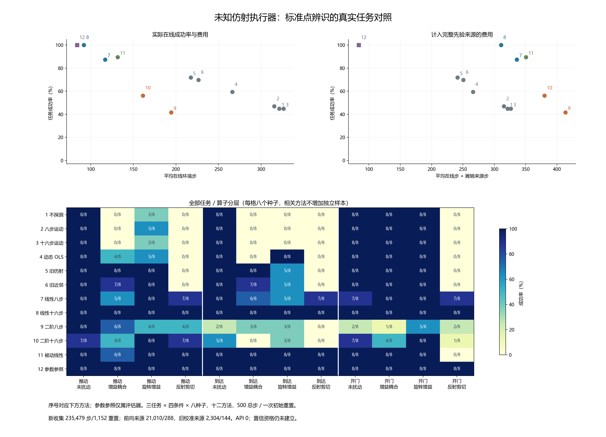

# 未知一般仿射执行器：前向点辨识的真实任务桥 v1

本轮完成一次冻结后的 **1,152 次方法执行**，独立审计通过，状态 **`COMPLETED_POINT_UTILITY_PASS`**。前向线性十六步完成 **96/96**，匹配十六步运动对照为 **43/96**，旧校准仿射为 **69/96**；线性八步为 **84/96**，被动线性为 **86/96**。线性十六步在同一先验访问下同时具有更高成功数和更低平均总费用，成为后续研究必须保留的标准基线。

二阶模型此前的平均名义前向误差较小，本轮实际纠正却只有八步 **40/96**、十六步 **54/96**，分别停止 **27、25** 次，并出现 **12、5** 个未扰动损害。当前数据中的前向平均精度排序不能替代逆映射选择与闭环任务表现；具体失效原因仍未确定。

本轮检验标准点模型的模拟控制假设，**没有认证执行器响应、置信区间、机器人安全或算法新颖性**。此前名义 1-mm／覆盖门失败仍保留。任务桥成立不等于持续 CCF A 目标完成。

## 实验身份与冻结

- 运行：`forward_operator_20261014T081128Z_37eee13f9943`。
- Manifest ID：`ecb45ac298f8ad6608fef95413a8e1d191791827e694207ba0527701d4b9ecc4`。
- 实现冻结提交：`37eee13f9943e26e2d15a81b9d3e6dd86e73f015`。

[协议](../docs/protocols/forward_operator_task_utility_v1.md)和[配置](../configs/forward_operator/task_utility_v1.json)在结果前冻结。新种子 **10600–10607** × 三任务 × 四条件，共 **96 单元**；10608–10799 保留，所有旧保留不变。每单元十二种方法，共 1,152 执行；只有 **八个独立开发种子簇**，不把相关执行当作 1,152 个独立样本。

条件是未扰动、增益耦合＋偏置、37 度旋转增益＋偏置、反射剪切＋偏置。代理不知道当前条件 ID、真实矩阵／偏置、种子、RNG 或实际加噪输入，不在四个真条件中查表。它拟合未知一般二维仿射参数，系数界 ±2、偏置界 ±0.3 只是公开数值域。四个固定评估算子不代表一般仿射空间的覆盖。

三任务使用官方固定 Sawyer v3 政策；xyz 噪声标准差 **0.05**，夹爪无噪声，政策权重不变。每执行一次初始环境／执行器重置，**探测＋任务最多 500 步**，状态、位移历史和 RNG 连续，成功后停止。全部方法使用统一的希望动作／发送动作截断接口；本轮不改写旧版本结果。

## 代理选择如何实际驱动执行

从第三步起，用当前可见观察、前两次已完成 xyz 位移、实际已发送命令及随后已观察 xy 位移建立样本。名义线性／二阶模型保持冻结，仅通过过去样本拟合输入有效映射 `Mhat,bhat`。不使用真实算子、实际噪声动作或未来任务结局。线性为闭式初始化＋有界预测误差优化，二阶为四个固定正交初始化的标准有界最小二乘；样本数、数值秩、参数域和逆矩阵门均预先固定。

控制器先保存，执行器使用保存选择，将固定政策当前希望动作映射为 `clip(inv(Mhat)*(a-bhat))`，z／夹爪不改。固定点方法非法拟合后停止，不由其他模型代执行；历史零补偿回退与被动保留上一控制器均按注册规则单独计数。被动更新每 16 任务步一次，使用最近至多 64 个过去样本，无跨案例学习或记忆。

八步程序为四方向各两步，十六步为各四步，八步不是十六步的前八步。匹配运动对照使用相同探测，因而能够区分辨识选择与探测运动的影响。Oracle 仅属评估器参数参照，不是代理／训练访问或最优任务策略定理。

## 全部总体对照与费用

每方法分母均为 **96**，包括停止。平均在线步包括实际探测／任务步；摊销费用完整计入来源银行。

| 方法 | 成功／96 | 平均在线步 | 来源摊销后步 | 点拟合停止 | 无效拟合选择 |
|---|---:|---:|---:|---:|---:|
| 不探测 | 43/96 | 321.3333 | 321.3333 | 0 | 0 |
| 八步运动对照 | 45/96 | 315.3125 | 315.3125 | 0 | 0 |
| 十六步运动对照 | 43/96 | 326.4271 | 326.4271 | 0 | 0 |
| 动态 OLS 十六步 | 57/96 | 266.1562 | 266.1562 | 0 | 0 |
| 旧仿射十六步 | 69/96 | 217.3646 | 241.3646 | 0 | 0 |
| 旧近邻十六步 | 67/96 | 226.5521 | 250.5521 | 0 | 0 |
| 前向线性八步 | 84/96 | 116.8958 | 335.7500 | 5 | 5 |
| 前向线性十六步 | 96/96 | 91.8021 | 310.6562 | 0 | 0 |
| 前向二阶八步 | 40/96 | 194.4896 | 413.3438 | 27 | 27 |
| 前向二阶十六步 | 54/96 | 161.1458 | 380.0000 | 25 | 25 |
| 被动线性 | 86/96 | 131.5938 | 350.4479 | 0 | 363 |
| 评估器参数参照 | 96/96 | 83.8333 | 83.8333 | 0 | 0 |

线性十六步相对匹配运动对照多 **53/96** 成功（55.21 个百分点），平均在线步 **91.8021**，低于线性八步 **116.8958** 和被动 **131.5938**。本轮多八步探测减少了后续失败／长执行的总费用，不能只按探测数量判断成本。

按 96 单元摊销完整来源后，线性十六步 **310.6562**、不探测 **321.3333**；在该口径中它提高成功数且降低平均资源。旧仿射 **241.3646** 更低，但只有 69 成功，不能宣称线性十六步以更低费用支配所有基线。参数参照使用真参数且无需辨识先验，不能作为可部署竞争方法。

[SVG 矢量图](../outputs/forward_operator/figure_v1/figure.svg)可导出。各行共享同组种子，不增加独立样本；参数参照明确属于评估器。

## 任务与算子分层

| 方法 | push／32 | reach／32 | door／32 | 未扰动／24 | 增益耦合／24 | 旋转增益／24 | 反射剪切／24 |
|---|---:|---:|---:|---:|---:|---:|---:|
| 不探测 | 11 | 8 | 24 | 24 | 8 | 11 | 0 |
| 八步运动对照 | 13 | 8 | 24 | 24 | 8 | 13 | 0 |
| 十六步运动对照 | 11 | 8 | 24 | 24 | 8 | 11 | 0 |
| 动态 OLS 十六步 | 17 | 16 | 24 | 24 | 12 | 21 | 0 |
| 旧仿射十六步 | 24 | 21 | 24 | 24 | 24 | 21 | 0 |
| 旧近邻十六步 | 23 | 20 | 24 | 24 | 22 | 21 | 0 |
| 前向线性八步 | 28 | 26 | 30 | 23 | 19 | 21 | 21 |
| 前向线性十六步 | 32 | 32 | 32 | 24 | 24 | 24 | 24 |
| 前向二阶八步 | 22 | 8 | 10 | 12 | 10 | 12 | 6 |
| 前向二阶十六步 | 26 | 8 | 20 | 19 | 8 | 19 | 8 |
| 被动线性 | 30 | 32 | 24 | 24 | 22 | 24 | 16 |
| 评估器参数参照 | 32 | 32 | 32 | 24 | 24 | 24 | 24 |

反射剪切条件中，不探测、动态 OLS、旧仿射／近邻均 **0/24**，线性十六步 **24/24**。被动线性总体 **16/24**，但开门 **0/8**；二阶十六步在 reach 总体只有 **8/32**。完整任务×算子格（每格八个种子）在图及诊断 JSON 中列出。

## 预注册效应与强基线支配

每个种子先平均三任务／四条件的配对成功差，再做固定 10,000 次种子簇 bootstrap。表中是 **99% 开发描述区间**，不是精确有限样本或同时覆盖定理；五个预注册对比全部展示。

| 前向方法 | 匹配对照 | 差值百分点 | 种子簇 99% 区间 | 点任务桥门 |
|---|---|---:|---|---|
| 前向线性八步 | 八步运动对照 | 40.6250 | [30.2083, 51.0417] | 通过 |
| 前向线性十六步 | 十六步运动对照 | 55.2083 | [51.0417, 58.3333] | 通过 |
| 前向二阶八步 | 八步运动对照 | -5.2083 | [-23.9583, 15.6250] | 失败 |
| 前向二阶十六步 | 十六步运动对照 | 11.4583 | [0.0000, 22.9167] | 失败 |
| 被动线性 | 不探测 | 44.7917 | [39.5833, 48.9583] | 通过 |

线性八步、线性十六步和被动线性通过点任务桥门；二阶八步为负效应，二阶十六步区间下端为零，均失败。通过的是标准点辨识的任务效应，不是置信认证或新算法晋升。

在相同前向来源和摊销口径下，**线性十六步支配其余四个前向方法**：成功数不低、平均在线和总费用更低。未来不能遗漏它而只比较动态 OLS／旧仿射来声称主动取证收益。八步／被动法较少探测本身不是额外贡献。

## 失败、停止与未扰动损害

共有 **372 个失败／停止方法案例**，均在分母中。[完整失败清单](../outputs/forward_operator/figure_v1/failure_cases.md)保留种子、任务、真实条件（只用于评估分层）、方法、实际步、停止与原因；[诊断 JSON](../outputs/forward_operator/figure_v1/diagnostics.json)保留全部案例、执行控制器及未扰动损害。

线性八步 12 个失败中，5 个因逆不稳定停止，7 个在有效点拟合后失败。二阶八步停止 27（19 逆不稳定、8 优化／参数域失败），另外 29 个点拟合后失败；二阶十六步停止 25（19 逆不稳定、6 优化／参数域失败），另外 17 个点拟合后失败。没有调门或换模型重跑。

被动有 **363 次无效更新选择**，按注册行为保留上一控制器或初始未纠正控制器，不改写成拟合成功。十个任务失败的最终拟合状态为八次输入支持不足、两次逆不稳定；保留控制器与实际动作均已审计。

未扰动的 NO_PROBE 为 **24/24**。线性八步相对它损害 **1** 个（10602／door），二阶八步 **12** 个、二阶十六步 **5** 个；线性十六步和被动没有未扰动损害。十八个方法／案例损害不是十八个独立种子，逐例保留。

## 拟合延迟与接口诊断

延迟包含选择／拟合构建及选择对象规范化，排除环境执行和日志写入。模拟器在拟合时不前进，不能据此宣称真实机器人实时控制。

| 方法 | 保存选择数 | 中位 ms | p90 ms | 最大 ms |
|---|---:|---:|---:|---:|
| 不探测 | 96 | 0.1070 | 0.1272 | 0.2054 |
| 八步运动对照 | 96 | 0.1033 | 0.1285 | 0.1739 |
| 十六步运动对照 | 96 | 0.1021 | 0.1338 | 0.2484 |
| 动态 OLS 十六步 | 96 | 1.6277 | 1.8658 | 3.1376 |
| 旧仿射十六步 | 96 | 0.5195 | 0.6281 | 0.8741 |
| 旧近邻十六步 | 96 | 0.4801 | 0.5934 | 0.8572 |
| 前向线性八步 | 96 | 3.5607 | 4.1813 | 6.3432 |
| 前向线性十六步 | 96 | 5.9888 | 7.0710 | 10.1542 |
| 前向二阶八步 | 96 | 25.7524 | 99.2160 | 169.3639 |
| 前向二阶十六步 | 96 | 34.9149 | 120.2751 | 191.4737 |
| 被动线性 | 835 | 24.0904 | 84.6282 | 197.0374 |
| 评估器参数参照 | 96 | 0.1788 | 0.2182 | 0.3565 |

线性十六步中位／最大约 **5.99／10.15 ms**，二阶十六步约 **34.91／191.47 ms**；被动保存 835 个选择（含无效更新），中位约 **24.09 ms**。更多二阶参数及更长计算没有带来本轮任务收益。

评估器只在事后计算补偿命令饱和及 **无噪声截断输入偏差**（归一化命令单位）。线性十六步饱和约 **20.87%**、偏差 **0.1788**；参数参照饱和约 **34.23%**、偏差仍为 **0.0652**。受限发送动作下，知道真参数也未必实现全部希望动作。[贡献边界笔记](../docs/research/forward_operator_contribution_gap_v1.md)给出了补偿误差恒等式。

接口指标按执行步骤汇总；方法停留状态和长度不同，不作为独立样本或因果优劣检验，也不是期望加噪输入误差。它们只在只读后处理使用，未反馈给代理。

## 完整资源与独立审计

新收集 **235,479 环境步／1,152 次初始重置**，小于 576,000 步上限。每前向方法完整承担来源 **21,010／288**（含原失败资格），按 96 单元为 **218.8542 步／3 次来源重置**；旧仿射／近邻为 **2,304／144**，即 **24 步／1.5 次来源重置**。实际新收集和两个来源银行各计一次，共 **258,793 步／1,584 次重置**。共同来源不重复计五批，也不因共享说免费。

新增 API、记忆写入及政策权重更新均为 **0**。[独立审计](../outputs/forward_operator/analysis_v1/audit.json)完整性 **`PASSED`**，核对 **235,479 可见转移、1,891 保存选择、960 连续探测衔接**。独立重建过去样本与前向拟合损失、重算实际发送动作，检查固定政策、状态/RNG、停止与费用。注册优化器／统计汇总复用同一实现，其输入由审计重建；没有重新仿真动力学。

[原始目录](../outputs/forward_operator/task_utility_v1/forward_operator_20261014T081128Z_37eee13f9943)保存十二个方法完整压缩轨迹、决策、manifest、summary、status，十六个文件由审计散列绑定。真实参数只属于评估器方法及事后标签。所有选择先于其后续执行，执行器没有根据结局替换选择。

实现冻结前和结果阶段全仓均通过 **686 项测试**，耗时分别为 **127.658 秒**与 **117.847 秒**；编译、依赖检查、秘密扫描和差异检查通过。591 个冻结 Git 输入与当前执行文件一致，16 个原始文件及五个图表产物的散列均核对通过。[验证归档](../outputs/forward_operator/validation_v1/validation.json)保存检查结果、完整测试日志和采集终端输出。结果阶段未新增 API 调用或仿真任务。

## 对持续研究目标的影响

这个任务桥建立了有用且强的标准线性恢复基线，并暴露较高名义预测精度的二阶模型在逆辨识／执行中的弱点。它只覆盖四个固定人工算子、三项模拟任务及八个开发种子；不等于真实故障、长期上下文、模型置信或机器人安全泛化。

仍需新的证据有效性／预算化重取证方法、与成熟控制导向采集的完整比较、独立非平稳流、置信合同、消融和完整技术论文。新增方法必须与本轮 **线性十六步 96/96** 的实际成功、完整来源费用和未扰动损害对照竞争。10600–10607 不重跑／不调门，10608–10799 保留；后续另行冻结。
