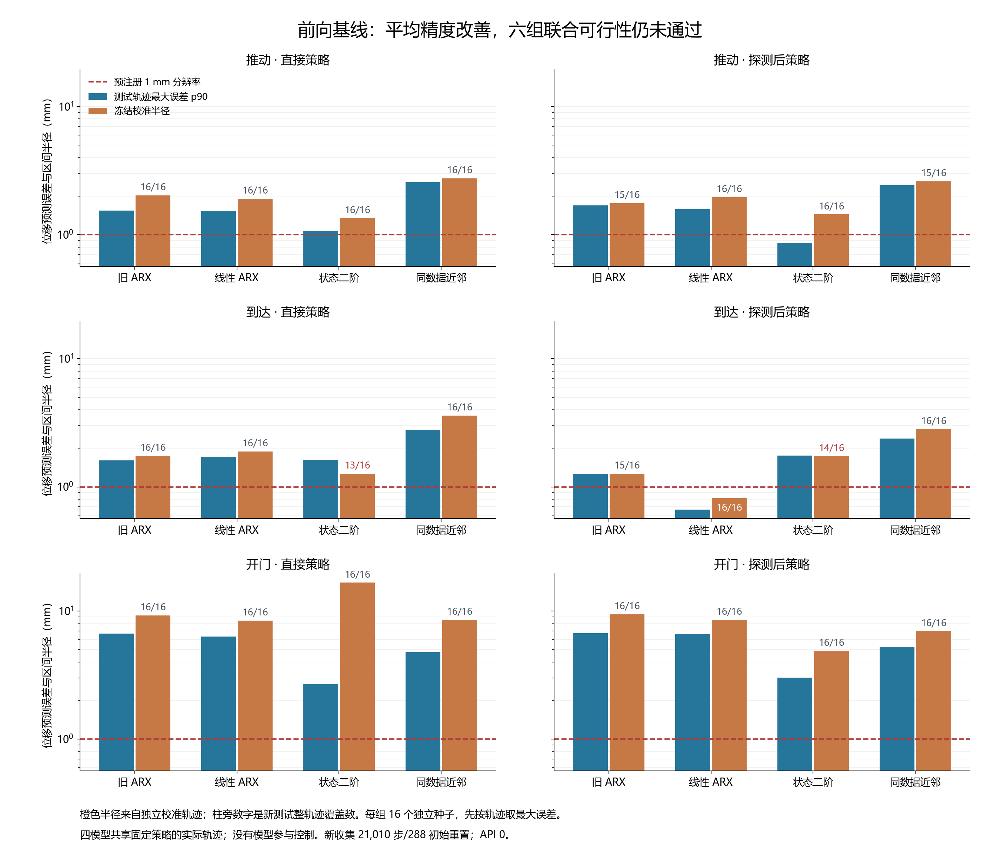

# 可见位移前向基线：独立训练、轨迹校准与测试 v1

本轮完成一次冻结后的 **288 条真实轨迹**，独立审计通过，状态为 **`COMPLETED_FEASIBILITY_FAILED`**。三个新标准模型改善了相对旧 ARX 的总体平均预测误差，但没有模型同时满足六组的整轨迹覆盖与 1 毫米区间半径要求。测试任务仍为固定策略，模型只预测、没有参与控制；本轮不报告纠正收益或新算法成立。

关键发现是平均预测精度与可用的误差区间需要分别检查。状态二阶模型相对旧 ARX 的平均轨迹最大误差减少约 **1.44 mm**，但 reach 两组覆盖只有 **13/16、14/16**；开门直接策略的校准区间半径又被一条 500 步失败轨迹推到 **16.6392 mm**。只展示平均误差或覆盖率都会隐去实质限制。

## 冻结身份与样本来源

- 运行：`forward_prediction_20261014T064233Z_bb812df15401`。
- Manifest ID：`d657fa9c3d0d6582f02a0dc7f346fdf7dbd013da977e93355bbacc7477a6868f`。
- 实现冻结提交：`bb812df15401fdaa702659294be1e457dd309758`。
- 新模型文件 SHA-256：`b3f2d7e69316dba65e722d74d49df25c7d651043e78bf4c0f6e1d37f1e599c80`。
- 校准文件 SHA-256：`f62819791d95a31ae95320a594206d6050ea9e68b7c5f0fc4f374fde900e69df`。

训练种子 **10200–10215**、校准种子 **10300–10315**、测试种子 **10400–10415** 独立分开。每阶段 16 种子 × 3 任务 × 2 程序，共 96 条轨迹；**10416–10599** 保留，原 **10016–10199** 及其他历史保留不变。10000–10015 的逆观察资格数据没有用于新模型拟合。

[协议](../docs/protocols/forward_prediction_baselines_v1.md)和[配置](../configs/forward_prediction/baselines_v1.json)在物理结果前冻结。每任务使用固定 Sawyer v3 策略，两程序是直接策略与原十六步连续对称 xy 探测后策略。已知零偏置名义执行器、xyz 高斯噪声标准差 0.05；命令与加噪执行分别按注册规则截断。每轨迹一次初始环境／执行器重置、最多 500 总步，衔接保持状态、历史和随机数连续，成功后不继续仿真。

## 模型与信息边界

预测目标是下一步实际可见手部 xy 位移，单位为米；不逆推执行器实际动作。每步仅使用当前可见观察、已发送命令和前两次已完成 xyz 位移，从第三步起预测；前两步真实执行但没有预测，物理费用仍计入。这是使用真实过去状态的一步预测，不是从初态递归预测整个未来轨迹。

模型不接受实际加噪动作、当前真实参数、种子、随机数、未来观察或任务结果。完整记录中的种子和 RNG 仅用于审计，没有进入预测特征。模型在 TRAIN 后保存，再从文件读取执行校准；区间在 CALIBRATION 后保存冻结，再读取进入测试。每一步预测都在对应物理执行前持久保存。

| 模型 | 固定结构与训练访问 |
|---|---|
| 旧 ARX | 原 push 初始探测训练模型直接前向预测；不重新拟合，只看上一 xy 位移和当前 xy 命令。 |
| 线性 ARX | 每任务用前两次 xyz 位移、当前四维命令与常数项，11 列；训练缩放，ridge=0.001，常数项不惩罚。 |
| 状态二阶 | 每任务用手部位置、位移历史、命令、夹爪开度、物体／目标相对位置，20 维基础输入及二阶项，共 231 列；同样 ridge=0.001。 |
| 同数据近邻 | 与状态二阶相同的 20 维训练缩放输入及目标；固定 16 邻居，按平方距离加权。 |

三个新模型共用全部训练数据，训练均值／标准差与参数只来自 TRAIN。每任务真实训练样本分别为 push-v3 2,150、reach-v3 1,619、door-open-v3 2,802，合计 **6,571** 个可见转移。没有通过测试数据挑特征、窗口、ridge 或邻居数。旧 ARX 只拥有原训练访问；与它的对比同时包含模型和训练访问变化，不能单独归因于某项新结构。三个新模型之间则具有相同训练／校准访问。

## 固定区间与全部六组结果

每轨迹先取所有预测步、两个 xy 分量的最大绝对误差，再按任务／程序形成 16 个独立轨迹分数。alpha=0.10 时使用 `ceil((16+1)*(1-alpha))=16`，校准半径为 16 个分数的最大值，不是插值 p90。测试覆盖要求整轨迹全部预测同时落入点预测 ± 半径。

预注册的经验筛选要求每个方法六组都满足 **覆盖至少 15/16、有限半径不超过 1 mm**；1 mm 仅是本轮前向分辨率筛选，不是任务容许误差、执行器辨识精度或安全界。没有缺少预测的测试轨迹。下表单位都是 **mm**；RMS 列先对每轨迹的逐步最大分量误差求 RMS，再对组内 16 轨迹取平均，不把长轨迹步骤当成独立样本。

[SVG 矢量图](../outputs/forward_prediction/figure_v2/figure.svg)可导出；第一版及其原绘图源码保留，第二版仅修复覆盖标注与阈值线的重叠，数据和筛选未改变。

### push-v3（推动） · 直接策略

| 模型 | 平均轨迹 RMS | 轨迹最大误差 p90 | 最坏误差 | 冻结半径 | 覆盖／16 | 本组门 |
|---|---:|---:|---:|---:|---:|---|
| 旧 ARX | 0.5186 | 1.5463 | 2.0002 | 2.0288 | 16/16 | 失败 |
| 线性 ARX | 0.2750 | 1.5272 | 1.8685 | 1.9103 | 16/16 | 失败 |
| 状态二阶 | 0.2040 | 1.0614 | 1.1890 | 1.3454 | 16/16 | 失败 |
| 同数据近邻 | 0.6901 | 2.5760 | 2.7082 | 2.7559 | 16/16 | 失败 |

### push-v3（推动） · 探测后策略

| 模型 | 平均轨迹 RMS | 轨迹最大误差 p90 | 最坏误差 | 冻结半径 | 覆盖／16 | 本组门 |
|---|---:|---:|---:|---:|---:|---|
| 旧 ARX | 0.4688 | 1.6882 | 1.7894 | 1.7588 | 15/16 | 失败 |
| 线性 ARX | 0.2065 | 1.5813 | 1.9099 | 1.9552 | 16/16 | 失败 |
| 状态二阶 | 0.1708 | 0.8656 | 0.9304 | 1.4386 | 16/16 | 失败 |
| 同数据近邻 | 0.6775 | 2.4435 | 3.0123 | 2.6090 | 15/16 | 失败 |

### reach-v3（到达） · 直接策略

| 模型 | 平均轨迹 RMS | 轨迹最大误差 p90 | 最坏误差 | 冻结半径 | 覆盖／16 | 本组门 |
|---|---:|---:|---:|---:|---:|---|
| 旧 ARX | 0.4256 | 1.6072 | 1.6688 | 1.7495 | 16/16 | 失败 |
| 线性 ARX | 0.2371 | 1.7151 | 1.7895 | 1.8944 | 16/16 | 失败 |
| 状态二阶 | 0.5610 | 1.6175 | 1.8549 | 1.2643 | 13/16 | 失败 |
| 同数据近邻 | 0.7100 | 2.8049 | 3.2647 | 3.6116 | 16/16 | 失败 |

### reach-v3（到达） · 探测后策略

| 模型 | 平均轨迹 RMS | 轨迹最大误差 p90 | 最坏误差 | 冻结半径 | 覆盖／16 | 本组门 |
|---|---:|---:|---:|---:|---:|---|
| 旧 ARX | 0.3644 | 1.2630 | 1.2716 | 1.2690 | 15/16 | 失败 |
| 线性 ARX | 0.1150 | 0.6650 | 0.7291 | 0.8152 | 16/16 | 通过 |
| 状态二阶 | 0.5545 | 1.7550 | 2.0081 | 1.7307 | 14/16 | 失败 |
| 同数据近邻 | 0.6781 | 2.3762 | 2.5655 | 2.8103 | 16/16 | 失败 |

### door-open-v3（开门） · 直接策略

| 模型 | 平均轨迹 RMS | 轨迹最大误差 p90 | 最坏误差 | 冻结半径 | 覆盖／16 | 本组门 |
|---|---:|---:|---:|---:|---:|---|
| 旧 ARX | 1.2714 | 6.6681 | 9.1289 | 9.2344 | 16/16 | 失败 |
| 线性 ARX | 0.9229 | 6.3092 | 7.1942 | 8.4253 | 16/16 | 失败 |
| 状态二阶 | 0.5791 | 2.6849 | 4.7855 | 16.6392 | 16/16 | 失败 |
| 同数据近邻 | 0.7959 | 4.7616 | 6.6646 | 8.5206 | 16/16 | 失败 |

### door-open-v3（开门） · 探测后策略

| 模型 | 平均轨迹 RMS | 轨迹最大误差 p90 | 最坏误差 | 冻结半径 | 覆盖／16 | 本组门 |
|---|---:|---:|---:|---:|---:|---|
| 旧 ARX | 1.1559 | 6.7091 | 7.3269 | 9.4353 | 16/16 | 失败 |
| 线性 ARX | 0.8532 | 6.6058 | 6.8713 | 8.5464 | 16/16 | 失败 |
| 状态二阶 | 0.5290 | 3.0153 | 4.5249 | 4.8709 | 16/16 | 失败 |
| 同数据近邻 | 0.7642 | 5.2450 | 6.8704 | 6.9611 | 16/16 | 失败 |

只有 **reach-v3／探测后策略／线性 ARX** 一组满足 1 mm 与覆盖条件：半径 **0.8152 mm**、覆盖 **16/16**。这不是全方法通过；其余 23 个模型／分组半径都超过 1 mm。状态二阶的两个 reach 分组同时未达到覆盖要求，全部结果仍为四个方法总体失败。

## 配对误差比较与失败案例

对每个测试种子先平均其六个任务／程序的轨迹最大误差差值，再对 16 个种子做固定 10,000 次配对 bootstrap。负差值表示新模型误差较小，区间为各模型的单独描述性 95% 区间；不是同时比较保证，也不能从平均值推出所有任务改善。

| 模型相对旧 ARX | 平均差值 mm | 种子簇 bootstrap 95% mm |
|---|---:|---|
| 线性 ARX | -0.2854 | [-0.4132, -0.1692] |
| 状态二阶 | -1.4424 | [-1.5952, -1.2912] |
| 同数据近邻 | -0.4121 | [-0.6435, -0.1370] |

均值改善主要不能代替尾部要求。例如近邻在 push 和 reach 的多个 p90 指标比旧 ARX 更大；二阶模型在 reach 探测后策略也更大。六组原表必须与总体平均一起阅读，不能只选择开门上的改进。

测试阶段共有 **8 个不同轨迹／模型区间未覆盖案例**，其中二阶模型 5 个、旧 ARX 2 个、近邻 1 个。对应任务本身都成功，区间失败不改写任务成功。全部案例、误差和冻结半径见[失败清单](../outputs/forward_prediction/figure_v2/failure_cases.md)；[诊断 JSON](../outputs/forward_prediction/figure_v2/diagnostics.json)保存 96 个测试案例和所有校准半径的驱动案例。

校准的固定策略失败案例是 **10314／door-open-v3／直接策略**，执行 **500 步**仍未成功。它在二阶模型下的最大误差 **16.6392 mm** 正好决定该组校准半径，不能删除该案例以缩小区间。该案例在旧 ARX 下的最大误差为 6.8214 mm、线性 ARX 为 5.5246 mm、近邻为 7.3922 mm。它说明更复杂点模型可在某条轨迹上产生较大的误差；不能仅据这一条轨迹把原因确定为长度、接触或状态外推。

低经验覆盖不等于推翻 conformal 的条件性理论。标准顺序统计量需要完整校准／测试轨迹可交换，覆盖是对校准样本与新轨迹联合随机性取边际概率；不承诺每次固定校准后的 16 个测试样本都达到标称比例。[原始量化说明 §3.1](https://arxiv.org/html/2210.10254v2) 本轮固定经验门仍失败，且没有验证未知扰动、反事实输入或新控制器下的分布条件，不继承该文的规划安全结论。

## 全部物理成本与任务结果

| 阶段 | 物理步 | 初始重置 | 探测步 | 固定策略任务成功 |
|---|---:|---:|---:|---:|
| 训练 | 6,763 | 96 | 768 | 96/96 |
| 校准 | 7,250 | 96 | 768 | 95/96 |
| 独立测试 | 6,997 | 96 | 768 | 96/96 |
| 新收集合计 | **21,010** | **288** | **2,304** | **287/288** |

三个新模型各自都需承担完整新训练与校准资源 **14,013 步／192 次重置**，测试另计 **6,997 步／96 次重置**；数据共享节约的是实际收集次数，不把收集成本变成零。旧 ARX 另计原完整离线 **2,304 步／144 次重置**，并承担本轮的校准与测试资源。将本研究所有实际收集资源及旧离线资源各计一次，合计 **23,314 步／432 次重置**，不是把三模型重复相加。

四模型共用同一物理转移，不能把它们说成四组独立执行或四个控制器都达到 96/96。训练 96/96、校准 95/96、测试 96/96 是固定策略场景结果。本轮新增 API 调用、记忆写入与政策权重更新均为 **0**，没有比较新纠正任务表现。

## 独立审计与可复现附件

[独立审计 JSON](../outputs/forward_prediction/analysis_v1/audit.json)完整性 **`PASSED`**：从可见数据独立重建特征、目标、训练缩放和 ridge／近邻来源，复核点预测数值、执行前日志、固定策略、状态/RNG 链、校准顺序统计量与全部物理费用。检查 **21,010 条执行前声明与转移**、**144 次连续探测衔接**及三个安装策略散列。统计汇总/配对 bootstrap 调用注册的共同实现，审计独立重建其输入；没有重新仿真动力学。

原始九个文件在[冻结运行目录](../outputs/forward_prediction/baselines_v1/forward_prediction_20261014T064233Z_bb812df15401)，由审计 SHA-256 绑定：manifest、三阶段压缩完整轨迹、执行前预测日志、模型、校准、summary、status。原始预测日志包含所有步骤（包括暖启动和训练步骤），没有事后替换输出。主模型、区间和原始物理数据在采集后未变；图与诊断只是另目录的只读后处理。

冻结前与结果提交前均通过全仓库 **677 项测试**（分别 111.406、112.289 秒），编译、`pip check`、暂存秘密扫描及工作区／暂存差异检查通过。580 个冻结 Git 输入、九个原始文件和两版图表的散列核对一致。完整日志和[验证记录](../outputs/forward_prediction/validation_v1/validation.json)已保存。代码检查不改变可行性门失败结论。

## 对持续研究目标的影响

本轮建立了三任务、独立训练／校准／测试的标准前向预测基线及其可重建记录，明确了较低平均误差仍不足以支持行动相关的窄区间。旧逆观察失效和本轮前向区间限制是两个不同问题；没有把前向毫米误差换算成已合格的执行器命令误差。

只有 **16 个独立测试种子簇**；同一轨迹步骤、同一任务／种子的两程序和同种子的多任务都不额外增加独立样本数。名义程序覆盖也不是未知执行器参数、噪声改变、反事实命令、缓存漂移或纠正策略的覆盖。本轮的物理响应资格、未知故障迁移与控制收益字段继续为 False。

下一阶段应以独立协议检验状态／行动依赖的区间和可辨识的前向响应效应，并保留标准残差归一化、非线性/被动辨识与主动设计的匹配对照；随后才能检验预算化证据复用是否真正改善任务。不能在 10400–10415 上改门槛或选模型后回头宣布通过。10416–10599 保留，新采集须另行冻结。前向回归与轨迹级校准已有相关工作，本轮不作为算法创新或 CCF A 投稿就绪证据。
