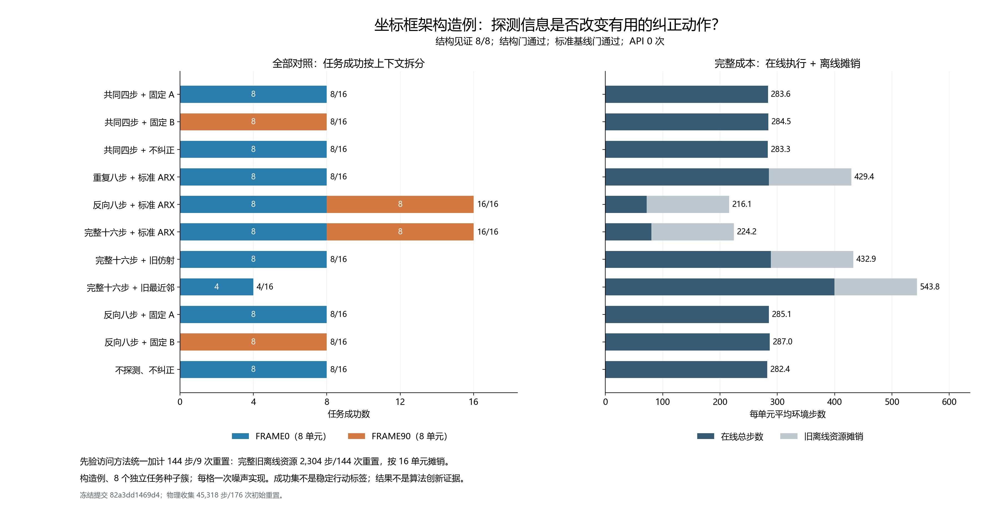

# 坐标框架歧义与行动相关信息：中文开发报告 v1

本轮补上了一个实验前提：相同探测观察可以对应不同的有效纠正动作，改变
探测方向能消除这类歧义。八个新任务种子均出现该构造见证；反向八步的
标准 ARX 辨识方法获得 16/16 成功，重复八步为 8/16，完整十六步也为
16/16。廉价标准方法已能解决此设置，本轮没有建立算法创新。

本轮 API 调用为零。此前在线 API 小试的真实闭环与负任务收益结果继续
保留：15 条实际 API 纠正链，LLM 14/16，两个校准基线均为 16/16。
详见 [在线 API 中文报告](online_calibrated_agent_development_v1.md)。两轮
使用不同故障、人群和协议，不能跨轮直接比较成功率或归因于 LLM。



## 冻结、人群与记录

- 分支：`codex/frame-evidence-validity-v1`。
- 运行：`frame_evidence_20261014T041345Z_82a3dd1469d4`。
- 冻结提交：`82a3dd1469d417501f96f9bb750d929a89a07f52`。
- Manifest：`529a5509983fb6cc948103753d49b7a3b07faf2a5ee727941b55ddd7f197ff94`。
- 新 ARX 模型：`f9f8f8b772e94d0639655b508c0038950b5fca0e85d21f03be0ad1454cf08019`。
- 原校准模型：`3d804711cfd7c17a993ebb96dc3dc4ba80c30c5026a349f2ac33b8dbccc6f037`。
- 种子 9800–9807 × 两种构造上下文，16 单元、176 方法执行；9808–9999 保留。
- 状态 `COMPLETED_PREREQUISITE_PASS`，独立审计 `PASSED`。

实现、配置、协议在任务结果出现前提交，干净提交生成唯一 manifest 后
一次执行。没有替换任务、续跑、扫描角度或从任务结果重新拟合。
[冻结协议](../docs/protocols/frame_evidence_development_v1.md) 定义本轮边界。

## 结构见证与标准方法

两个世界分别是 R=I、b=(-0.1,+0.1)，以及 R 为 90 度旋转、b=(+0.1,-0.1)。
命令 (+0.2,0) 的无噪声执行输入在两世界相同；命令 (-0.2,0) 则不同。
配对世界共用同一噪声流，仅供评估器建立不可区分见证。该构造是事先指定
的存在性测试，没有测量真实机器人故障的频率。

所有八个种子的共同四步及重复八步完整观察轨迹逐值相同；反向八步则在
每个种子分开两个世界。共同四步之后，世界 0 的成功候选为固定 A 与不纠正，
世界 90 的成功候选为固定 B。两世界的成功集在八个种子上均不相交。
限定三个注册控制器的上下文盲样本上界为 8/16，知上下文样本上界为 16/16。
这些是一次噪声实现下的事后样本得分，不是真实成功概率上界或稳定行动标签。

标准方法只用原来的 72 条名义训练轨迹拟合 ARX，获得 1,080 个样本；设计
秩为 5，缩放条件数 2.3091，训练残差 RMSE 0.00017945。它在两个事先公开
的旋转假设下分别拟合自由常数项，按残差选择注册控制器。模型在本轮任务前
保存冻结；原资格数据没有参与拟合，也不构成此 ARX/旋转模型的资格认证。
部署函数仅接收模型和当前命令/可见轨迹，当前故障标签、执行输入和结果
不进入选择函数。残差与数值秩不提供置信证书。

## 全部结果与成本

固定 push-v3 与 SawyerPushV3Policy，xyz 噪声标准差 0.05，每次执行总预算
500 步，探测直接衔接策略。这个独立版本统一截断策略希望动作和发送命令，
再施加旋转、偏置、噪声与最终环境截断；历史实验接口没有被追溯改写。

| 方法 | 成功/16 | 世界 0/8 | 世界 90/8 | 平均在线步 | 平均含离线摊销步 |
|---|---:|---:|---:|---:|---:|
| 共同四步＋固定 A | 8 | 8 | 0 | 283.62 | 283.62 |
| 共同四步＋固定 B | 8 | 0 | 8 | 284.50 | 284.50 |
| 共同四步＋不纠正 | 8 | 8 | 0 | 283.31 | 283.31 |
| 重复八步＋标准 ARX | 8 | 8 | 0 | 285.38 | 429.38 |
| 反向八步＋标准 ARX | 16 | 8 | 8 | 72.12 | 216.12 |
| 完整十六步＋标准 ARX | 16 | 8 | 8 | 80.25 | 224.25 |
| 完整十六步＋旧仿射 | 8 | 8 | 0 | 288.88 | 432.88 |
| 完整十六步＋旧最近邻 | 4 | 4 | 0 | 399.81 | 543.81 |
| 反向八步＋固定 A | 8 | 8 | 0 | 285.12 | 285.12 |
| 反向八步＋固定 B | 8 | 0 | 8 | 287.00 | 287.00 |
| 不探测、不纠正 | 8 | 8 | 0 | 282.38 | 282.38 |

反向八步与完整十六步都正确选择 16/16 旋转；重复八步始终按不可区分
输入的注册默认规则选 A，只正确 8/16。反向八步比完整十六步少 8.125
平均在线步。两者不同的探测运动也改变任务起始状态，该差是配置总效果，
不能把全部步数差归因于信息。旧仿射获得较长轨迹仍不能解决旋转，反映
它的模型/动作空间局限，不能解释为所有仿射系统辨识方法失效。

新物理收集共 **45,318 步/176 次初始重置**：1,472 探测步，43,846 任务步。
零 API 调用、零记忆写入、零策略权重更新。所有五个先验访问方法均加计
完整旧离线资源 **2,304 步/144 次重置**，按 16 单元摊销为每单元额外
144 步/9 次重置；本轮没有重新物理收集该资源。新数据加一次共享离线资源
合计为 47,622 步/320 次初始重置，不能再把共享数据计作五次实际收集。

反向八步平均在线 72.125 步，含离线 216.125 步/10 次重置；不探测平均
282.375 步/1 次重置。若把一次重置成本记为 r 个环境步等价，两者的平均
成本差为 `-66.25 + 9r`，在 r≈7.36 时相等。因此较少平均步数不能代替
完整系统成本判断。固定候选是预先给定的控制器库；没有计入人工设计成本。

## 配对解释与不确定性

在同一个反向八步探测下，标准方法的 16 条完整实际执行轨迹均逐值等同于
其选择对应的固定 A/B 对照，包括观察、命令、执行输入、计数和随机数流。
相对始终 A，方法改变八次选择，八次均在本样本中有益、零有害；相对始终 B
也为八次有益、零有害。这个匹配对照隔离了探测运动后的选择效果；控制器
是在任务结果前保存并读取执行的，未用当前真值替换选择。

反向八步对不探测、重复八步、旧仿射和任一固定反向控制器均为 +50 pp。
八个种子簇的差都为 +50 pp，注册的经验簇 bootstrap 区间因此退化为
[50,50] pp；这不意味着真实差已被精确确定。对旧最近邻为 +75 pp，95%
簇区间 [56.25,93.75] pp；对完整十六步为 0 pp。只有八个独立簇，每格
一次噪声实现，区间只是探索性描述，不提供更广人群、多重比较或重复实现保证。

本轮有 **76 个失败方法执行**：固定 A/B、无纠正、重复八步、旧仿射各自的
失败上下文，以及最近邻在世界 0 的四例和世界 90 的八例。标准反向/完整
ARX 没有失败或停止。全部失败逐例见
[失败清单](../outputs/frame_evidence/decision_effect_v1/failure_cases.md)，原始
轨迹和判定均保留；没有给失败方法代执行。

## 审计与复现

独立离线审计检查 565 个冻结输入散列，重建训练模型，重放 176 个决策、
160 个连续探测衔接、43,846 个任务步及 1,472 个探测步。完整 39 维观察、
固定策略命令、旋转/噪声/截断、预算、保存选择的执行和事件次序均通过。
信息边界、预算、衔接、选择替换、顺序违规均为零，系统时钟回跳为零。
审计重放保存的数据与策略，不重新仿真任务动力学。

核心实现冻结前通过 646 项仓库测试；新增两项只读匹配诊断测试检查不能
忽略实际命令/观察变化，最终全部 **648 项测试通过**（63.755 秒）。此前辅助
差异查看 PowerShell 出现一次 CLR 异常；串行重做冻结检查全部通过，未因此
开始或重复物理任务。中文 PNG/SVG 图已核对布局和审计数据来源；SVG
行末空格规范化经 XML 几何/内容等价检查，PNG 与科学数据未改变。
编译、依赖、暂存秘密扫描和差异检查通过；另对冻结提交的 565 个 Git
输入对象和 11 个暂存结果/工具/图文件逐字节核对。
[验证记录](../outputs/frame_evidence/validation_v1.json) 保存检查范围与测试结果。

从仓库根目录可只读重建审计和图表，输出必须选新目录；不要重启物理收集：

```powershell
.\.venv\Scripts\python.exe -X utf8 scripts\analyze_frame_evidence.py --manifest outputs\frame_evidence\development_v1\frame_evidence_20261014T041345Z_82a3dd1469d4\manifest.json --output <new-audit-dir>
.\.venv\Scripts\python.exe -X utf8 scripts\analyze_frame_decision_effect.py --manifest outputs\frame_evidence\development_v1\frame_evidence_20261014T041345Z_82a3dd1469d4\manifest.json --audit <new-audit-dir>\audit.json --output <new-effect-dir>
```

绘图用可用的 Matplotlib 运行时执行 `scripts/render_frame_evidence.py`，传入
相同 manifest、audit 和新的 `--output` 文件前缀；PNG/SVG 及元数据均记录
审计散列与绘图脚本散列，不改变科学数据。

## 对持续研究目标的含义

按行动区域获取信息已有 [Javdani 等 AISTATS 2014](https://proceedings.mlr.press/v33/javdani14.html)
研究，任务相关探索已有 [Liang 等 RSS 2020](https://roboticsproceedings.org/rss16/p085.html)
研究，[SPI-Active / CoRL 2025](https://proceedings.mlr.press/v305/sobanbabu25a.html)
也使用主动输入提高系统辨识信息量。本轮没有与这些完整方法实测比较；
改变输入支持、残差选模型和名义校准都不能作为我们的创新点。

本轮建立了有限构造例中的行动相关歧义与廉价标准解法。后续方法必须面对
这个标准解法，并在独立数据、未知模型有效性、更广任务与故障以及重复
噪声实现下提供新的可检验能力。API 闭环、LLM 增量收益和算法创新仍是
三个不同问题：前者此前成立，第二项此前为负，本轮也没有证明第三项。
持续的 CCF A 全文研究目标仍未完成。
