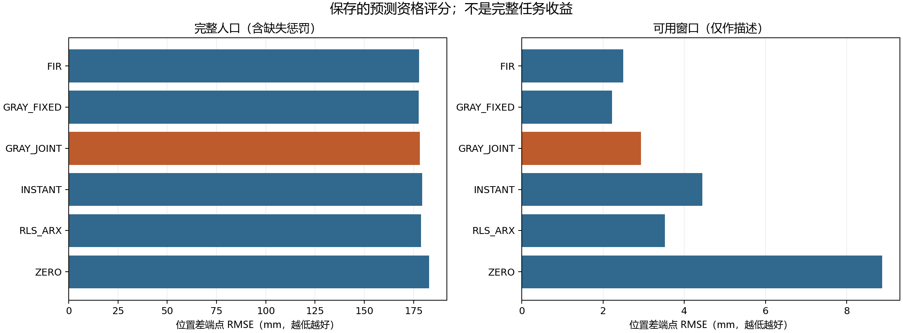

# 公开历史联合观测器：独立资格补充 v2

2026-10-28。结论 **CLOSED_NEGATIVE**。本轮评价标准前向响应差参考，**没有完整任务收益、错误采用率、安全或算法新颖性结论，CCF A目标仍未完成**。

## 冻结与失败继承

冻结提交 `168d23922b046a4762d862bd2ca42588a7187d45`；运行 `graybox_qualification_20261027T184320Z_168d23922b04`；manifest ID `f0e12745b4b7bcce4910ba95c2f2b2d2743aa25218706e8eb9cf9fc16b4c7115`。原cf2712d流水线因训练审计上下文计数错误停止，459次采集及训练保留。只读修复完成独立数值重建后，本补充在新目录、采集前独立冻结；原失败回执和原缺失的training/audit.json不修改，没有悄悄恢复旧流水线。

新入口仅允许CAL／QUAL，原预留但未使用的分配、种子、任务、条件、时点、获取位置、命令包、噪声及算子命名空间均逐条保持。原459实际记录与本补充432条计划按原KEYS合并仍为891条，不把历史呈现表里的未启动占位条目重复计数。原始完整种子census保留所有615份来源；七个确切原所有者／本补充来源是冲突判断例外，不豁免目录或外部登记。启动时另查原CAL／QUAL没有意图或目录、原进程终止、模型q未选择。

模型文件SHA为 `101030e545e92232b1855dc59eb77617025e56353786e4c10c2ae7922203927a`；主训练、名义网格、C4／C8和政策的新拟合均为零。训练来源、模型与成功补充审计逐字节导入并标明来源，原训练费用另列。本轮不是新的训练模型或训练人口。

## 方法及固定资格

ZERO预测输入差无响应；INSTANT为累计输入差；FIR是16阶有限脉冲响应。RLS_ARX以全部真实公开历史递归辨识，起点来自受控名义来源。GRAY_FIXED固定输入仿射参数为恒等假设；GRAY_JOINT联合估计运动、隐目标和输入仿射行。理想灰箱均值存在标准ARX2实现，隐状态或联合EKF不能直接算新模型类或新获取算法。

CAL仅在q=0/0.001/0.01中以完整分配、等组三角色对H8/H16损失精确有理数选择，平局取最先者；没有选其他模型、特征、任务或阈值。数值、记录与统计门全部通过后才锁定，锁早于QUAL。选择锁及全部候选均保存。

| 方法 | 全分配平均端点损失mm↓ | 可用窗口描述值mm↓ | 可用／分配端点 |
| --- | --- | --- | --- |
| FIR | 113.916089 | 3.237703 | 192/216 |
| GRAY_FIXED | 114.137097 | 3.386367 | 192/216 |
| GRAY_Q0 | 114.461532 | 3.921255 | 192/216 |
| GRAY_Q1 | 114.193554 | 3.613005 | 192/216 |
| GRAY_Q2 | 113.915348 | 3.285942 | 192/216 |
| INSTANT | 115.764299 | 5.298987 | 192/216 |
| RLS_ARX | 115.661760 | 5.092763 | 192/216 |
| ZERO | 121.572057 | 11.543830 | 192/216 |

QUAL只保留锁定q的GRAY_JOINT与五个强参考。评价端点是位置差预测的XY RMSE，封顶1米；无入口、短包或无效预测罚1米并保留分母。轨迹内计算后按独立组组织，三个时点层内整组bootstrap10000次；可用窗口列仅作描述，不能替代完整人口。

可用窗口列先在各可用组内平均，再对可用组等权；它不是把全分配均值简单去掉固定惩罚所得的原始逐端点均值。所有方法的缺失、组权和比较分母完全披露。

| 方法 | 全分配平均端点损失mm↓ | 可用窗口描述值mm↓ | 可用／分配端点 |
| --- | --- | --- | --- |
| FIR | 177.698619 | 2.496961 | 534/648 |
| GRAY_FIXED | 177.559097 | 2.222452 | 534/648 |
| GRAY_JOINT | 178.098541 | 2.932447 | 534/648 |
| INSTANT | 179.377363 | 4.446980 | 534/648 |
| RLS_ARX | 178.708128 | 3.524390 | 534/648 |
| ZERO | 182.801976 | 8.871207 | 534/648 |

| GRAY_JOINT−参考 | 平均差mm | 整组bootstrap95%区间mm |
| --- | --- | --- |
| ZERO | -4.703435 | [-5.222477, -4.164135] |
| INSTANT | -1.278822 | [-1.759871, -0.788951] |
| FIR | +0.399922 | [-0.066189, +0.936962] |
| RLS_ARX | -0.609587 | [-0.964395, -0.204002] |
| GRAY_FIXED | +0.539444 | [+0.156580, +1.010380] |

本轮预指定联合观测器相对FIR全人口平均差为+0.399922毫米，95%区间[-0.066189,+0.936962]毫米；该区间含零。相对固定输入参数参考为+0.539444毫米，区间[+0.156580,+1.010380]毫米。联合方法虽优于ZERO、INSTANT及RLS_ARX，仍未通过全部强参考门，不能以局部胜出替代晋级。此为本冻结配置的负结果，不证明所有联合估计或A方向均无效。

| 完整边际层 | FIR | GRAY_FIXED | GRAY_JOINT | INSTANT | RLS_ARX | ZERO |
| --- | --- | --- | --- | --- | --- | --- |
| task=push-v3 | 112.519665 | 112.269421 | 112.421110 | 115.034203 | 113.968373 | 117.723340 |
| task=reach-v3 | 362.541472 | 362.531757 | 362.445755 | 363.471732 | 362.812535 | 366.275897 |
| task=door-open-v3 | 58.034720 | 57.876114 | 59.428758 | 59.626154 | 59.343476 | 64.406689 |
| context=UNCHANGED | 168.162204 | 167.938316 | 168.344020 | 170.194355 | 169.277320 | 173.895681 |
| context=CHANGED | 187.235034 | 187.179878 | 187.853062 | 188.560371 | 188.138935 | 191.708270 |
| acquisition_action=IN_TASK | 150.324166 | 150.192871 | 150.570335 | 151.674750 | 151.592970 | 154.826393 |
| acquisition_action=MOVE | 205.073072 | 204.925323 | 205.626746 | 207.079975 | 205.823285 | 210.777558 |
| boundary=16 | 1.455836 | 1.217045 | 1.500573 | 3.870897 | 3.218223 | 7.938534 |
| boundary=32 | 196.631021 | 196.639312 | 196.686796 | 198.276761 | 197.656111 | 201.710702 |
| boundary=64 | 335.009000 | 334.820933 | 336.108254 | 335.984430 | 335.250050 | 338.756691 |
| horizon=8 | 177.204055 | 177.201190 | 177.443640 | 178.874414 | 177.987764 | 180.445140 |
| horizon=16 | 178.193183 | 177.917004 | 178.753442 | 179.880312 | 179.428492 | 185.158811 |

三任务×不变／变化×IN_TASK／MOVE×时点×H8/H16的全部联合分层保存在对应阶段panels.json与presentation的CSV（阶段未执行则不造文件）。全部432条新分配、病例及缺失原因见all_case_outcomes.json、all_strata_missingness.json；原891条计划的无重复合并登记见combined_original_allocation_register.json。

五项组级区间上界全部<0、所有任务及H8/H16点低于全部参考、九组都有完整家族、每任务×条件×位置至少三个完整角色对和零无效预测，必须同时满足。完整门与失败见research_decision.json。不据QUAL调参、扩样或挑任务。

## 真实执行与独立审计

完整因果公开历史从真实初始观测起构建，没有伪造最早两段位移；只给定已声明未来命令，不给未来观测、真实扰动、噪声、种子或私有状态。任何家族包响应之前保存预测，兄弟角色仅消费原预测。复制的是数学信念；物理世界不捕获／恢复，每次受控初始重置后状态、随机数与时钟连续。

记录审计重建float32仿射／死区→XYZ实际噪声→最终裁剪→原生目标，核对游标、每步5帧及0.0125秒、原生见证和保存先后。独立预测禁用生产预测／拟合，以标量积分／协方差和批式RLS复算；统计禁用主评分／选择，以Decimal／Fraction读原保存结果。共享JSON、浮点、科学原语及部分固定政策／程序重放，不是物理重仿真或对全部未记录状态的保证。

## 全部成本和失败

本补充实际432次启动、29967控制步、22032全部重置、11165835帧；上限432、40320、22032、11217600。政策查询实际15324。每次50次工厂内部重置＋1次受控重置全部计费，不能只报在线控制步。

加原459条真实来源后，累计891次、60984控制步、45441全部重置、23025420帧。原主求解9／网格27、两次独立训练重建共LS18／网格54，原构造LS18等历史费用单列，不再次充当本轮新拟合。在线滤波／RLS、独立批式求解、延迟、阶段耗时和全部构造测试另列costs.json；嵌套／并行时间不简单相加。

18项新增入口检查＋2410项源码绑定复用＝2428项唯一检查。开发中Windows短路径比较失败及诊断、修正和重复构造次数保留，不重复计为新唯一测试。编译、依赖、完整已跟踪秘密扫描、新索引BASIC／EXTRA与字节检查按来源核对。在线LLM API=0，新主拟合=0，无重采训练人口。技术终止文件：无。

全部9份新原始流／大元数据已分片、校验并实际恢复，原件与副本继续本地保留；索引位于outputs/graybox_qualification/archives_v2/graybox_qualification_20261027T184320Z_168d23922b04/catalog.json。紧凑远端若省略原始大记录或.bin分片，须按实际目录披露，不能声称已上传全部数据。旧源失败、原所有研究负结果及六项旧比较保持。

## 判断与下一步

封存该固定版本及失败，不按QUAL调参、改基线或扩样，不围绕失败版本叠加反演／选择门。数值合法、当前预测能力和完整费用任务收益分别验收。工作植物的XY解耦、零平衡偏移、高斯矩和局部裁剪／EKF均有建模限制；参数协方差不是概率覆盖或安全保证。包期成功标志不等于完整任务成功率，预测差误差也不是参数真值或逆控制资格。

若组件通过，仍须独立自身时序的完整任务评价，保留DIRECT_C8、积分、强廉价被动适应、始终获取／不更新、标准检测和历史辨识，以及MDE、Residual RL、OCCAM、GAUGE、Poke and Strike、TOM、双重控制、CPC及同权限完整程序风险／DR与消融。新机制必须说明获取和纠正如何改变后续适用性，并经过查新，不能将门控、混合或普通表现预测包装成新颖性。

本轮补充查新见 `docs/research/correction_scope_validity_policy_review_v3_zh.md`：UAI2024局部模型有效性主动学习及ICML2023 PDML是直接相关路线，实际读取范围与限制均披露；不据此修改本轮规则或宣称已证明新颖性。
