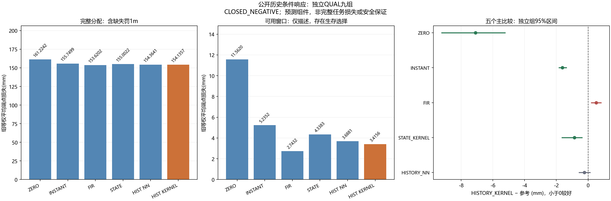

# A线：公开历史条件响应 v1 中文报告

结果：**`CLOSED_NEGATIVE`**。这是标准预测组件的新训练与独立资格；完整截止任务损失、错误更新率和论文创新仍未建立。CCF A目标保持未完成。

## 冻结与全部人口

冻结`b2f69d34b63042c3bcc15cc1123c0cbfbf9e66ac`；运行`history_response_20261027T130543Z_b2f69d34b630`；manifest ID `13e9ad62e09978dd3facceb14b451f10170f64570c7fc1aefd10607df211e38f`；清单文件SHA256 `744cb85d66016384cc6deb5c67ff18368eaa3b32f1e49e28f4741cfb50cd82ff`。
收集器、32项新数组/合成记录检查、独立记录/数值/统计审计、种子和预算先提交。2,286项旧检查按源码哈希复用；编译、依赖、全跟踪文件秘密扫描、真实索引补充扫描、差异及提交字节核验通过。91次冻结前测试执行含重复，不算91项新测试。前两次终端摘要保留，未捕获完整源绑定/外层计数的限制明示。

| 阶段 | 实际/分配 | 状态 | 控制步 | 真实入口 | 完整包 |
| --- | --- | --- | --- | --- | --- |
| SOFTWARE | 108/108 | COLLECTED_FOR_INDEPENDENT_AUDIT | 8196 | 105 | 105 |
| TRAIN | 324/324 | COLLECTED_FOR_INDEPENDENT_AUDIT | 21059 | 249 | 247 |
| CAL | 108/108 | COLLECTED_FOR_INDEPENDENT_AUDIT | 6633 | 81 | 81 |
| QUAL | 324/324 | COLLECTED_FOR_INDEPENDENT_AUDIT | 22019 | 276 | 275 |

全部864分配逐例登记，包括未执行、提前成功、短包、未就绪和异常；不重试或扩样。模型始终只观察，没有选择实际控制。
六个预测器共用同一物理人口，不是6×864次独立执行。补充只读种子审计发现原检查器没有完整遍历嵌套范围数组；对冻结的297个JSON源再检查333次范围出现（含重复）后无冲突。该补充核验晚于采集开始，不能声称其在冻结前完成；分配、种子、模型和记录均未改，检查器缺陷与时间戳保存在pipeline_control/nested_seed_scope_supplement.json。

## 名称和信息权限

- ZERO：预测不同命令没有响应差异。零发送命令仍有真实扰动和噪声。
- INSTANT：一个任务级XY增益乘累计命令。
- FIR：16个延迟响应核，按已知输入的时间顺序预测。
- STATE_KERNEL：依据当前公开观测及携带积分，给训练响应核加权。
- HISTORY_NN：取最近的历史中心，使用其已由最近8个训练家族预拟合的FIR。这是简单局部重加权参考。
- HISTORY_KERNEL：用16段真实已完成的动作/位移历史给响应核加权，是采集前唯一指定候选。

STATE共41维，HISTORY共153维。STATE含MetaWorld自带前一帧观测及携带积分，不能称为完全无历史。额外历史包含16段发送命令与手部XYZ实际位移；不使用获取类别、时刻、种子、真扰动、噪声或私有目标。私有值仅独立执行审计使用，标签来自实际公共手部位置。
响应差异目标不识别唯一的绝对执行偏置；保存的核系数也不等于执行器物理参数。数值合法、当前预测能力与包含获取成本的任务收益分别评价，三者不能互相替代。没有逐步接触力/接触对输入，不能据误差分层认定接触是唯一原因。

固定原任务策略RAW PI0.5前缀，IN_TASK或原LOCAL_PID移动，真实共同8步测量，随后已声明的ZERO/PLUS/MINUS16步包。每个角色实际从初始开始，不能恢复获取位移。共享入口预测早于任何角色包第一步，另两角色核对物理/公开/RNG/时钟入口后只引用缓存。

## 训练与独立资格

登记108个TRAIN家族，其中81个三角色H16完整家族；实际主求解93次。
各任务先等权组、再家族、再16H。三角色完整筛选存在输入依赖的终止偏差。反对称标签减少重复线性行；偶分量是参数无关常数，仍完整进入测试三配对评分。正则固定0.001，描述符按TRAIN标准化，核带宽固定1；最近邻数量固定8。
独立读取器和增广最小二乘/特征分解重建训练，不调用生产特征、拟合、预测器。预测时只有矩阵乘法和核权重，无新拟合。CAL不选模型/阈值，固定HISTORY_KERNEL在QUAL前锁定。

| 模型 | 全分配平均端点损失mm↓ | 可用端点描述均值mm↓ | 可用/全部端点 |
| --- | --- | --- | --- |
| FIR | 153.620214750 | 2.743201439 | 550/648 |
| HISTORY_KERNEL | 154.135671606 | 3.415618196 | 550/648 |
| HISTORY_NN | 154.364110236 | 3.688112261 | 550/648 |
| INSTANT | 155.749885048 | 5.235163690 | 550/648 |
| STATE_KERNEL | 155.002154048 | 4.338277424 | 550/648 |
| ZERO | 161.224220491 | 11.561989401 | 550/648 |

评分为H8/H16×三配对的XY端点RMSE，缺失/无效罚1m、封顶1m，80位十进制HALF_EVEN至纳米。主指标是完整分配损失，包含缺失罚分；可用子集仅描述。不能把含罚分均值称为纯物理误差。9独立组按干预时点分层bootstrap10,000次，相关步/配对不当作独立样本。

| HISTORY_KERNEL−参考 | 均差mm | 独立组bootstrap95%mm |
| --- | --- | --- |
| ZERO | -7.088548884 | [-9.243644488, -5.196827972] |
| INSTANT | -1.614213441 | [-1.865021418, -1.345966724] |
| FIR | +0.515456856 | [+0.181516092, +0.844588596] |
| STATE_KERNEL | -0.866482441 | [-1.668609030, -0.351091645] |
| HISTORY_NN | -0.228438630 | [-0.587747420, +0.148616289] |

固定候选的区间门未过参考：['FIR', 'HISTORY_NN']；点比较未过层：['task__push-v3', 'task__reach-v3', 'task__door-open-v3', 'horizon__8', 'horizon__16']。
全局FIR在本次新人口中为强参考，不能把这轮分数与旧QUAL直接比较并称为旧版改善：种子、实际可用窗口和缺失罚分比例均不同，旧资格仍关闭。HISTORY与STATE两核也改变了距离几何（分别除以153和41）；其比较不是仅增加历史信息而其他因素完全相同的因果消融。不能由两者差值证明信息价值或唯一失败原因。

资格门：

- `all_five_primary_CI_upper_negative`：`False`。
- `all_task_and_horizon_points_below_all`：`False`。
- `all9_groups_have_complete_family`：`True`。
- `minimum_complete_pairs_per_cell`：`True`。
- `zero_invalid_forecasts`：`True`。

有独立QUAL时，全部边际如下，单位mm；任务×条件×获取×时点×H全部交叉层保留在all_qualification_panels.csv，没有挑选子集。未进入QUAL时不生成该表。

| 完整边际层 | ZERO | INSTANT | FIR | STATE_KERNEL | HISTORY_NN | HISTORY_KERNEL |
| --- | --- | --- | --- | --- | --- | --- |
| {'task': 'push-v3'} | 10.885745 | 4.750697 | 2.104662 | 3.853762 | 2.931746 | 2.645144 |
| {'task': 'reach-v3'} | 461.175327 | 456.904097 | 455.153044 | 456.381979 | 455.842378 | 455.464142 |
| {'task': 'door-open-v3'} | 11.611589 | 5.594861 | 3.602938 | 4.770722 | 4.318207 | 4.297729 |
| {'context': 'UNCHANGED'} | 158.020711 | 152.533463 | 150.052507 | 151.755431 | 150.857879 | 150.498659 |
| {'context': 'CHANGED'} | 164.427730 | 158.966307 | 157.187922 | 158.248877 | 157.870342 | 157.772684 |
| {'acquisition_action': 'IN_TASK'} | 163.561334 | 158.789211 | 157.027087 | 157.985550 | 157.908542 | 157.585844 |
| {'acquisition_action': 'MOVE'} | 158.887107 | 152.710559 | 150.213342 | 152.018758 | 150.819679 | 150.685499 |
| {'boundary': 16} | 11.764100 | 5.705529 | 3.432924 | 4.075302 | 3.675842 | 3.534219 |
| {'boundary': 32} | 131.793137 | 124.919473 | 122.411105 | 124.721853 | 123.378147 | 122.776629 |
| {'boundary': 64} | 340.115425 | 336.624654 | 335.016615 | 336.209307 | 336.038342 | 336.096166 |
| {'horizon': 8} | 154.369170 | 151.625971 | 149.707715 | 150.285458 | 149.797628 | 149.844786 |
| {'horizon': 16} | 168.079271 | 159.873799 | 157.532715 | 159.718850 | 158.930593 | 158.426557 |

## 失败、限制与后续判断

无阶段执行异常。

完整逐例与缺失原因见all_case_outcomes.csv、full_population_missingness.json，逐步记录原样保留。包末成功标志不是完整任务成功率；未执行任务尾部，完整截止损失及错误更新率均为未评价，不能填零。
FIR原资格、旧ARX/GRU/SS/F20和A1负结果不改变。本版不因结果换历史长度、带宽、特征、最佳任务或强参考。负结果只否定固定候选的本次资格，不能推导所有公开历史都无信息或唯一物理失配原因。通过也不能自动进入逆控制或声称适应收益。

下一步判断：封存该历史核版本；不能按QUAL换窗口/带宽/特征、扩样或改参考；不概括为公开历史必然无信息。最终仍要新获取/采用机制在自身独立时序中以包含获取/失败的完整截止损失超过强控制，并完成消融。DIRECT_C8、积分、RAW PI/廉价固定率、始终获取/不更新及标准检测/历史辨识/任务相关获取不能被削弱。

## 成本与来源

| 阶段 | 控制步 | 全部重置 | 物理帧 | 固定策略在线/审计查询 | 采集秒 |
| --- | --- | --- | --- | --- | --- |
| SOFTWARE | 8196 | 5508 | 2794980 | 4032/4032 | 318.486 |
| TRAIN | 21059 | 16524 | 8367295 | 11040/11040 | 905.161 |
| CAL | 6633 | 5508 | 2787165 | 3684/3684 | 302.412 |
| QUAL | 22019 | 16524 | 8372095 | 11028/11028 | 891.817 |

本版实际864次、57907控制步、44064全部重置、22321535帧；上限864/80,640/44,064/22,435,200。包括工厂50次内部重置和每尝试一次受控初始重置。主求解93，独立增广LS 87，独立特征分解6。模型使用与计算延迟单列于costs.json和canonical_forecast_latencies.json；审计CPU查询另收费。
冻结前构造测试的数值费用与科学拟合分开，前两次由确定性断言/控制流复算、最后一次由外层guard实测，不能混称全为测量。旧来源原账本和哈希单列，不复用旧样本或权重、不重复计作新交互。在线LLM API=0，神经更新=0，C4/C8拟合=0，物理恢复=0。
独立执行审计复算float32仿射/死区→XYZ噪声→最终裁剪及每个原生目标更新；补充策略重放只读保存观测，共享原策略类/调度解析器的限制已披露，不是独立物理重仿真。

历史条件、核LPV、模型适用域、收益预测及策略相关建模都有先例。查新及阅读范围见[决定文档](../docs/research/history_response_decision_v1_zh.md)，包括[LPV核辨识](https://arxiv.org/abs/2303.07932)、[MDE](https://arxiv.org/html/2401.04007v2)、[OCCAM](https://arxiv.org/html/2406.17620v1)、[CAPTURE](https://arxiv.org/html/2410.20357v2)及[策略驱动世界模型](https://proceedings.mlr.press/v306/chen26fl.html)。尚未建立超出这些路线的新颖性。

协议docs/protocols/history_response_v1_zh.md；入口scripts/run_history_response_v1.py。科学人口不重跑。原始gzip保留，结果提交包含不超过4MiB分片及索引，逐个实际恢复和核对哈希，恢复副本保留；远端紧凑归档明确省略原始gzip和.bin分片，不声称远端包含全部大记录。

交付字节审计首次因Git对终端日志的CRLF→LF过滤失败；失败回执、原始外部日志及逐字节副本全部保留。只为该终端日志设置binary属性；第二次检查仍发现旧索引缓存，随后仅对该路径执行git add --renormalize。两次失败均保留，未改科学记录、模型或分数。首次交付检查耗时未完整捕获，不填虚构零值。
