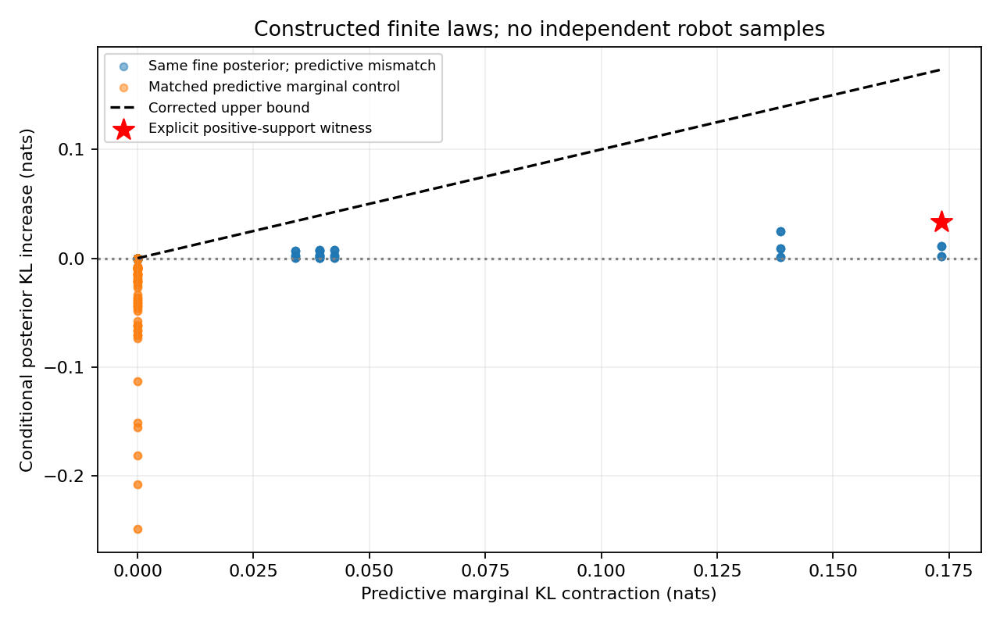
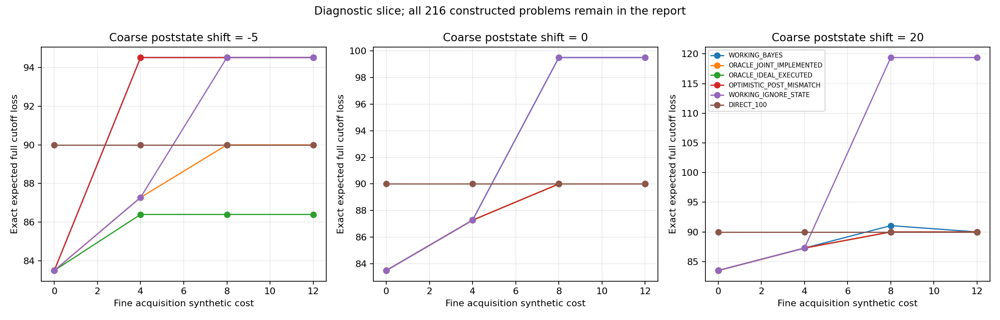

# 信息误差与实际采用规则：有限模型参考 v1

**本轮是构造性数学复核和标准决策参考，不是机器人实验、新算法资格或CCF A成果。** 所有构造与网格在完整枚举前冻结；显式反例是事先推导的数学见证，不伪装成独立抽样发现。新环境/重置/控制步/帧、拟合、优化器、在线LLM API、任务种子均为0。

冻结`2c6170321ce51308d1affef83391f93f43474bf3`；清单`1170fbb671618031625e116678e8369e7734aad02adfce47eb9f0099bb4e4077`；独立审计核对104997字段，采用精确有理概率和80位Decimal对数，禁用主计算/规划函数。

## 要解决的具体问题

上一轮机器人主候选仍未通过资格；本轮不改模型或旧QUAL。当前研究需要区分：后验在数值上合法、对当前观测/状态有预测能力、实际采用后降低完整任务损失。若把一般信息准则的收缩直接当成更新风险缩小，就可能跳过其中两层。

[Callahan与Catanach，AISTATS2026](https://proceedings.mlr.press/v300/callahan26a.html)研究失配推断下的信息价值。已读正文§2–4及附录C.2–C.3，并实际查看PDF第3、4、17页。以下只复核附录C.2按共同核合并观测时使用的后验条件KL收缩步骤；正文R4的充分关系措辞有方向歧义，本报告不推断作者意图，也不声称作者已接受任何修订。

## 一个全支撑、共同先验的明确见证

隐变量Θ有两值，观测Y有三值。P和Q都是合法联合分布，所有六个单元严格为正。两者的Θ先验均为(1/2,1/2)，细观测下Θ=1的后验均为(1/10,1/2,9/10)。差异仅在观测频率：P_Y=(1/4,1/2,1/4)，Q_Y=(2/5,1/5,2/5)。共同确定性核把前两类观测合并，保留第三类。

|Θ|P(Y=0)|P(Y=1)|P(Y=2)|Q(Y=0)|Q(Y=1)|Q(Y=2)|
|---|---|---|---|---|---|---|
|0|9/40|1/4|1/40|9/25|1/10|1/25|
|1|1/40|1/4|9/40|1/25|1/10|9/25|

令C为按P观测频率平均的后验KL，J为联合KL，M为观测边际KL。所有对数为自然对数。

|量，单位nats|细观测|合并观测|
|---|---:|---:|
|conditional_posterior_KL|0.000000000000000|0.033544671567054|
|joint_KL|0.223143551314210|0.083401427741277|
|predictive_marginal_KL|0.223143551314210|0.049856756174223|
|true_mutual_information|0.184032103584249|0.119008116089078|
|EGIG|0.184032103584249|0.085463444522024|

合并后的第一类观测，P的Θ=1后验为11/30，Q为7/30。细观测后验误差为0，合并后为正；与此同时，联合KL仍然减小。因此共同核下的联合KL数据处理不等式，不能直接改写成这里的条件后验KL收缩。该见证不需要零概率、先验差异、近似推断或数值奇异。

由标准KL链式法则与联合数据处理不等式，可直接得到修正边界：

\[C_2-C_1\leq M_1-M_2,\qquad J_i=M_i+C_i.\]

右端是观测频率失配被合并掉的量，不一定为零。若两模型细观测边际相同，则右端为0，此时恢复条件后验收缩。这里只使用标准恒等式，不将这两行推导声称为新的理论贡献或机器人安全保证。

## 完整构造网格与正对照

完整保留324条构造记录、270个唯一联合分布/通道问题，54条重复是两个检验族的明确重叠，不是独立样本。条件后验无条件收缩在72/324条中不成立；所有联合KL收缩、真实信息收缩和带边际松弛项边界均通过：True。同观测边际的162条正对照全部保留，不只展示反例。没有p值、置信区间或样本量功效主张。

另外，在两模型后验都保持先验不动、但观测频率不同的无信息例中，EGIG为0.000000000000，联合惩罚版RFIM_KL为-0.143841036226。因此，“后验不更新的归一化”与“同时惩罚预测频率失配”是不同要求，不能把它们当作同一条件。

## 成本、后状态与实际采用：全部有限决策参考

216个构造问题覆盖正向/反向频率失配、全部预定获取成本和后状态变化。每题12个参考程序，共2592份策略先保存再评估。CONTINUE、FINE、COARSE是有限数学决策，并非真实机器人指令；025/050/100仅是合成尾策略标签，不是重新启动旧ARX限幅实验。

成功时损失为获取成本加真实后状态下的完成时长；失败按500截止。实际期望损失为(1−f)(k+d_s)+500f，失败时不能再加k。KEEP在获取后的状态继续，不能撤销状态变化；STOP保留已花代价，截止损失仍为500。

WORKING_BAYES使用工作模型Q的标准有限贝叶斯选择；两个ORACLE显式读取合成真分布P，属于有特权的参考，不是可部署算法。ORACLE_JOINT_IMPLEMENTED评价实际Q后继规则；ORACLE_IDEAL_EXECUTED同时用P作后继决策。OPTIMISTIC_POST_MISMATCH先假想理想后继，实际却执行Q规则，专门暴露前后规则不一致造成的乐观性。另保留忽略状态、忽略成本、四种直接固定尾策略和两种始终获取参考。

下表是完整构造网格等权描述，不是独立机器人成功率。成功概率来自声明的有限概率表，不是新增物理执行；有特权参考的优势不能当作本方法任务收益。

|参考|完整截止损失均值|平均成功概率|平均获取等价成本|不利采用概率|保留但错过收益概率|
|---|---:|---:|---:|---:|---:|
|WORKING_BAYES|87.791925926|0.943328704|2.032407407|0.066666667|0.149305556|
|ORACLE_JOINT_IMPLEMENTED|86.074134259|0.929041667|2.106481481|0.052777778|0.000000000|
|ORACLE_IDEAL_EXECUTED|85.088287037|0.943731481|2.032407407|0.000000000|0.000000000|
|OPTIMISTIC_POST_MISMATCH|86.898120370|0.935972222|2.032407407|0.119444444|0.083333333|
|WORKING_IGNORE_STATE|92.426833333|0.950916667|1.583333333|0.000000000|0.156250000|
|WORKING_IGNORE_COST|87.288814815|0.949555556|4.277777778|0.033333333|0.083333333|
|DIRECT_KEEP|120.000000000|1.000000000|0.000000000|0.000000000|1.000000000|
|DIRECT_025|111.775000000|0.975000000|0.000000000|0.000000000|0.000000000|
|DIRECT_050|104.100000000|0.950000000|0.000000000|0.000000000|0.000000000|
|DIRECT_100|90.000000000|0.900000000|0.000000000|0.000000000|0.000000000|
|ALWAYS_FINE_WORKING|92.093500000|0.958500000|6.000000000|0.000000000|0.000000000|
|ALWAYS_COARSE_WORKING|100.011944444|0.943541667|1.666666667|0.300000000|0.250000000|

“不利采用”用同一已获取后状态及该观测下，所选采用尾策略的真条件期望损失高于KEEP定义；“错过收益”是保留时存在更低损失尾策略。这里只在声明真分布的有限问题中可精确计算，实际机器人中一次配对实现值不等于这些条件期望。

图仅展示事先声明的正向失配、FINE状态变化0、COARSE成本1切片；全部216题、两个失配方向、12程序及其动作、成功概率与采用错误均保留在evaluation/results.json，不据切片选择新任务或阈值。

## 后续研究判断

新证据改变了资格要求：后验更集中或更稳定不足以推出模型更可信，还必须检查获取所产生的公开后状态/证据频率及实际后继行为。但真联合分布在机器人在线决策时不可用，本轮没有得到一个可直接部署的风险评分器。

下一独立设计应先给出可用公开数据估计的联合后状态—证据分布和完整尾收益参考，区分工作模型、实际采用规则与获取后的真实状态。与OCCAM类直接表现预测、标准双重控制/决策相关探测作同权限强比较；不将本轮标准链式推导或两阶段结构当作新颖性。旧两阶段RBF和尾价值参考的负结果继续保留，不能换名重试旧人口。

新采集前仍需独立冻结训练/校准/最终自身时序评价、种子检查、完整物理及拟合费用、主比较和停止条件。最终任务标准保持截止损失优于DIRECT_C8和积分，并保留更强RAW PI、始终获取、获取不更新、标准检测/历史辨识及任务相关参考。当前不采集、不调旧QUAL、不接入失败SS/ARX，不宣称安全或完成CCF A目标。

[本轮一手文献与具体差异核对](../docs/research/information_scope_prior_art_v1_zh.md)
