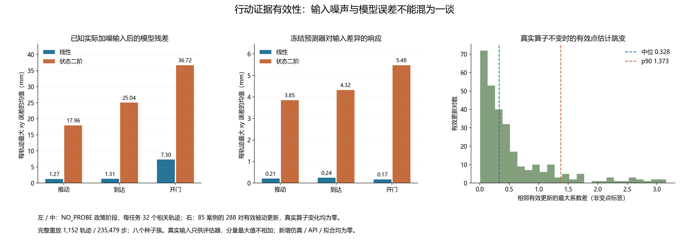

# 行动响应有效性前提 输入噪声与模型误差分解

本轮只读重放了 **1,152 条原始轨迹／235,479 步**，没有新增仿真、API 或模型拟合。结果收窄了后续方法设计：**知道实际执行输入也没有消除名义模型残差；真实执行器不变时，有效点估计仍可大幅变化。** 因而不能把点参数更新直接标为执行器变点，也不能只把预测偏差解释成执行噪声。

这次诊断没有产生新的任务成功率、控制器或采集策略，未完成算法贡献与 CCF A 研究目标。原线性十六步 **96/96** 仍是后续必须比较的强基线。

## 数据与分析身份

原数据：`forward_operator_20261014T081128Z_37eee13f9943`，冻结任务源 `37eee13f9943e26e2d15a81b9d3e6dd86e73f015`。分析工具先提交为 **`b196090565926a8d24bcc0870e4440caa4c245b0`**，再读取本轮诊断；输出是新的[分析目录](../outputs/input_model_error/development_v1/input_model_error_20261014T091921Z_b19609056592)。原任务审计、十六个原始文件和冻结名义银行的散列均绑定。

两种预测器均使用原名义训练数据的固定权重，对同一真实观察历史和同一 xy 位移目标计算，保留所有十二种方法、三任务、四种静态条件及全部失败／停止。每轨迹前两步建立真实位移历史，因此每种预测器与输入条件各有 **233,175 个带历史的比较步**。两种输入条件构成同一步的配对预测，不增加独立样本。

[定义与范围](../docs/research/input_model_error_audit_v1.md)在分析前固定。所有原种子与保留范围不变；没有根据结果选新阈值、特征、样本或点估计。

## 已知真实输入后的残差

下表只使用 **NO_PROBE 的政策阶段**。每任务 32 条轨迹，来自八个种子与四条件；相关条件不是 32 个独立种子。数值为每条轨迹最大 xy 绝对误差的均值，单位 mm。

| 任务 | 冻结预测器 | 轨迹 | 真算子参考输入残差 | 已知实际输入后残差 | 预测器输入差异响应 |
|---|---|---:|---:|---:|---:|
| 推动 | 线性 | 32 | 1.2607 | 1.2682 | 0.2063 |
| 推动 | 状态二阶 | 32 | 15.5575 | 17.9613 | 3.8532 |
| 到达 | 线性 | 32 | 1.2761 | 1.3078 | 0.2424 |
| 到达 | 状态二阶 | 32 | 22.1830 | 25.0418 | 4.3236 |
| 开门 | 线性 | 32 | 7.2665 | 7.3002 | 0.1675 |
| 开门 | 状态二阶 | 32 | 34.3459 | 36.7183 | 5.4774 |

推动／到达的线性模型在知道实际输入后仍约 **1.27／1.31 mm**，开门约 **7.30 mm**。二阶模型对应 **17.96／25.04／36.72 mm**。这些残差不能仅靠获知本步噪声输入消除。它们可包含未观察状态、接触、动力学和模型近似误差；本分析没有进一步归因。

“真算子参考输入残差”使用 **真实算子下不加噪并截断的参考输入**，不是代理用自己估计参数作出的预测误差。真实算子与实际加噪输入均只供评估器；这里没有把这项诊断能力授予在线代理。模型仍未获得物理响应、概率或控制安全资格。



[SVG 图](../outputs/input_model_error/figure_v1/figure.svg)可导出。完整[逐轨迹／阶段诊断](../outputs/input_model_error/development_v1/input_model_error_20261014T091921Z_b19609056592/diagnostics.json)还包含全部方法的步加权 RMSE、轨迹最大值均值／p90 和交叉项，不只展示上表。

## 分解为什么不能解释成百分比

令 y 为实际位移，f0 为真算子下参考输入预测，fa 为实际输入预测：

```text
r_total = f0 - y
r_model = fa - y
r_input = f0 - fa
r_total = r_model + r_input
||r_total||² = ||r_model||² + ||r_input||² + 2<r_model,r_input>
```

工具逐例验证了有符号及平方误差恒等式。交叉项保留，各分量不是独立因果来源；各自最大值还可能位于不同步骤，不能相加或除成误差占比。实际输入包含 xyz 噪声、float32 注入和最后截断；夹爪不加噪。参考输入也不等于截断加噪输入的期望。

不同方法经历的状态、长度和指令不同。本分析的模型配对共享同一步的历史，但跨方法数值仍只是描述，不能作为控制收益、模型更改的反事实任务效果或独立泛化确认。

## 静态真值下的有效参数更新

原协议中，每条轨迹的真实执行器矩阵与偏置始终不变。仍有 **288 对相邻有效被动更新**，来自 **85 个方法案例**；最大系数变化的中位／p90／最大为 **0.3276／1.3730／3.1561**。真实变化均为零。

只比较成功保存并实际执行的有效拟合，且核对拟合矩阵与保存控制器的逆映射一致。被拒更新保持被拒，不当作控制器变化；原 363 次无效更新仍留在原结果中。参数变化可混合有限样本噪声、输入支持变化与模型误差，并非可直接使用的变点标签。这里没有实现变点检测器，也没有声称某门限的误报率。

## 因子分解的条件性不可辨识

若允许当前动力学包含输入映射的组合，名义动力学加变化执行器，与名义执行器加相应变化动力学，可对全部因果策略产生同一观察分布。相同历史产生相同命令，再产生同一下一观察分布，归纳得到完整历史与状态定义任务结果等价。噪声和截断可以包含在转移核里。

这是[设计说明](../docs/research/input_model_error_audit_v1.md)中的条件性论证与解析例子，未声称当前所有 MetaWorld 故障都不可分，也未作为新定理。打破这类等价需要限制动力学／误差族、参考传感器或额外干预。若只关心当前行动响应，两类原因可能属于同一行动等价类。

后续应验证**给定当前状态、命令和过去观察，旧响应是否仍能支持下一行动**，明确观测及误差合同，再决定复用、定向测量或停止。集合辨识、控制导向实验设计和输入／状态作用域已有成熟工作，不能只改名称就宣称新颖；必须与标准 C-optimal／控制导向采集、变化检测、近期窗口以及廉价线性十六步公平比较，并在独立时变流中检验。

## 核验与成本

[独立核验记录](../outputs/input_model_error/verification_v1/verification.json)为 **PASSED**：全部 **235,479** 个重建输入与原执行器类逐项相同；使用原特征／设计函数核对 **27,648** 次预测，并检查 **4,608** 组保存阶段计数及平方恒等式。预测核对是每轨迹六个均匀位置的抽查，**没有冒充全部预测或汇总的独立重算**。RNG 和观察链在主分析中逐步核对，原任务独立审计保持有效。

新增物理步、环境重置、API、记忆写入和模型拟合均为 **0**。原任务与两份来源银行的物理总成本 **258,793 步／1,584 次重置** 保留在[原任务报告](forward_operator_task_utility_v1.md)；本次读取并不构成新的独立采集，也不把来源费用说成免费。

分析工具冻结前和结果阶段分别通过 **693 项全仓测试**，耗时 **113.243／109.341 秒**；结果阶段还扩大了特征测试至全部系数及非平凡归一化。编译、依赖检查通过，图表已查看并核验。[验证归档](../outputs/input_model_error/validation_v1/validation.json)保存完整测试／分析日志与产物散列；提交前另执行秘密扫描和 Git 差异检查。

## 当前研究结论

这轮新增的是模型作用域与观测可辨识边界的实际诊断。此前名义预测表现、当前真实输入下的残差、输入辨识点估计、任务成功与变点证据是不同对象；任何一个都不能自动替代其余对象。当前没有新的在线复用收益、采集收益或算法晋升，持续发表目标仍未完成。下一份协议需要围绕可观察的行动响应合同和独立非平稳评价收敛。
