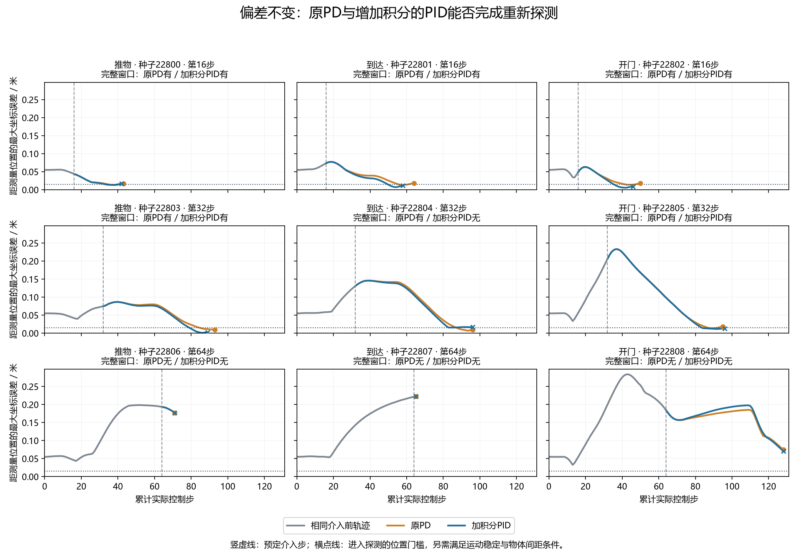
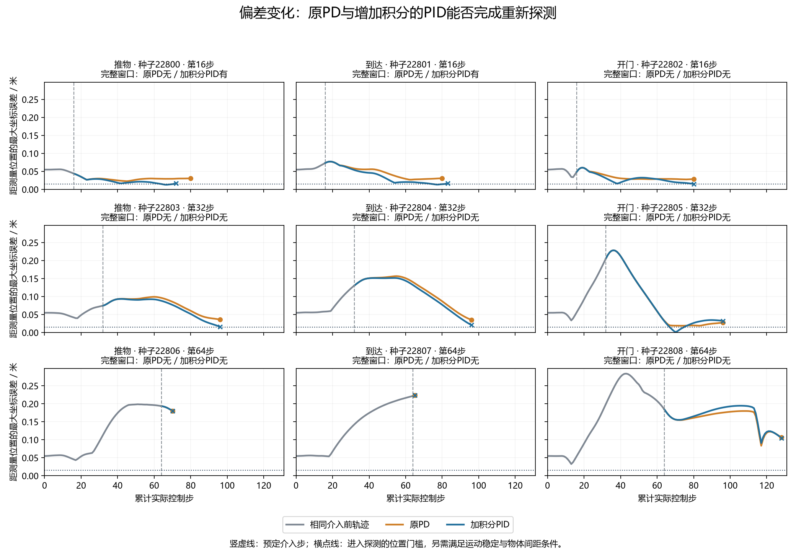

# 积分反馈重新探测：全部四组结果

**偏差不变：原PD 6/9，加积分PID 5/9；偏差变化：原PD 0/9，加积分PID 2/9。**

C8是用最开始8步数据算出的纠正。PD看当前偏差及最近位移；PID再记住持续偏差并累积补偿。重新探测是先移到测量位置，再做8步测试动作。完整窗口不等于任务成功。

记录审计：PASSED；PID执行资格：NOT_QUALIFIED。

PD根据当前位置偏差和最近位移调整动作；PID再累积持续偏差，逐步补偿。两者同样使用已保存的旧C8、最多64步移动和8步探测。积分增益0.32、幅度上限0.5在新数据之前冻结。该标准控制参考没有算法新颖性声明。

完整窗口仅表示取得规定测量，不表示参数估计或最终任务收益。PID必须在偏差不变及变化两种条件下，每任务至少取得一个窗口；原PD作为原样保留的对照，不要求其通过门槛。

全部36次执行、9个四组单元保留；每单元四组变化前初始状态、边界状态及全部物理前缀相同。核对17270条事件和108份完整私有见证。

|任务|种子|条件／方法|介入步|完整窗口|停止理由|移动步|探测步|总步数|期间任务成功|
|---|---:|---|---:|---|---|---:|---:|---:|---|
|推物|22800|偏差不变／原PD|16|True|COMPLETE_UNQUALIFIED|19|8|43|False|
|推物|22800|偏差不变／加积分PID|16|True|COMPLETE_UNQUALIFIED|18|8|42|False|
|推物|22800|偏差变化／原PD|16|False|ANCHOR_NOT_REACHED|64|0|80|False|
|推物|22800|偏差变化／加积分PID|16|True|COMPLETE_UNQUALIFIED|48|8|72|False|
|到达|22801|偏差不变／原PD|16|True|COMPLETE_UNQUALIFIED|40|8|64|False|
|到达|22801|偏差不变／加积分PID|16|True|COMPLETE_UNQUALIFIED|34|8|58|False|
|到达|22801|偏差变化／原PD|16|False|ANCHOR_NOT_REACHED|64|0|80|False|
|到达|22801|偏差变化／加积分PID|16|True|COMPLETE_UNQUALIFIED|59|8|83|False|
|开门|22802|偏差不变／原PD|16|True|COMPLETE_UNQUALIFIED|26|8|50|False|
|开门|22802|偏差不变／加积分PID|16|True|COMPLETE_UNQUALIFIED|22|8|46|False|
|开门|22802|偏差变化／原PD|16|False|ANCHOR_NOT_REACHED|64|0|80|False|
|开门|22802|偏差变化／加积分PID|16|False|ANCHOR_NOT_REACHED|64|0|80|False|
|推物|22803|偏差不变／原PD|32|True|COMPLETE_UNQUALIFIED|53|8|93|False|
|推物|22803|偏差不变／加积分PID|32|True|COMPLETE_UNQUALIFIED|49|8|89|False|
|推物|22803|偏差变化／原PD|32|False|ANCHOR_NOT_REACHED|64|0|96|False|
|推物|22803|偏差变化／加积分PID|32|False|ANCHOR_NOT_REACHED|64|0|96|False|
|到达|22804|偏差不变／原PD|32|True|COMPLETE_UNQUALIFIED|56|8|96|False|
|到达|22804|偏差不变／加积分PID|32|False|ANCHOR_NOT_REACHED|64|0|96|False|
|到达|22804|偏差变化／原PD|32|False|ANCHOR_NOT_REACHED|64|0|96|False|
|到达|22804|偏差变化／加积分PID|32|False|ANCHOR_NOT_REACHED|64|0|96|False|
|开门|22805|偏差不变／原PD|32|True|COMPLETE_UNQUALIFIED|55|8|95|False|
|开门|22805|偏差不变／加积分PID|32|True|COMPLETE_UNQUALIFIED|56|8|96|False|
|开门|22805|偏差变化／原PD|32|False|ANCHOR_NOT_REACHED|64|0|96|False|
|开门|22805|偏差变化／加积分PID|32|False|ANCHOR_NOT_REACHED|64|0|96|False|
|推物|22806|偏差不变／原PD|64|False|ENDED_DURING_REPOSITION|7|0|71|True|
|推物|22806|偏差不变／加积分PID|64|False|ENDED_DURING_REPOSITION|7|0|71|True|
|推物|22806|偏差变化／原PD|64|False|ENDED_DURING_REPOSITION|6|0|70|True|
|推物|22806|偏差变化／加积分PID|64|False|ENDED_DURING_REPOSITION|6|0|70|True|
|到达|22807|偏差不变／原PD|64|False|ENDED_DURING_REPOSITION|1|0|65|True|
|到达|22807|偏差不变／加积分PID|64|False|ENDED_DURING_REPOSITION|1|0|65|True|
|到达|22807|偏差变化／原PD|64|False|ENDED_DURING_REPOSITION|1|0|65|True|
|到达|22807|偏差变化／加积分PID|64|False|ENDED_DURING_REPOSITION|1|0|65|True|
|开门|22808|偏差不变／原PD|64|False|ANCHOR_NOT_REACHED|64|0|128|False|
|开门|22808|偏差不变／加积分PID|64|False|ANCHOR_NOT_REACHED|64|0|128|False|
|开门|22808|偏差变化／原PD|64|False|ANCHOR_NOT_REACHED|64|0|128|False|
|开门|22808|偏差变化／加积分PID|64|False|ANCHOR_NOT_REACHED|64|0|128|False|

|条件／方法|完整窗口|总步数|移动步|探测步|
|---|---:|---:|---:|---:|
|偏差不变／原PD|6/9|705|321|48|
|偏差不变／加积分PID|5/9|691|315|40|
|偏差变化／原PD|0/9|791|455|0|
|偏差变化／加积分PID|2/9|786|434|16|

两种条件下PID减PD的窗口计数差：{'UNCHANGED': -1, 'CHANGED': 2}。小样本计数不能解释为一般成功概率或任务效益；不同介入时刻用了不同种子，不能比较介入时间的因果作用。

每次移动结束都保存积分状态和由它构成的补偿参考，保存发生在8步探测之前，失败案例也保留该记录。它只改旧C8的偏移项，不能辨识新的动作矩阵，也不等于已验证的参数估计。未来任务比较必须加入这个不需要额外8步的补偿参考。

新增控制步2973，受控重置36次、全部重置1836次、完成仿真帧932865。API 0；新名义训练0；策略更新0。
策略查询1056次、初始拟合72次；审计另重算1056次策略、72次拟合，审计不调用环境。
每组承担完整历史名义成本3840控制步、480受控重置、24480全部重置、12259200帧；按9单元摊销426.666667历史控制步/单元。历史采集只实际发生一次；各组分别计入来源成本。
采集主体159.674秒，审计主体28.412秒，进程费用单独保存。

全过程没有环境复制、恢复、额外重置、噪声重抽或使用私有条件作代理证据。按固定程序在窗口完成或停止后结束，未继续完整任务。

仍未完成：真实中途响应模型校准、额外探测相对移动补偿的完整成本任务收益、独立变化流与强基线、创新性论证和论文。

标准积分与饱和问题参考：[Åström 与 Murray 控制教材](https://www.cds.caltech.edu/~murray/FBS/Chapter_10_-_PID_Control.html)。这里的增益是理想运动学设计启发，不是教材给出的MetaWorld稳定性保证。

冻结提交：`8014d27d424a0ca59d61971ea66ea9b440c8e9eb`；清单：`2406a8e68db6e603bd85443b0587354cf9f3f4d78a787b3de096a0323e3c405e`。

两图坐标范围相同，全部9个单元及提前结束、未到位案例保留。窗口入口的位置门槛不要求在后续探测脉冲中继续满足。

采集进程174.442秒；只读审计进程29.668秒。未为报告新增物理步骤、拟合或API调用。

软件检查及原生夹具费用另存于outputs/integral_reprobe/validation_v1；这些夹具费用不冒充完整开发计算账单。过程日志的Gymnasium和MetaWorld提示原样保留。

[冻结协议](../docs/protocols/integral_reprobe_execution_qualification_v1.md)；[原始记录与审计](../outputs/integral_reprobe/qualification_v1/integral_reprobe_20261019T132410Z_8014d27d424a)。
