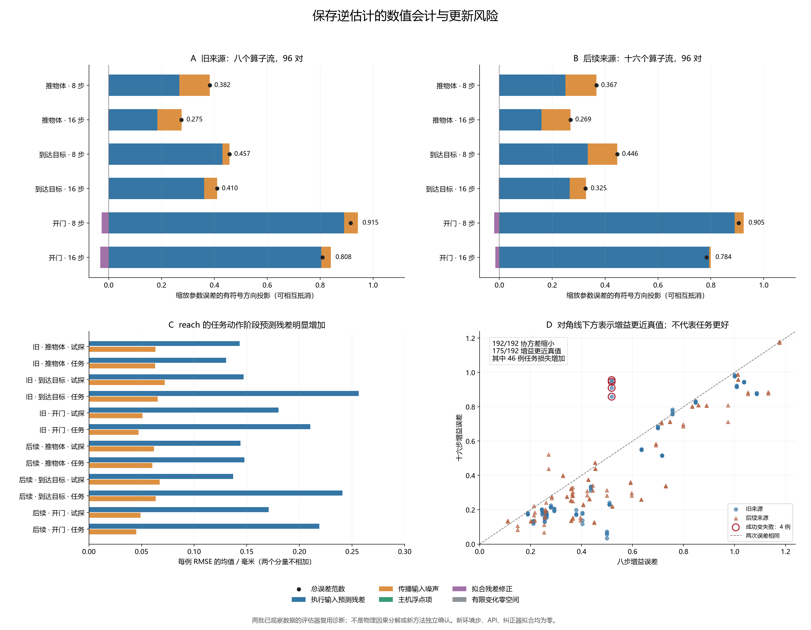

# 更新更确定为何仍可能伤害任务

本轮只读分析此前保存的 192 对执行、384 个八步／十六步估计，没有新机器人仿真、API 调用或纠正器拟合。独立公式复算通过 13,248 个数值字段。192 对中协方差全部缩小，增益参数在 175 对中更接近注入真值，但其中 46 对任务损失仍变大。参数更准确和估计更确定，都不足以作为接受更新的任务判据。

在这组固定预测器会计中，执行输入下的预测残差是各分层平均参数误差方向投影的主要正项。reach 的新增任务动作阶段残差明显高于探测阶段。这支持下一步同时检验前向预测适用性与更新后的动作影响；它没有证明某一物理原因，也没有证明换成工具变量估计就能解决问题。

[全部原始分量](../outputs/inverse_error_attribution/development_v1/inverse_attribution_20261015T120559Z_fcaa4a08b818/results.json)、[独立审计](../outputs/inverse_error_attribution/analysis_v1/audit.json)、[汇总来源](../outputs/inverse_error_attribution/report_v1/summary.json)和[冻结协议](../docs/protocols/inverse_error_attribution_v1.md)保存完整证据。数值一致性与参数真值距离均不是算法创新或 CCF A 发表证据。

## 比较的两种方法

DIRECT_G8 是先探测八步，按八步估计纠正后持续执行任务。PASSIVE_G16 同样探测八步，并用相同纠正方式执行八步任务，再把新观测加入估计，随后继续任务。两者最初十六步的列明观察、命令、原政策、噪声历史与实际动作逐条匹配；八步估计相同。因此表中任务差异出现在后续是否采用更新后的纠正器。

G 是近似 Gaussian 参考；其协方差未经覆盖率校准。所谓真实参数，只是注入执行器的平面增益矩阵和偏置。保存的估计是固定名义模型下的有效参数假设，靠近注入真值并不自动使固定政策更好。

## 全部任务结局

DISCOVERY_REUSE 为旧八算子流、三任务、四个后续噪声实现；LATER_REUSE 为后续十六算子流、三任务、两个实现。两个来源结局都在本分析提出前已被观察，因此后者也不是此诊断假设的独立确认。每组 96 对中，未来噪声重复不增加独立算子流数量；这里仅报告描述统计，不合并计算显著性。

成功记实际总步，失败或停止记 500，全部保留在分母。正的改善次数指 PASSIVE 损失更小。

| 来源 | DIRECT 成功 | PASSIVE 成功 | DIRECT 平均损失 | PASSIVE 平均损失 | 改善／恶化／相同 | 成功变失败／失败变成功 |
|---|---:|---:|---:|---:|---:|---:|
| DISCOVERY_REUSE | 85/96 | 88/96 | 128.83333 | 113.21875 | 48 / 30 / 18 | 4 / 7 |
| LATER_REUSE | 93/96 | 94/96 | 96.53125 | 86.98958 | 60 / 20 / 16 | 0 / 1 |

这两个已观察来源里，PASSIVE 平均表现优于 DIRECT，但仍有局部伤害。本轮不重做既有十二方法选择器的主比较，也不把这里的两方法平均改善包装成新方法结果。

| 来源 | 协方差缩小 | 增益误差变小 | 缩放总参数误差变小 | 增益更准但任务更慢或失败 |
|---|---:|---:|---:|---:|
| DISCOVERY_REUSE | 96/96 | 89/96 | 89/96 | 26/96 |
| LATER_REUSE | 96/96 | 86/96 | 89/96 | 20/96 |

## 三项残差和五项参数分量怎么理解

在同一段已记录历史上，将观察位移减去真实参数参考下的固定模型预测，拆成三项：实际执行输入下仍剩的预测残差、模型传播的输入噪声差异、主机浮点实现差异。三项相加恢复原残差；平方误差还包括两两交叉项，不能把各项 RMSE 相加。

再通过包含裁剪的有限变化矩阵及其伪逆，把保存参数与注入参数的差拆成五个向量：上述三项的投影、保存拟合残差修正、有限变化矩阵零空间项。最后两项必须保留；拟合残差修正不等于优化失败。增益误差是矩阵 Frobenius 范数，偏置误差是二范数，总参数按 (1,1,0.3,1,1,0.3) 缩放后求范数。

下表五项是在总参数误差方向上的有符号投影，按行相加等于末列；负值表示抵消，不能解释成物理因果百分比。G8 有六个有效样本；G16 有十四个，含六个探测样本及八个任务样本。前两步用于历史预热。

| 来源／任务／前缀 | 执行输入预测残差 | 传播输入噪声 | 浮点项 | 拟合残差修正 | 零空间 | 缩放总误差 |
|---|---:|---:|---:|---:|---:|---:|
| DISCOVERY_REUSE / door-open-v3 / 8 | 0.890736 | 0.0516074 | 3.94296e-09 | -0.0269055 | -2.11087e-16 | 0.915438 |
| DISCOVERY_REUSE / door-open-v3 / 16 | 0.80413 | 0.0359495 | -4.25519e-11 | -0.0318456 | 1.0402e-15 | 0.808234 |
| DISCOVERY_REUSE / push-v3 / 8 | 0.266915 | 0.115137 | 2.49509e-08 | 1.64434e-16 | 5.51883e-17 | 0.382052 |
| DISCOVERY_REUSE / push-v3 / 16 | 0.184019 | 0.0924365 | 1.64436e-08 | -0.00178128 | -1.20384e-17 | 0.274674 |
| DISCOVERY_REUSE / reach-v3 / 8 | 0.430191 | 0.0269708 | 7.67592e-09 | -3.07816e-16 | -1.663e-17 | 0.457162 |
| DISCOVERY_REUSE / reach-v3 / 16 | 0.361052 | 0.0488312 | 1.79816e-08 | 0.00011623 | 2.03761e-17 | 0.409999 |
| LATER_REUSE / door-open-v3 / 8 | 0.889783 | 0.0347291 | 7.56676e-09 | -0.0196113 | -2.73742e-16 | 0.904901 |
| LATER_REUSE / door-open-v3 / 16 | 0.793349 | 0.00617539 | 1.82638e-08 | -0.0155196 | 3.42228e-16 | 0.784004 |
| LATER_REUSE / push-v3 / 8 | 0.249751 | 0.117037 | -3.18012e-09 | 1.24432e-16 | 3.56872e-17 | 0.366788 |
| LATER_REUSE / push-v3 / 16 | 0.159805 | 0.109308 | -6.09421e-09 | -0.000211635 | 6.27746e-17 | 0.268901 |
| LATER_REUSE / reach-v3 / 8 | 0.334016 | 0.11213 | -1.44803e-09 | 1.3352e-16 | -1.11566e-16 | 0.446146 |
| LATER_REUSE / reach-v3 / 16 | 0.266367 | 0.0613757 | -1.30855e-08 | -0.00251774 | -2.0275e-16 | 0.325225 |

固定 LINEAR_ARX 输入包含最近两段三维位移和当前四维命令，包含 z 与夹爪命令；它没有使用当前位置。原模型按有噪声的请求命令训练，把它用于记录的执行输入只是本轮评估器诊断，并非已知的无噪声物理响应模型。裁剪前去掉新噪声再裁剪，也不等于随机执行动作的条件均值。因此残差可能混有模型适用性、历史近似和隐藏状态等因素，本分析不能将其分离成物理因果。

## 试探与实际任务阶段

下表是每例阶段 RMSE 再取均值，单位毫米；四列分别列示，不相加。每行 32 例，PROBE 每例六个有效样本，POLICY 每例八个。政策阶段的变化与历史、状态和动作分布同时改变，只是观察性比较。

| 来源／任务／阶段 | 总残差 | 执行输入预测残差 | 传播输入噪声 | 浮点项 |
|---|---:|---:|---:|---:|
| DISCOVERY_REUSE / push-v3 / PROBE | 0.155824 | 0.143207 | 0.0633587 | 1.18899e-08 |
| DISCOVERY_REUSE / push-v3 / POLICY | 0.14039 | 0.13035 | 0.0630376 | 2.50545e-08 |
| DISCOVERY_REUSE / reach-v3 / PROBE | 0.142199 | 0.146885 | 0.0721046 | 1.15999e-08 |
| DISCOVERY_REUSE / reach-v3 / POLICY | 0.256682 | 0.256424 | 0.065402 | 2.56626e-08 |
| DISCOVERY_REUSE / door-open-v3 / PROBE | 0.187042 | 0.18021 | 0.0510497 | 8.7533e-09 |
| DISCOVERY_REUSE / door-open-v3 / POLICY | 0.216215 | 0.21026 | 0.0472583 | 1.31221e-08 |
| LATER_REUSE / push-v3 / PROBE | 0.140359 | 0.143988 | 0.0617778 | 1.48271e-08 |
| LATER_REUSE / push-v3 / POLICY | 0.154399 | 0.147763 | 0.0603188 | 1.79489e-08 |
| LATER_REUSE / reach-v3 / PROBE | 0.14015 | 0.137155 | 0.0671784 | 1.45355e-08 |
| LATER_REUSE / reach-v3 / POLICY | 0.241472 | 0.240735 | 0.0634308 | 2.04908e-08 |
| LATER_REUSE / door-open-v3 / PROBE | 0.180912 | 0.170846 | 0.0490029 | 1.11261e-08 |
| LATER_REUSE / door-open-v3 / POLICY | 0.226261 | 0.218786 | 0.0449978 | 1.99907e-08 |

reach 的执行输入预测残差在旧来源从 0.146885 mm 增到 0.256424 mm，在后续来源从 0.137155 mm 增到 0.240735 mm。对应传播噪声项没有同幅增长。这使‘全部是执行输入噪声，换估计器即可修好’缺少依据；并不能据此锁定某个缺失变量。

## 四个成功变失败案例

四例均来自 DISCOVERY_REUSE 流 6 的 reach，在共同前缀下的四个后续噪声实现。八步估计相同，增益误差 0.518060、偏置误差 0.078660、协方差迹 0.105379。十六步后协方差继续缩小，但增益和偏置误差都增大。

| 流／未来 | DIRECT 损失 | PASSIVE 损失 | G16 增益误差 | G16 偏置误差 | G16 协方差迹 | 执行输入残差投影 | 噪声投影 | 拟合修正 |
|---|---:|---:|---:|---:|---:|---:|---:|---:|
| 6 / 0 | 52 | 500 | 0.945228 | 0.156389 | 0.075120 | 1.079630 | 0.021051 | -0.021234 |
| 6 / 1 | 53 | 500 | 0.910267 | 0.148716 | 0.074379 | 1.061575 | -0.031788 | 0.006710 |
| 6 / 2 | 52 | 500 | 0.858768 | 0.142296 | 0.074555 | 1.022333 | -0.043076 | 0.001794 |
| 6 / 3 | 50 | 500 | 0.955297 | 0.159148 | 0.074444 | 1.078231 | -0.001971 | 0.016450 |

这四个 G16 分解的有限变化矩阵秩均为 6，保存参数均未触及声明边界。不能以未激励的精确零空间或参数边界单独解释它们，也不能仅凭这里的代数投影证明预测残差是任务失败的独立物理原因。

## 完整逐例结局

D/P 是 DIRECT/PASSIVE；增益变化为 G16 减 G8，负值代表更接近注入增益。这里的误差与结局关联使用了仅评估器可见真值，不能直接成为在线规则。

| 来源 | 流 | 任务 | 未来 | D 成功／损失 | P 成功／损失 | 增益误差变化 | 协方差迹变化 |
|---|---:|---|---:|---:|---:|---:|---:|
| DISCOVERY_REUSE | 0 | push-v3 | 0 | 1 / 78 | 1 / 78 | -0.105922 | -0.0636094 |
| DISCOVERY_REUSE | 0 | push-v3 | 1 | 1 / 79 | 1 / 79 | -0.123758 | -0.0634861 |
| DISCOVERY_REUSE | 0 | push-v3 | 2 | 1 / 77 | 1 / 78 | -0.124984 | -0.0637849 |
| DISCOVERY_REUSE | 0 | push-v3 | 3 | 1 / 79 | 1 / 79 | -0.106664 | -0.0637502 |
| DISCOVERY_REUSE | 0 | reach-v3 | 0 | 1 / 75 | 1 / 68 | -0.0917713 | -0.0225626 |
| DISCOVERY_REUSE | 0 | reach-v3 | 1 | 1 / 83 | 1 / 75 | -0.075216 | -0.0225612 |
| DISCOVERY_REUSE | 0 | reach-v3 | 2 | 1 / 83 | 1 / 68 | -0.0841887 | -0.0225833 |
| DISCOVERY_REUSE | 0 | reach-v3 | 3 | 1 / 77 | 1 / 67 | -0.0778182 | -0.0225253 |
| DISCOVERY_REUSE | 0 | door-open-v3 | 0 | 1 / 101 | 1 / 101 | -0.0848902 | -0.0258983 |
| DISCOVERY_REUSE | 0 | door-open-v3 | 1 | 1 / 101 | 1 / 101 | -0.082937 | -0.0258983 |
| DISCOVERY_REUSE | 0 | door-open-v3 | 2 | 1 / 101 | 1 / 101 | -0.0863399 | -0.0258983 |
| DISCOVERY_REUSE | 0 | door-open-v3 | 3 | 1 / 101 | 1 / 101 | -0.081656 | -0.0258983 |
| DISCOVERY_REUSE | 1 | push-v3 | 0 | 1 / 74 | 1 / 75 | -0.0883458 | -0.0621722 |
| DISCOVERY_REUSE | 1 | push-v3 | 1 | 1 / 75 | 1 / 76 | -0.0988258 | -0.0621386 |
| DISCOVERY_REUSE | 1 | push-v3 | 2 | 1 / 75 | 1 / 76 | -0.0963106 | -0.0622128 |
| DISCOVERY_REUSE | 1 | push-v3 | 3 | 1 / 75 | 1 / 75 | -0.0855661 | -0.062126 |
| DISCOVERY_REUSE | 1 | reach-v3 | 0 | 1 / 48 | 1 / 40 | 0.0281863 | -0.0433505 |
| DISCOVERY_REUSE | 1 | reach-v3 | 1 | 1 / 47 | 1 / 40 | -0.000241139 | -0.0423022 |
| DISCOVERY_REUSE | 1 | reach-v3 | 2 | 1 / 49 | 1 / 40 | 0.00269935 | -0.0430537 |
| DISCOVERY_REUSE | 1 | reach-v3 | 3 | 1 / 48 | 1 / 40 | 0.0186003 | -0.0434677 |
| DISCOVERY_REUSE | 1 | door-open-v3 | 0 | 1 / 98 | 1 / 98 | -0.0860312 | -0.090474 |
| DISCOVERY_REUSE | 1 | door-open-v3 | 1 | 1 / 98 | 1 / 99 | -0.090835 | -0.090474 |
| DISCOVERY_REUSE | 1 | door-open-v3 | 2 | 1 / 98 | 1 / 99 | -0.0911861 | -0.090474 |
| DISCOVERY_REUSE | 1 | door-open-v3 | 3 | 1 / 98 | 1 / 99 | -0.0930327 | -0.090474 |
| DISCOVERY_REUSE | 2 | push-v3 | 0 | 1 / 79 | 1 / 77 | -0.100877 | -0.0600253 |
| DISCOVERY_REUSE | 2 | push-v3 | 1 | 1 / 80 | 1 / 78 | -0.100843 | -0.0601371 |
| DISCOVERY_REUSE | 2 | push-v3 | 2 | 1 / 81 | 1 / 78 | -0.111066 | -0.0601297 |
| DISCOVERY_REUSE | 2 | push-v3 | 3 | 1 / 82 | 1 / 78 | -0.122816 | -0.0603324 |
| DISCOVERY_REUSE | 2 | reach-v3 | 0 | 1 / 75 | 1 / 66 | -0.0743376 | -0.0525843 |
| DISCOVERY_REUSE | 2 | reach-v3 | 1 | 1 / 78 | 1 / 69 | -0.0691175 | -0.0525911 |
| DISCOVERY_REUSE | 2 | reach-v3 | 2 | 1 / 116 | 1 / 71 | -0.0590744 | -0.0526059 |
| DISCOVERY_REUSE | 2 | reach-v3 | 3 | 1 / 83 | 1 / 62 | -0.0608931 | -0.052584 |
| DISCOVERY_REUSE | 2 | door-open-v3 | 0 | 1 / 104 | 1 / 106 | -0.200567 | -0.0969963 |
| DISCOVERY_REUSE | 2 | door-open-v3 | 1 | 1 / 107 | 1 / 106 | -0.200955 | -0.0969963 |
| DISCOVERY_REUSE | 2 | door-open-v3 | 2 | 1 / 108 | 1 / 107 | -0.198823 | -0.0969963 |
| DISCOVERY_REUSE | 2 | door-open-v3 | 3 | 1 / 103 | 1 / 106 | -0.200754 | -0.0969963 |
| DISCOVERY_REUSE | 3 | push-v3 | 0 | 0 / 500 | 1 / 78 | -0.00687392 | -0.0662557 |
| DISCOVERY_REUSE | 3 | push-v3 | 1 | 0 / 500 | 1 / 77 | -0.0146524 | -0.0663368 |
| DISCOVERY_REUSE | 3 | push-v3 | 2 | 0 / 500 | 1 / 78 | -0.0145167 | -0.066168 |
| DISCOVERY_REUSE | 3 | push-v3 | 3 | 0 / 500 | 1 / 78 | -0.016316 | -0.066314 |
| DISCOVERY_REUSE | 3 | reach-v3 | 0 | 1 / 69 | 1 / 67 | -0.0432816 | -0.0417458 |
| DISCOVERY_REUSE | 3 | reach-v3 | 1 | 1 / 72 | 1 / 67 | -0.0434542 | -0.0415841 |
| DISCOVERY_REUSE | 3 | reach-v3 | 2 | 1 / 64 | 1 / 62 | -0.0414609 | -0.0418133 |
| DISCOVERY_REUSE | 3 | reach-v3 | 3 | 1 / 64 | 1 / 60 | -0.0437822 | -0.0417968 |
| DISCOVERY_REUSE | 3 | door-open-v3 | 0 | 0 / 500 | 0 / 500 | -0.0206892 | -0.0891068 |
| DISCOVERY_REUSE | 3 | door-open-v3 | 1 | 0 / 500 | 0 / 500 | -0.0224875 | -0.0890802 |
| DISCOVERY_REUSE | 3 | door-open-v3 | 2 | 0 / 500 | 0 / 500 | -0.0180354 | -0.0891376 |
| DISCOVERY_REUSE | 3 | door-open-v3 | 3 | 0 / 500 | 0 / 500 | -0.0141781 | -0.0778775 |
| DISCOVERY_REUSE | 4 | push-v3 | 0 | 0 / 500 | 1 / 84 | -0.0551527 | -0.0319331 |
| DISCOVERY_REUSE | 4 | push-v3 | 1 | 1 / 92 | 1 / 86 | -0.0664022 | -0.031425 |
| DISCOVERY_REUSE | 4 | push-v3 | 2 | 0 / 500 | 1 / 86 | -0.0659822 | -0.0318811 |
| DISCOVERY_REUSE | 4 | push-v3 | 3 | 0 / 500 | 1 / 85 | -0.0633735 | -0.030069 |
| DISCOVERY_REUSE | 4 | reach-v3 | 0 | 1 / 56 | 1 / 53 | -0.0758293 | -0.0637394 |
| DISCOVERY_REUSE | 4 | reach-v3 | 1 | 1 / 57 | 1 / 52 | -0.0924346 | -0.0637394 |
| DISCOVERY_REUSE | 4 | reach-v3 | 2 | 1 / 55 | 1 / 51 | -0.0875932 | -0.0637394 |
| DISCOVERY_REUSE | 4 | reach-v3 | 3 | 1 / 59 | 1 / 55 | -0.0758429 | -0.0637394 |
| DISCOVERY_REUSE | 4 | door-open-v3 | 0 | 1 / 125 | 1 / 126 | -0.0204934 | -0.0847875 |
| DISCOVERY_REUSE | 4 | door-open-v3 | 1 | 1 / 117 | 1 / 116 | -0.0230932 | -0.0847875 |
| DISCOVERY_REUSE | 4 | door-open-v3 | 2 | 1 / 130 | 1 / 118 | -0.022654 | -0.0847875 |
| DISCOVERY_REUSE | 4 | door-open-v3 | 3 | 1 / 122 | 1 / 124 | -0.013757 | -0.0847875 |
| DISCOVERY_REUSE | 5 | push-v3 | 0 | 1 / 77 | 1 / 78 | -0.286169 | -0.0656909 |
| DISCOVERY_REUSE | 5 | push-v3 | 1 | 1 / 76 | 1 / 76 | -0.219895 | -0.0656911 |
| DISCOVERY_REUSE | 5 | push-v3 | 2 | 1 / 77 | 1 / 78 | -0.264971 | -0.0656852 |
| DISCOVERY_REUSE | 5 | push-v3 | 3 | 1 / 77 | 1 / 77 | -0.225998 | -0.0655613 |
| DISCOVERY_REUSE | 5 | reach-v3 | 0 | 1 / 84 | 1 / 54 | -0.43506 | -0.0600151 |
| DISCOVERY_REUSE | 5 | reach-v3 | 1 | 1 / 83 | 1 / 53 | -0.465605 | -0.0599887 |
| DISCOVERY_REUSE | 5 | reach-v3 | 2 | 1 / 87 | 1 / 55 | -0.426019 | -0.0600006 |
| DISCOVERY_REUSE | 5 | reach-v3 | 3 | 1 / 84 | 1 / 55 | -0.442546 | -0.0600317 |
| DISCOVERY_REUSE | 5 | door-open-v3 | 0 | 1 / 89 | 1 / 93 | -0.0147933 | -0.0370804 |
| DISCOVERY_REUSE | 5 | door-open-v3 | 1 | 1 / 89 | 1 / 93 | -0.0233036 | -0.0370804 |
| DISCOVERY_REUSE | 5 | door-open-v3 | 2 | 1 / 89 | 1 / 93 | -0.0223263 | -0.0370804 |
| DISCOVERY_REUSE | 5 | door-open-v3 | 3 | 1 / 89 | 1 / 92 | -0.0221944 | -0.0370804 |
| DISCOVERY_REUSE | 6 | push-v3 | 0 | 1 / 67 | 1 / 67 | -0.18004 | -0.0594114 |
| DISCOVERY_REUSE | 6 | push-v3 | 1 | 1 / 68 | 1 / 66 | -0.208262 | -0.0606332 |
| DISCOVERY_REUSE | 6 | push-v3 | 2 | 1 / 68 | 1 / 67 | -0.203831 | -0.0594255 |
| DISCOVERY_REUSE | 6 | push-v3 | 3 | 1 / 69 | 1 / 68 | -0.204189 | -0.0592525 |
| DISCOVERY_REUSE | 6 | reach-v3 | 0 | 1 / 52 | 0 / 500 | 0.427169 | -0.0302586 |
| DISCOVERY_REUSE | 6 | reach-v3 | 1 | 1 / 53 | 0 / 500 | 0.392208 | -0.0309998 |
| DISCOVERY_REUSE | 6 | reach-v3 | 2 | 1 / 52 | 0 / 500 | 0.340708 | -0.0308235 |
| DISCOVERY_REUSE | 6 | reach-v3 | 3 | 1 / 50 | 0 / 500 | 0.437237 | -0.030935 |
| DISCOVERY_REUSE | 6 | door-open-v3 | 0 | 1 / 92 | 1 / 98 | -0.0935146 | -0.0964654 |
| DISCOVERY_REUSE | 6 | door-open-v3 | 1 | 1 / 92 | 1 / 98 | -0.0916663 | -0.0964654 |
| DISCOVERY_REUSE | 6 | door-open-v3 | 2 | 1 / 91 | 1 / 97 | -0.0950498 | -0.0964654 |
| DISCOVERY_REUSE | 6 | door-open-v3 | 3 | 1 / 91 | 1 / 98 | -0.0941532 | -0.0964654 |
| DISCOVERY_REUSE | 7 | push-v3 | 0 | 1 / 64 | 1 / 64 | -0.107313 | -0.0630431 |
| DISCOVERY_REUSE | 7 | push-v3 | 1 | 1 / 65 | 1 / 66 | -0.090189 | -0.0622663 |
| DISCOVERY_REUSE | 7 | push-v3 | 2 | 1 / 66 | 1 / 67 | -0.0908377 | -0.0627112 |
| DISCOVERY_REUSE | 7 | push-v3 | 3 | 1 / 65 | 1 / 65 | -0.0999225 | -0.0630406 |
| DISCOVERY_REUSE | 7 | reach-v3 | 0 | 1 / 77 | 1 / 59 | -0.278422 | -0.0277039 |
| DISCOVERY_REUSE | 7 | reach-v3 | 1 | 1 / 65 | 1 / 52 | -0.277791 | -0.0276421 |
| DISCOVERY_REUSE | 7 | reach-v3 | 2 | 1 / 67 | 1 / 53 | -0.267418 | -0.0277101 |
| DISCOVERY_REUSE | 7 | reach-v3 | 3 | 1 / 67 | 1 / 56 | -0.278207 | -0.0276797 |
| DISCOVERY_REUSE | 7 | door-open-v3 | 0 | 1 / 85 | 1 / 90 | -0.205951 | -0.0927009 |
| DISCOVERY_REUSE | 7 | door-open-v3 | 1 | 1 / 126 | 1 / 92 | -0.213305 | -0.0927009 |
| DISCOVERY_REUSE | 7 | door-open-v3 | 2 | 1 / 90 | 1 / 95 | -0.211144 | -0.0927009 |
| DISCOVERY_REUSE | 7 | door-open-v3 | 3 | 1 / 89 | 1 / 94 | -0.211633 | -0.0927009 |
| LATER_REUSE | 0 | push-v3 | 0 | 1 / 66 | 1 / 67 | -0.102074 | -0.0660522 |
| LATER_REUSE | 0 | push-v3 | 1 | 1 / 68 | 1 / 68 | -0.0901254 | -0.0660323 |
| LATER_REUSE | 0 | reach-v3 | 0 | 1 / 60 | 1 / 59 | -0.234641 | -0.0248504 |
| LATER_REUSE | 0 | reach-v3 | 1 | 1 / 61 | 1 / 59 | -0.230779 | -0.0302626 |
| LATER_REUSE | 0 | door-open-v3 | 0 | 1 / 103 | 1 / 94 | -0.254544 | -0.0810415 |
| LATER_REUSE | 0 | door-open-v3 | 1 | 1 / 106 | 1 / 97 | -0.246222 | -0.0810415 |
| LATER_REUSE | 1 | push-v3 | 0 | 1 / 74 | 1 / 73 | -0.10335 | -0.0498236 |
| LATER_REUSE | 1 | push-v3 | 1 | 1 / 72 | 1 / 73 | -0.105109 | -0.0499785 |
| LATER_REUSE | 1 | reach-v3 | 0 | 1 / 63 | 1 / 55 | -0.0388348 | -0.0245209 |
| LATER_REUSE | 1 | reach-v3 | 1 | 1 / 56 | 1 / 53 | -0.0328263 | -0.0245229 |
| LATER_REUSE | 1 | door-open-v3 | 0 | 0 / 500 | 1 / 98 | 0.0224251 | -0.0727971 |
| LATER_REUSE | 1 | door-open-v3 | 1 | 1 / 101 | 1 / 98 | 0.0219271 | -0.0727971 |
| LATER_REUSE | 2 | push-v3 | 0 | 1 / 72 | 1 / 71 | -0.184922 | -0.055674 |
| LATER_REUSE | 2 | push-v3 | 1 | 1 / 72 | 1 / 71 | -0.140459 | -0.0552635 |
| LATER_REUSE | 2 | reach-v3 | 0 | 1 / 44 | 1 / 43 | -0.321494 | -0.0301462 |
| LATER_REUSE | 2 | reach-v3 | 1 | 1 / 43 | 1 / 43 | -0.326352 | -0.02927 |
| LATER_REUSE | 2 | door-open-v3 | 0 | 1 / 178 | 1 / 111 | -0.261042 | -0.0588116 |
| LATER_REUSE | 2 | door-open-v3 | 1 | 1 / 173 | 1 / 116 | -0.16545 | -0.0561023 |
| LATER_REUSE | 3 | push-v3 | 0 | 1 / 138 | 1 / 129 | -0.300372 | -0.0587912 |
| LATER_REUSE | 3 | push-v3 | 1 | 1 / 81 | 1 / 80 | -0.298638 | -0.0604345 |
| LATER_REUSE | 3 | reach-v3 | 0 | 1 / 57 | 1 / 54 | -0.0139179 | -0.0517845 |
| LATER_REUSE | 3 | reach-v3 | 1 | 1 / 57 | 1 / 53 | -0.0165062 | -0.0516794 |
| LATER_REUSE | 3 | door-open-v3 | 0 | 1 / 93 | 1 / 96 | -0.0547358 | -0.0917201 |
| LATER_REUSE | 3 | door-open-v3 | 1 | 1 / 93 | 1 / 98 | -0.0556255 | -0.0917201 |
| LATER_REUSE | 4 | push-v3 | 0 | 1 / 80 | 1 / 77 | -0.0427936 | -0.0693368 |
| LATER_REUSE | 4 | push-v3 | 1 | 1 / 80 | 1 / 78 | -0.0663149 | -0.0698602 |
| LATER_REUSE | 4 | reach-v3 | 0 | 1 / 152 | 1 / 66 | -0.0658079 | -0.0617304 |
| LATER_REUSE | 4 | reach-v3 | 1 | 1 / 143 | 1 / 65 | -0.0662894 | -0.0620342 |
| LATER_REUSE | 4 | door-open-v3 | 0 | 1 / 161 | 1 / 163 | -0.390923 | -0.0966649 |
| LATER_REUSE | 4 | door-open-v3 | 1 | 1 / 169 | 1 / 168 | -0.393916 | -0.0966649 |
| LATER_REUSE | 5 | push-v3 | 0 | 1 / 71 | 1 / 68 | -0.223466 | -0.06207 |
| LATER_REUSE | 5 | push-v3 | 1 | 1 / 73 | 1 / 70 | -0.222276 | -0.0620395 |
| LATER_REUSE | 5 | reach-v3 | 0 | 1 / 71 | 1 / 63 | -0.179798 | -0.0221214 |
| LATER_REUSE | 5 | reach-v3 | 1 | 1 / 72 | 1 / 61 | -0.174117 | -0.0221761 |
| LATER_REUSE | 5 | door-open-v3 | 0 | 1 / 92 | 1 / 91 | -0.00259935 | -0.0824158 |
| LATER_REUSE | 5 | door-open-v3 | 1 | 1 / 92 | 1 / 91 | -0.0094055 | -0.0824158 |
| LATER_REUSE | 6 | push-v3 | 0 | 1 / 76 | 1 / 75 | -0.0667831 | -0.0287188 |
| LATER_REUSE | 6 | push-v3 | 1 | 1 / 78 | 1 / 77 | -0.0188777 | -0.0282948 |
| LATER_REUSE | 6 | reach-v3 | 0 | 1 / 52 | 1 / 57 | -0.114049 | -0.039764 |
| LATER_REUSE | 6 | reach-v3 | 1 | 1 / 54 | 1 / 59 | -0.137936 | -0.039752 |
| LATER_REUSE | 6 | door-open-v3 | 0 | 1 / 96 | 1 / 94 | -0.178004 | -0.0695047 |
| LATER_REUSE | 6 | door-open-v3 | 1 | 1 / 94 | 1 / 93 | -0.167927 | -0.0695047 |
| LATER_REUSE | 7 | push-v3 | 0 | 1 / 67 | 1 / 64 | -0.0354017 | -0.059206 |
| LATER_REUSE | 7 | push-v3 | 1 | 1 / 67 | 1 / 66 | -0.116142 | -0.0587955 |
| LATER_REUSE | 7 | reach-v3 | 0 | 1 / 52 | 1 / 49 | -0.209557 | -0.0276685 |
| LATER_REUSE | 7 | reach-v3 | 1 | 1 / 53 | 1 / 52 | -0.218358 | -0.0277417 |
| LATER_REUSE | 7 | door-open-v3 | 0 | 1 / 86 | 1 / 87 | -0.0842019 | -0.0905937 |
| LATER_REUSE | 7 | door-open-v3 | 1 | 1 / 87 | 1 / 89 | -0.082922 | -0.0905937 |
| LATER_REUSE | 8 | push-v3 | 0 | 1 / 71 | 1 / 73 | -0.0319973 | -0.0509005 |
| LATER_REUSE | 8 | push-v3 | 1 | 1 / 70 | 1 / 70 | -0.0789713 | -0.0508417 |
| LATER_REUSE | 8 | reach-v3 | 0 | 1 / 72 | 1 / 66 | 0.0732142 | -0.033448 |
| LATER_REUSE | 8 | reach-v3 | 1 | 1 / 66 | 1 / 60 | 0.0707708 | -0.0336989 |
| LATER_REUSE | 8 | door-open-v3 | 0 | 1 / 106 | 1 / 107 | -0.0518295 | -0.0962642 |
| LATER_REUSE | 8 | door-open-v3 | 1 | 1 / 105 | 1 / 105 | -0.0505275 | -0.0962642 |
| LATER_REUSE | 9 | push-v3 | 0 | 1 / 56 | 1 / 55 | -0.0697592 | -0.00717454 |
| LATER_REUSE | 9 | push-v3 | 1 | 1 / 56 | 1 / 55 | -0.0659624 | -0.00736154 |
| LATER_REUSE | 9 | reach-v3 | 0 | 1 / 61 | 1 / 51 | -0.184401 | -0.0197446 |
| LATER_REUSE | 9 | reach-v3 | 1 | 1 / 61 | 1 / 53 | -0.216538 | -0.0197345 |
| LATER_REUSE | 9 | door-open-v3 | 0 | 1 / 103 | 1 / 104 | -0.0499995 | -0.0905103 |
| LATER_REUSE | 9 | door-open-v3 | 1 | 1 / 103 | 1 / 105 | -0.0470503 | -0.0905103 |
| LATER_REUSE | 10 | push-v3 | 0 | 1 / 62 | 1 / 61 | -0.131492 | -0.0153971 |
| LATER_REUSE | 10 | push-v3 | 1 | 1 / 63 | 1 / 63 | -0.102329 | -0.0152933 |
| LATER_REUSE | 10 | reach-v3 | 0 | 1 / 70 | 1 / 61 | -0.0822541 | -0.0510514 |
| LATER_REUSE | 10 | reach-v3 | 1 | 1 / 68 | 1 / 64 | -0.071526 | -0.0520709 |
| LATER_REUSE | 10 | door-open-v3 | 0 | 0 / 500 | 0 / 500 | -0.0326493 | -0.092823 |
| LATER_REUSE | 10 | door-open-v3 | 1 | 0 / 500 | 0 / 500 | -0.0342478 | -0.092823 |
| LATER_REUSE | 11 | push-v3 | 0 | 1 / 80 | 1 / 80 | -0.165323 | -0.0232315 |
| LATER_REUSE | 11 | push-v3 | 1 | 1 / 81 | 1 / 82 | -0.169846 | -0.0231451 |
| LATER_REUSE | 11 | reach-v3 | 0 | 1 / 104 | 1 / 65 | -0.374229 | -0.0272613 |
| LATER_REUSE | 11 | reach-v3 | 1 | 1 / 108 | 1 / 65 | -0.373337 | -0.0271965 |
| LATER_REUSE | 11 | door-open-v3 | 0 | 1 / 89 | 1 / 89 | -0.0259771 | -0.0256063 |
| LATER_REUSE | 11 | door-open-v3 | 1 | 1 / 89 | 1 / 89 | -0.0240097 | -0.0256063 |
| LATER_REUSE | 12 | push-v3 | 0 | 1 / 80 | 1 / 80 | -0.0459921 | -0.0457981 |
| LATER_REUSE | 12 | push-v3 | 1 | 1 / 79 | 1 / 78 | 0.00880972 | -0.0476294 |
| LATER_REUSE | 12 | reach-v3 | 0 | 1 / 59 | 1 / 58 | 0.0194887 | -0.0307438 |
| LATER_REUSE | 12 | reach-v3 | 1 | 1 / 61 | 1 / 58 | 0.0264647 | -0.0308403 |
| LATER_REUSE | 12 | door-open-v3 | 0 | 1 / 113 | 1 / 113 | -0.10135 | -0.0847875 |
| LATER_REUSE | 12 | door-open-v3 | 1 | 1 / 118 | 1 / 119 | -0.112046 | -0.0847875 |
| LATER_REUSE | 13 | push-v3 | 0 | 1 / 70 | 1 / 72 | -0.054477 | -0.0628948 |
| LATER_REUSE | 13 | push-v3 | 1 | 1 / 71 | 1 / 72 | -0.0673257 | -0.0628722 |
| LATER_REUSE | 13 | reach-v3 | 0 | 1 / 69 | 1 / 54 | -0.239963 | -0.0471498 |
| LATER_REUSE | 13 | reach-v3 | 1 | 1 / 62 | 1 / 52 | -0.257138 | -0.0472498 |
| LATER_REUSE | 13 | door-open-v3 | 0 | 1 / 118 | 1 / 118 | -0.0304552 | -0.0253114 |
| LATER_REUSE | 13 | door-open-v3 | 1 | 1 / 125 | 1 / 153 | -0.0336188 | -0.0253114 |
| LATER_REUSE | 14 | push-v3 | 0 | 1 / 67 | 1 / 67 | 0.251031 | -0.0444502 |
| LATER_REUSE | 14 | push-v3 | 1 | 1 / 67 | 1 / 67 | 0.167928 | -0.044631 |
| LATER_REUSE | 14 | reach-v3 | 0 | 1 / 53 | 1 / 57 | -0.00472981 | -0.0364653 |
| LATER_REUSE | 14 | reach-v3 | 1 | 1 / 51 | 1 / 54 | -0.0149314 | -0.036539 |
| LATER_REUSE | 14 | door-open-v3 | 0 | 1 / 108 | 1 / 103 | -0.11553 | -0.0847128 |
| LATER_REUSE | 14 | door-open-v3 | 1 | 1 / 108 | 1 / 102 | -0.107407 | -0.0847128 |
| LATER_REUSE | 15 | push-v3 | 0 | 1 / 75 | 1 / 73 | -0.0614964 | -0.0417162 |
| LATER_REUSE | 15 | push-v3 | 1 | 1 / 74 | 1 / 70 | -0.0839617 | -0.0419756 |
| LATER_REUSE | 15 | reach-v3 | 0 | 1 / 69 | 1 / 62 | -0.299042 | -0.0490226 |
| LATER_REUSE | 15 | reach-v3 | 1 | 1 / 75 | 1 / 63 | -0.313594 | -0.0487478 |
| LATER_REUSE | 15 | door-open-v3 | 0 | 1 / 101 | 1 / 101 | 0.00351168 | -0.0307652 |
| LATER_REUSE | 15 | door-open-v3 | 1 | 1 / 101 | 1 / 100 | -0.00430799 | -0.0310931 |

## 完整逐前缀诊断

保留全部 384 个已保存前缀。裁剪栏依次为真实无新增噪声参考、保存估计参考、实际输入达到平面边界的样本数；边界栏指保存参数触及注册参数边界。完整三项均方、交叉项及五个向量见原始 JSON。

| 来源／流／任务／未来 | 前缀 | 样本 | 增益误差 | 偏置误差 | 缩放参数误差 | 总残差 mm | 秩 | 裁剪样本 | 参数边界 |
|---|---:|---:|---:|---:|---:|---:|---:|---|---|
| DISCOVERY_REUSE / 0 / push-v3 / 0 | 8 | 6 | 0.255261 | 0.0902409 | 0.394513 | 0.149158 | 6 | 0 / 0 / 0 | False |
| DISCOVERY_REUSE / 0 / push-v3 / 0 | 16 | 14 | 0.149339 | 0.0806424 | 0.307506 | 0.127284 | 6 | 0 / 0 / 0 | False |
| DISCOVERY_REUSE / 0 / push-v3 / 1 | 8 | 6 | 0.255261 | 0.0902409 | 0.394513 | 0.149158 | 6 | 0 / 0 / 0 | False |
| DISCOVERY_REUSE / 0 / push-v3 / 1 | 16 | 14 | 0.131503 | 0.0818721 | 0.302938 | 0.134968 | 6 | 0 / 0 / 0 | False |
| DISCOVERY_REUSE / 0 / push-v3 / 2 | 8 | 6 | 0.255261 | 0.0902409 | 0.394513 | 0.149158 | 6 | 0 / 0 / 0 | False |
| DISCOVERY_REUSE / 0 / push-v3 / 2 | 16 | 14 | 0.130277 | 0.0775336 | 0.289424 | 0.140635 | 6 | 0 / 0 / 0 | False |
| DISCOVERY_REUSE / 0 / push-v3 / 3 | 8 | 6 | 0.255261 | 0.0902409 | 0.394513 | 0.149158 | 6 | 0 / 0 / 0 | False |
| DISCOVERY_REUSE / 0 / push-v3 / 3 | 16 | 14 | 0.148597 | 0.0804215 | 0.306502 | 0.140562 | 6 | 0 / 0 / 0 | False |
| DISCOVERY_REUSE / 0 / reach-v3 / 0 | 8 | 6 | 0.210871 | 0.041901 | 0.252931 | 0.118219 | 6 | 0 / 0 / 0 | False |
| DISCOVERY_REUSE / 0 / reach-v3 / 0 | 16 | 14 | 0.119099 | 0.0321679 | 0.160256 | 0.194745 | 6 | 0 / 0 / 0 | False |
| DISCOVERY_REUSE / 0 / reach-v3 / 1 | 8 | 6 | 0.210871 | 0.041901 | 0.252931 | 0.118219 | 6 | 0 / 0 / 0 | False |
| DISCOVERY_REUSE / 0 / reach-v3 / 1 | 16 | 14 | 0.135655 | 0.0281823 | 0.165006 | 0.215673 | 6 | 0 / 0 / 0 | False |
| DISCOVERY_REUSE / 0 / reach-v3 / 2 | 8 | 6 | 0.210871 | 0.041901 | 0.252931 | 0.118219 | 6 | 0 / 0 / 0 | False |
| DISCOVERY_REUSE / 0 / reach-v3 / 2 | 16 | 14 | 0.126682 | 0.0301568 | 0.161719 | 0.202325 | 6 | 0 / 0 / 0 | False |
| DISCOVERY_REUSE / 0 / reach-v3 / 3 | 8 | 6 | 0.210871 | 0.041901 | 0.252931 | 0.118219 | 6 | 0 / 0 / 0 | False |
| DISCOVERY_REUSE / 0 / reach-v3 / 3 | 16 | 14 | 0.133052 | 0.0285332 | 0.163551 | 0.188844 | 6 | 0 / 0 / 0 | False |
| DISCOVERY_REUSE / 0 / door-open-v3 / 0 | 8 | 6 | 0.634608 | 0.0574671 | 0.662889 | 0.138431 | 6 | 0 / 0 / 0 | False |
| DISCOVERY_REUSE / 0 / door-open-v3 / 0 | 16 | 14 | 0.549718 | 0.0462924 | 0.570965 | 0.202025 | 6 | 8 / 8 / 6 | False |
| DISCOVERY_REUSE / 0 / door-open-v3 / 1 | 8 | 6 | 0.634608 | 0.0574671 | 0.662889 | 0.138431 | 6 | 0 / 0 / 0 | False |
| DISCOVERY_REUSE / 0 / door-open-v3 / 1 | 16 | 14 | 0.551671 | 0.0465908 | 0.573114 | 0.202359 | 6 | 8 / 8 / 8 | False |
| DISCOVERY_REUSE / 0 / door-open-v3 / 2 | 8 | 6 | 0.634608 | 0.0574671 | 0.662889 | 0.138431 | 6 | 0 / 0 / 0 | False |
| DISCOVERY_REUSE / 0 / door-open-v3 / 2 | 16 | 14 | 0.548268 | 0.0440079 | 0.567553 | 0.215714 | 6 | 8 / 8 / 7 | False |
| DISCOVERY_REUSE / 0 / door-open-v3 / 3 | 8 | 6 | 0.634608 | 0.0574671 | 0.662889 | 0.138431 | 6 | 0 / 0 / 0 | False |
| DISCOVERY_REUSE / 0 / door-open-v3 / 3 | 16 | 14 | 0.552952 | 0.0471086 | 0.574816 | 0.198574 | 6 | 8 / 8 / 6 | False |
| DISCOVERY_REUSE / 1 / push-v3 / 0 | 8 | 6 | 0.292152 | 0.0559832 | 0.346665 | 0.204612 | 6 | 0 / 0 / 0 | False |
| DISCOVERY_REUSE / 1 / push-v3 / 0 | 16 | 14 | 0.203806 | 0.0516994 | 0.266899 | 0.158799 | 6 | 0 / 0 / 0 | False |
| DISCOVERY_REUSE / 1 / push-v3 / 1 | 8 | 6 | 0.292152 | 0.0559832 | 0.346665 | 0.204612 | 6 | 0 / 0 / 0 | False |
| DISCOVERY_REUSE / 1 / push-v3 / 1 | 16 | 14 | 0.193326 | 0.0394414 | 0.233794 | 0.160432 | 6 | 0 / 0 / 0 | False |
| DISCOVERY_REUSE / 1 / push-v3 / 2 | 8 | 6 | 0.292152 | 0.0559832 | 0.346665 | 0.204612 | 6 | 0 / 0 / 0 | False |
| DISCOVERY_REUSE / 1 / push-v3 / 2 | 16 | 14 | 0.195841 | 0.0411704 | 0.239138 | 0.154305 | 6 | 0 / 0 / 0 | False |
| DISCOVERY_REUSE / 1 / push-v3 / 3 | 8 | 6 | 0.292152 | 0.0559832 | 0.346665 | 0.204612 | 6 | 0 / 0 / 0 | False |
| DISCOVERY_REUSE / 1 / push-v3 / 3 | 16 | 14 | 0.206586 | 0.0406802 | 0.247114 | 0.157088 | 6 | 0 / 0 / 0 | False |
| DISCOVERY_REUSE / 1 / reach-v3 / 0 | 8 | 6 | 0.75624 | 0.0398803 | 0.767835 | 0.209721 | 6 | 0 / 0 / 0 | False |
| DISCOVERY_REUSE / 1 / reach-v3 / 0 | 16 | 14 | 0.784427 | 0.0377868 | 0.794475 | 0.273314 | 6 | 0 / 0 / 0 | False |
| DISCOVERY_REUSE / 1 / reach-v3 / 1 | 8 | 6 | 0.75624 | 0.0398803 | 0.767835 | 0.209721 | 6 | 0 / 0 / 0 | False |
| DISCOVERY_REUSE / 1 / reach-v3 / 1 | 16 | 14 | 0.755999 | 0.0376262 | 0.766332 | 0.254561 | 6 | 0 / 0 / 0 | False |
| DISCOVERY_REUSE / 1 / reach-v3 / 2 | 8 | 6 | 0.75624 | 0.0398803 | 0.767835 | 0.209721 | 6 | 0 / 0 / 0 | False |
| DISCOVERY_REUSE / 1 / reach-v3 / 2 | 16 | 14 | 0.75894 | 0.0358584 | 0.768294 | 0.260736 | 6 | 0 / 0 / 0 | False |
| DISCOVERY_REUSE / 1 / reach-v3 / 3 | 8 | 6 | 0.75624 | 0.0398803 | 0.767835 | 0.209721 | 6 | 0 / 0 / 0 | False |
| DISCOVERY_REUSE / 1 / reach-v3 / 3 | 16 | 14 | 0.77484 | 0.0348998 | 0.783525 | 0.291017 | 6 | 0 / 0 / 0 | False |
| DISCOVERY_REUSE / 1 / door-open-v3 / 0 | 8 | 6 | 1.00875 | 0.0641266 | 1.03115 | 0.246372 | 6 | 0 / 0 / 0 | True |
| DISCOVERY_REUSE / 1 / door-open-v3 / 0 | 16 | 14 | 0.922721 | 0.0663008 | 0.948819 | 0.232555 | 6 | 0 / 0 / 0 | True |
| DISCOVERY_REUSE / 1 / door-open-v3 / 1 | 8 | 6 | 1.00875 | 0.0641266 | 1.03115 | 0.246372 | 6 | 0 / 0 / 0 | True |
| DISCOVERY_REUSE / 1 / door-open-v3 / 1 | 16 | 14 | 0.917917 | 0.0621087 | 0.940975 | 0.229232 | 6 | 0 / 0 / 0 | True |
| DISCOVERY_REUSE / 1 / door-open-v3 / 2 | 8 | 6 | 1.00875 | 0.0641266 | 1.03115 | 0.246372 | 6 | 0 / 0 / 0 | True |
| DISCOVERY_REUSE / 1 / door-open-v3 / 2 | 16 | 14 | 0.917566 | 0.0633028 | 0.941516 | 0.228341 | 6 | 0 / 0 / 0 | True |
| DISCOVERY_REUSE / 1 / door-open-v3 / 3 | 8 | 6 | 1.00875 | 0.0641266 | 1.03115 | 0.246372 | 6 | 0 / 0 / 0 | True |
| DISCOVERY_REUSE / 1 / door-open-v3 / 3 | 16 | 14 | 0.91572 | 0.065067 | 0.941055 | 0.227989 | 6 | 0 / 0 / 0 | True |
| DISCOVERY_REUSE / 2 / push-v3 / 0 | 8 | 6 | 0.43578 | 0.0391766 | 0.454926 | 0.126426 | 6 | 0 / 0 / 0 | False |
| DISCOVERY_REUSE / 2 / push-v3 / 0 | 16 | 14 | 0.334903 | 0.0215039 | 0.342488 | 0.0954794 | 6 | 0 / 0 / 0 | False |
| DISCOVERY_REUSE / 2 / push-v3 / 1 | 8 | 6 | 0.43578 | 0.0391766 | 0.454926 | 0.126426 | 6 | 0 / 0 / 0 | False |
| DISCOVERY_REUSE / 2 / push-v3 / 1 | 16 | 14 | 0.334937 | 0.0219053 | 0.342804 | 0.102149 | 6 | 0 / 0 / 0 | False |
| DISCOVERY_REUSE / 2 / push-v3 / 2 | 8 | 6 | 0.43578 | 0.0391766 | 0.454926 | 0.126426 | 6 | 0 / 0 / 0 | False |
| DISCOVERY_REUSE / 2 / push-v3 / 2 | 16 | 14 | 0.324713 | 0.0193444 | 0.331054 | 0.102123 | 6 | 0 / 0 / 0 | False |
| DISCOVERY_REUSE / 2 / push-v3 / 3 | 8 | 6 | 0.43578 | 0.0391766 | 0.454926 | 0.126426 | 6 | 0 / 0 / 0 | False |
| DISCOVERY_REUSE / 2 / push-v3 / 3 | 16 | 14 | 0.312963 | 0.0303132 | 0.328871 | 0.10967 | 6 | 0 / 0 / 0 | False |
| DISCOVERY_REUSE / 2 / reach-v3 / 0 | 8 | 6 | 0.246131 | 0.0622177 | 0.321857 | 0.088459 | 6 | 0 / 0 / 0 | False |
| DISCOVERY_REUSE / 2 / reach-v3 / 0 | 16 | 14 | 0.171793 | 0.0198097 | 0.184047 | 0.169737 | 6 | 0 / 0 / 0 | False |
| DISCOVERY_REUSE / 2 / reach-v3 / 1 | 8 | 6 | 0.246131 | 0.0622177 | 0.321857 | 0.088459 | 6 | 0 / 0 / 0 | False |
| DISCOVERY_REUSE / 2 / reach-v3 / 1 | 16 | 14 | 0.177014 | 0.016782 | 0.185642 | 0.174083 | 6 | 0 / 0 / 0 | False |
| DISCOVERY_REUSE / 2 / reach-v3 / 2 | 8 | 6 | 0.246131 | 0.0622177 | 0.321857 | 0.088459 | 6 | 0 / 0 / 0 | False |
| DISCOVERY_REUSE / 2 / reach-v3 / 2 | 16 | 14 | 0.187057 | 0.0172097 | 0.195655 | 0.168427 | 6 | 0 / 0 / 0 | False |
| DISCOVERY_REUSE / 2 / reach-v3 / 3 | 8 | 6 | 0.246131 | 0.0622177 | 0.321857 | 0.088459 | 6 | 0 / 0 / 0 | False |
| DISCOVERY_REUSE / 2 / reach-v3 / 3 | 16 | 14 | 0.185238 | 0.0206571 | 0.197622 | 0.181096 | 6 | 0 / 0 / 0 | False |
| DISCOVERY_REUSE / 2 / door-open-v3 / 0 | 8 | 6 | 0.716059 | 0.047403 | 0.733286 | 0.164591 | 6 | 0 / 0 / 0 | False |
| DISCOVERY_REUSE / 2 / door-open-v3 / 0 | 16 | 14 | 0.515492 | 0.0338532 | 0.527699 | 0.173386 | 6 | 0 / 0 / 0 | False |
| DISCOVERY_REUSE / 2 / door-open-v3 / 1 | 8 | 6 | 0.716059 | 0.047403 | 0.733286 | 0.164591 | 6 | 0 / 0 / 0 | False |
| DISCOVERY_REUSE / 2 / door-open-v3 / 1 | 16 | 14 | 0.515104 | 0.0365908 | 0.529347 | 0.179588 | 6 | 0 / 0 / 0 | False |
| DISCOVERY_REUSE / 2 / door-open-v3 / 2 | 8 | 6 | 0.716059 | 0.047403 | 0.733286 | 0.164591 | 6 | 0 / 0 / 0 | False |
| DISCOVERY_REUSE / 2 / door-open-v3 / 2 | 16 | 14 | 0.517237 | 0.0329292 | 0.528755 | 0.169662 | 6 | 0 / 0 / 0 | False |
| DISCOVERY_REUSE / 2 / door-open-v3 / 3 | 8 | 6 | 0.716059 | 0.047403 | 0.733286 | 0.164591 | 6 | 0 / 0 / 0 | False |
| DISCOVERY_REUSE / 2 / door-open-v3 / 3 | 16 | 14 | 0.515305 | 0.0366263 | 0.52957 | 0.177263 | 6 | 0 / 0 / 0 | False |
| DISCOVERY_REUSE / 3 / push-v3 / 0 | 8 | 6 | 0.189342 | 0.0632649 | 0.283412 | 0.156981 | 6 | 0 / 0 / 0 | False |
| DISCOVERY_REUSE / 3 / push-v3 / 0 | 16 | 14 | 0.182468 | 0.0431358 | 0.232313 | 0.135951 | 6 | 0 / 0 / 0 | False |
| DISCOVERY_REUSE / 3 / push-v3 / 1 | 8 | 6 | 0.189342 | 0.0632649 | 0.283412 | 0.156981 | 6 | 0 / 0 / 0 | False |
| DISCOVERY_REUSE / 3 / push-v3 / 1 | 16 | 14 | 0.17469 | 0.0502639 | 0.24205 | 0.13993 | 6 | 0 / 0 / 0 | False |
| DISCOVERY_REUSE / 3 / push-v3 / 2 | 8 | 6 | 0.189342 | 0.0632649 | 0.283412 | 0.156981 | 6 | 0 / 0 / 0 | False |
| DISCOVERY_REUSE / 3 / push-v3 / 2 | 16 | 14 | 0.174826 | 0.0407241 | 0.22134 | 0.135067 | 6 | 0 / 0 / 0 | False |
| DISCOVERY_REUSE / 3 / push-v3 / 3 | 8 | 6 | 0.189342 | 0.0632649 | 0.283412 | 0.156981 | 6 | 0 / 0 / 0 | False |
| DISCOVERY_REUSE / 3 / push-v3 / 3 | 16 | 14 | 0.173026 | 0.0468667 | 0.233117 | 0.141352 | 6 | 0 / 0 / 0 | False |
| DISCOVERY_REUSE / 3 / reach-v3 / 0 | 8 | 6 | 0.244519 | 0.0673852 | 0.332028 | 0.138951 | 6 | 0 / 0 / 0 | False |
| DISCOVERY_REUSE / 3 / reach-v3 / 0 | 16 | 14 | 0.201237 | 0.0676417 | 0.302216 | 0.194406 | 6 | 0 / 0 / 0 | False |
| DISCOVERY_REUSE / 3 / reach-v3 / 1 | 8 | 6 | 0.244519 | 0.0673852 | 0.332028 | 0.138951 | 6 | 0 / 0 / 0 | False |
| DISCOVERY_REUSE / 3 / reach-v3 / 1 | 16 | 14 | 0.201065 | 0.0704461 | 0.30914 | 0.190979 | 6 | 0 / 0 / 0 | False |
| DISCOVERY_REUSE / 3 / reach-v3 / 2 | 8 | 6 | 0.244519 | 0.0673852 | 0.332028 | 0.138951 | 6 | 0 / 0 / 0 | False |
| DISCOVERY_REUSE / 3 / reach-v3 / 2 | 16 | 14 | 0.203058 | 0.0668957 | 0.301588 | 0.166375 | 6 | 0 / 0 / 0 | False |
| DISCOVERY_REUSE / 3 / reach-v3 / 3 | 8 | 6 | 0.244519 | 0.0673852 | 0.332028 | 0.138951 | 6 | 0 / 0 / 0 | False |
| DISCOVERY_REUSE / 3 / reach-v3 / 3 | 16 | 14 | 0.200737 | 0.0658677 | 0.297492 | 0.173414 | 6 | 0 / 0 / 0 | False |
| DISCOVERY_REUSE / 3 / door-open-v3 / 0 | 8 | 6 | 0.846649 | 0.0430719 | 0.858736 | 0.176279 | 6 | 0 / 0 / 0 | False |
| DISCOVERY_REUSE / 3 / door-open-v3 / 0 | 16 | 14 | 0.82596 | 0.0512773 | 0.84346 | 0.228645 | 6 | 0 / 0 / 0 | False |
| DISCOVERY_REUSE / 3 / door-open-v3 / 1 | 8 | 6 | 0.846649 | 0.0430719 | 0.858736 | 0.176279 | 6 | 0 / 0 / 0 | False |
| DISCOVERY_REUSE / 3 / door-open-v3 / 1 | 16 | 14 | 0.824162 | 0.0486176 | 0.839944 | 0.222324 | 6 | 0 / 0 / 0 | False |
| DISCOVERY_REUSE / 3 / door-open-v3 / 2 | 8 | 6 | 0.846649 | 0.0430719 | 0.858736 | 0.176279 | 6 | 0 / 0 / 0 | False |
| DISCOVERY_REUSE / 3 / door-open-v3 / 2 | 16 | 14 | 0.828614 | 0.0486648 | 0.844343 | 0.226231 | 6 | 0 / 0 / 0 | False |
| DISCOVERY_REUSE / 3 / door-open-v3 / 3 | 8 | 6 | 0.846649 | 0.0430719 | 0.858736 | 0.176279 | 6 | 0 / 0 / 0 | False |
| DISCOVERY_REUSE / 3 / door-open-v3 / 3 | 16 | 14 | 0.832471 | 0.058767 | 0.855208 | 0.242765 | 6 | 0 / 7 / 0 | False |
| DISCOVERY_REUSE / 4 / push-v3 / 0 | 8 | 6 | 0.279822 | 0.0792831 | 0.384893 | 0.138554 | 6 | 0 / 0 / 0 | False |
| DISCOVERY_REUSE / 4 / push-v3 / 0 | 16 | 14 | 0.224669 | 0.0696562 | 0.32309 | 0.137236 | 6 | 0 / 0 / 0 | False |
| DISCOVERY_REUSE / 4 / push-v3 / 1 | 8 | 6 | 0.279822 | 0.0792831 | 0.384893 | 0.138554 | 6 | 0 / 0 / 0 | False |
| DISCOVERY_REUSE / 4 / push-v3 / 1 | 16 | 14 | 0.21342 | 0.0715911 | 0.320149 | 0.128609 | 6 | 0 / 0 / 0 | False |
| DISCOVERY_REUSE / 4 / push-v3 / 2 | 8 | 6 | 0.279822 | 0.0792831 | 0.384893 | 0.138554 | 6 | 0 / 0 / 0 | False |
| DISCOVERY_REUSE / 4 / push-v3 / 2 | 16 | 14 | 0.21384 | 0.0686976 | 0.313313 | 0.155936 | 6 | 0 / 0 / 0 | False |
| DISCOVERY_REUSE / 4 / push-v3 / 3 | 8 | 6 | 0.279822 | 0.0792831 | 0.384893 | 0.138554 | 6 | 0 / 0 / 0 | False |
| DISCOVERY_REUSE / 4 / push-v3 / 3 | 16 | 14 | 0.216449 | 0.0684341 | 0.314461 | 0.132105 | 6 | 0 / 0 / 0 | False |
| DISCOVERY_REUSE / 4 / reach-v3 / 0 | 8 | 6 | 0.262173 | 0.064317 | 0.338671 | 0.0937174 | 6 | 0 / 0 / 0 | False |
| DISCOVERY_REUSE / 4 / reach-v3 / 0 | 16 | 14 | 0.186344 | 0.0558478 | 0.2634 | 0.284829 | 6 | 0 / 0 / 0 | False |
| DISCOVERY_REUSE / 4 / reach-v3 / 1 | 8 | 6 | 0.262173 | 0.064317 | 0.338671 | 0.0937174 | 6 | 0 / 0 / 0 | False |
| DISCOVERY_REUSE / 4 / reach-v3 / 1 | 16 | 14 | 0.169739 | 0.054966 | 0.249762 | 0.273144 | 6 | 0 / 0 / 0 | False |
| DISCOVERY_REUSE / 4 / reach-v3 / 2 | 8 | 6 | 0.262173 | 0.064317 | 0.338671 | 0.0937174 | 6 | 0 / 0 / 0 | False |
| DISCOVERY_REUSE / 4 / reach-v3 / 2 | 16 | 14 | 0.17458 | 0.0562088 | 0.256092 | 0.252254 | 6 | 0 / 0 / 0 | False |
| DISCOVERY_REUSE / 4 / reach-v3 / 3 | 8 | 6 | 0.262173 | 0.064317 | 0.338671 | 0.0937174 | 6 | 0 / 0 / 0 | False |
| DISCOVERY_REUSE / 4 / reach-v3 / 3 | 16 | 14 | 0.186331 | 0.0544954 | 0.260224 | 0.278451 | 6 | 0 / 0 / 0 | False |
| DISCOVERY_REUSE / 4 / door-open-v3 / 0 | 8 | 6 | 0.698943 | 0.0565993 | 0.723958 | 0.128864 | 6 | 0 / 0 / 0 | False |
| DISCOVERY_REUSE / 4 / door-open-v3 / 0 | 16 | 14 | 0.67845 | 0.0440796 | 0.694178 | 0.16138 | 6 | 0 / 0 / 0 | False |
| DISCOVERY_REUSE / 4 / door-open-v3 / 1 | 8 | 6 | 0.698943 | 0.0565993 | 0.723958 | 0.128864 | 6 | 0 / 0 / 0 | False |
| DISCOVERY_REUSE / 4 / door-open-v3 / 1 | 16 | 14 | 0.67585 | 0.0448106 | 0.692159 | 0.171229 | 6 | 0 / 0 / 0 | False |
| DISCOVERY_REUSE / 4 / door-open-v3 / 2 | 8 | 6 | 0.698943 | 0.0565993 | 0.723958 | 0.128864 | 6 | 0 / 0 / 0 | False |
| DISCOVERY_REUSE / 4 / door-open-v3 / 2 | 16 | 14 | 0.676289 | 0.0434852 | 0.691648 | 0.16784 | 6 | 0 / 0 / 0 | False |
| DISCOVERY_REUSE / 4 / door-open-v3 / 3 | 8 | 6 | 0.698943 | 0.0565993 | 0.723958 | 0.128864 | 6 | 0 / 0 / 0 | False |
| DISCOVERY_REUSE / 4 / door-open-v3 / 3 | 16 | 14 | 0.685186 | 0.046265 | 0.702327 | 0.168902 | 6 | 0 / 0 / 0 | False |
| DISCOVERY_REUSE / 5 / push-v3 / 0 | 8 | 6 | 0.402869 | 0.0406158 | 0.425009 | 0.160089 | 6 | 0 / 0 / 0 | False |
| DISCOVERY_REUSE / 5 / push-v3 / 0 | 16 | 14 | 0.116699 | 0.0577787 | 0.225193 | 0.145839 | 6 | 0 / 0 / 0 | False |
| DISCOVERY_REUSE / 5 / push-v3 / 1 | 8 | 6 | 0.402869 | 0.0406158 | 0.425009 | 0.160089 | 6 | 0 / 0 / 0 | False |
| DISCOVERY_REUSE / 5 / push-v3 / 1 | 16 | 14 | 0.182974 | 0.0577809 | 0.26566 | 0.142964 | 6 | 0 / 0 / 0 | False |
| DISCOVERY_REUSE / 5 / push-v3 / 2 | 8 | 6 | 0.402869 | 0.0406158 | 0.425009 | 0.160089 | 6 | 0 / 0 / 0 | False |
| DISCOVERY_REUSE / 5 / push-v3 / 2 | 16 | 14 | 0.137898 | 0.0581649 | 0.237921 | 0.142783 | 6 | 0 / 0 / 0 | False |
| DISCOVERY_REUSE / 5 / push-v3 / 3 | 8 | 6 | 0.402869 | 0.0406158 | 0.425009 | 0.160089 | 6 | 0 / 0 / 0 | False |
| DISCOVERY_REUSE / 5 / push-v3 / 3 | 16 | 14 | 0.176871 | 0.0555106 | 0.255971 | 0.148368 | 6 | 0 / 0 / 0 | False |
| DISCOVERY_REUSE / 5 / reach-v3 / 0 | 8 | 6 | 0.499222 | 0.0457135 | 0.52196 | 0.134925 | 6 | 0 / 0 / 0 | False |
| DISCOVERY_REUSE / 5 / reach-v3 / 0 | 16 | 14 | 0.0641625 | 0.0408741 | 0.150599 | 0.166356 | 6 | 0 / 0 / 0 | False |
| DISCOVERY_REUSE / 5 / reach-v3 / 1 | 8 | 6 | 0.499222 | 0.0457135 | 0.52196 | 0.134925 | 6 | 0 / 0 / 0 | False |
| DISCOVERY_REUSE / 5 / reach-v3 / 1 | 16 | 14 | 0.0336171 | 0.0396671 | 0.13643 | 0.204395 | 6 | 0 / 0 / 0 | False |
| DISCOVERY_REUSE / 5 / reach-v3 / 2 | 8 | 6 | 0.499222 | 0.0457135 | 0.52196 | 0.134925 | 6 | 0 / 0 / 0 | False |
| DISCOVERY_REUSE / 5 / reach-v3 / 2 | 16 | 14 | 0.073203 | 0.0377634 | 0.145616 | 0.225618 | 6 | 0 / 0 / 0 | False |
| DISCOVERY_REUSE / 5 / reach-v3 / 3 | 8 | 6 | 0.499222 | 0.0457135 | 0.52196 | 0.134925 | 6 | 0 / 0 / 0 | False |
| DISCOVERY_REUSE / 5 / reach-v3 / 3 | 16 | 14 | 0.0566761 | 0.0400299 | 0.144971 | 0.204394 | 6 | 0 / 0 / 0 | False |
| DISCOVERY_REUSE / 5 / door-open-v3 / 0 | 8 | 6 | 1.00048 | 0.0369609 | 1.00803 | 0.162848 | 6 | 0 / 0 / 0 | False |
| DISCOVERY_REUSE / 5 / door-open-v3 / 0 | 16 | 14 | 0.985683 | 0.0379939 | 0.993785 | 0.194911 | 6 | 0 / 0 / 0 | False |
| DISCOVERY_REUSE / 5 / door-open-v3 / 1 | 8 | 6 | 1.00048 | 0.0369609 | 1.00803 | 0.162848 | 6 | 0 / 0 / 0 | False |
| DISCOVERY_REUSE / 5 / door-open-v3 / 1 | 16 | 14 | 0.977172 | 0.0383509 | 0.985499 | 0.187823 | 6 | 0 / 0 / 0 | False |
| DISCOVERY_REUSE / 5 / door-open-v3 / 2 | 8 | 6 | 1.00048 | 0.0369609 | 1.00803 | 0.162848 | 6 | 0 / 0 / 0 | False |
| DISCOVERY_REUSE / 5 / door-open-v3 / 2 | 16 | 14 | 0.97815 | 0.0383215 | 0.986455 | 0.194406 | 6 | 0 / 0 / 0 | False |
| DISCOVERY_REUSE / 5 / door-open-v3 / 3 | 8 | 6 | 1.00048 | 0.0369609 | 1.00803 | 0.162848 | 6 | 0 / 0 / 0 | False |
| DISCOVERY_REUSE / 5 / door-open-v3 / 3 | 16 | 14 | 0.978281 | 0.0384994 | 0.986663 | 0.202962 | 6 | 0 / 0 / 0 | False |
| DISCOVERY_REUSE / 6 / push-v3 / 0 | 8 | 6 | 0.378366 | 0.0852974 | 0.473288 | 0.166875 | 6 | 0 / 0 / 0 | False |
| DISCOVERY_REUSE / 6 / push-v3 / 0 | 16 | 14 | 0.198326 | 0.0466853 | 0.252091 | 0.252462 | 6 | 3 / 5 / 2 | False |
| DISCOVERY_REUSE / 6 / push-v3 / 1 | 8 | 6 | 0.378366 | 0.0852974 | 0.473288 | 0.166875 | 6 | 0 / 0 / 0 | False |
| DISCOVERY_REUSE / 6 / push-v3 / 1 | 16 | 14 | 0.170104 | 0.0611232 | 0.265419 | 0.252403 | 6 | 3 / 4 / 4 | False |
| DISCOVERY_REUSE / 6 / push-v3 / 2 | 8 | 6 | 0.378366 | 0.0852974 | 0.473288 | 0.166875 | 6 | 0 / 0 / 0 | False |
| DISCOVERY_REUSE / 6 / push-v3 / 2 | 16 | 14 | 0.174535 | 0.0449825 | 0.230098 | 0.246186 | 6 | 3 / 5 / 2 | False |
| DISCOVERY_REUSE / 6 / push-v3 / 3 | 8 | 6 | 0.378366 | 0.0852974 | 0.473288 | 0.166875 | 6 | 0 / 0 / 0 | False |
| DISCOVERY_REUSE / 6 / push-v3 / 3 | 16 | 14 | 0.174177 | 0.03845 | 0.216251 | 0.25337 | 6 | 3 / 5 / 4 | False |
| DISCOVERY_REUSE / 6 / reach-v3 / 0 | 8 | 6 | 0.51806 | 0.0786596 | 0.580632 | 0.15693 | 6 | 0 / 0 / 0 | False |
| DISCOVERY_REUSE / 6 / reach-v3 / 0 | 16 | 14 | 0.945228 | 0.156389 | 1.07945 | 0.229603 | 6 | 6 / 3 / 6 | False |
| DISCOVERY_REUSE / 6 / reach-v3 / 1 | 8 | 6 | 0.51806 | 0.0786596 | 0.580632 | 0.15693 | 6 | 0 / 0 / 0 | False |
| DISCOVERY_REUSE / 6 / reach-v3 / 1 | 16 | 14 | 0.910267 | 0.148716 | 1.0365 | 0.211773 | 6 | 6 / 2 / 3 | False |
| DISCOVERY_REUSE / 6 / reach-v3 / 2 | 8 | 6 | 0.51806 | 0.0786596 | 0.580632 | 0.15693 | 6 | 0 / 0 / 0 | False |
| DISCOVERY_REUSE / 6 / reach-v3 / 2 | 16 | 14 | 0.858768 | 0.142296 | 0.981051 | 0.202709 | 6 | 6 / 2 / 1 | False |
| DISCOVERY_REUSE / 6 / reach-v3 / 3 | 8 | 6 | 0.51806 | 0.0786596 | 0.580632 | 0.15693 | 6 | 0 / 0 / 0 | False |
| DISCOVERY_REUSE / 6 / reach-v3 / 3 | 16 | 14 | 0.955297 | 0.159148 | 1.09271 | 0.226655 | 6 | 6 / 3 / 6 | False |
| DISCOVERY_REUSE / 6 / door-open-v3 / 0 | 8 | 6 | 1.03732 | 0.157465 | 1.16255 | 0.25691 | 6 | 0 / 0 / 0 | False |
| DISCOVERY_REUSE / 6 / door-open-v3 / 0 | 16 | 14 | 0.943802 | 0.0765447 | 0.977683 | 0.23739 | 6 | 0 / 0 / 2 | False |
| DISCOVERY_REUSE / 6 / door-open-v3 / 1 | 8 | 6 | 1.03732 | 0.157465 | 1.16255 | 0.25691 | 6 | 0 / 0 / 0 | False |
| DISCOVERY_REUSE / 6 / door-open-v3 / 1 | 16 | 14 | 0.945651 | 0.0782424 | 0.980957 | 0.242703 | 6 | 0 / 0 / 3 | False |
| DISCOVERY_REUSE / 6 / door-open-v3 / 2 | 8 | 6 | 1.03732 | 0.157465 | 1.16255 | 0.25691 | 6 | 0 / 0 / 0 | False |
| DISCOVERY_REUSE / 6 / door-open-v3 / 2 | 16 | 14 | 0.942267 | 0.0768079 | 0.976431 | 0.231177 | 6 | 0 / 0 / 3 | False |
| DISCOVERY_REUSE / 6 / door-open-v3 / 3 | 8 | 6 | 1.03732 | 0.157465 | 1.16255 | 0.25691 | 6 | 0 / 0 / 0 | False |
| DISCOVERY_REUSE / 6 / door-open-v3 / 3 | 16 | 14 | 0.943164 | 0.0757529 | 0.976381 | 0.233291 | 6 | 0 / 0 / 3 | False |
| DISCOVERY_REUSE / 7 / push-v3 / 0 | 8 | 6 | 0.26247 | 0.0395462 | 0.293713 | 0.143898 | 6 | 0 / 0 / 0 | False |
| DISCOVERY_REUSE / 7 / push-v3 / 0 | 16 | 14 | 0.155157 | 0.0656493 | 0.268255 | 0.122287 | 6 | 1 / 0 / 2 | False |
| DISCOVERY_REUSE / 7 / push-v3 / 1 | 8 | 6 | 0.26247 | 0.0395462 | 0.293713 | 0.143898 | 6 | 0 / 0 / 0 | False |
| DISCOVERY_REUSE / 7 / push-v3 / 1 | 16 | 14 | 0.172281 | 0.0676564 | 0.283797 | 0.136151 | 6 | 1 / 2 / 4 | False |
| DISCOVERY_REUSE / 7 / push-v3 / 2 | 8 | 6 | 0.26247 | 0.0395462 | 0.293713 | 0.143898 | 6 | 0 / 0 / 0 | False |
| DISCOVERY_REUSE / 7 / push-v3 / 2 | 16 | 14 | 0.171632 | 0.0696243 | 0.288651 | 0.130568 | 6 | 1 / 1 / 1 | False |
| DISCOVERY_REUSE / 7 / push-v3 / 3 | 8 | 6 | 0.26247 | 0.0395462 | 0.293713 | 0.143898 | 6 | 0 / 0 / 0 | False |
| DISCOVERY_REUSE / 7 / push-v3 / 3 | 16 | 14 | 0.162547 | 0.0616047 | 0.261897 | 0.130241 | 6 | 1 / 0 / 1 | False |
| DISCOVERY_REUSE / 7 / reach-v3 / 0 | 8 | 6 | 0.508571 | 0.0556821 | 0.541382 | 0.196667 | 6 | 0 / 0 / 0 | False |
| DISCOVERY_REUSE / 7 / reach-v3 / 0 | 16 | 14 | 0.230149 | 0.100067 | 0.40525 | 0.216758 | 6 | 0 / 0 / 0 | False |
| DISCOVERY_REUSE / 7 / reach-v3 / 1 | 8 | 6 | 0.508571 | 0.0556821 | 0.541382 | 0.196667 | 6 | 0 / 0 / 0 | False |
| DISCOVERY_REUSE / 7 / reach-v3 / 1 | 16 | 14 | 0.230779 | 0.0966909 | 0.396407 | 0.208903 | 6 | 0 / 0 / 0 | False |
| DISCOVERY_REUSE / 7 / reach-v3 / 2 | 8 | 6 | 0.508571 | 0.0556821 | 0.541382 | 0.196667 | 6 | 0 / 0 / 0 | False |
| DISCOVERY_REUSE / 7 / reach-v3 / 2 | 16 | 14 | 0.241152 | 0.0916075 | 0.389099 | 0.23083 | 6 | 0 / 0 / 0 | False |
| DISCOVERY_REUSE / 7 / reach-v3 / 3 | 8 | 6 | 0.508571 | 0.0556821 | 0.541382 | 0.196667 | 6 | 0 / 0 / 0 | False |
| DISCOVERY_REUSE / 7 / reach-v3 / 3 | 16 | 14 | 0.230364 | 0.0965768 | 0.395856 | 0.225521 | 6 | 0 / 0 / 0 | False |
| DISCOVERY_REUSE / 7 / door-open-v3 / 0 | 8 | 6 | 1.08714 | 0.105788 | 1.1429 | 0.222038 | 6 | 0 / 0 / 0 | False |
| DISCOVERY_REUSE / 7 / door-open-v3 / 0 | 16 | 14 | 0.881186 | 0.0825039 | 0.923104 | 0.211889 | 6 | 0 / 0 / 4 | False |
| DISCOVERY_REUSE / 7 / door-open-v3 / 1 | 8 | 6 | 1.08714 | 0.105788 | 1.1429 | 0.222038 | 6 | 0 / 0 / 0 | False |
| DISCOVERY_REUSE / 7 / door-open-v3 / 1 | 16 | 14 | 0.873832 | 0.0767788 | 0.91054 | 0.213336 | 6 | 0 / 0 / 3 | False |
| DISCOVERY_REUSE / 7 / door-open-v3 / 2 | 8 | 6 | 1.08714 | 0.105788 | 1.1429 | 0.222038 | 6 | 0 / 0 / 0 | False |
| DISCOVERY_REUSE / 7 / door-open-v3 / 2 | 16 | 14 | 0.875993 | 0.0790126 | 0.914729 | 0.210832 | 6 | 0 / 0 / 3 | False |
| DISCOVERY_REUSE / 7 / door-open-v3 / 3 | 8 | 6 | 1.08714 | 0.105788 | 1.1429 | 0.222038 | 6 | 0 / 0 / 0 | False |
| DISCOVERY_REUSE / 7 / door-open-v3 / 3 | 16 | 14 | 0.875503 | 0.0785271 | 0.913796 | 0.201286 | 6 | 0 / 0 / 3 | False |
| LATER_REUSE / 0 / push-v3 / 0 | 8 | 6 | 0.255646 | 0.0915595 | 0.398122 | 0.161137 | 6 | 0 / 0 / 0 | False |
| LATER_REUSE / 0 / push-v3 / 0 | 16 | 14 | 0.153572 | 0.0418533 | 0.207479 | 0.160961 | 6 | 0 / 0 / 0 | False |
| LATER_REUSE / 0 / push-v3 / 1 | 8 | 6 | 0.255646 | 0.0915595 | 0.398122 | 0.161137 | 6 | 0 / 0 / 0 | False |
| LATER_REUSE / 0 / push-v3 / 1 | 16 | 14 | 0.165521 | 0.0405309 | 0.213658 | 0.148082 | 6 | 0 / 0 / 0 | False |
| LATER_REUSE / 0 / reach-v3 / 0 | 8 | 6 | 0.591712 | 0.0922733 | 0.666879 | 0.174551 | 6 | 0 / 0 / 0 | False |
| LATER_REUSE / 0 / reach-v3 / 0 | 16 | 14 | 0.357072 | 0.0642301 | 0.41634 | 0.225375 | 6 | 8 / 6 / 8 | False |
| LATER_REUSE / 0 / reach-v3 / 1 | 8 | 6 | 0.591712 | 0.0922733 | 0.666879 | 0.174551 | 6 | 0 / 0 / 0 | False |
| LATER_REUSE / 0 / reach-v3 / 1 | 16 | 14 | 0.360934 | 0.0673902 | 0.425128 | 0.239803 | 6 | 8 / 0 / 5 | False |
| LATER_REUSE / 0 / door-open-v3 / 0 | 8 | 6 | 1.13171 | 0.149633 | 1.23675 | 0.197802 | 6 | 0 / 0 / 0 | False |
| LATER_REUSE / 0 / door-open-v3 / 0 | 16 | 14 | 0.877167 | 0.068537 | 0.90643 | 0.245148 | 6 | 8 / 0 / 6 | False |
| LATER_REUSE / 0 / door-open-v3 / 1 | 8 | 6 | 1.13171 | 0.149633 | 1.23675 | 0.197802 | 6 | 0 / 0 / 0 | False |
| LATER_REUSE / 0 / door-open-v3 / 1 | 16 | 14 | 0.88549 | 0.0656294 | 0.912113 | 0.248171 | 6 | 8 / 0 / 6 | False |
| LATER_REUSE / 1 / push-v3 / 0 | 8 | 6 | 0.358199 | 0.0785187 | 0.443631 | 0.134367 | 6 | 0 / 0 / 0 | False |
| LATER_REUSE / 1 / push-v3 / 0 | 16 | 14 | 0.25485 | 0.0920795 | 0.398943 | 0.222514 | 6 | 0 / 0 / 1 | False |
| LATER_REUSE / 1 / push-v3 / 1 | 8 | 6 | 0.358199 | 0.0785187 | 0.443631 | 0.134367 | 6 | 0 / 0 / 0 | False |
| LATER_REUSE / 1 / push-v3 / 1 | 16 | 14 | 0.25309 | 0.0859276 | 0.382223 | 0.227804 | 6 | 0 / 0 / 1 | False |
| LATER_REUSE / 1 / reach-v3 / 0 | 8 | 6 | 0.358894 | 0.0442444 | 0.388015 | 0.105842 | 6 | 0 / 0 / 0 | False |
| LATER_REUSE / 1 / reach-v3 / 0 | 16 | 14 | 0.320059 | 0.0604681 | 0.378239 | 0.180515 | 6 | 0 / 0 / 0 | False |
| LATER_REUSE / 1 / reach-v3 / 1 | 8 | 6 | 0.358894 | 0.0442444 | 0.388015 | 0.105842 | 6 | 0 / 0 / 0 | False |
| LATER_REUSE / 1 / reach-v3 / 1 | 16 | 14 | 0.326068 | 0.0607758 | 0.383877 | 0.197575 | 6 | 0 / 0 / 0 | False |
| LATER_REUSE / 1 / door-open-v3 / 0 | 8 | 6 | 0.452326 | 0.0965059 | 0.55505 | 0.135083 | 6 | 0 / 0 / 0 | False |
| LATER_REUSE / 1 / door-open-v3 / 0 | 16 | 14 | 0.474751 | 0.0839212 | 0.551037 | 0.21589 | 6 | 0 / 0 / 2 | False |
| LATER_REUSE / 1 / door-open-v3 / 1 | 8 | 6 | 0.452326 | 0.0965059 | 0.55505 | 0.135083 | 6 | 0 / 0 / 0 | False |
| LATER_REUSE / 1 / door-open-v3 / 1 | 16 | 14 | 0.474253 | 0.0860829 | 0.554303 | 0.234658 | 6 | 0 / 0 / 3 | False |
| LATER_REUSE / 2 / push-v3 / 0 | 8 | 6 | 0.252506 | 0.0687855 | 0.341073 | 0.136684 | 6 | 0 / 0 / 0 | False |
| LATER_REUSE / 2 / push-v3 / 0 | 16 | 14 | 0.067584 | 0.026229 | 0.110506 | 0.111496 | 6 | 0 / 0 / 0 | False |
| LATER_REUSE / 2 / push-v3 / 1 | 8 | 6 | 0.252506 | 0.0687855 | 0.341073 | 0.136684 | 6 | 0 / 0 / 0 | False |
| LATER_REUSE / 2 / push-v3 / 1 | 16 | 14 | 0.112047 | 0.0264632 | 0.142603 | 0.11853 | 6 | 0 / 0 / 0 | False |
| LATER_REUSE / 2 / reach-v3 / 0 | 8 | 6 | 0.449806 | 0.0406328 | 0.469756 | 0.128423 | 6 | 0 / 0 / 0 | False |
| LATER_REUSE / 2 / reach-v3 / 0 | 16 | 14 | 0.128313 | 0.0064982 | 0.130128 | 0.267353 | 6 | 0 / 0 / 0 | False |
| LATER_REUSE / 2 / reach-v3 / 1 | 8 | 6 | 0.449806 | 0.0406328 | 0.469756 | 0.128423 | 6 | 0 / 0 / 0 | False |
| LATER_REUSE / 2 / reach-v3 / 1 | 16 | 14 | 0.123455 | 0.00435521 | 0.124305 | 0.2684 | 6 | 0 / 0 / 0 | False |
| LATER_REUSE / 2 / door-open-v3 / 0 | 8 | 6 | 0.973632 | 0.158192 | 1.10725 | 0.190825 | 6 | 0 / 0 / 0 | False |
| LATER_REUSE / 2 / door-open-v3 / 0 | 16 | 14 | 0.71259 | 0.109314 | 0.800348 | 0.239593 | 6 | 0 / 0 / 0 | False |
| LATER_REUSE / 2 / door-open-v3 / 1 | 8 | 6 | 0.973632 | 0.158192 | 1.10725 | 0.190825 | 6 | 0 / 0 / 0 | False |
| LATER_REUSE / 2 / door-open-v3 / 1 | 16 | 14 | 0.808182 | 0.11653 | 0.896682 | 0.214176 | 6 | 0 / 0 / 0 | False |
| LATER_REUSE / 3 / push-v3 / 0 | 8 | 6 | 0.519658 | 0.0751865 | 0.576937 | 0.161161 | 6 | 0 / 0 / 0 | False |
| LATER_REUSE / 3 / push-v3 / 0 | 16 | 14 | 0.219286 | 0.0467007 | 0.268922 | 0.167284 | 6 | 5 / 5 / 5 | False |
| LATER_REUSE / 3 / push-v3 / 1 | 8 | 6 | 0.519658 | 0.0751865 | 0.576937 | 0.161161 | 6 | 0 / 0 / 0 | False |
| LATER_REUSE / 3 / push-v3 / 1 | 16 | 14 | 0.221021 | 0.0412223 | 0.260252 | 0.16185 | 6 | 5 / 4 / 4 | False |
| LATER_REUSE / 3 / reach-v3 / 0 | 8 | 6 | 0.454433 | 0.0783991 | 0.524217 | 0.189266 | 6 | 0 / 0 / 0 | False |
| LATER_REUSE / 3 / reach-v3 / 0 | 16 | 14 | 0.440515 | 0.0766644 | 0.509272 | 0.278767 | 6 | 0 / 0 / 0 | False |
| LATER_REUSE / 3 / reach-v3 / 1 | 8 | 6 | 0.454433 | 0.0783991 | 0.524217 | 0.189266 | 6 | 0 / 0 / 0 | False |
| LATER_REUSE / 3 / reach-v3 / 1 | 16 | 14 | 0.437927 | 0.0761463 | 0.506167 | 0.251532 | 6 | 0 / 0 / 0 | False |
| LATER_REUSE / 3 / door-open-v3 / 0 | 8 | 6 | 1.01402 | 0.0508637 | 1.0281 | 0.236279 | 6 | 0 / 0 / 0 | False |
| LATER_REUSE / 3 / door-open-v3 / 0 | 16 | 14 | 0.959286 | 0.0365515 | 0.966993 | 0.214939 | 6 | 0 / 0 / 0 | False |
| LATER_REUSE / 3 / door-open-v3 / 1 | 8 | 6 | 1.01402 | 0.0508637 | 1.0281 | 0.236279 | 6 | 0 / 0 / 0 | False |
| LATER_REUSE / 3 / door-open-v3 / 1 | 16 | 14 | 0.958397 | 0.0353891 | 0.965629 | 0.209404 | 6 | 0 / 0 / 0 | False |
| LATER_REUSE / 4 / push-v3 / 0 | 8 | 6 | 0.149066 | 0.0438858 | 0.208855 | 0.0801071 | 6 | 0 / 0 / 0 | False |
| LATER_REUSE / 4 / push-v3 / 0 | 16 | 14 | 0.106272 | 0.0356891 | 0.159519 | 0.0690919 | 6 | 0 / 0 / 0 | False |
| LATER_REUSE / 4 / push-v3 / 1 | 8 | 6 | 0.149066 | 0.0438858 | 0.208855 | 0.0801071 | 6 | 0 / 0 / 0 | False |
| LATER_REUSE / 4 / push-v3 / 1 | 16 | 14 | 0.0827508 | 0.0383784 | 0.152359 | 0.0821003 | 6 | 0 / 0 / 0 | False |
| LATER_REUSE / 4 / reach-v3 / 0 | 8 | 6 | 0.342317 | 0.075994 | 0.42585 | 0.0948948 | 6 | 0 / 0 / 0 | False |
| LATER_REUSE / 4 / reach-v3 / 0 | 16 | 14 | 0.276509 | 0.0494618 | 0.321932 | 0.158619 | 6 | 0 / 0 / 0 | False |
| LATER_REUSE / 4 / reach-v3 / 1 | 8 | 6 | 0.342317 | 0.075994 | 0.42585 | 0.0948948 | 6 | 0 / 0 / 0 | False |
| LATER_REUSE / 4 / reach-v3 / 1 | 16 | 14 | 0.276028 | 0.0481003 | 0.319215 | 0.175022 | 6 | 0 / 0 / 0 | False |
| LATER_REUSE / 4 / door-open-v3 / 0 | 8 | 6 | 0.730401 | 0.154966 | 0.894602 | 0.163207 | 6 | 0 / 0 / 0 | True |
| LATER_REUSE / 4 / door-open-v3 / 0 | 16 | 14 | 0.339479 | 0.0771945 | 0.425978 | 0.166084 | 6 | 0 / 0 / 0 | False |
| LATER_REUSE / 4 / door-open-v3 / 1 | 8 | 6 | 0.730401 | 0.154966 | 0.894602 | 0.163207 | 6 | 0 / 0 / 0 | True |
| LATER_REUSE / 4 / door-open-v3 / 1 | 16 | 14 | 0.336485 | 0.078944 | 0.427163 | 0.166444 | 6 | 0 / 0 / 0 | False |
| LATER_REUSE / 5 / push-v3 / 0 | 8 | 6 | 0.358581 | 0.0530057 | 0.399747 | 0.127111 | 6 | 0 / 0 / 0 | False |
| LATER_REUSE / 5 / push-v3 / 0 | 16 | 14 | 0.135115 | 0.00916713 | 0.138527 | 0.0994162 | 6 | 0 / 0 / 0 | False |
| LATER_REUSE / 5 / push-v3 / 1 | 8 | 6 | 0.358581 | 0.0530057 | 0.399747 | 0.127111 | 6 | 0 / 0 / 0 | False |
| LATER_REUSE / 5 / push-v3 / 1 | 16 | 14 | 0.136305 | 0.0129772 | 0.143004 | 0.113012 | 6 | 0 / 0 / 0 | False |
| LATER_REUSE / 5 / reach-v3 / 0 | 8 | 6 | 0.406389 | 0.0255085 | 0.415189 | 0.14335 | 6 | 0 / 0 / 0 | False |
| LATER_REUSE / 5 / reach-v3 / 0 | 16 | 14 | 0.226591 | 0.0228739 | 0.239076 | 0.205969 | 6 | 0 / 0 / 0 | False |
| LATER_REUSE / 5 / reach-v3 / 1 | 8 | 6 | 0.406389 | 0.0255085 | 0.415189 | 0.14335 | 6 | 0 / 0 / 0 | False |
| LATER_REUSE / 5 / reach-v3 / 1 | 16 | 14 | 0.232271 | 0.0235571 | 0.245186 | 0.210528 | 6 | 0 / 0 / 0 | False |
| LATER_REUSE / 5 / door-open-v3 / 0 | 8 | 6 | 0.71325 | 0.0346536 | 0.722543 | 0.164089 | 6 | 0 / 0 / 0 | False |
| LATER_REUSE / 5 / door-open-v3 / 0 | 16 | 14 | 0.71065 | 0.0330398 | 0.719134 | 0.220616 | 6 | 0 / 0 / 4 | False |
| LATER_REUSE / 5 / door-open-v3 / 1 | 8 | 6 | 0.71325 | 0.0346536 | 0.722543 | 0.164089 | 6 | 0 / 0 / 0 | False |
| LATER_REUSE / 5 / door-open-v3 / 1 | 16 | 14 | 0.703844 | 0.0293629 | 0.710617 | 0.219544 | 6 | 0 / 0 / 4 | False |
| LATER_REUSE / 6 / push-v3 / 0 | 8 | 6 | 0.260276 | 0.0373297 | 0.288491 | 0.1353 | 6 | 0 / 0 / 0 | False |
| LATER_REUSE / 6 / push-v3 / 0 | 16 | 14 | 0.193493 | 0.0150295 | 0.199874 | 0.117395 | 6 | 0 / 0 / 0 | False |
| LATER_REUSE / 6 / push-v3 / 1 | 8 | 6 | 0.260276 | 0.0373297 | 0.288491 | 0.1353 | 6 | 0 / 0 / 0 | False |
| LATER_REUSE / 6 / push-v3 / 1 | 16 | 14 | 0.241399 | 0.0246641 | 0.255014 | 0.109225 | 6 | 0 / 0 / 0 | False |
| LATER_REUSE / 6 / reach-v3 / 0 | 8 | 6 | 0.422201 | 0.0495826 | 0.453397 | 0.119787 | 6 | 0 / 0 / 0 | False |
| LATER_REUSE / 6 / reach-v3 / 0 | 16 | 14 | 0.308152 | 0.0295319 | 0.323493 | 0.147492 | 6 | 0 / 0 / 0 | False |
| LATER_REUSE / 6 / reach-v3 / 1 | 8 | 6 | 0.422201 | 0.0495826 | 0.453397 | 0.119787 | 6 | 0 / 0 / 0 | False |
| LATER_REUSE / 6 / reach-v3 / 1 | 16 | 14 | 0.284265 | 0.0251108 | 0.296332 | 0.151798 | 6 | 0 / 0 / 0 | False |
| LATER_REUSE / 6 / door-open-v3 / 0 | 8 | 6 | 1.05224 | 0.0316604 | 1.05752 | 0.184108 | 6 | 0 / 0 / 0 | False |
| LATER_REUSE / 6 / door-open-v3 / 0 | 16 | 14 | 0.874233 | 0.0262237 | 0.878592 | 0.198688 | 6 | 0 / 0 / 0 | False |
| LATER_REUSE / 6 / door-open-v3 / 1 | 8 | 6 | 1.05224 | 0.0316604 | 1.05752 | 0.184108 | 6 | 0 / 0 / 0 | False |
| LATER_REUSE / 6 / door-open-v3 / 1 | 16 | 14 | 0.884309 | 0.0226495 | 0.887526 | 0.194106 | 6 | 0 / 0 / 0 | False |
| LATER_REUSE / 7 / push-v3 / 0 | 8 | 6 | 0.365274 | 0.0891264 | 0.470835 | 0.191689 | 6 | 0 / 0 / 0 | False |
| LATER_REUSE / 7 / push-v3 / 0 | 16 | 14 | 0.329872 | 0.0395429 | 0.355231 | 0.147856 | 6 | 0 / 0 / 0 | False |
| LATER_REUSE / 7 / push-v3 / 1 | 8 | 6 | 0.365274 | 0.0891264 | 0.470835 | 0.191689 | 6 | 0 / 0 / 0 | False |
| LATER_REUSE / 7 / push-v3 / 1 | 16 | 14 | 0.249132 | 0.0486551 | 0.297271 | 0.142563 | 6 | 0 / 0 / 0 | False |
| LATER_REUSE / 7 / reach-v3 / 0 | 8 | 6 | 0.365047 | 0.0325616 | 0.380841 | 0.158645 | 6 | 0 / 0 / 0 | False |
| LATER_REUSE / 7 / reach-v3 / 0 | 16 | 14 | 0.15549 | 0.0763401 | 0.298212 | 0.214427 | 6 | 0 / 0 / 0 | False |
| LATER_REUSE / 7 / reach-v3 / 1 | 8 | 6 | 0.365047 | 0.0325616 | 0.380841 | 0.158645 | 6 | 0 / 0 / 0 | False |
| LATER_REUSE / 7 / reach-v3 / 1 | 16 | 14 | 0.146689 | 0.0728826 | 0.283793 | 0.218879 | 6 | 0 / 0 / 0 | False |
| LATER_REUSE / 7 / door-open-v3 / 0 | 8 | 6 | 0.890375 | 0.0610167 | 0.91331 | 0.191409 | 6 | 0 / 0 / 0 | True |
| LATER_REUSE / 7 / door-open-v3 / 0 | 16 | 14 | 0.806173 | 0.0534921 | 0.825657 | 0.21637 | 6 | 0 / 0 / 0 | True |
| LATER_REUSE / 7 / door-open-v3 / 1 | 8 | 6 | 0.890375 | 0.0610167 | 0.91331 | 0.191409 | 6 | 0 / 0 / 0 | True |
| LATER_REUSE / 7 / door-open-v3 / 1 | 16 | 14 | 0.807453 | 0.0486064 | 0.823548 | 0.206624 | 6 | 0 / 0 / 0 | True |
| LATER_REUSE / 8 / push-v3 / 0 | 8 | 6 | 0.216778 | 0.0149871 | 0.22246 | 0.114544 | 6 | 0 / 0 / 0 | False |
| LATER_REUSE / 8 / push-v3 / 0 | 16 | 14 | 0.18478 | 0.0333 | 0.215557 | 0.101863 | 6 | 0 / 0 / 0 | False |
| LATER_REUSE / 8 / push-v3 / 1 | 8 | 6 | 0.216778 | 0.0149871 | 0.22246 | 0.114544 | 6 | 0 / 0 / 0 | False |
| LATER_REUSE / 8 / push-v3 / 1 | 16 | 14 | 0.137806 | 0.0180623 | 0.150385 | 0.0956732 | 6 | 0 / 0 / 0 | False |
| LATER_REUSE / 8 / reach-v3 / 0 | 8 | 6 | 0.327386 | 0.0306839 | 0.342991 | 0.143835 | 6 | 0 / 0 / 0 | False |
| LATER_REUSE / 8 / reach-v3 / 0 | 16 | 14 | 0.4006 | 0.0408196 | 0.423077 | 0.215559 | 6 | 0 / 0 / 0 | False |
| LATER_REUSE / 8 / reach-v3 / 1 | 8 | 6 | 0.327386 | 0.0306839 | 0.342991 | 0.143835 | 6 | 0 / 0 / 0 | False |
| LATER_REUSE / 8 / reach-v3 / 1 | 16 | 14 | 0.398156 | 0.0437063 | 0.423973 | 0.201905 | 6 | 0 / 0 / 0 | False |
| LATER_REUSE / 8 / door-open-v3 / 0 | 8 | 6 | 0.426292 | 0.0700998 | 0.486132 | 0.144424 | 6 | 0 / 0 / 0 | False |
| LATER_REUSE / 8 / door-open-v3 / 0 | 16 | 14 | 0.374462 | 0.0365663 | 0.3938 | 0.169361 | 6 | 0 / 0 / 0 | False |
| LATER_REUSE / 8 / door-open-v3 / 1 | 8 | 6 | 0.426292 | 0.0700998 | 0.486132 | 0.144424 | 6 | 0 / 0 / 0 | False |
| LATER_REUSE / 8 / door-open-v3 / 1 | 16 | 14 | 0.375764 | 0.0358181 | 0.394276 | 0.162352 | 6 | 0 / 0 / 0 | False |
| LATER_REUSE / 9 / push-v3 / 0 | 8 | 6 | 0.201503 | 0.0541194 | 0.270457 | 0.148894 | 6 | 0 / 0 / 0 | False |
| LATER_REUSE / 9 / push-v3 / 0 | 16 | 14 | 0.131744 | 0.0251639 | 0.15618 | 0.229828 | 6 | 0 / 0 / 0 | False |
| LATER_REUSE / 9 / push-v3 / 1 | 8 | 6 | 0.201503 | 0.0541194 | 0.270457 | 0.148894 | 6 | 0 / 0 / 0 | False |
| LATER_REUSE / 9 / push-v3 / 1 | 16 | 14 | 0.135541 | 0.0289025 | 0.166292 | 0.223917 | 6 | 0 / 0 / 0 | False |
| LATER_REUSE / 9 / reach-v3 / 0 | 8 | 6 | 0.498906 | 0.0351199 | 0.512457 | 0.160631 | 6 | 0 / 0 / 0 | False |
| LATER_REUSE / 9 / reach-v3 / 0 | 16 | 14 | 0.314506 | 0.107352 | 0.476408 | 0.237352 | 6 | 0 / 0 / 0 | False |
| LATER_REUSE / 9 / reach-v3 / 1 | 8 | 6 | 0.498906 | 0.0351199 | 0.512457 | 0.160631 | 6 | 0 / 0 / 0 | False |
| LATER_REUSE / 9 / reach-v3 / 1 | 16 | 14 | 0.282368 | 0.106642 | 0.453975 | 0.216924 | 6 | 0 / 0 / 0 | False |
| LATER_REUSE / 9 / door-open-v3 / 0 | 8 | 6 | 0.857834 | 0.0967388 | 0.91644 | 0.20347 | 6 | 0 / 0 / 0 | True |
| LATER_REUSE / 9 / door-open-v3 / 0 | 16 | 14 | 0.807835 | 0.0910068 | 0.862915 | 0.213526 | 6 | 0 / 0 / 0 | True |
| LATER_REUSE / 9 / door-open-v3 / 1 | 8 | 6 | 0.857834 | 0.0967388 | 0.91644 | 0.20347 | 6 | 0 / 0 / 0 | True |
| LATER_REUSE / 9 / door-open-v3 / 1 | 16 | 14 | 0.810784 | 0.0890611 | 0.863425 | 0.201573 | 6 | 0 / 0 / 0 | True |
| LATER_REUSE / 10 / push-v3 / 0 | 8 | 6 | 0.444193 | 0.0559443 | 0.48175 | 0.149354 | 6 | 0 / 0 / 0 | False |
| LATER_REUSE / 10 / push-v3 / 0 | 16 | 14 | 0.312702 | 0.0222734 | 0.321395 | 0.116773 | 6 | 0 / 0 / 0 | False |
| LATER_REUSE / 10 / push-v3 / 1 | 8 | 6 | 0.444193 | 0.0559443 | 0.48175 | 0.149354 | 6 | 0 / 0 / 0 | False |
| LATER_REUSE / 10 / push-v3 / 1 | 16 | 14 | 0.341864 | 0.0471797 | 0.376303 | 0.116165 | 6 | 0 / 0 / 0 | False |
| LATER_REUSE / 10 / reach-v3 / 0 | 8 | 6 | 0.363802 | 0.0739899 | 0.439522 | 0.137476 | 6 | 0 / 0 / 0 | False |
| LATER_REUSE / 10 / reach-v3 / 0 | 16 | 14 | 0.281548 | 0.0636523 | 0.352544 | 0.235329 | 6 | 8 / 5 / 8 | False |
| LATER_REUSE / 10 / reach-v3 / 1 | 8 | 6 | 0.363802 | 0.0739899 | 0.439522 | 0.137476 | 6 | 0 / 0 / 0 | False |
| LATER_REUSE / 10 / reach-v3 / 1 | 16 | 14 | 0.292276 | 0.0632555 | 0.360394 | 0.227503 | 6 | 8 / 4 / 7 | False |
| LATER_REUSE / 10 / door-open-v3 / 0 | 8 | 6 | 0.746122 | 0.0788521 | 0.791065 | 0.155224 | 6 | 0 / 0 / 0 | False |
| LATER_REUSE / 10 / door-open-v3 / 0 | 16 | 14 | 0.713473 | 0.0629496 | 0.743689 | 0.187633 | 6 | 0 / 0 / 0 | False |
| LATER_REUSE / 10 / door-open-v3 / 1 | 8 | 6 | 0.746122 | 0.0788521 | 0.791065 | 0.155224 | 6 | 0 / 0 / 0 | False |
| LATER_REUSE / 10 / door-open-v3 / 1 | 16 | 14 | 0.711874 | 0.0607784 | 0.740142 | 0.176421 | 6 | 0 / 0 / 0 | False |
| LATER_REUSE / 11 / push-v3 / 0 | 8 | 6 | 0.430591 | 0.070731 | 0.490913 | 0.172857 | 6 | 0 / 0 / 0 | False |
| LATER_REUSE / 11 / push-v3 / 0 | 16 | 14 | 0.265268 | 0.079871 | 0.375831 | 0.173922 | 6 | 0 / 0 / 0 | False |
| LATER_REUSE / 11 / push-v3 / 1 | 8 | 6 | 0.430591 | 0.070731 | 0.490913 | 0.172857 | 6 | 0 / 0 / 0 | False |
| LATER_REUSE / 11 / push-v3 / 1 | 16 | 14 | 0.260744 | 0.100813 | 0.425337 | 0.217271 | 6 | 0 / 0 / 0 | False |
| LATER_REUSE / 11 / reach-v3 / 0 | 8 | 6 | 0.633792 | 0.0263179 | 0.639835 | 0.198391 | 6 | 0 / 0 / 0 | False |
| LATER_REUSE / 11 / reach-v3 / 0 | 16 | 14 | 0.259563 | 0.0630292 | 0.333937 | 0.201621 | 6 | 0 / 0 / 0 | False |
| LATER_REUSE / 11 / reach-v3 / 1 | 8 | 6 | 0.633792 | 0.0263179 | 0.639835 | 0.198391 | 6 | 0 / 0 / 0 | False |
| LATER_REUSE / 11 / reach-v3 / 1 | 16 | 14 | 0.260455 | 0.0619821 | 0.33245 | 0.188219 | 6 | 0 / 0 / 0 | False |
| LATER_REUSE / 11 / door-open-v3 / 0 | 8 | 6 | 1.01278 | 0.0472408 | 1.02495 | 0.204631 | 6 | 0 / 0 / 0 | True |
| LATER_REUSE / 11 / door-open-v3 / 0 | 16 | 14 | 0.986803 | 0.0485159 | 0.999967 | 0.226952 | 6 | 8 / 8 / 8 | True |
| LATER_REUSE / 11 / door-open-v3 / 1 | 8 | 6 | 1.01278 | 0.0472408 | 1.02495 | 0.204631 | 6 | 0 / 0 / 0 | True |
| LATER_REUSE / 11 / door-open-v3 / 1 | 16 | 14 | 0.988771 | 0.0488652 | 1.0021 | 0.228936 | 6 | 8 / 8 / 8 | True |
| LATER_REUSE / 12 / push-v3 / 0 | 8 | 6 | 0.213312 | 0.0584091 | 0.288806 | 0.121635 | 6 | 0 / 0 / 0 | False |
| LATER_REUSE / 12 / push-v3 / 0 | 16 | 14 | 0.167319 | 0.0230893 | 0.184172 | 0.241078 | 6 | 0 / 0 / 0 | False |
| LATER_REUSE / 12 / push-v3 / 1 | 8 | 6 | 0.213312 | 0.0584091 | 0.288806 | 0.121635 | 6 | 0 / 0 / 0 | False |
| LATER_REUSE / 12 / push-v3 / 1 | 16 | 14 | 0.222121 | 0.0501842 | 0.278066 | 0.240878 | 6 | 0 / 0 / 0 | False |
| LATER_REUSE / 12 / reach-v3 / 0 | 8 | 6 | 0.109982 | 0.0361245 | 0.163082 | 0.0966374 | 6 | 0 / 0 / 0 | False |
| LATER_REUSE / 12 / reach-v3 / 0 | 16 | 14 | 0.129471 | 0.0403273 | 0.186635 | 0.1451 | 6 | 0 / 0 / 0 | False |
| LATER_REUSE / 12 / reach-v3 / 1 | 8 | 6 | 0.109982 | 0.0361245 | 0.163082 | 0.0966374 | 6 | 0 / 0 / 0 | False |
| LATER_REUSE / 12 / reach-v3 / 1 | 16 | 14 | 0.136447 | 0.0411348 | 0.193439 | 0.163391 | 6 | 0 / 0 / 0 | False |
| LATER_REUSE / 12 / door-open-v3 / 0 | 8 | 6 | 0.798027 | 0.0712481 | 0.832616 | 0.148556 | 6 | 0 / 0 / 0 | False |
| LATER_REUSE / 12 / door-open-v3 / 0 | 16 | 14 | 0.696676 | 0.0412149 | 0.710093 | 0.185621 | 6 | 0 / 0 / 0 | False |
| LATER_REUSE / 12 / door-open-v3 / 1 | 8 | 6 | 0.798027 | 0.0712481 | 0.832616 | 0.148556 | 6 | 0 / 0 / 0 | False |
| LATER_REUSE / 12 / door-open-v3 / 1 | 16 | 14 | 0.685981 | 0.0367109 | 0.69681 | 0.176452 | 6 | 0 / 0 / 0 | False |
| LATER_REUSE / 13 / push-v3 / 0 | 8 | 6 | 0.257529 | 0.0191987 | 0.265361 | 0.150704 | 6 | 0 / 0 / 0 | False |
| LATER_REUSE / 13 / push-v3 / 0 | 16 | 14 | 0.203052 | 0.0242363 | 0.218533 | 0.19795 | 6 | 4 / 5 / 2 | False |
| LATER_REUSE / 13 / push-v3 / 1 | 8 | 6 | 0.257529 | 0.0191987 | 0.265361 | 0.150704 | 6 | 0 / 0 / 0 | False |
| LATER_REUSE / 13 / push-v3 / 1 | 16 | 14 | 0.190203 | 0.0247364 | 0.207307 | 0.181702 | 6 | 4 / 5 / 2 | False |
| LATER_REUSE / 13 / reach-v3 / 0 | 8 | 6 | 0.395078 | 0.00242131 | 0.395161 | 0.158938 | 6 | 0 / 0 / 0 | False |
| LATER_REUSE / 13 / reach-v3 / 0 | 16 | 14 | 0.155115 | 0.0527017 | 0.234354 | 0.210313 | 6 | 0 / 0 / 0 | False |
| LATER_REUSE / 13 / reach-v3 / 1 | 8 | 6 | 0.395078 | 0.00242131 | 0.395161 | 0.158938 | 6 | 0 / 0 / 0 | False |
| LATER_REUSE / 13 / reach-v3 / 1 | 16 | 14 | 0.13794 | 0.0527071 | 0.223371 | 0.206078 | 6 | 0 / 0 / 0 | False |
| LATER_REUSE / 13 / door-open-v3 / 0 | 8 | 6 | 0.833578 | 0.144396 | 0.962559 | 0.237064 | 6 | 0 / 0 / 0 | True |
| LATER_REUSE / 13 / door-open-v3 / 0 | 16 | 14 | 0.803123 | 0.138604 | 0.926533 | 0.25882 | 6 | 0 / 8 / 1 | True |
| LATER_REUSE / 13 / door-open-v3 / 1 | 8 | 6 | 0.833578 | 0.144396 | 0.962559 | 0.237064 | 6 | 0 / 0 / 0 | True |
| LATER_REUSE / 13 / door-open-v3 / 1 | 16 | 14 | 0.79996 | 0.137623 | 0.922162 | 0.256044 | 6 | 0 / 8 / 5 | True |
| LATER_REUSE / 14 / push-v3 / 0 | 8 | 6 | 0.270265 | 0.0573287 | 0.331 | 0.102695 | 6 | 0 / 0 / 0 | False |
| LATER_REUSE / 14 / push-v3 / 0 | 16 | 14 | 0.521296 | 0.11905 | 0.655154 | 0.167423 | 6 | 0 / 0 / 0 | False |
| LATER_REUSE / 14 / push-v3 / 1 | 8 | 6 | 0.270265 | 0.0573287 | 0.331 | 0.102695 | 6 | 0 / 0 / 0 | False |
| LATER_REUSE / 14 / push-v3 / 1 | 16 | 14 | 0.438193 | 0.100445 | 0.551467 | 0.153702 | 6 | 0 / 0 / 0 | False |
| LATER_REUSE / 14 / reach-v3 / 0 | 8 | 6 | 0.282773 | 0.0437741 | 0.3182 | 0.084624 | 6 | 0 / 0 / 0 | False |
| LATER_REUSE / 14 / reach-v3 / 0 | 16 | 14 | 0.278043 | 0.0286151 | 0.293949 | 0.171236 | 6 | 0 / 0 / 0 | False |
| LATER_REUSE / 14 / reach-v3 / 1 | 8 | 6 | 0.282773 | 0.0437741 | 0.3182 | 0.084624 | 6 | 0 / 0 / 0 | False |
| LATER_REUSE / 14 / reach-v3 / 1 | 16 | 14 | 0.267842 | 0.0266784 | 0.282219 | 0.158516 | 6 | 0 / 0 / 0 | False |
| LATER_REUSE / 14 / door-open-v3 / 0 | 8 | 6 | 0.691305 | 0.0953729 | 0.7609 | 0.150217 | 6 | 0 / 0 / 0 | False |
| LATER_REUSE / 14 / door-open-v3 / 0 | 16 | 14 | 0.575775 | 0.0495771 | 0.599022 | 0.184368 | 6 | 0 / 0 / 0 | False |
| LATER_REUSE / 14 / door-open-v3 / 1 | 8 | 6 | 0.691305 | 0.0953729 | 0.7609 | 0.150217 | 6 | 0 / 0 / 0 | False |
| LATER_REUSE / 14 / door-open-v3 / 1 | 16 | 14 | 0.583899 | 0.0535038 | 0.610528 | 0.206629 | 6 | 0 / 0 / 0 | False |
| LATER_REUSE / 15 / push-v3 / 0 | 8 | 6 | 0.365519 | 0.0409454 | 0.390169 | 0.157504 | 6 | 0 / 0 / 0 | False |
| LATER_REUSE / 15 / push-v3 / 0 | 16 | 14 | 0.304023 | 0.0418395 | 0.334485 | 0.120062 | 6 | 0 / 0 / 0 | False |
| LATER_REUSE / 15 / push-v3 / 1 | 8 | 6 | 0.365519 | 0.0409454 | 0.390169 | 0.157504 | 6 | 0 / 0 / 0 | False |
| LATER_REUSE / 15 / push-v3 / 1 | 16 | 14 | 0.281557 | 0.0335839 | 0.302996 | 0.118246 | 6 | 0 / 0 / 0 | False |
| LATER_REUSE / 15 / reach-v3 / 0 | 8 | 6 | 0.596341 | 0.026705 | 0.602948 | 0.147105 | 6 | 0 / 0 / 0 | False |
| LATER_REUSE / 15 / reach-v3 / 0 | 16 | 14 | 0.297299 | 0.0360478 | 0.320663 | 0.207363 | 6 | 0 / 0 / 0 | False |
| LATER_REUSE / 15 / reach-v3 / 1 | 8 | 6 | 0.596341 | 0.026705 | 0.602948 | 0.147105 | 6 | 0 / 0 / 0 | False |
| LATER_REUSE / 15 / reach-v3 / 1 | 16 | 14 | 0.282747 | 0.0417264 | 0.315106 | 0.18897 | 6 | 0 / 0 / 0 | False |
| LATER_REUSE / 15 / door-open-v3 / 0 | 8 | 6 | 1.17642 | 0.0509645 | 1.18863 | 0.188202 | 6 | 0 / 0 / 0 | False |
| LATER_REUSE / 15 / door-open-v3 / 0 | 16 | 14 | 1.17994 | 0.0466583 | 1.19014 | 0.214601 | 6 | 0 / 0 / 0 | False |
| LATER_REUSE / 15 / door-open-v3 / 1 | 8 | 6 | 1.17642 | 0.0509645 | 1.18863 | 0.188202 | 6 | 0 / 0 / 0 | False |
| LATER_REUSE / 15 / door-open-v3 / 1 | 16 | 14 | 1.17212 | 0.0428537 | 1.18079 | 0.226038 | 6 | 0 / 0 / 0 | False |

## 来源成本与数值审计

| 项目 | 机器人环境步 | 控制初始重置 | 本轮是否新增 |
|---|---:|---:|---|
| 两个完整历史银行 | 234,519 | 1,824 | 否，只读复用 |
| 共用名义模型来源 | 21,010 | 288 | 否，共用一次 |
| 本轮诊断 | 0 | 0 | 无新物理执行 |

两来源原实验另有工厂临时重置和模拟请求帧，详见各自完整报告；本轮没有新增这些调用。384 次伪逆属于诊断投影计算，不是纠正器重新拟合。API 调用、政策权重更新、阈值拟合及保留种子执行均为零。

核对当前冻结输入及历史来源字节；历史 Git 输入共 1308 项。独立审计复用抽取和认证，但以直接系数预测、逐元素裁剪有限变化和独立投影公式复算全部 384 前缀。最大残差会计误差 2.17e-19，最大响应有限变化误差 2.48e-18，最大参数会计误差 3.1e-15。核对范围是声明的来源、列明轨迹及数值公式，不是完整隐藏状态或物理因果证明。

冻结前 829 项单元测试通过。交付时的完整测试、编译、依赖、秘密扫描、差异检查及文件字节绑定见[交付记录](../outputs/inverse_error_attribution/delivery_v1/receipt.json)。本轮只新增报告、图与交付材料，保持冻结实现、配置和原始结果不变。

## 后续研究决策

停止把协方差缩小、样本内拟合改善、参数真值距离单独作为任务更新的接受条件。下一项方法研究需要在 Agent 可见历史上明确预测器何时适用、更新会如何改变实际动作，并用任务结局检验其价值。工具变量、标准核回归与近邻本身都不是新贡献；必须先对照已有闭环辨识、稳健策略改进和任务导向探测方法，明确尚未解决的机制。

这批已观察数据可用于形成假设和揭示反例，不能继续调特征、阈值或核再称独立测试。下一次物理采集要采用新协议、预先冻结方法和判据、使用新算子流，并保留强固定基线及全部来源费用。CCF A 目标所需的新颖方法、独立任务收益、更广评价和完整论文仍未完成。

分析标识 `inverse_attribution_20261015T120559Z_fcaa4a08b818`；manifest `392c1562cc58fa70c77c4eec6863fd311ef6d772958d78b15c2c7c1bda4c363e`；冻结提交 `fcaa4a08b818dd5cbb8d0d8248b455345235a9be`。
