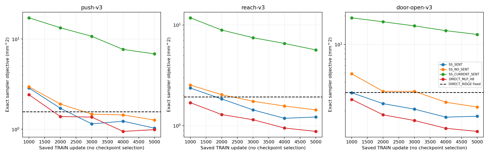
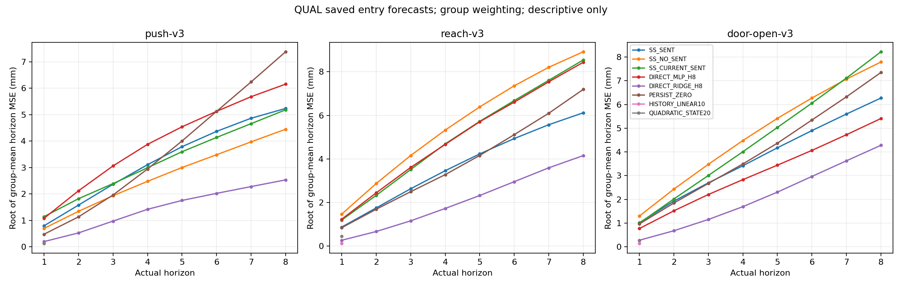
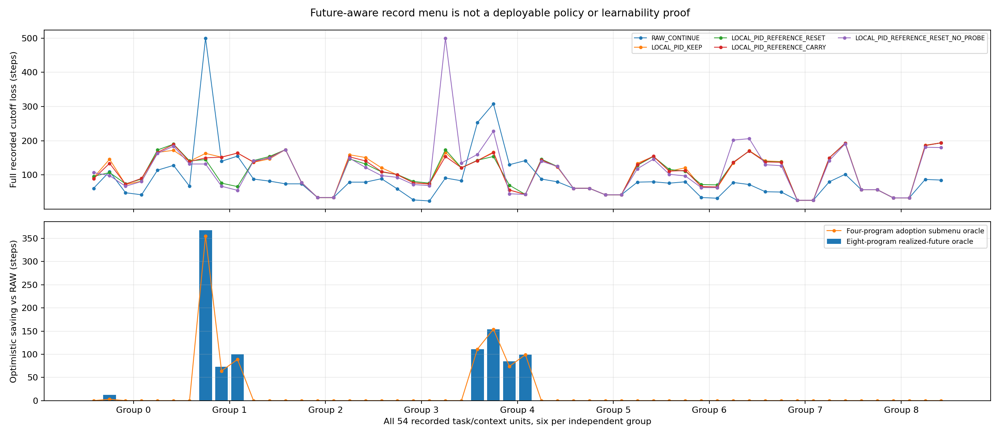

# 响应失败与完整任务机会诊断 v1

**全部新增分析为事后描述性分析。** 本轮未采集、拟合、更新、选择或部署模型，也不改变旧资格/统计。数值合法、当前预测与完整任务收益继续分开。CCF A目标未完成。

分析冻结`32b47031cb85c7a80333e79dd84dae8ef5bdca0c`；运行`latent_response_diagnosis_20261022T210319Z_32b47031cb85`；清单`29fbdbceba0312e4aaada453f3665f817d69c9311edce50cb880704a18b6e907`。

独立审计PASSED，核对11145117字段。每遍复算100464个既有权重/查询，另读取3424个既有CAL/QUAL预测；训练、优化器更新、环境/重置/步/帧、在线LLM API新增均0。主分析237.353秒，独立审计202.493秒；不可把同一轨迹的窗口或前向次数当作独立样本。

## 原始结论及全部分母

原SS_SENT资格仍为**NOT_QUALIFIED**。原完整分配H8损失0.197250184m；有效窗口原均值3.482987mm，直接岭回归1.744844mm。以上直接引用冻结统计，不被下文不同权重的描述替代。

|来源阶段|全部执行|有诊断查询的轨迹|查询窗口|完整首8步物理包|
|---|---:|---:|---:|---:|
|SOFTWARE|36|0|0|26|
|TRAIN|216|168|4186|168|
|CAL|108|80|80|80|
|QUAL|432|348|348|348|

SOFTWARE按原协议未运行预测，不能将其空预测当成失败误差。TRAIN4186窗口包含一个提前结束的32步包，所有掩码/空箱保留；CAL/QUAL只读原先真实执行前保存的入口预测，没有重算其他检查点。完整792例登记及每个空箱原因见case_register和trajectory_metrics。

## 训练目标是否已落后于简单参考

此表按冻结神经采样：每任务可用轨迹等权、轨迹内实际窗口等权、窗口内实际有效XY元素等权，使用物理mm²单位。它是完整经验训练目标，不是一个随机小批次的loss；部分标签掩码使其不必等于岭回归各时域分别拟合的目标。

|任务|方法|可用轨迹|全部窗口目标mm²↓|入口目标mm²↓|
|---|---|---:|---:|---:|
|push-v3|SS_SENT|61|1.027378945|1.279561180|
|push-v3|SS_NO_SENT|61|1.264512542|1.925430542|
|push-v3|SS_CURRENT_SENT|61|6.850143076|4.122527068|
|push-v3|DIRECT_MLP_H8|61|0.988044162|1.044192339|
|push-v3|DIRECT_RIDGE_H8|61|1.566475404|1.371371166|
|push-v3|PERSIST_ZERO|61|65.353916711|33.368133310|
|push-v3|HISTORY_LINEAR10|61|H1模型不适用|不适用|
|push-v3|QUADRATIC_STATE20|61|H1模型不适用|不适用|
|reach-v3|SS_SENT|44|1.220039333|2.267629819|
|reach-v3|SS_NO_SENT|44|1.435362965|2.154131873|
|reach-v3|SS_CURRENT_SENT|44|5.656919131|5.154708478|
|reach-v3|DIRECT_MLP_H8|44|0.878393650|1.686079512|
|reach-v3|DIRECT_RIDGE_H8|44|1.931530668|2.262474244|
|reach-v3|PERSIST_ZERO|44|54.662752285|31.407093513|
|reach-v3|HISTORY_LINEAR10|44|H1模型不适用|不适用|
|reach-v3|QUADRATIC_STATE20|44|H1模型不适用|不适用|
|door-open-v3|SS_SENT|63|1.747003141|2.097486742|
|door-open-v3|SS_NO_SENT|63|2.186845238|2.173109985|
|door-open-v3|SS_CURRENT_SENT|63|12.748349434|7.566628892|
|door-open-v3|DIRECT_MLP_H8|63|1.209547603|1.281503246|
|door-open-v3|DIRECT_RIDGE_H8|63|3.115967866|2.853030238|
|door-open-v3|PERSIST_ZERO|63|62.526479852|43.202454622|
|door-open-v3|HISTORY_LINEAR10|63|H1模型不适用|不适用|
|door-open-v3|QUADRATIC_STATE20|63|H1模型不适用|不适用|

|任务|SS_SENT在TRAIN目标上已劣于直接岭|
|---|---|
|push-v3|False|
|reach-v3|False|
|door-open-v3|False|

若上表为True，纯粹由独立人口分布变化解释该任务上的全部差距不充分。它仍不能区分表示容量、优化过程、目标权重和噪声；没有追加训练、换初值或修改容量验证任何唯一原因。反之也不能仅凭TRAIN较好断定独立差距只由某种漂移造成。

### 所有既有神经检查点，仅TRAIN

|任务|方法|更新步|全部窗口目标mm²|入口目标mm²|
|---|---|---:|---:|---:|
|push-v3|SS_SENT|1000|2.865002052|3.226438068|
|push-v3|SS_SENT|2000|1.708061025|2.413992083|
|push-v3|SS_SENT|3000|1.145794998|1.275822041|
|push-v3|SS_SENT|4000|1.228066395|1.287549208|
|push-v3|SS_SENT|5000|1.027378945|1.279561180|
|push-v3|SS_NO_SENT|1000|2.953689101|2.869245725|
|push-v3|SS_NO_SENT|2000|1.905693729|2.471554119|
|push-v3|SS_NO_SENT|3000|1.468284457|1.604278107|
|push-v3|SS_NO_SENT|4000|1.440161888|1.758784892|
|push-v3|SS_NO_SENT|5000|1.264512542|1.925430542|
|push-v3|SS_CURRENT_SENT|1000|17.208669798|7.657687974|
|push-v3|SS_CURRENT_SENT|2000|13.339060269|6.845509187|
|push-v3|SS_CURRENT_SENT|3000|10.732270255|5.603485574|
|push-v3|SS_CURRENT_SENT|4000|7.675867178|4.255868368|
|push-v3|SS_CURRENT_SENT|5000|6.850143076|4.122527068|
|push-v3|DIRECT_MLP_H8|1000|2.414871603|4.255656118|
|push-v3|DIRECT_MLP_H8|2000|1.382774149|2.177071385|
|push-v3|DIRECT_MLP_H8|3000|1.362938929|2.152548480|
|push-v3|DIRECT_MLP_H8|4000|0.946253359|1.264386038|
|push-v3|DIRECT_MLP_H8|5000|0.988044162|1.044192339|
|reach-v3|SS_SENT|1000|2.365864424|3.708596891|
|reach-v3|SS_SENT|2000|1.843238389|2.959220221|
|reach-v3|SS_SENT|3000|1.434395147|2.287006159|
|reach-v3|SS_SENT|4000|1.184472634|2.317679022|
|reach-v3|SS_SENT|5000|1.220039333|2.267629819|
|reach-v3|SS_NO_SENT|1000|2.531852977|3.912775850|
|reach-v3|SS_NO_SENT|2000|2.031552447|3.045516477|
|reach-v3|SS_NO_SENT|3000|1.749008024|2.663233742|
|reach-v3|SS_NO_SENT|4000|1.568202432|2.630792900|
|reach-v3|SS_NO_SENT|5000|1.435362965|2.154131873|
|reach-v3|SS_CURRENT_SENT|1000|11.787201335|8.790889852|
|reach-v3|SS_CURRENT_SENT|2000|8.908460503|6.992718894|
|reach-v3|SS_CURRENT_SENT|3000|7.478652117|6.008525334|
|reach-v3|SS_CURRENT_SENT|4000|6.561971474|5.761266335|
|reach-v3|SS_CURRENT_SENT|5000|5.656919131|5.154708478|
|reach-v3|DIRECT_MLP_H8|1000|1.692910375|2.562984533|
|reach-v3|DIRECT_MLP_H8|2000|1.290676813|2.319745321|
|reach-v3|DIRECT_MLP_H8|3000|1.146574976|2.002075971|
|reach-v3|DIRECT_MLP_H8|4000|0.948150959|1.885245307|
|reach-v3|DIRECT_MLP_H8|5000|0.878393650|1.686079512|
|door-open-v3|SS_SENT|1000|3.093108286|3.173553621|
|door-open-v3|SS_SENT|2000|2.373333095|2.679897004|
|door-open-v3|SS_SENT|3000|2.075701234|2.724158287|
|door-open-v3|SS_SENT|4000|1.709947587|2.313249809|
|door-open-v3|SS_SENT|5000|1.747003141|2.097486742|
|door-open-v3|SS_NO_SENT|1000|4.900171993|5.237726806|
|door-open-v3|SS_NO_SENT|2000|3.201343219|3.407826368|
|door-open-v3|SS_NO_SENT|3000|3.200487476|3.306817710|
|door-open-v3|SS_NO_SENT|4000|2.455537814|2.989999758|
|door-open-v3|SS_NO_SENT|5000|2.186845238|2.173109985|
|door-open-v3|SS_CURRENT_SENT|1000|19.103243503|13.755411971|
|door-open-v3|SS_CURRENT_SENT|2000|17.338636287|13.236346846|
|door-open-v3|SS_CURRENT_SENT|3000|15.700287793|11.721924850|
|door-open-v3|SS_CURRENT_SENT|4000|13.978286600|9.345807931|
|door-open-v3|SS_CURRENT_SENT|5000|12.748349434|7.566628892|
|door-open-v3|DIRECT_MLP_H8|1000|2.627775649|2.854880281|
|door-open-v3|DIRECT_MLP_H8|2000|1.809549109|1.917534435|
|door-open-v3|DIRECT_MLP_H8|3000|1.575587886|1.721661239|
|door-open-v3|DIRECT_MLP_H8|4000|1.303126003|1.359513318|
|door-open-v3|DIRECT_MLP_H8|5000|1.209547603|1.281503246|

没有选取“最好检查点”。最终权重仍是5000步；曲线改善、停滞或非单调都不是新优化方案的资格证据。

## 入口和后续窗口：按轨迹及独立组组织

下表先在每条真实轨迹内平均，再在独立组内和组间等权。可用性不同时，这与原“有效案例等权均值”可能不同，因此不能替换原3.482987mm或原完整分配比较。每项原始误差只平均有实际相应时域的窗口，缺失分母另列；不填零、不产生新的区间或显著性。

|阶段|任务|方法|窗口|分配/可用轨迹|独立/可用组|H1均值mm|H8均值mm|
|---|---|---|---|---|---|---:|---:|
|SOFTWARE|push-v3|SS_SENT|ALL_WINDOWS|12/0|3/0|缺失|缺失|
|SOFTWARE|push-v3|SS_SENT|ENTRY_ONLY|12/0|3/0|缺失|缺失|
|SOFTWARE|push-v3|SS_NO_SENT|ALL_WINDOWS|12/0|3/0|缺失|缺失|
|SOFTWARE|push-v3|SS_NO_SENT|ENTRY_ONLY|12/0|3/0|缺失|缺失|
|SOFTWARE|push-v3|SS_CURRENT_SENT|ALL_WINDOWS|12/0|3/0|缺失|缺失|
|SOFTWARE|push-v3|SS_CURRENT_SENT|ENTRY_ONLY|12/0|3/0|缺失|缺失|
|SOFTWARE|push-v3|DIRECT_MLP_H8|ALL_WINDOWS|12/0|3/0|缺失|缺失|
|SOFTWARE|push-v3|DIRECT_MLP_H8|ENTRY_ONLY|12/0|3/0|缺失|缺失|
|SOFTWARE|push-v3|DIRECT_RIDGE_H8|ALL_WINDOWS|12/0|3/0|缺失|缺失|
|SOFTWARE|push-v3|DIRECT_RIDGE_H8|ENTRY_ONLY|12/0|3/0|缺失|缺失|
|SOFTWARE|push-v3|PERSIST_ZERO|ALL_WINDOWS|12/0|3/0|缺失|缺失|
|SOFTWARE|push-v3|PERSIST_ZERO|ENTRY_ONLY|12/0|3/0|缺失|缺失|
|SOFTWARE|push-v3|HISTORY_LINEAR10|ALL_WINDOWS|12/0|3/0|缺失|缺失|
|SOFTWARE|push-v3|HISTORY_LINEAR10|ENTRY_ONLY|12/0|3/0|缺失|缺失|
|SOFTWARE|push-v3|QUADRATIC_STATE20|ALL_WINDOWS|12/0|3/0|缺失|缺失|
|SOFTWARE|push-v3|QUADRATIC_STATE20|ENTRY_ONLY|12/0|3/0|缺失|缺失|
|SOFTWARE|reach-v3|SS_SENT|ALL_WINDOWS|12/0|3/0|缺失|缺失|
|SOFTWARE|reach-v3|SS_SENT|ENTRY_ONLY|12/0|3/0|缺失|缺失|
|SOFTWARE|reach-v3|SS_NO_SENT|ALL_WINDOWS|12/0|3/0|缺失|缺失|
|SOFTWARE|reach-v3|SS_NO_SENT|ENTRY_ONLY|12/0|3/0|缺失|缺失|
|SOFTWARE|reach-v3|SS_CURRENT_SENT|ALL_WINDOWS|12/0|3/0|缺失|缺失|
|SOFTWARE|reach-v3|SS_CURRENT_SENT|ENTRY_ONLY|12/0|3/0|缺失|缺失|
|SOFTWARE|reach-v3|DIRECT_MLP_H8|ALL_WINDOWS|12/0|3/0|缺失|缺失|
|SOFTWARE|reach-v3|DIRECT_MLP_H8|ENTRY_ONLY|12/0|3/0|缺失|缺失|
|SOFTWARE|reach-v3|DIRECT_RIDGE_H8|ALL_WINDOWS|12/0|3/0|缺失|缺失|
|SOFTWARE|reach-v3|DIRECT_RIDGE_H8|ENTRY_ONLY|12/0|3/0|缺失|缺失|
|SOFTWARE|reach-v3|PERSIST_ZERO|ALL_WINDOWS|12/0|3/0|缺失|缺失|
|SOFTWARE|reach-v3|PERSIST_ZERO|ENTRY_ONLY|12/0|3/0|缺失|缺失|
|SOFTWARE|reach-v3|HISTORY_LINEAR10|ALL_WINDOWS|12/0|3/0|缺失|缺失|
|SOFTWARE|reach-v3|HISTORY_LINEAR10|ENTRY_ONLY|12/0|3/0|缺失|缺失|
|SOFTWARE|reach-v3|QUADRATIC_STATE20|ALL_WINDOWS|12/0|3/0|缺失|缺失|
|SOFTWARE|reach-v3|QUADRATIC_STATE20|ENTRY_ONLY|12/0|3/0|缺失|缺失|
|SOFTWARE|door-open-v3|SS_SENT|ALL_WINDOWS|12/0|3/0|缺失|缺失|
|SOFTWARE|door-open-v3|SS_SENT|ENTRY_ONLY|12/0|3/0|缺失|缺失|
|SOFTWARE|door-open-v3|SS_NO_SENT|ALL_WINDOWS|12/0|3/0|缺失|缺失|
|SOFTWARE|door-open-v3|SS_NO_SENT|ENTRY_ONLY|12/0|3/0|缺失|缺失|
|SOFTWARE|door-open-v3|SS_CURRENT_SENT|ALL_WINDOWS|12/0|3/0|缺失|缺失|
|SOFTWARE|door-open-v3|SS_CURRENT_SENT|ENTRY_ONLY|12/0|3/0|缺失|缺失|
|SOFTWARE|door-open-v3|DIRECT_MLP_H8|ALL_WINDOWS|12/0|3/0|缺失|缺失|
|SOFTWARE|door-open-v3|DIRECT_MLP_H8|ENTRY_ONLY|12/0|3/0|缺失|缺失|
|SOFTWARE|door-open-v3|DIRECT_RIDGE_H8|ALL_WINDOWS|12/0|3/0|缺失|缺失|
|SOFTWARE|door-open-v3|DIRECT_RIDGE_H8|ENTRY_ONLY|12/0|3/0|缺失|缺失|
|SOFTWARE|door-open-v3|PERSIST_ZERO|ALL_WINDOWS|12/0|3/0|缺失|缺失|
|SOFTWARE|door-open-v3|PERSIST_ZERO|ENTRY_ONLY|12/0|3/0|缺失|缺失|
|SOFTWARE|door-open-v3|HISTORY_LINEAR10|ALL_WINDOWS|12/0|3/0|缺失|缺失|
|SOFTWARE|door-open-v3|HISTORY_LINEAR10|ENTRY_ONLY|12/0|3/0|缺失|缺失|
|SOFTWARE|door-open-v3|QUADRATIC_STATE20|ALL_WINDOWS|12/0|3/0|缺失|缺失|
|SOFTWARE|door-open-v3|QUADRATIC_STATE20|ENTRY_ONLY|12/0|3/0|缺失|缺失|
|TRAIN|push-v3|SS_SENT|ALL_WINDOWS|72/61|36/31|0.384079|0.904477|
|TRAIN|push-v3|SS_SENT|ENTRY_ONLY|72/61|36/31|0.419911|1.062752|
|TRAIN|push-v3|SS_NO_SENT|ALL_WINDOWS|72/61|36/31|0.413716|0.999654|
|TRAIN|push-v3|SS_NO_SENT|ENTRY_ONLY|72/61|36/31|0.354518|1.251465|
|TRAIN|push-v3|SS_CURRENT_SENT|ALL_WINDOWS|72/61|36/31|0.933462|2.375400|
|TRAIN|push-v3|SS_CURRENT_SENT|ENTRY_ONLY|72/61|36/31|0.703408|1.870760|
|TRAIN|push-v3|DIRECT_MLP_H8|ALL_WINDOWS|72/61|36/31|0.371503|0.875698|
|TRAIN|push-v3|DIRECT_MLP_H8|ENTRY_ONLY|72/61|36/31|0.341193|0.933206|
|TRAIN|push-v3|DIRECT_RIDGE_H8|ALL_WINDOWS|72/61|36/31|0.142456|1.062337|
|TRAIN|push-v3|DIRECT_RIDGE_H8|ENTRY_ONLY|72/61|36/31|0.097603|0.974981|
|TRAIN|push-v3|PERSIST_ZERO|ALL_WINDOWS|72/61|36/31|1.524401|7.170061|
|TRAIN|push-v3|PERSIST_ZERO|ENTRY_ONLY|72/61|36/31|0.533278|5.226409|
|TRAIN|push-v3|HISTORY_LINEAR10|ALL_WINDOWS|72/61|36/31|0.176801|缺失/不适用|
|TRAIN|push-v3|HISTORY_LINEAR10|ENTRY_ONLY|72/61|36/31|0.122316|缺失/不适用|
|TRAIN|push-v3|QUADRATIC_STATE20|ALL_WINDOWS|72/61|36/31|0.146243|缺失/不适用|
|TRAIN|push-v3|QUADRATIC_STATE20|ENTRY_ONLY|72/61|36/31|0.091128|缺失/不适用|
|TRAIN|reach-v3|SS_SENT|ALL_WINDOWS|72/44|36/22|0.404869|0.956933|
|TRAIN|reach-v3|SS_SENT|ENTRY_ONLY|72/44|36/22|0.408429|1.291273|
|TRAIN|reach-v3|SS_NO_SENT|ALL_WINDOWS|72/44|36/22|0.393539|1.046373|
|TRAIN|reach-v3|SS_NO_SENT|ENTRY_ONLY|72/44|36/22|0.428695|1.257133|
|TRAIN|reach-v3|SS_CURRENT_SENT|ALL_WINDOWS|72/44|36/22|0.854757|2.189736|
|TRAIN|reach-v3|SS_CURRENT_SENT|ENTRY_ONLY|72/44|36/22|0.625599|2.160824|
|TRAIN|reach-v3|DIRECT_MLP_H8|ALL_WINDOWS|72/44|36/22|0.314133|0.787559|
|TRAIN|reach-v3|DIRECT_MLP_H8|ENTRY_ONLY|72/44|36/22|0.318884|1.043376|
|TRAIN|reach-v3|DIRECT_RIDGE_H8|ALL_WINDOWS|72/44|36/22|0.164865|1.230825|
|TRAIN|reach-v3|DIRECT_RIDGE_H8|ENTRY_ONLY|72/44|36/22|0.135897|1.367246|
|TRAIN|reach-v3|PERSIST_ZERO|ALL_WINDOWS|72/44|36/22|1.438427|6.716709|
|TRAIN|reach-v3|PERSIST_ZERO|ENTRY_ONLY|72/44|36/22|0.795266|5.062961|
|TRAIN|reach-v3|HISTORY_LINEAR10|ALL_WINDOWS|72/44|36/22|0.171818|缺失/不适用|
|TRAIN|reach-v3|HISTORY_LINEAR10|ENTRY_ONLY|72/44|36/22|0.121017|缺失/不适用|
|TRAIN|reach-v3|QUADRATIC_STATE20|ALL_WINDOWS|72/44|36/22|0.126091|缺失/不适用|
|TRAIN|reach-v3|QUADRATIC_STATE20|ENTRY_ONLY|72/44|36/22|0.079637|缺失/不适用|
|TRAIN|door-open-v3|SS_SENT|ALL_WINDOWS|72/63|36/33|0.498652|1.200252|
|TRAIN|door-open-v3|SS_SENT|ENTRY_ONLY|72/63|36/33|0.593698|1.292976|
|TRAIN|door-open-v3|SS_NO_SENT|ALL_WINDOWS|72/63|36/33|0.504482|1.329977|
|TRAIN|door-open-v3|SS_NO_SENT|ENTRY_ONLY|72/63|36/33|0.532133|1.371043|
|TRAIN|door-open-v3|SS_CURRENT_SENT|ALL_WINDOWS|72/63|36/33|1.120022|3.215538|
|TRAIN|door-open-v3|SS_CURRENT_SENT|ENTRY_ONLY|72/63|36/33|0.827761|2.470185|
|TRAIN|door-open-v3|DIRECT_MLP_H8|ALL_WINDOWS|72/63|36/33|0.392799|0.968363|
|TRAIN|door-open-v3|DIRECT_MLP_H8|ENTRY_ONLY|72/63|36/33|0.357265|0.972643|
|TRAIN|door-open-v3|DIRECT_RIDGE_H8|ALL_WINDOWS|72/63|36/33|0.204836|1.458849|
|TRAIN|door-open-v3|DIRECT_RIDGE_H8|ENTRY_ONLY|72/63|36/33|0.142318|1.438088|
|TRAIN|door-open-v3|PERSIST_ZERO|ALL_WINDOWS|72/63|36/33|1.519683|7.065052|
|TRAIN|door-open-v3|PERSIST_ZERO|ENTRY_ONLY|72/63|36/33|0.992765|5.782109|
|TRAIN|door-open-v3|HISTORY_LINEAR10|ALL_WINDOWS|72/63|36/33|0.185361|缺失/不适用|
|TRAIN|door-open-v3|HISTORY_LINEAR10|ENTRY_ONLY|72/63|36/33|0.113427|缺失/不适用|
|TRAIN|door-open-v3|QUADRATIC_STATE20|ALL_WINDOWS|72/63|36/33|0.159658|缺失/不适用|
|TRAIN|door-open-v3|QUADRATIC_STATE20|ENTRY_ONLY|72/63|36/33|0.105851|缺失/不适用|
|CAL|push-v3|SS_SENT|ALL_WINDOWS|36/32|9/8|0.512264|2.399038|
|CAL|push-v3|SS_SENT|ENTRY_ONLY|36/32|9/8|0.512264|2.399038|
|CAL|push-v3|SS_NO_SENT|ALL_WINDOWS|36/32|9/8|0.661973|2.570822|
|CAL|push-v3|SS_NO_SENT|ENTRY_ONLY|36/32|9/8|0.661973|2.570822|
|CAL|push-v3|SS_CURRENT_SENT|ALL_WINDOWS|36/32|9/8|0.958058|3.492969|
|CAL|push-v3|SS_CURRENT_SENT|ENTRY_ONLY|36/32|9/8|0.958058|3.492969|
|CAL|push-v3|DIRECT_MLP_H8|ALL_WINDOWS|36/32|9/8|0.835572|3.168547|
|CAL|push-v3|DIRECT_MLP_H8|ENTRY_ONLY|36/32|9/8|0.835572|3.168547|
|CAL|push-v3|DIRECT_RIDGE_H8|ALL_WINDOWS|36/32|9/8|0.125769|0.846960|
|CAL|push-v3|DIRECT_RIDGE_H8|ENTRY_ONLY|36/32|9/8|0.125769|0.846960|
|CAL|push-v3|PERSIST_ZERO|ALL_WINDOWS|36/32|9/8|0.512119|3.044025|
|CAL|push-v3|PERSIST_ZERO|ENTRY_ONLY|36/32|9/8|0.512119|3.044025|
|CAL|push-v3|HISTORY_LINEAR10|ALL_WINDOWS|36/32|9/8|0.128404|缺失/不适用|
|CAL|push-v3|HISTORY_LINEAR10|ENTRY_ONLY|36/32|9/8|0.128404|缺失/不适用|
|CAL|push-v3|QUADRATIC_STATE20|ALL_WINDOWS|36/32|9/8|0.153861|缺失/不适用|
|CAL|push-v3|QUADRATIC_STATE20|ENTRY_ONLY|36/32|9/8|0.153861|缺失/不适用|
|CAL|reach-v3|SS_SENT|ALL_WINDOWS|36/24|9/6|1.172530|4.371958|
|CAL|reach-v3|SS_SENT|ENTRY_ONLY|36/24|9/6|1.172530|4.371958|
|CAL|reach-v3|SS_NO_SENT|ALL_WINDOWS|36/24|9/6|1.162152|3.990003|
|CAL|reach-v3|SS_NO_SENT|ENTRY_ONLY|36/24|9/6|1.162152|3.990003|
|CAL|reach-v3|SS_CURRENT_SENT|ALL_WINDOWS|36/24|9/6|1.084302|4.192435|
|CAL|reach-v3|SS_CURRENT_SENT|ENTRY_ONLY|36/24|9/6|1.084302|4.192435|
|CAL|reach-v3|DIRECT_MLP_H8|ALL_WINDOWS|36/24|9/6|1.509071|5.125018|
|CAL|reach-v3|DIRECT_MLP_H8|ENTRY_ONLY|36/24|9/6|1.509071|5.125018|
|CAL|reach-v3|DIRECT_RIDGE_H8|ALL_WINDOWS|36/24|9/6|0.206407|1.896200|
|CAL|reach-v3|DIRECT_RIDGE_H8|ENTRY_ONLY|36/24|9/6|0.206407|1.896200|
|CAL|reach-v3|PERSIST_ZERO|ALL_WINDOWS|36/24|9/6|0.618334|3.236798|
|CAL|reach-v3|PERSIST_ZERO|ENTRY_ONLY|36/24|9/6|0.618334|3.236798|
|CAL|reach-v3|HISTORY_LINEAR10|ALL_WINDOWS|36/24|9/6|0.111554|缺失/不适用|
|CAL|reach-v3|HISTORY_LINEAR10|ENTRY_ONLY|36/24|9/6|0.111554|缺失/不适用|
|CAL|reach-v3|QUADRATIC_STATE20|ALL_WINDOWS|36/24|9/6|0.366624|缺失/不适用|
|CAL|reach-v3|QUADRATIC_STATE20|ENTRY_ONLY|36/24|9/6|0.366624|缺失/不适用|
|CAL|door-open-v3|SS_SENT|ALL_WINDOWS|36/24|9/6|0.748833|2.703963|
|CAL|door-open-v3|SS_SENT|ENTRY_ONLY|36/24|9/6|0.748833|2.703963|
|CAL|door-open-v3|SS_NO_SENT|ALL_WINDOWS|36/24|9/6|0.857005|2.907718|
|CAL|door-open-v3|SS_NO_SENT|ENTRY_ONLY|36/24|9/6|0.857005|2.907718|
|CAL|door-open-v3|SS_CURRENT_SENT|ALL_WINDOWS|36/24|9/6|1.165286|4.867487|
|CAL|door-open-v3|SS_CURRENT_SENT|ENTRY_ONLY|36/24|9/6|1.165286|4.867487|
|CAL|door-open-v3|DIRECT_MLP_H8|ALL_WINDOWS|36/24|9/6|0.522676|2.668003|
|CAL|door-open-v3|DIRECT_MLP_H8|ENTRY_ONLY|36/24|9/6|0.522676|2.668003|
|CAL|door-open-v3|DIRECT_RIDGE_H8|ALL_WINDOWS|36/24|9/6|0.221600|2.475727|
|CAL|door-open-v3|DIRECT_RIDGE_H8|ENTRY_ONLY|36/24|9/6|0.221600|2.475727|
|CAL|door-open-v3|PERSIST_ZERO|ALL_WINDOWS|36/24|9/6|1.057223|4.100499|
|CAL|door-open-v3|PERSIST_ZERO|ENTRY_ONLY|36/24|9/6|1.057223|4.100499|
|CAL|door-open-v3|HISTORY_LINEAR10|ALL_WINDOWS|36/24|9/6|0.075962|缺失/不适用|
|CAL|door-open-v3|HISTORY_LINEAR10|ENTRY_ONLY|36/24|9/6|0.075962|缺失/不适用|
|CAL|door-open-v3|QUADRATIC_STATE20|ALL_WINDOWS|36/24|9/6|0.154570|缺失/不适用|
|CAL|door-open-v3|QUADRATIC_STATE20|ENTRY_ONLY|36/24|9/6|0.154570|缺失/不适用|
|QUAL|push-v3|SS_SENT|ALL_WINDOWS|144/132|18/18|0.712120|3.214269|
|QUAL|push-v3|SS_SENT|ENTRY_ONLY|144/132|18/18|0.712120|3.214269|
|QUAL|push-v3|SS_NO_SENT|ALL_WINDOWS|144/132|18/18|0.611541|2.618855|
|QUAL|push-v3|SS_NO_SENT|ENTRY_ONLY|144/132|18/18|0.611541|2.618855|
|QUAL|push-v3|SS_CURRENT_SENT|ALL_WINDOWS|144/132|18/18|1.047634|3.005549|
|QUAL|push-v3|SS_CURRENT_SENT|ENTRY_ONLY|144/132|18/18|1.047634|3.005549|
|QUAL|push-v3|DIRECT_MLP_H8|ALL_WINDOWS|144/132|18/18|0.945953|3.816523|
|QUAL|push-v3|DIRECT_MLP_H8|ENTRY_ONLY|144/132|18/18|0.945953|3.816523|
|QUAL|push-v3|DIRECT_RIDGE_H8|ALL_WINDOWS|144/132|18/18|0.159296|1.255169|
|QUAL|push-v3|DIRECT_RIDGE_H8|ENTRY_ONLY|144/132|18/18|0.159296|1.255169|
|QUAL|push-v3|PERSIST_ZERO|ALL_WINDOWS|144/132|18/18|0.433986|3.671058|
|QUAL|push-v3|PERSIST_ZERO|ENTRY_ONLY|144/132|18/18|0.433986|3.671058|
|QUAL|push-v3|HISTORY_LINEAR10|ALL_WINDOWS|144/132|18/18|0.111983|缺失/不适用|
|QUAL|push-v3|HISTORY_LINEAR10|ENTRY_ONLY|144/132|18/18|0.111983|缺失/不适用|
|QUAL|push-v3|QUADRATIC_STATE20|ALL_WINDOWS|144/132|18/18|0.113598|缺失/不适用|
|QUAL|push-v3|QUADRATIC_STATE20|ENTRY_ONLY|144/132|18/18|0.113598|缺失/不适用|
|QUAL|reach-v3|SS_SENT|ALL_WINDOWS|144/92|18/13|0.801525|3.772490|
|QUAL|reach-v3|SS_SENT|ENTRY_ONLY|144/92|18/13|0.801525|3.772490|
|QUAL|reach-v3|SS_NO_SENT|ALL_WINDOWS|144/92|18/13|1.220734|5.374889|
|QUAL|reach-v3|SS_NO_SENT|ENTRY_ONLY|144/92|18/13|1.220734|5.374889|
|QUAL|reach-v3|SS_CURRENT_SENT|ALL_WINDOWS|144/92|18/13|1.093809|5.015832|
|QUAL|reach-v3|SS_CURRENT_SENT|ENTRY_ONLY|144/92|18/13|1.093809|5.015832|
|QUAL|reach-v3|DIRECT_MLP_H8|ALL_WINDOWS|144/92|18/13|1.100010|4.935846|
|QUAL|reach-v3|DIRECT_MLP_H8|ENTRY_ONLY|144/92|18/13|1.100010|4.935846|
|QUAL|reach-v3|DIRECT_RIDGE_H8|ALL_WINDOWS|144/92|18/13|0.236679|2.137274|
|QUAL|reach-v3|DIRECT_RIDGE_H8|ENTRY_ONLY|144/92|18/13|0.236679|2.137274|
|QUAL|reach-v3|PERSIST_ZERO|ALL_WINDOWS|144/92|18/13|0.772828|4.010392|
|QUAL|reach-v3|PERSIST_ZERO|ENTRY_ONLY|144/92|18/13|0.772828|4.010392|
|QUAL|reach-v3|HISTORY_LINEAR10|ALL_WINDOWS|144/92|18/13|0.102069|缺失/不适用|
|QUAL|reach-v3|HISTORY_LINEAR10|ENTRY_ONLY|144/92|18/13|0.102069|缺失/不适用|
|QUAL|reach-v3|QUADRATIC_STATE20|ALL_WINDOWS|144/92|18/13|0.380614|缺失/不适用|
|QUAL|reach-v3|QUADRATIC_STATE20|ENTRY_ONLY|144/92|18/13|0.380614|缺失/不适用|
|QUAL|door-open-v3|SS_SENT|ALL_WINDOWS|144/124|18/17|0.884477|3.524429|
|QUAL|door-open-v3|SS_SENT|ENTRY_ONLY|144/124|18/17|0.884477|3.524429|
|QUAL|door-open-v3|SS_NO_SENT|ALL_WINDOWS|144/124|18/17|1.127859|4.576250|
|QUAL|door-open-v3|SS_NO_SENT|ENTRY_ONLY|144/124|18/17|1.127859|4.576250|
|QUAL|door-open-v3|SS_CURRENT_SENT|ALL_WINDOWS|144/124|18/17|0.904276|4.572414|
|QUAL|door-open-v3|SS_CURRENT_SENT|ENTRY_ONLY|144/124|18/17|0.904276|4.572414|
|QUAL|door-open-v3|DIRECT_MLP_H8|ALL_WINDOWS|144/124|18/17|0.665089|3.103000|
|QUAL|door-open-v3|DIRECT_MLP_H8|ENTRY_ONLY|144/124|18/17|0.665089|3.103000|
|QUAL|door-open-v3|DIRECT_RIDGE_H8|ALL_WINDOWS|144/124|18/17|0.205392|1.910254|
|QUAL|door-open-v3|DIRECT_RIDGE_H8|ENTRY_ONLY|144/124|18/17|0.205392|1.910254|
|QUAL|door-open-v3|PERSIST_ZERO|ALL_WINDOWS|144/124|18/17|0.862178|4.076656|
|QUAL|door-open-v3|PERSIST_ZERO|ENTRY_ONLY|144/124|18/17|0.862178|4.076656|
|QUAL|door-open-v3|HISTORY_LINEAR10|ALL_WINDOWS|144/124|18/17|0.125037|缺失/不适用|
|QUAL|door-open-v3|HISTORY_LINEAR10|ENTRY_ONLY|144/124|18/17|0.125037|缺失/不适用|
|QUAL|door-open-v3|QUADRATIC_STATE20|ALL_WINDOWS|144/124|18/17|0.225954|缺失/不适用|
|QUAL|door-open-v3|QUADRATIC_STATE20|ENTRY_ONLY|144/124|18/17|0.225954|缺失/不适用|

完整task×初始条件×变化×包×时点×窗口分段表位于grouped_metrics.json；空段的reason保留在trajectory_metrics。

## 累积、原生目标与手部响应

以下为QUAL完整H8窗口、轨迹/组等权的有符号能量。终点误差=增量误差能量+所有交叉项；交叉项负值表示抵消，正值表示相干累积，不能由此独断噪声或物理失配的唯一来源。模型/名义/实测原生/手部的三项分解也保留全部交叉项。

|任务|方法|H8末端mm²|增量对角mm²|有符号交叉mm²|
|---|---|---:|---:|---:|
|push-v3|SS_SENT|27.399033438|4.764020734|22.635012704|
|push-v3|SS_NO_SENT|19.787621722|3.919490151|15.868131570|
|push-v3|SS_CURRENT_SENT|26.868151263|5.624631654|21.243519608|
|push-v3|DIRECT_MLP_H8|37.883397923|5.744568355|32.138829568|
|push-v3|DIRECT_RIDGE_H8|6.415883785|1.141904452|5.273979333|
|push-v3|PERSIST_ZERO|54.447499505|10.661626421|43.785873084|
|reach-v3|SS_SENT|37.435127626|5.876563167|31.558564459|
|reach-v3|SS_NO_SENT|79.555663672|12.122900617|67.432763055|
|reach-v3|SS_CURRENT_SENT|72.999396837|12.440748110|60.558648727|
|reach-v3|DIRECT_MLP_H8|71.195950013|9.920840101|61.275109911|
|reach-v3|DIRECT_RIDGE_H8|17.245781420|2.775192231|14.470589189|
|reach-v3|PERSIST_ZERO|51.732124291|9.942174594|41.789949698|
|door-open-v3|SS_SENT|39.350720048|6.702514967|32.648205080|
|door-open-v3|SS_NO_SENT|60.719152029|9.673435796|51.045716234|
|door-open-v3|SS_CURRENT_SENT|67.622706445|11.989889619|55.632816826|
|door-open-v3|DIRECT_MLP_H8|29.259979583|4.670169065|24.589810518|
|door-open-v3|DIRECT_RIDGE_H8|18.319633117|2.787645087|15.531988030|
|door-open-v3|PERSIST_ZERO|54.030044744|10.777000726|43.253044018|

原生目标与名义累计不等，原生目标也不等于手部位置。两个差都包括真实执行过程的影响，不能把剩余项叫“无噪声物理误差”。本轮没有重做真实参数拟合或使用私有状态监督。入口连续特征只是代理描述，冻结标准化幅度不是适用域证明；缺少接触力/接触对，手物距离不能确定接触机制。

## 完整任务：现有动作菜单有多少记录内机会

这一部分来自另一个旧QUAL，54任务单元、9独立组、540次完整程序执行，不能与响应误差人口混合。八个RAW共同前缀程序实际匹配378对；C8和积分另有前缀，只作为完整程序外部强对照。以下全部旧均值/成功数与原统计核对不变。

|程序|成功/54|完整截止损失均值↓|
|---|---:|---:|
|RAW_CONTINUE|53/54|87.166667|
|DIRECT_C8|51/54|105.018519|
|MOVE_INTEGRAL|50/54|146.222222|
|FIXED_PD_KEEP|50/54|160.462963|
|FIXED_PID_KEEP|51/54|154.185185|
|LOCAL_PD_KEEP|52/54|125.944444|
|LOCAL_PID_KEEP|54/54|110.981481|
|LOCAL_PID_REFERENCE_RESET|54/54|107.240741|
|LOCAL_PID_REFERENCE_CARRY|54/54|110.055556|
|LOCAL_PID_REFERENCE_RESET_NO_PROBE|53/54|112.240741|

八程序未来结果可见的记录内最优菜单均值68.611111步；RAW均值87.166667步；乐观平均余地18.555556步，8/54单元有严格正的实现差值。四程序同获取/采用分支子菜单均值69.592593步、乐观余地17.574074步。所有并列最小值保留。

这是看过所有已发生未来结果的乐观记录菜单；它必然不差于菜单内RAW，不能当成真实策略、一般最优界、可学习性证明或新的任务收益。新方法仍须在独立自身时序历史中实际部署并支付全部费用。

|任务|条件|时点|全部单元|RAW均值|记录菜单均值|正实现余地单元|
|---|---|---:|---:|---:|---:|---:|
|push-v3|UNCHANGED|16|3|75.333333|75.333333|0|
|push-v3|UNCHANGED|32|3|123.666667|86.666667|1|
|push-v3|UNCHANGED|64|3|64.000000|64.000000|0|
|push-v3|CHANGED|16|3|83.000000|79.000000|1|
|push-v3|CHANGED|32|3|286.000000|112.000000|2|
|push-v3|CHANGED|64|3|64.000000|64.000000|0|
|reach-v3|UNCHANGED|16|3|36.333333|36.333333|0|
|reach-v3|UNCHANGED|32|3|98.666667|46.000000|2|
|reach-v3|UNCHANGED|64|3|36.333333|36.333333|0|
|reach-v3|CHANGED|16|3|32.666667|32.666667|0|
|reach-v3|CHANGED|32|3|107.666667|41.333333|2|
|reach-v3|CHANGED|64|3|36.333333|36.333333|0|
|door-open-v3|UNCHANGED|16|3|94.333333|94.333333|0|
|door-open-v3|UNCHANGED|32|3|85.333333|85.333333|0|
|door-open-v3|UNCHANGED|64|3|81.666667|81.666667|0|
|door-open-v3|CHANGED|16|3|94.333333|94.333333|0|
|door-open-v3|CHANGED|32|3|88.000000|88.000000|0|
|door-open-v3|CHANGED|64|3|81.333333|81.333333|0|

### 全部54单元及获取/采用分解

完整损失已经包含移动与测量。KEEP减RAW包含获取成本和实际状态改变；RESET/CARRY减KEEP在相同获取路径后描述分支差，保留所有分配，不按采用/拒绝筛选因果样本。下面三列是代数恒等式，不把拟合误差或纯移动步数当收益。

|组|任务|条件|程序|整体减RAW|KEEP减RAW|分支减KEEP|
|---:|---|---|---|---:|---:|---:|
|0|push-v3|UNCHANGED|LOCAL_PID_REFERENCE_RESET|35|31|4|
|0|push-v3|UNCHANGED|LOCAL_PID_REFERENCE_CARRY|28|31|-3|
|0|push-v3|CHANGED|LOCAL_PID_REFERENCE_RESET|-3|36|-39|
|0|push-v3|CHANGED|LOCAL_PID_REFERENCE_CARRY|24|36|-12|
|0|reach-v3|UNCHANGED|LOCAL_PID_REFERENCE_RESET|26|24|2|
|0|reach-v3|UNCHANGED|LOCAL_PID_REFERENCE_CARRY|25|24|1|
|0|reach-v3|CHANGED|LOCAL_PID_REFERENCE_RESET|46|40|6|
|0|reach-v3|CHANGED|LOCAL_PID_REFERENCE_CARRY|48|40|8|
|0|door-open-v3|UNCHANGED|LOCAL_PID_REFERENCE_RESET|59|52|7|
|0|door-open-v3|UNCHANGED|LOCAL_PID_REFERENCE_CARRY|52|52|0|
|0|door-open-v3|CHANGED|LOCAL_PID_REFERENCE_RESET|62|44|18|
|0|door-open-v3|CHANGED|LOCAL_PID_REFERENCE_CARRY|61|44|17|
|1|push-v3|UNCHANGED|LOCAL_PID_REFERENCE_RESET|74|73|1|
|1|push-v3|UNCHANGED|LOCAL_PID_REFERENCE_CARRY|72|73|-1|
|1|push-v3|CHANGED|LOCAL_PID_REFERENCE_RESET|-355|-337|-18|
|1|push-v3|CHANGED|LOCAL_PID_REFERENCE_CARRY|-350|-337|-13|
|1|reach-v3|UNCHANGED|LOCAL_PID_REFERENCE_RESET|-64|12|-76|
|1|reach-v3|UNCHANGED|LOCAL_PID_REFERENCE_CARRY|12|12|0|
|1|reach-v3|CHANGED|LOCAL_PID_REFERENCE_RESET|-89|9|-98|
|1|reach-v3|CHANGED|LOCAL_PID_REFERENCE_CARRY|9|9|0|
|1|door-open-v3|UNCHANGED|LOCAL_PID_REFERENCE_RESET|54|49|5|
|1|door-open-v3|UNCHANGED|LOCAL_PID_REFERENCE_CARRY|50|49|1|
|1|door-open-v3|CHANGED|LOCAL_PID_REFERENCE_RESET|72|65|7|
|1|door-open-v3|CHANGED|LOCAL_PID_REFERENCE_CARRY|69|65|4|
|2|push-v3|UNCHANGED|LOCAL_PID_REFERENCE_RESET|100|100|0|
|2|push-v3|UNCHANGED|LOCAL_PID_REFERENCE_CARRY|100|100|0|
|2|push-v3|CHANGED|LOCAL_PID_REFERENCE_RESET|4|4|0|
|2|push-v3|CHANGED|LOCAL_PID_REFERENCE_CARRY|4|4|0|
|2|reach-v3|UNCHANGED|LOCAL_PID_REFERENCE_RESET|0|0|0|
|2|reach-v3|UNCHANGED|LOCAL_PID_REFERENCE_CARRY|0|0|0|
|2|reach-v3|CHANGED|LOCAL_PID_REFERENCE_RESET|0|0|0|
|2|reach-v3|CHANGED|LOCAL_PID_REFERENCE_CARRY|0|0|0|
|2|door-open-v3|UNCHANGED|LOCAL_PID_REFERENCE_RESET|68|80|-12|
|2|door-open-v3|UNCHANGED|LOCAL_PID_REFERENCE_CARRY|74|80|-6|
|2|door-open-v3|CHANGED|LOCAL_PID_REFERENCE_RESET|53|72|-19|
|2|door-open-v3|CHANGED|LOCAL_PID_REFERENCE_CARRY|62|72|-10|
|3|push-v3|UNCHANGED|LOCAL_PID_REFERENCE_RESET|20|32|-12|
|3|push-v3|UNCHANGED|LOCAL_PID_REFERENCE_CARRY|21|32|-11|
|3|push-v3|CHANGED|LOCAL_PID_REFERENCE_RESET|42|41|1|
|3|push-v3|CHANGED|LOCAL_PID_REFERENCE_CARRY|42|41|1|
|3|reach-v3|UNCHANGED|LOCAL_PID_REFERENCE_RESET|54|50|4|
|3|reach-v3|UNCHANGED|LOCAL_PID_REFERENCE_CARRY|50|50|0|
|3|reach-v3|CHANGED|LOCAL_PID_REFERENCE_RESET|52|49|3|
|3|reach-v3|CHANGED|LOCAL_PID_REFERENCE_CARRY|50|49|1|
|3|door-open-v3|UNCHANGED|LOCAL_PID_REFERENCE_RESET|83|75|8|
|3|door-open-v3|UNCHANGED|LOCAL_PID_REFERENCE_CARRY|63|75|-12|
|3|door-open-v3|CHANGED|LOCAL_PID_REFERENCE_RESET|38|38|0|
|3|door-open-v3|CHANGED|LOCAL_PID_REFERENCE_CARRY|38|38|0|
|4|push-v3|UNCHANGED|LOCAL_PID_REFERENCE_RESET|-110|-111|1|
|4|push-v3|UNCHANGED|LOCAL_PID_REFERENCE_CARRY|-111|-111|0|
|4|push-v3|CHANGED|LOCAL_PID_REFERENCE_RESET|-154|-141|-13|
|4|push-v3|CHANGED|LOCAL_PID_REFERENCE_CARRY|-143|-141|-2|
|4|reach-v3|UNCHANGED|LOCAL_PID_REFERENCE_RESET|-60|-74|14|
|4|reach-v3|UNCHANGED|LOCAL_PID_REFERENCE_CARRY|-74|-74|0|
|4|reach-v3|CHANGED|LOCAL_PID_REFERENCE_RESET|-99|-99|0|
|4|reach-v3|CHANGED|LOCAL_PID_REFERENCE_CARRY|-99|-99|0|
|4|door-open-v3|UNCHANGED|LOCAL_PID_REFERENCE_RESET|58|57|1|
|4|door-open-v3|UNCHANGED|LOCAL_PID_REFERENCE_CARRY|56|57|-1|
|4|door-open-v3|CHANGED|LOCAL_PID_REFERENCE_RESET|45|43|2|
|4|door-open-v3|CHANGED|LOCAL_PID_REFERENCE_CARRY|44|43|1|
|5|push-v3|UNCHANGED|LOCAL_PID_REFERENCE_RESET|0|0|0|
|5|push-v3|UNCHANGED|LOCAL_PID_REFERENCE_CARRY|0|0|0|
|5|push-v3|CHANGED|LOCAL_PID_REFERENCE_RESET|0|0|0|
|5|push-v3|CHANGED|LOCAL_PID_REFERENCE_CARRY|0|0|0|
|5|reach-v3|UNCHANGED|LOCAL_PID_REFERENCE_RESET|0|0|0|
|5|reach-v3|UNCHANGED|LOCAL_PID_REFERENCE_CARRY|0|0|0|
|5|reach-v3|CHANGED|LOCAL_PID_REFERENCE_RESET|0|0|0|
|5|reach-v3|CHANGED|LOCAL_PID_REFERENCE_CARRY|0|0|0|
|5|door-open-v3|UNCHANGED|LOCAL_PID_REFERENCE_RESET|49|55|-6|
|5|door-open-v3|UNCHANGED|LOCAL_PID_REFERENCE_CARRY|51|55|-4|
|5|door-open-v3|CHANGED|LOCAL_PID_REFERENCE_RESET|74|74|0|
|5|door-open-v3|CHANGED|LOCAL_PID_REFERENCE_CARRY|75|74|1|
|6|push-v3|UNCHANGED|LOCAL_PID_REFERENCE_RESET|40|35|5|
|6|push-v3|UNCHANGED|LOCAL_PID_REFERENCE_CARRY|35|35|0|
|6|push-v3|CHANGED|LOCAL_PID_REFERENCE_RESET|31|41|-10|
|6|push-v3|CHANGED|LOCAL_PID_REFERENCE_CARRY|33|41|-8|
|6|reach-v3|UNCHANGED|LOCAL_PID_REFERENCE_RESET|38|31|7|
|6|reach-v3|UNCHANGED|LOCAL_PID_REFERENCE_CARRY|32|31|1|
|6|reach-v3|CHANGED|LOCAL_PID_REFERENCE_RESET|39|31|8|
|6|reach-v3|CHANGED|LOCAL_PID_REFERENCE_CARRY|33|31|2|
|6|door-open-v3|UNCHANGED|LOCAL_PID_REFERENCE_RESET|59|57|2|
|6|door-open-v3|UNCHANGED|LOCAL_PID_REFERENCE_CARRY|59|57|2|
|6|door-open-v3|CHANGED|LOCAL_PID_REFERENCE_RESET|98|99|-1|
|6|door-open-v3|CHANGED|LOCAL_PID_REFERENCE_CARRY|98|99|-1|
|7|push-v3|UNCHANGED|LOCAL_PID_REFERENCE_RESET|88|90|-2|
|7|push-v3|UNCHANGED|LOCAL_PID_REFERENCE_CARRY|87|90|-3|
|7|push-v3|CHANGED|LOCAL_PID_REFERENCE_RESET|88|89|-1|
|7|push-v3|CHANGED|LOCAL_PID_REFERENCE_CARRY|87|89|-2|
|7|reach-v3|UNCHANGED|LOCAL_PID_REFERENCE_RESET|0|0|0|
|7|reach-v3|UNCHANGED|LOCAL_PID_REFERENCE_CARRY|0|0|0|
|7|reach-v3|CHANGED|LOCAL_PID_REFERENCE_RESET|0|0|0|
|7|reach-v3|CHANGED|LOCAL_PID_REFERENCE_CARRY|0|0|0|
|7|door-open-v3|UNCHANGED|LOCAL_PID_REFERENCE_RESET|70|70|0|
|7|door-open-v3|UNCHANGED|LOCAL_PID_REFERENCE_CARRY|70|70|0|
|7|door-open-v3|CHANGED|LOCAL_PID_REFERENCE_RESET|91|91|0|
|7|door-open-v3|CHANGED|LOCAL_PID_REFERENCE_CARRY|91|91|0|
|8|push-v3|UNCHANGED|LOCAL_PID_REFERENCE_RESET|0|0|0|
|8|push-v3|UNCHANGED|LOCAL_PID_REFERENCE_CARRY|0|0|0|
|8|push-v3|CHANGED|LOCAL_PID_REFERENCE_RESET|0|0|0|
|8|push-v3|CHANGED|LOCAL_PID_REFERENCE_CARRY|0|0|0|
|8|reach-v3|UNCHANGED|LOCAL_PID_REFERENCE_RESET|0|0|0|
|8|reach-v3|UNCHANGED|LOCAL_PID_REFERENCE_CARRY|0|0|0|
|8|reach-v3|CHANGED|LOCAL_PID_REFERENCE_RESET|0|0|0|
|8|reach-v3|CHANGED|LOCAL_PID_REFERENCE_CARRY|0|0|0|
|8|door-open-v3|UNCHANGED|LOCAL_PID_REFERENCE_RESET|99|100|-1|
|8|door-open-v3|UNCHANGED|LOCAL_PID_REFERENCE_CARRY|99|100|-1|
|8|door-open-v3|CHANGED|LOCAL_PID_REFERENCE_RESET|109|109|0|
|8|door-open-v3|CHANGED|LOCAL_PID_REFERENCE_CARRY|109|109|0|

## 费用、来源与后续判断

原响应来源费用为792执行/59268控制步/40392全部重置/20492340帧，包含21个拟合模型的12神经训练/60000更新、30岭系统及30审计重算；旧参考QUAL费用为540执行/65854步/27540全部重置/14099270帧，初始C4/C8尝试216、过去审计重算216。它们是历史费用，不能称为本轮新增；也不与本轮零交互重复相加。

本轮新前向计算和独立前向复核分别记账；没有新拟合、优化器步、环境或LLM。分析完整来源哈希及未改变的原比较在manifest，全部预测/掩码/误差/轨迹/组/菜单表在analysis目录。

后续不围绕失败SS版本增加逆控制、混合权重或门控，也不按旧QUAL改优化器/容量/阈值。训练目标上的反证只能促成可检验的新解释；菜单乐观余地只能说明值得或不值得进一步研究的范围，不能替代可观察证据与独立部署。新的研究设计应明确联合处理获取后的实际状态、所获数据、模型适用性及采用/拒绝后继行为，并以完整任务损失对强基线验证。

任务相关模型本身有先例：[Value Equivalence，NeurIPS 2020](https://proceedings.neurips.cc/paper_files/paper/2020/hash/3bb585ea00014b0e3ebe4c6dd165a358-Abstract.html)讨论模型对价值规划的作用；[Task-based Model Learning，NIPS 2017](https://proceedings.neurips.cc/paper/2017/hash/3fc2c60b5782f641f76bcefc39fb2392-Abstract.html)直接以最终任务目标学习模型。本轮只读官方摘要，未复现算法/证明；不能将“改用任务损失”或“用价值模型”本身称作创新。原五项路线、双重控制和任务相关探索继续必须比较。
