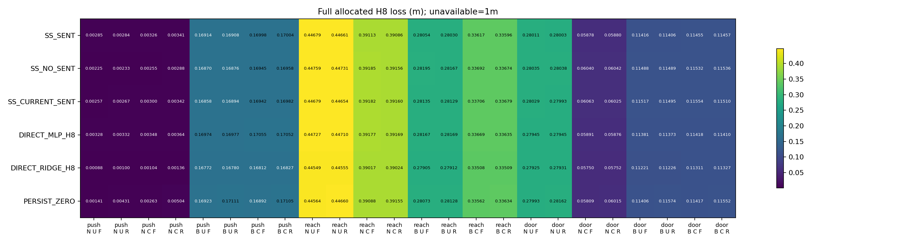
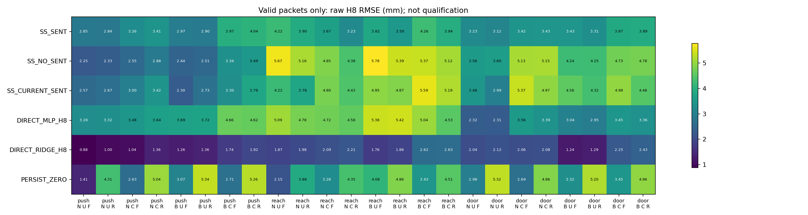

# 多步响应资格 v1：完整人口与失败附录

本附录除复述预登记主统计外，全部人口分层及费用解释均为**描述性结果**。不改动资格门、模型或原六项比较，不把相关时间步作为独立样本。

冻结 `e4410b8985e383f8429e00bb9e577c99df129ea8`；运行 `latent_response_20261022T190735Z_e4410b8985e3`。报告入口：[主要中文报告](latent_response_qualification_v1_zh.md)。

## 实际费用与可追溯来源

|阶段|分配|完整执行|控制步|受控重置|全部重置|物理帧|核心采集秒|
|---|---:|---:|---:|---:|---:|---:|---:|
|SOFTWARE|36|36|2456|36|1836|930280|88.677|
|TRAIN|216|216|18600|216|11016|5601000|548.982|
|CAL|108|108|7454|108|5508|2791270|278.512|
|QUAL|432|432|30758|432|22032|11169790|1063.937|

附录呈现v1在绘图导入时缺少Matplotlib，部分JSON与失败日志保留；v2绘图成功后遇到局部变量重名的呈现错误；v3仅修复报告变量名，并使用独立报告环境绘图。统计字段逐项核对v1/v2部分输出不变。这些呈现错误没有重跑采集、训练或资格。失败helper单独耗时未记录；原工具调用2.8537966秒包含成功主报告与失败附录，不能归为纯失败耗时。

全部费用包括缺失窗口和部分失败尝试；工厂内部重置不是免费。重置帧与控制帧分别计入同一实际总账。

补充种子审计发现原扫描器没有专门沿嵌套列表传递种子字段语义，因此另写独立扫描器读取冻结时相同来源SHA：250份JSON及三个已知嵌套/命名空间反例均通过，71000--71999没有旧分配/预留冲突。原116份协议Markdown扫描保持不变。补充审计不读实验排名、不改变种子或数据，新增物理交互/拟合/API为0；后续分配应先补齐该类嵌套检查。详细回执为seed_scope_independent_nested_audit.json。

直接前置来源native_command_witness_v1已交付18执行/2835控制步/918全部重置/473175物理帧，本轮新增另列，不重复收取或伪装为零历史费用。更早历史训练和实验继续保留在原报告，不在本轮账本重复加总。

|实际拟合/核对费用|数量|
|---|---:|
|ridge_systems_attempted|30|
|ridge_systems_saved|30|
|neural_fits_attempted|12|
|neural_fits_saved|12|
|neural_updates_confirmed_by_flushed_progress_log|60000|
|model_audit_ridge_systems|30|
|neural_optimizer_retrains|0|
|online_LLM_API_calls|0|

训练和模型审计是两个不同来源：科学训练30岭系统，完整模型审计另重算30系统；神经审计只核对前向/初值/采样，没有重演优化器。若出现部分训练，更新数只声称刷新日志能证明的下界，失败细节仍保留。

|CLI阶段|分配|状态|总秒|
|---|---|---|---:|
|collect|CAL|PASSED|284.297|
|collect|QUAL|PASSED|1069.140|
|collect|SOFTWARE|PASSED|93.722|
|collect|TRAIN|PASSED|553.959|
|evaluate|CAL|PASSED|4.082|
|evaluate|QUAL|PASSED|10.224|
|lock|None|PASSED|2.016|
|models-audit|None|PASSED|110.561|
|records-audit|CAL|PASSED|36.606|
|records-audit|QUAL|PASSED|138.978|
|records-audit|SOFTWARE|PASSED|13.589|
|records-audit|TRAIN|PASSED|73.546|
|statistics-audit|CAL|PASSED|4.640|
|statistics-audit|QUAL|PASSED|11.360|
|train|None|PASSED|474.615|

CLI总耗时包含其子进程/检查，不能再与子阶段秒数重复相加。原始process_logs另含外层实际墙钟；所有费用表、案例登记和完整数据问题索引位于本运行delivery_v3目录；delivery及delivery_v2保留呈现失败的部分输出。

## 完整阶段结果及所有数据问题

|阶段|响应结果原因|案例数|
|---|---|---:|
|SOFTWARE|PACKET_COMPLETE|26|
|SOFTWARE|ENDED_DURING_REPOSITION|4|
|SOFTWARE|ENDED_BEFORE_BOUNDARY|4|
|SOFTWARE|ANCHOR_NOT_REACHED|2|
|TRAIN|PACKET_COMPLETE|167|
|TRAIN|ENDED_BEFORE_BOUNDARY|32|
|TRAIN|ENDED_DURING_PACKET|1|
|TRAIN|ENDED_DURING_REPOSITION|6|
|TRAIN|ANCHOR_NOT_REACHED|10|
|CAL|PACKET_COMPLETE|80|
|CAL|ENDED_BEFORE_BOUNDARY|16|
|CAL|ANCHOR_NOT_REACHED|12|
|QUAL|PACKET_COMPLETE|348|
|QUAL|ANCHOR_NOT_REACHED|22|
|QUAL|ENDED_BEFORE_BOUNDARY|48|
|QUAL|ENDED_DURING_REPOSITION|14|

以下逐例列出所有不完整包及部分物理失败，包括TRAIN首8步已完整但32步包提前结束。提前任务成功仍保留其数据不可用原因；实际已有的首8步仍可用于相应时域评估。响应结束的未成功标志不称为完整任务失败。有效预测失败单独列在invalid_saved_predictions.json，数量=0。

|阶段|组|任务|初始|变化|包|实际步|包步|原因|首8完整|响应时成功|
|---|---:|---|---|---|---|---:|---:|---|---|---|
|SOFTWARE|1|reach-v3|BIASED|UNCHANGED|FIXED8|33|0|ENDED_DURING_REPOSITION|False|True|
|SOFTWARE|1|reach-v3|BIASED|UNCHANGED|RANDOM8|33|0|ENDED_DURING_REPOSITION|False|True|
|SOFTWARE|1|reach-v3|BIASED|CHANGED|FIXED8|33|0|ENDED_DURING_REPOSITION|False|True|
|SOFTWARE|1|reach-v3|BIASED|CHANGED|RANDOM8|33|0|ENDED_DURING_REPOSITION|False|True|
|SOFTWARE|2|push-v3|BIASED|UNCHANGED|FIXED8|58|0|ENDED_BEFORE_BOUNDARY|False|True|
|SOFTWARE|2|push-v3|BIASED|UNCHANGED|RANDOM8|58|0|ENDED_BEFORE_BOUNDARY|False|True|
|SOFTWARE|2|push-v3|BIASED|CHANGED|FIXED8|58|0|ENDED_BEFORE_BOUNDARY|False|True|
|SOFTWARE|2|push-v3|BIASED|CHANGED|RANDOM8|58|0|ENDED_BEFORE_BOUNDARY|False|True|
|SOFTWARE|2|door-open-v3|BIASED|CHANGED|FIXED8|128|0|ANCHOR_NOT_REACHED|False|False|
|SOFTWARE|2|door-open-v3|BIASED|CHANGED|RANDOM8|128|0|ANCHOR_NOT_REACHED|False|False|
|TRAIN|2|push-v3|NOMINAL|UNCHANGED|RANDOM32|60|0|ENDED_BEFORE_BOUNDARY|False|True|
|TRAIN|2|push-v3|NOMINAL|CHANGED|RANDOM32|60|0|ENDED_BEFORE_BOUNDARY|False|True|
|TRAIN|2|reach-v3|NOMINAL|UNCHANGED|RANDOM32|27|0|ENDED_BEFORE_BOUNDARY|False|True|
|TRAIN|2|reach-v3|NOMINAL|CHANGED|RANDOM32|27|0|ENDED_BEFORE_BOUNDARY|False|True|
|TRAIN|4|reach-v3|NOMINAL|UNCHANGED|RANDOM32|48|11|ENDED_DURING_PACKET|True|True|
|TRAIN|5|reach-v3|RANDOM|UNCHANGED|RANDOM32|41|0|ENDED_BEFORE_BOUNDARY|False|True|
|TRAIN|5|reach-v3|RANDOM|CHANGED|RANDOM32|41|0|ENDED_BEFORE_BOUNDARY|False|True|
|TRAIN|8|push-v3|NOMINAL|UNCHANGED|RANDOM32|60|0|ENDED_BEFORE_BOUNDARY|False|True|
|TRAIN|8|push-v3|NOMINAL|CHANGED|RANDOM32|60|0|ENDED_BEFORE_BOUNDARY|False|True|
|TRAIN|10|reach-v3|NOMINAL|UNCHANGED|RANDOM32|37|0|ENDED_DURING_REPOSITION|False|True|
|TRAIN|10|reach-v3|NOMINAL|CHANGED|RANDOM32|36|0|ENDED_DURING_REPOSITION|False|True|
|TRAIN|11|reach-v3|RANDOM|UNCHANGED|RANDOM32|35|0|ENDED_BEFORE_BOUNDARY|False|True|
|TRAIN|11|reach-v3|RANDOM|CHANGED|RANDOM32|35|0|ENDED_BEFORE_BOUNDARY|False|True|
|TRAIN|11|door-open-v3|RANDOM|UNCHANGED|RANDOM32|128|0|ANCHOR_NOT_REACHED|False|False|
|TRAIN|11|door-open-v3|RANDOM|CHANGED|RANDOM32|128|0|ANCHOR_NOT_REACHED|False|False|
|TRAIN|14|push-v3|NOMINAL|UNCHANGED|RANDOM32|56|0|ENDED_BEFORE_BOUNDARY|False|True|
|TRAIN|14|push-v3|NOMINAL|CHANGED|RANDOM32|56|0|ENDED_BEFORE_BOUNDARY|False|True|
|TRAIN|16|reach-v3|NOMINAL|UNCHANGED|RANDOM32|26|0|ENDED_BEFORE_BOUNDARY|False|True|
|TRAIN|16|reach-v3|NOMINAL|CHANGED|RANDOM32|26|0|ENDED_BEFORE_BOUNDARY|False|True|
|TRAIN|17|reach-v3|RANDOM|UNCHANGED|RANDOM32|29|0|ENDED_BEFORE_BOUNDARY|False|True|
|TRAIN|17|reach-v3|RANDOM|CHANGED|RANDOM32|29|0|ENDED_BEFORE_BOUNDARY|False|True|
|TRAIN|19|reach-v3|RANDOM|UNCHANGED|RANDOM32|30|0|ENDED_BEFORE_BOUNDARY|False|True|
|TRAIN|19|reach-v3|RANDOM|CHANGED|RANDOM32|30|0|ENDED_BEFORE_BOUNDARY|False|True|
|TRAIN|19|door-open-v3|RANDOM|CHANGED|RANDOM32|96|0|ANCHOR_NOT_REACHED|False|False|
|TRAIN|20|reach-v3|NOMINAL|UNCHANGED|RANDOM32|39|0|ENDED_BEFORE_BOUNDARY|False|True|
|TRAIN|20|reach-v3|NOMINAL|CHANGED|RANDOM32|39|0|ENDED_BEFORE_BOUNDARY|False|True|
|TRAIN|22|door-open-v3|NOMINAL|CHANGED|RANDOM32|96|0|ANCHOR_NOT_REACHED|False|False|
|TRAIN|23|push-v3|RANDOM|UNCHANGED|RANDOM32|57|0|ENDED_BEFORE_BOUNDARY|False|True|
|TRAIN|23|push-v3|RANDOM|CHANGED|RANDOM32|57|0|ENDED_BEFORE_BOUNDARY|False|True|
|TRAIN|23|reach-v3|RANDOM|UNCHANGED|RANDOM32|31|0|ENDED_BEFORE_BOUNDARY|False|True|
|TRAIN|23|reach-v3|RANDOM|CHANGED|RANDOM32|31|0|ENDED_BEFORE_BOUNDARY|False|True|
|TRAIN|25|reach-v3|RANDOM|UNCHANGED|RANDOM32|33|0|ENDED_DURING_REPOSITION|False|True|
|TRAIN|25|reach-v3|RANDOM|CHANGED|RANDOM32|33|0|ENDED_DURING_REPOSITION|False|True|
|TRAIN|26|push-v3|NOMINAL|UNCHANGED|RANDOM32|54|0|ENDED_BEFORE_BOUNDARY|False|True|
|TRAIN|26|push-v3|NOMINAL|CHANGED|RANDOM32|54|0|ENDED_BEFORE_BOUNDARY|False|True|
|TRAIN|26|reach-v3|NOMINAL|UNCHANGED|RANDOM32|28|0|ENDED_BEFORE_BOUNDARY|False|True|
|TRAIN|26|reach-v3|NOMINAL|CHANGED|RANDOM32|28|0|ENDED_BEFORE_BOUNDARY|False|True|
|TRAIN|26|door-open-v3|NOMINAL|UNCHANGED|RANDOM32|128|0|ANCHOR_NOT_REACHED|False|False|
|TRAIN|26|door-open-v3|NOMINAL|CHANGED|RANDOM32|128|0|ANCHOR_NOT_REACHED|False|False|
|TRAIN|28|reach-v3|NOMINAL|UNCHANGED|RANDOM32|42|0|ENDED_DURING_REPOSITION|False|True|
|TRAIN|28|reach-v3|NOMINAL|CHANGED|RANDOM32|43|0|ENDED_DURING_REPOSITION|False|True|
|TRAIN|28|door-open-v3|NOMINAL|UNCHANGED|RANDOM32|96|0|ANCHOR_NOT_REACHED|False|False|
|TRAIN|29|door-open-v3|RANDOM|UNCHANGED|RANDOM32|128|0|ANCHOR_NOT_REACHED|False|False|
|TRAIN|29|door-open-v3|RANDOM|CHANGED|RANDOM32|128|0|ANCHOR_NOT_REACHED|False|False|
|TRAIN|34|reach-v3|NOMINAL|UNCHANGED|RANDOM32|24|0|ENDED_BEFORE_BOUNDARY|False|True|
|TRAIN|34|reach-v3|NOMINAL|CHANGED|RANDOM32|24|0|ENDED_BEFORE_BOUNDARY|False|True|
|TRAIN|35|push-v3|RANDOM|UNCHANGED|RANDOM32|128|0|ANCHOR_NOT_REACHED|False|False|
|TRAIN|35|reach-v3|RANDOM|UNCHANGED|RANDOM32|47|0|ENDED_BEFORE_BOUNDARY|False|True|
|TRAIN|35|reach-v3|RANDOM|CHANGED|RANDOM32|47|0|ENDED_BEFORE_BOUNDARY|False|True|
|CAL|2|reach-v3|NOMINAL|UNCHANGED|FIXED8|31|0|ENDED_BEFORE_BOUNDARY|False|True|
|CAL|2|reach-v3|NOMINAL|UNCHANGED|RANDOM8|31|0|ENDED_BEFORE_BOUNDARY|False|True|
|CAL|2|reach-v3|NOMINAL|CHANGED|FIXED8|31|0|ENDED_BEFORE_BOUNDARY|False|True|
|CAL|2|reach-v3|NOMINAL|CHANGED|RANDOM8|31|0|ENDED_BEFORE_BOUNDARY|False|True|
|CAL|4|door-open-v3|NOMINAL|UNCHANGED|FIXED8|96|0|ANCHOR_NOT_REACHED|False|False|
|CAL|4|door-open-v3|NOMINAL|UNCHANGED|RANDOM8|96|0|ANCHOR_NOT_REACHED|False|False|
|CAL|4|door-open-v3|NOMINAL|CHANGED|FIXED8|96|0|ANCHOR_NOT_REACHED|False|False|
|CAL|4|door-open-v3|NOMINAL|CHANGED|RANDOM8|96|0|ANCHOR_NOT_REACHED|False|False|
|CAL|5|door-open-v3|RANDOM|UNCHANGED|FIXED8|128|0|ANCHOR_NOT_REACHED|False|False|
|CAL|5|door-open-v3|RANDOM|UNCHANGED|RANDOM8|128|0|ANCHOR_NOT_REACHED|False|False|
|CAL|5|door-open-v3|RANDOM|CHANGED|FIXED8|128|0|ANCHOR_NOT_REACHED|False|False|
|CAL|5|door-open-v3|RANDOM|CHANGED|RANDOM8|128|0|ANCHOR_NOT_REACHED|False|False|
|CAL|7|reach-v3|RANDOM|UNCHANGED|FIXED8|28|0|ENDED_BEFORE_BOUNDARY|False|True|
|CAL|7|reach-v3|RANDOM|UNCHANGED|RANDOM8|28|0|ENDED_BEFORE_BOUNDARY|False|True|
|CAL|7|reach-v3|RANDOM|CHANGED|FIXED8|28|0|ENDED_BEFORE_BOUNDARY|False|True|
|CAL|7|reach-v3|RANDOM|CHANGED|RANDOM8|28|0|ENDED_BEFORE_BOUNDARY|False|True|
|CAL|7|door-open-v3|RANDOM|UNCHANGED|FIXED8|96|0|ANCHOR_NOT_REACHED|False|False|
|CAL|7|door-open-v3|RANDOM|UNCHANGED|RANDOM8|96|0|ANCHOR_NOT_REACHED|False|False|
|CAL|7|door-open-v3|RANDOM|CHANGED|FIXED8|96|0|ANCHOR_NOT_REACHED|False|False|
|CAL|7|door-open-v3|RANDOM|CHANGED|RANDOM8|96|0|ANCHOR_NOT_REACHED|False|False|
|CAL|8|push-v3|NOMINAL|UNCHANGED|FIXED8|55|0|ENDED_BEFORE_BOUNDARY|False|True|
|CAL|8|push-v3|NOMINAL|UNCHANGED|RANDOM8|55|0|ENDED_BEFORE_BOUNDARY|False|True|
|CAL|8|push-v3|NOMINAL|CHANGED|FIXED8|55|0|ENDED_BEFORE_BOUNDARY|False|True|
|CAL|8|push-v3|NOMINAL|CHANGED|RANDOM8|55|0|ENDED_BEFORE_BOUNDARY|False|True|
|CAL|8|reach-v3|NOMINAL|UNCHANGED|FIXED8|26|0|ENDED_BEFORE_BOUNDARY|False|True|
|CAL|8|reach-v3|NOMINAL|UNCHANGED|RANDOM8|26|0|ENDED_BEFORE_BOUNDARY|False|True|
|CAL|8|reach-v3|NOMINAL|CHANGED|FIXED8|26|0|ENDED_BEFORE_BOUNDARY|False|True|
|CAL|8|reach-v3|NOMINAL|CHANGED|RANDOM8|26|0|ENDED_BEFORE_BOUNDARY|False|True|
|QUAL|1|door-open-v3|NOMINAL|UNCHANGED|FIXED8|96|0|ANCHOR_NOT_REACHED|False|False|
|QUAL|1|door-open-v3|NOMINAL|UNCHANGED|RANDOM8|96|0|ANCHOR_NOT_REACHED|False|False|
|QUAL|1|door-open-v3|NOMINAL|CHANGED|FIXED8|96|0|ANCHOR_NOT_REACHED|False|False|
|QUAL|1|door-open-v3|NOMINAL|CHANGED|RANDOM8|96|0|ANCHOR_NOT_REACHED|False|False|
|QUAL|1|door-open-v3|BIASED|UNCHANGED|FIXED8|96|0|ANCHOR_NOT_REACHED|False|False|
|QUAL|1|door-open-v3|BIASED|UNCHANGED|RANDOM8|96|0|ANCHOR_NOT_REACHED|False|False|
|QUAL|1|door-open-v3|BIASED|CHANGED|FIXED8|96|0|ANCHOR_NOT_REACHED|False|False|
|QUAL|1|door-open-v3|BIASED|CHANGED|RANDOM8|96|0|ANCHOR_NOT_REACHED|False|False|
|QUAL|2|reach-v3|NOMINAL|UNCHANGED|FIXED8|35|0|ENDED_BEFORE_BOUNDARY|False|True|
|QUAL|2|reach-v3|NOMINAL|UNCHANGED|RANDOM8|35|0|ENDED_BEFORE_BOUNDARY|False|True|
|QUAL|2|reach-v3|NOMINAL|CHANGED|FIXED8|35|0|ENDED_BEFORE_BOUNDARY|False|True|
|QUAL|2|reach-v3|NOMINAL|CHANGED|RANDOM8|35|0|ENDED_BEFORE_BOUNDARY|False|True|
|QUAL|2|reach-v3|BIASED|UNCHANGED|FIXED8|38|0|ENDED_BEFORE_BOUNDARY|False|True|
|QUAL|2|reach-v3|BIASED|UNCHANGED|RANDOM8|38|0|ENDED_BEFORE_BOUNDARY|False|True|
|QUAL|2|reach-v3|BIASED|CHANGED|FIXED8|38|0|ENDED_BEFORE_BOUNDARY|False|True|
|QUAL|2|reach-v3|BIASED|CHANGED|RANDOM8|38|0|ENDED_BEFORE_BOUNDARY|False|True|
|QUAL|4|reach-v3|NOMINAL|UNCHANGED|FIXED8|35|0|ENDED_DURING_REPOSITION|False|True|
|QUAL|4|reach-v3|NOMINAL|UNCHANGED|RANDOM8|35|0|ENDED_DURING_REPOSITION|False|True|
|QUAL|4|reach-v3|NOMINAL|CHANGED|FIXED8|35|0|ENDED_DURING_REPOSITION|False|True|
|QUAL|4|reach-v3|NOMINAL|CHANGED|RANDOM8|35|0|ENDED_DURING_REPOSITION|False|True|
|QUAL|4|door-open-v3|NOMINAL|UNCHANGED|FIXED8|96|0|ANCHOR_NOT_REACHED|False|False|
|QUAL|4|door-open-v3|NOMINAL|UNCHANGED|RANDOM8|96|0|ANCHOR_NOT_REACHED|False|False|
|QUAL|5|reach-v3|NOMINAL|UNCHANGED|FIXED8|33|0|ENDED_BEFORE_BOUNDARY|False|True|
|QUAL|5|reach-v3|NOMINAL|UNCHANGED|RANDOM8|33|0|ENDED_BEFORE_BOUNDARY|False|True|
|QUAL|5|reach-v3|NOMINAL|CHANGED|FIXED8|33|0|ENDED_BEFORE_BOUNDARY|False|True|
|QUAL|5|reach-v3|NOMINAL|CHANGED|RANDOM8|33|0|ENDED_BEFORE_BOUNDARY|False|True|
|QUAL|5|door-open-v3|BIASED|CHANGED|FIXED8|128|0|ANCHOR_NOT_REACHED|False|False|
|QUAL|5|door-open-v3|BIASED|CHANGED|RANDOM8|128|0|ANCHOR_NOT_REACHED|False|False|
|QUAL|7|reach-v3|NOMINAL|UNCHANGED|FIXED8|38|0|ENDED_DURING_REPOSITION|False|True|
|QUAL|7|reach-v3|NOMINAL|UNCHANGED|RANDOM8|38|0|ENDED_DURING_REPOSITION|False|True|
|QUAL|7|reach-v3|BIASED|CHANGED|FIXED8|96|0|ANCHOR_NOT_REACHED|False|False|
|QUAL|7|reach-v3|BIASED|CHANGED|RANDOM8|96|0|ANCHOR_NOT_REACHED|False|False|
|QUAL|8|push-v3|BIASED|UNCHANGED|FIXED8|58|0|ENDED_BEFORE_BOUNDARY|False|True|
|QUAL|8|push-v3|BIASED|UNCHANGED|RANDOM8|58|0|ENDED_BEFORE_BOUNDARY|False|True|
|QUAL|8|push-v3|BIASED|CHANGED|FIXED8|58|0|ENDED_BEFORE_BOUNDARY|False|True|
|QUAL|8|push-v3|BIASED|CHANGED|RANDOM8|58|0|ENDED_BEFORE_BOUNDARY|False|True|
|QUAL|10|reach-v3|NOMINAL|UNCHANGED|FIXED8|32|0|ENDED_BEFORE_BOUNDARY|False|True|
|QUAL|10|reach-v3|NOMINAL|UNCHANGED|RANDOM8|32|0|ENDED_BEFORE_BOUNDARY|False|True|
|QUAL|10|reach-v3|NOMINAL|CHANGED|FIXED8|32|0|ENDED_BEFORE_BOUNDARY|False|True|
|QUAL|10|reach-v3|NOMINAL|CHANGED|RANDOM8|32|0|ENDED_BEFORE_BOUNDARY|False|True|
|QUAL|10|reach-v3|BIASED|UNCHANGED|FIXED8|38|0|ENDED_DURING_REPOSITION|False|True|
|QUAL|10|reach-v3|BIASED|UNCHANGED|RANDOM8|38|0|ENDED_DURING_REPOSITION|False|True|
|QUAL|10|reach-v3|BIASED|CHANGED|FIXED8|36|0|ENDED_DURING_REPOSITION|False|True|
|QUAL|10|reach-v3|BIASED|CHANGED|RANDOM8|36|0|ENDED_DURING_REPOSITION|False|True|
|QUAL|11|reach-v3|NOMINAL|UNCHANGED|FIXED8|24|0|ENDED_BEFORE_BOUNDARY|False|True|
|QUAL|11|reach-v3|NOMINAL|UNCHANGED|RANDOM8|24|0|ENDED_BEFORE_BOUNDARY|False|True|
|QUAL|11|reach-v3|NOMINAL|CHANGED|FIXED8|24|0|ENDED_BEFORE_BOUNDARY|False|True|
|QUAL|11|reach-v3|NOMINAL|CHANGED|RANDOM8|24|0|ENDED_BEFORE_BOUNDARY|False|True|
|QUAL|11|reach-v3|BIASED|UNCHANGED|FIXED8|26|0|ENDED_BEFORE_BOUNDARY|False|True|
|QUAL|11|reach-v3|BIASED|UNCHANGED|RANDOM8|26|0|ENDED_BEFORE_BOUNDARY|False|True|
|QUAL|11|reach-v3|BIASED|CHANGED|FIXED8|26|0|ENDED_BEFORE_BOUNDARY|False|True|
|QUAL|11|reach-v3|BIASED|CHANGED|RANDOM8|26|0|ENDED_BEFORE_BOUNDARY|False|True|
|QUAL|13|door-open-v3|NOMINAL|UNCHANGED|FIXED8|96|0|ANCHOR_NOT_REACHED|False|False|
|QUAL|13|door-open-v3|NOMINAL|UNCHANGED|RANDOM8|96|0|ANCHOR_NOT_REACHED|False|False|
|QUAL|14|push-v3|BIASED|UNCHANGED|FIXED8|62|0|ENDED_BEFORE_BOUNDARY|False|True|
|QUAL|14|push-v3|BIASED|UNCHANGED|RANDOM8|62|0|ENDED_BEFORE_BOUNDARY|False|True|
|QUAL|14|push-v3|BIASED|CHANGED|FIXED8|62|0|ENDED_BEFORE_BOUNDARY|False|True|
|QUAL|14|push-v3|BIASED|CHANGED|RANDOM8|62|0|ENDED_BEFORE_BOUNDARY|False|True|
|QUAL|14|reach-v3|NOMINAL|UNCHANGED|FIXED8|26|0|ENDED_BEFORE_BOUNDARY|False|True|
|QUAL|14|reach-v3|NOMINAL|UNCHANGED|RANDOM8|26|0|ENDED_BEFORE_BOUNDARY|False|True|
|QUAL|14|reach-v3|NOMINAL|CHANGED|FIXED8|26|0|ENDED_BEFORE_BOUNDARY|False|True|
|QUAL|14|reach-v3|NOMINAL|CHANGED|RANDOM8|26|0|ENDED_BEFORE_BOUNDARY|False|True|
|QUAL|14|reach-v3|BIASED|UNCHANGED|FIXED8|29|0|ENDED_BEFORE_BOUNDARY|False|True|
|QUAL|14|reach-v3|BIASED|UNCHANGED|RANDOM8|29|0|ENDED_BEFORE_BOUNDARY|False|True|
|QUAL|14|reach-v3|BIASED|CHANGED|FIXED8|29|0|ENDED_BEFORE_BOUNDARY|False|True|
|QUAL|14|reach-v3|BIASED|CHANGED|RANDOM8|29|0|ENDED_BEFORE_BOUNDARY|False|True|
|QUAL|14|door-open-v3|NOMINAL|UNCHANGED|FIXED8|128|0|ANCHOR_NOT_REACHED|False|False|
|QUAL|14|door-open-v3|NOMINAL|UNCHANGED|RANDOM8|128|0|ANCHOR_NOT_REACHED|False|False|
|QUAL|16|reach-v3|NOMINAL|UNCHANGED|FIXED8|32|0|ENDED_BEFORE_BOUNDARY|False|True|
|QUAL|16|reach-v3|NOMINAL|UNCHANGED|RANDOM8|32|0|ENDED_BEFORE_BOUNDARY|False|True|
|QUAL|16|reach-v3|NOMINAL|CHANGED|FIXED8|32|0|ENDED_BEFORE_BOUNDARY|False|True|
|QUAL|16|reach-v3|NOMINAL|CHANGED|RANDOM8|32|0|ENDED_BEFORE_BOUNDARY|False|True|
|QUAL|16|reach-v3|BIASED|UNCHANGED|FIXED8|35|0|ENDED_DURING_REPOSITION|False|True|
|QUAL|16|reach-v3|BIASED|UNCHANGED|RANDOM8|35|0|ENDED_DURING_REPOSITION|False|True|
|QUAL|16|reach-v3|BIASED|CHANGED|FIXED8|35|0|ENDED_DURING_REPOSITION|False|True|
|QUAL|16|reach-v3|BIASED|CHANGED|RANDOM8|35|0|ENDED_DURING_REPOSITION|False|True|
|QUAL|16|door-open-v3|NOMINAL|UNCHANGED|FIXED8|96|0|ANCHOR_NOT_REACHED|False|False|
|QUAL|16|door-open-v3|NOMINAL|UNCHANGED|RANDOM8|96|0|ANCHOR_NOT_REACHED|False|False|
|QUAL|17|push-v3|BIASED|UNCHANGED|FIXED8|58|0|ENDED_BEFORE_BOUNDARY|False|True|
|QUAL|17|push-v3|BIASED|UNCHANGED|RANDOM8|58|0|ENDED_BEFORE_BOUNDARY|False|True|
|QUAL|17|push-v3|BIASED|CHANGED|FIXED8|58|0|ENDED_BEFORE_BOUNDARY|False|True|
|QUAL|17|push-v3|BIASED|CHANGED|RANDOM8|58|0|ENDED_BEFORE_BOUNDARY|False|True|
|QUAL|17|door-open-v3|BIASED|UNCHANGED|FIXED8|128|0|ANCHOR_NOT_REACHED|False|False|
|QUAL|17|door-open-v3|BIASED|UNCHANGED|RANDOM8|128|0|ANCHOR_NOT_REACHED|False|False|

## 所有任务/初始/变化/包/模型分层

QUAL每个单元18个独立组；CAL按冻结初始因素分别为5或4组，实际分母逐行列出。同一组相关条件不当成独立重复。本表为描述性均值，不在任务层挑选赢家。H1模型H8不适用；有效窗口均值不能替代完整分配损失。

### CAL

|任务/初始/变化/包|方法|分配|完整/有效H8|全人口H8m↓|有效原始H8m↓|全人口H1m↓|
|---|---|---:|---|---:|---:|---:|
|push-v3/NOMINAL/UNCHANGED/FIXED8|SS_SENT|5|4/4|0.201535219|0.001919024|0.200303162|
|push-v3/NOMINAL/UNCHANGED/FIXED8|SS_NO_SENT|5|4/4|0.202140191|0.002675239|0.200537989|
|push-v3/NOMINAL/UNCHANGED/FIXED8|SS_CURRENT_SENT|5|4/4|0.202641766|0.003302208|0.200721379|
|push-v3/NOMINAL/UNCHANGED/FIXED8|DIRECT_MLP_H8|5|4/4|0.201718989|0.002148736|0.200419569|
|push-v3/NOMINAL/UNCHANGED/FIXED8|DIRECT_RIDGE_H8|5|4/4|0.200567778|0.000709723|0.200089811|
|push-v3/NOMINAL/UNCHANGED/FIXED8|PERSIST_ZERO|5|4/4|0.201397757|0.001747196|0.200298991|
|push-v3/NOMINAL/UNCHANGED/FIXED8|HISTORY_LINEAR10|5|4/0|不适用/缺失|不适用/缺失|0.200065556|
|push-v3/NOMINAL/UNCHANGED/FIXED8|QUADRATIC_STATE20|5|4/0|不适用/缺失|不适用/缺失|0.200094672|
|push-v3/NOMINAL/UNCHANGED/RANDOM8|SS_SENT|5|4/4|0.201438456|0.001798070|0.200314569|
|push-v3/NOMINAL/UNCHANGED/RANDOM8|SS_NO_SENT|5|4/4|0.202129928|0.002662411|0.200528805|
|push-v3/NOMINAL/UNCHANGED/RANDOM8|SS_CURRENT_SENT|5|4/4|0.203052621|0.003815776|0.200632355|
|push-v3/NOMINAL/UNCHANGED/RANDOM8|DIRECT_MLP_H8|5|4/4|0.201604687|0.002005859|0.200414155|
|push-v3/NOMINAL/UNCHANGED/RANDOM8|DIRECT_RIDGE_H8|5|4/4|0.200655859|0.000819824|0.200087293|
|push-v3/NOMINAL/UNCHANGED/RANDOM8|PERSIST_ZERO|5|4/4|0.202723963|0.003404954|0.200412278|
|push-v3/NOMINAL/UNCHANGED/RANDOM8|HISTORY_LINEAR10|5|4/0|不适用/缺失|不适用/缺失|0.200061694|
|push-v3/NOMINAL/UNCHANGED/RANDOM8|QUADRATIC_STATE20|5|4/0|不适用/缺失|不适用/缺失|0.200085464|
|push-v3/NOMINAL/CHANGED/FIXED8|SS_SENT|5|4/4|0.202317644|0.002897055|0.200452010|
|push-v3/NOMINAL/CHANGED/FIXED8|SS_NO_SENT|5|4/4|0.203329414|0.004161767|0.200772760|
|push-v3/NOMINAL/CHANGED/FIXED8|SS_CURRENT_SENT|5|4/4|0.202529099|0.003161374|0.200842498|
|push-v3/NOMINAL/CHANGED/FIXED8|DIRECT_MLP_H8|5|4/4|0.202373010|0.002966262|0.200617074|
|push-v3/NOMINAL/CHANGED/FIXED8|DIRECT_RIDGE_H8|5|4/4|0.200644702|0.000805877|0.200099908|
|push-v3/NOMINAL/CHANGED/FIXED8|PERSIST_ZERO|5|4/4|0.201964489|0.002455611|0.200242173|
|push-v3/NOMINAL/CHANGED/FIXED8|HISTORY_LINEAR10|5|4/0|不适用/缺失|不适用/缺失|0.200139662|
|push-v3/NOMINAL/CHANGED/FIXED8|QUADRATIC_STATE20|5|4/0|不适用/缺失|不适用/缺失|0.200127662|
|push-v3/NOMINAL/CHANGED/RANDOM8|SS_SENT|5|4/4|0.202516940|0.003146175|0.200398954|
|push-v3/NOMINAL/CHANGED/RANDOM8|SS_NO_SENT|5|4/4|0.203350337|0.004187922|0.200732326|
|push-v3/NOMINAL/CHANGED/RANDOM8|SS_CURRENT_SENT|5|4/4|0.202812353|0.003515442|0.200778088|
|push-v3/NOMINAL/CHANGED/RANDOM8|DIRECT_MLP_H8|5|4/4|0.202334367|0.002917959|0.200619818|
|push-v3/NOMINAL/CHANGED/RANDOM8|DIRECT_RIDGE_H8|5|4/4|0.200669082|0.000836352|0.200084529|
|push-v3/NOMINAL/CHANGED/RANDOM8|PERSIST_ZERO|5|4/4|0.202374612|0.002968264|0.200453811|
|push-v3/NOMINAL/CHANGED/RANDOM8|HISTORY_LINEAR10|5|4/0|不适用/缺失|不适用/缺失|0.200123884|
|push-v3/NOMINAL/CHANGED/RANDOM8|QUADRATIC_STATE20|5|4/0|不适用/缺失|不适用/缺失|0.200122289|
|reach-v3/NOMINAL/UNCHANGED/FIXED8|SS_SENT|5|3/3|0.403453921|0.005756535|0.400584370|
|reach-v3/NOMINAL/UNCHANGED/FIXED8|SS_NO_SENT|5|3/3|0.403462562|0.005770937|0.400814169|
|reach-v3/NOMINAL/UNCHANGED/FIXED8|SS_CURRENT_SENT|5|3/3|0.402645398|0.004408997|0.401044962|
|reach-v3/NOMINAL/UNCHANGED/FIXED8|DIRECT_MLP_H8|5|3/3|0.404074506|0.006790842|0.401062901|
|reach-v3/NOMINAL/UNCHANGED/FIXED8|DIRECT_RIDGE_H8|5|3/3|0.400757104|0.001261841|0.400077494|
|reach-v3/NOMINAL/UNCHANGED/FIXED8|PERSIST_ZERO|5|3/3|0.401375956|0.002293259|0.400446687|
|reach-v3/NOMINAL/UNCHANGED/FIXED8|HISTORY_LINEAR10|5|3/0|不适用/缺失|不适用/缺失|0.400033349|
|reach-v3/NOMINAL/UNCHANGED/FIXED8|QUADRATIC_STATE20|5|3/0|不适用/缺失|不适用/缺失|0.400344260|
|reach-v3/NOMINAL/UNCHANGED/RANDOM8|SS_SENT|5|3/3|0.402926863|0.004878105|0.400573368|
|reach-v3/NOMINAL/UNCHANGED/RANDOM8|SS_NO_SENT|5|3/3|0.402805892|0.004676487|0.400798503|
|reach-v3/NOMINAL/UNCHANGED/RANDOM8|SS_CURRENT_SENT|5|3/3|0.402888260|0.004813766|0.401054003|
|reach-v3/NOMINAL/UNCHANGED/RANDOM8|DIRECT_MLP_H8|5|3/3|0.403593152|0.005988587|0.401006648|
|reach-v3/NOMINAL/UNCHANGED/RANDOM8|DIRECT_RIDGE_H8|5|3/3|0.400612654|0.001021091|0.400061782|
|reach-v3/NOMINAL/UNCHANGED/RANDOM8|PERSIST_ZERO|5|3/3|0.402326031|0.003876719|0.400312105|
|reach-v3/NOMINAL/UNCHANGED/RANDOM8|HISTORY_LINEAR10|5|3/0|不适用/缺失|不适用/缺失|0.400062865|
|reach-v3/NOMINAL/UNCHANGED/RANDOM8|QUADRATIC_STATE20|5|3/0|不适用/缺失|不适用/缺失|0.400324094|
|reach-v3/NOMINAL/CHANGED/FIXED8|SS_SENT|5|3/3|0.401876811|0.003128018|0.400321755|
|reach-v3/NOMINAL/CHANGED/FIXED8|SS_NO_SENT|5|3/3|0.402375360|0.003958932|0.400616246|
|reach-v3/NOMINAL/CHANGED/FIXED8|SS_CURRENT_SENT|5|3/3|0.401969624|0.003282706|0.400650953|
|reach-v3/NOMINAL/CHANGED/FIXED8|DIRECT_MLP_H8|5|3/3|0.403356595|0.005594325|0.400987217|
|reach-v3/NOMINAL/CHANGED/FIXED8|DIRECT_RIDGE_H8|5|3/3|0.400950077|0.001583461|0.400069418|
|reach-v3/NOMINAL/CHANGED/FIXED8|PERSIST_ZERO|5|3/3|0.401051634|0.001752723|0.400516603|
|reach-v3/NOMINAL/CHANGED/FIXED8|HISTORY_LINEAR10|5|3/0|不适用/缺失|不适用/缺失|0.400063331|
|reach-v3/NOMINAL/CHANGED/FIXED8|QUADRATIC_STATE20|5|3/0|不适用/缺失|不适用/缺失|0.400321010|
|reach-v3/NOMINAL/CHANGED/RANDOM8|SS_SENT|5|3/3|0.401719680|0.002866133|0.400407797|
|reach-v3/NOMINAL/CHANGED/RANDOM8|SS_NO_SENT|5|3/3|0.402061483|0.003435806|0.400665764|
|reach-v3/NOMINAL/CHANGED/RANDOM8|SS_CURRENT_SENT|5|3/3|0.402134228|0.003557047|0.400601476|
|reach-v3/NOMINAL/CHANGED/RANDOM8|DIRECT_MLP_H8|5|3/3|0.403127197|0.005211994|0.400975282|
|reach-v3/NOMINAL/CHANGED/RANDOM8|DIRECT_RIDGE_H8|5|3/3|0.401107677|0.001846129|0.400090096|
|reach-v3/NOMINAL/CHANGED/RANDOM8|PERSIST_ZERO|5|3/3|0.402403910|0.004006516|0.400342284|
|reach-v3/NOMINAL/CHANGED/RANDOM8|HISTORY_LINEAR10|5|3/0|不适用/缺失|不适用/缺失|0.400067116|
|reach-v3/NOMINAL/CHANGED/RANDOM8|QUADRATIC_STATE20|5|3/0|不适用/缺失|不适用/缺失|0.400280112|
|door-open-v3/NOMINAL/UNCHANGED/FIXED8|SS_SENT|5|4/4|0.201948745|0.002435931|0.200600024|
|door-open-v3/NOMINAL/UNCHANGED/FIXED8|SS_NO_SENT|5|4/4|0.202785286|0.003481608|0.200731827|
|door-open-v3/NOMINAL/UNCHANGED/FIXED8|SS_CURRENT_SENT|5|4/4|0.203735260|0.004669076|0.200965199|
|door-open-v3/NOMINAL/UNCHANGED/FIXED8|DIRECT_MLP_H8|5|4/4|0.202713239|0.003391548|0.200515945|
|door-open-v3/NOMINAL/UNCHANGED/FIXED8|DIRECT_RIDGE_H8|5|4/4|0.201984271|0.002480340|0.200176095|
|door-open-v3/NOMINAL/UNCHANGED/FIXED8|PERSIST_ZERO|5|4/4|0.202516376|0.003145470|0.201010336|
|door-open-v3/NOMINAL/UNCHANGED/FIXED8|HISTORY_LINEAR10|5|4/0|不适用/缺失|不适用/缺失|0.200045205|
|door-open-v3/NOMINAL/UNCHANGED/FIXED8|QUADRATIC_STATE20|5|4/0|不适用/缺失|不适用/缺失|0.200116052|
|door-open-v3/NOMINAL/UNCHANGED/RANDOM8|SS_SENT|5|4/4|0.201844467|0.002305584|0.200538692|
|door-open-v3/NOMINAL/UNCHANGED/RANDOM8|SS_NO_SENT|5|4/4|0.202595606|0.003244508|0.200821702|
|door-open-v3/NOMINAL/UNCHANGED/RANDOM8|SS_CURRENT_SENT|5|4/4|0.204635795|0.005794743|0.200866687|
|door-open-v3/NOMINAL/UNCHANGED/RANDOM8|DIRECT_MLP_H8|5|4/4|0.202743065|0.003428832|0.200497333|
|door-open-v3/NOMINAL/UNCHANGED/RANDOM8|DIRECT_RIDGE_H8|5|4/4|0.202071786|0.002589733|0.200180867|
|door-open-v3/NOMINAL/UNCHANGED/RANDOM8|PERSIST_ZERO|5|4/4|0.204750000|0.005937500|0.201006301|
|door-open-v3/NOMINAL/UNCHANGED/RANDOM8|HISTORY_LINEAR10|5|4/0|不适用/缺失|不适用/缺失|0.200045916|
|door-open-v3/NOMINAL/UNCHANGED/RANDOM8|QUADRATIC_STATE20|5|4/0|不适用/缺失|不适用/缺失|0.200135804|
|door-open-v3/NOMINAL/CHANGED/FIXED8|SS_SENT|5|4/4|0.202746202|0.003432753|0.200792432|
|door-open-v3/NOMINAL/CHANGED/FIXED8|SS_NO_SENT|5|4/4|0.202474106|0.003092632|0.200752690|
|door-open-v3/NOMINAL/CHANGED/FIXED8|SS_CURRENT_SENT|5|4/4|0.204974772|0.006218465|0.201337052|
|door-open-v3/NOMINAL/CHANGED/FIXED8|DIRECT_MLP_H8|5|4/4|0.202012061|0.002515076|0.200419560|
|door-open-v3/NOMINAL/CHANGED/FIXED8|DIRECT_RIDGE_H8|5|4/4|0.201827994|0.002284993|0.200180182|
|door-open-v3/NOMINAL/CHANGED/FIXED8|PERSIST_ZERO|5|4/4|0.203159464|0.003949331|0.200998232|
|door-open-v3/NOMINAL/CHANGED/FIXED8|HISTORY_LINEAR10|5|4/0|不适用/缺失|不适用/缺失|0.200090859|
|door-open-v3/NOMINAL/CHANGED/FIXED8|QUADRATIC_STATE20|5|4/0|不适用/缺失|不适用/缺失|0.200182163|
|door-open-v3/NOMINAL/CHANGED/RANDOM8|SS_SENT|5|4/4|0.202120312|0.002650390|0.200704246|
|door-open-v3/NOMINAL/CHANGED/RANDOM8|SS_NO_SENT|5|4/4|0.202057767|0.002572209|0.200674580|
|door-open-v3/NOMINAL/CHANGED/RANDOM8|SS_CURRENT_SENT|5|4/4|0.205644922|0.007056152|0.201325106|
|door-open-v3/NOMINAL/CHANGED/RANDOM8|DIRECT_MLP_H8|5|4/4|0.202498971|0.003123714|0.200423215|
|door-open-v3/NOMINAL/CHANGED/RANDOM8|DIRECT_RIDGE_H8|5|4/4|0.202155634|0.002694542|0.200216465|
|door-open-v3/NOMINAL/CHANGED/RANDOM8|PERSIST_ZERO|5|4/4|0.205174291|0.006467864|0.201006400|
|door-open-v3/NOMINAL/CHANGED/RANDOM8|HISTORY_LINEAR10|5|4/0|不适用/缺失|不适用/缺失|0.200063328|
|door-open-v3/NOMINAL/CHANGED/RANDOM8|QUADRATIC_STATE20|5|4/0|不适用/缺失|不适用/缺失|0.200200876|
|push-v3/RANDOM/UNCHANGED/FIXED8|SS_SENT|4|4/4|0.002229156|0.002229156|0.000502631|
|push-v3/RANDOM/UNCHANGED/FIXED8|SS_NO_SENT|4|4/4|0.001564630|0.001564630|0.000549933|
|push-v3/RANDOM/UNCHANGED/FIXED8|SS_CURRENT_SENT|4|4/4|0.003328300|0.003328300|0.001027677|
|push-v3/RANDOM/UNCHANGED/FIXED8|DIRECT_MLP_H8|4|4/4|0.003320422|0.003320422|0.000938623|
|push-v3/RANDOM/UNCHANGED/FIXED8|DIRECT_RIDGE_H8|4|4/4|0.000828910|0.000828910|0.000133263|
|push-v3/RANDOM/UNCHANGED/FIXED8|PERSIST_ZERO|4|4/4|0.002599785|0.002599785|0.000672893|
|push-v3/RANDOM/UNCHANGED/FIXED8|HISTORY_LINEAR10|4|4/0|不适用/缺失|不适用/缺失|0.000112828|
|push-v3/RANDOM/UNCHANGED/FIXED8|QUADRATIC_STATE20|4|4/0|不适用/缺失|不适用/缺失|0.000138293|
|push-v3/RANDOM/UNCHANGED/RANDOM8|SS_SENT|4|4/4|0.002456426|0.002456426|0.000565591|
|push-v3/RANDOM/UNCHANGED/RANDOM8|SS_NO_SENT|4|4/4|0.001531602|0.001531602|0.000493624|
|push-v3/RANDOM/UNCHANGED/RANDOM8|SS_CURRENT_SENT|4|4/4|0.003765083|0.003765084|0.001082511|
|push-v3/RANDOM/UNCHANGED/RANDOM8|DIRECT_MLP_H8|4|4/4|0.003517993|0.003517994|0.001078053|
|push-v3/RANDOM/UNCHANGED/RANDOM8|DIRECT_RIDGE_H8|4|4/4|0.000843759|0.000843759|0.000118726|
|push-v3/RANDOM/UNCHANGED/RANDOM8|PERSIST_ZERO|4|4/4|0.004146379|0.004146379|0.000611216|
|push-v3/RANDOM/UNCHANGED/RANDOM8|HISTORY_LINEAR10|4|4/0|不适用/缺失|不适用/缺失|0.000167344|
|push-v3/RANDOM/UNCHANGED/RANDOM8|QUADRATIC_STATE20|4|4/0|不适用/缺失|不适用/缺失|0.000193993|
|push-v3/RANDOM/CHANGED/FIXED8|SS_SENT|4|4/4|0.002267597|0.002267597|0.000528097|
|push-v3/RANDOM/CHANGED/FIXED8|SS_NO_SENT|4|4/4|0.001694934|0.001694934|0.000500228|
|push-v3/RANDOM/CHANGED/FIXED8|SS_CURRENT_SENT|4|4/4|0.003165857|0.003165857|0.000840731|
|push-v3/RANDOM/CHANGED/FIXED8|DIRECT_MLP_H8|4|4/4|0.004232003|0.004232003|0.001024693|
|push-v3/RANDOM/CHANGED/FIXED8|DIRECT_RIDGE_H8|4|4/4|0.000974190|0.000974190|0.000119133|
|push-v3/RANDOM/CHANGED/FIXED8|PERSIST_ZERO|4|4/4|0.002876437|0.002876437|0.000534301|
|push-v3/RANDOM/CHANGED/FIXED8|HISTORY_LINEAR10|4|4/0|不适用/缺失|不适用/缺失|0.000104136|
|push-v3/RANDOM/CHANGED/FIXED8|QUADRATIC_STATE20|4|4/0|不适用/缺失|不适用/缺失|0.000153691|
|push-v3/RANDOM/CHANGED/RANDOM8|SS_SENT|4|4/4|0.002478799|0.002478799|0.000665929|
|push-v3/RANDOM/CHANGED/RANDOM8|SS_NO_SENT|4|4/4|0.002088072|0.002088072|0.000537147|
|push-v3/RANDOM/CHANGED/RANDOM8|SS_CURRENT_SENT|4|4/4|0.003889709|0.003889708|0.000995648|
|push-v3/RANDOM/CHANGED/RANDOM8|DIRECT_MLP_H8|4|4/4|0.004239142|0.004239142|0.001054942|
|push-v3/RANDOM/CHANGED/RANDOM8|DIRECT_RIDGE_H8|4|4/4|0.000957047|0.000957048|0.000183102|
|push-v3/RANDOM/CHANGED/RANDOM8|PERSIST_ZERO|4|4/4|0.004153570|0.004153570|0.000519473|
|push-v3/RANDOM/CHANGED/RANDOM8|HISTORY_LINEAR10|4|4/0|不适用/缺失|不适用/缺失|0.000154423|
|push-v3/RANDOM/CHANGED/RANDOM8|QUADRATIC_STATE20|4|4/0|不适用/缺失|不适用/缺失|0.000207304|
|reach-v3/RANDOM/UNCHANGED/FIXED8|SS_SENT|4|3/3|0.252775211|0.003700281|0.250985855|
|reach-v3/RANDOM/UNCHANGED/FIXED8|SS_NO_SENT|4|3/3|0.252779849|0.003706466|0.250770634|
|reach-v3/RANDOM/UNCHANGED/FIXED8|SS_CURRENT_SENT|4|3/3|0.252659392|0.003545856|0.250403909|
|reach-v3/RANDOM/UNCHANGED/FIXED8|DIRECT_MLP_H8|4|3/3|0.253152983|0.004203977|0.251086971|
|reach-v3/RANDOM/UNCHANGED/FIXED8|DIRECT_RIDGE_H8|4|3/3|0.251655532|0.002207376|0.250229757|
|reach-v3/RANDOM/UNCHANGED/FIXED8|PERSIST_ZERO|4|3/3|0.251287306|0.001716408|0.250325779|
|reach-v3/RANDOM/UNCHANGED/FIXED8|HISTORY_LINEAR10|4|3/0|不适用/缺失|不适用/缺失|0.250080682|
|reach-v3/RANDOM/UNCHANGED/FIXED8|QUADRATIC_STATE20|4|3/0|不适用/缺失|不适用/缺失|0.250185342|
|reach-v3/RANDOM/UNCHANGED/RANDOM8|SS_SENT|4|3/3|0.252700299|0.003600399|0.251033352|
|reach-v3/RANDOM/UNCHANGED/RANDOM8|SS_NO_SENT|4|3/3|0.252779515|0.003706019|0.250708410|
|reach-v3/RANDOM/UNCHANGED/RANDOM8|SS_CURRENT_SENT|4|3/3|0.253738060|0.004984079|0.250388359|
|reach-v3/RANDOM/UNCHANGED/RANDOM8|DIRECT_MLP_H8|4|3/3|0.252719522|0.003626030|0.250708835|
|reach-v3/RANDOM/UNCHANGED/RANDOM8|DIRECT_RIDGE_H8|4|3/3|0.252061980|0.002749307|0.250264637|
|reach-v3/RANDOM/UNCHANGED/RANDOM8|PERSIST_ZERO|4|3/3|0.254497393|0.005996524|0.250441760|
|reach-v3/RANDOM/UNCHANGED/RANDOM8|HISTORY_LINEAR10|4|3/0|不适用/缺失|不适用/缺失|0.250123360|
|reach-v3/RANDOM/UNCHANGED/RANDOM8|QUADRATIC_STATE20|4|3/0|不适用/缺失|不适用/缺失|0.250137083|
|reach-v3/RANDOM/CHANGED/FIXED8|SS_SENT|4|3/3|0.254517546|0.006023394|0.251325028|
|reach-v3/RANDOM/CHANGED/FIXED8|SS_NO_SENT|4|3/3|0.252740896|0.003654527|0.250962858|
|reach-v3/RANDOM/CHANGED/FIXED8|SS_CURRENT_SENT|4|3/3|0.253263460|0.004351280|0.250734639|
|reach-v3/RANDOM/CHANGED/FIXED8|DIRECT_MLP_H8|4|3/3|0.254216179|0.005621572|0.251317329|
|reach-v3/RANDOM/CHANGED/FIXED8|DIRECT_RIDGE_H8|4|3/3|0.251776220|0.002368294|0.250198325|
|reach-v3/RANDOM/CHANGED/FIXED8|PERSIST_ZERO|4|3/3|0.251502644|0.002003525|0.250473249|
|reach-v3/RANDOM/CHANGED/FIXED8|HISTORY_LINEAR10|4|3/0|不适用/缺失|不适用/缺失|0.250069362|
|reach-v3/RANDOM/CHANGED/FIXED8|QUADRATIC_STATE20|4|3/0|不适用/缺失|不适用/缺失|0.250141307|
|reach-v3/RANDOM/CHANGED/RANDOM8|SS_SENT|4|3/3|0.253767101|0.005022802|0.251331832|
|reach-v3/RANDOM/CHANGED/RANDOM8|SS_NO_SENT|4|3/3|0.252258134|0.003010845|0.250912658|
|reach-v3/RANDOM/CHANGED/RANDOM8|SS_CURRENT_SENT|4|3/3|0.253446813|0.004595751|0.250789660|
|reach-v3/RANDOM/CHANGED/RANDOM8|DIRECT_MLP_H8|4|3/3|0.252972113|0.003962817|0.250901232|
|reach-v3/RANDOM/CHANGED/RANDOM8|DIRECT_RIDGE_H8|4|3/3|0.251599073|0.002132097|0.250172238|
|reach-v3/RANDOM/CHANGED/RANDOM8|PERSIST_ZERO|4|3/3|0.253186530|0.004248706|0.250447119|
|reach-v3/RANDOM/CHANGED/RANDOM8|HISTORY_LINEAR10|4|3/0|不适用/缺失|不适用/缺失|0.250112591|
|reach-v3/RANDOM/CHANGED/RANDOM8|QUADRATIC_STATE20|4|3/0|不适用/缺失|不适用/缺失|0.250149169|
|door-open-v3/RANDOM/UNCHANGED/FIXED8|SS_SENT|4|2/2|0.500929377|0.001858753|0.500242606|
|door-open-v3/RANDOM/UNCHANGED/FIXED8|SS_NO_SENT|4|2/2|0.501142497|0.002284993|0.500329067|
|door-open-v3/RANDOM/UNCHANGED/FIXED8|SS_CURRENT_SENT|4|2/2|0.501707059|0.003414117|0.500388765|
|door-open-v3/RANDOM/UNCHANGED/FIXED8|DIRECT_MLP_H8|4|2/2|0.500426496|0.000852992|0.500129612|
|door-open-v3/RANDOM/UNCHANGED/FIXED8|DIRECT_RIDGE_H8|4|2/2|0.500922884|0.001845768|0.500076461|
|door-open-v3/RANDOM/UNCHANGED/FIXED8|PERSIST_ZERO|4|2/2|0.500975442|0.001950884|0.500335461|
|door-open-v3/RANDOM/UNCHANGED/FIXED8|HISTORY_LINEAR10|4|2/0|不适用/缺失|不适用/缺失|0.500020278|
|door-open-v3/RANDOM/UNCHANGED/FIXED8|QUADRATIC_STATE20|4|2/0|不适用/缺失|不适用/缺失|0.500033832|
|door-open-v3/RANDOM/UNCHANGED/RANDOM8|SS_SENT|4|2/2|0.501049337|0.002098675|0.500235614|
|door-open-v3/RANDOM/UNCHANGED/RANDOM8|SS_NO_SENT|4|2/2|0.501254795|0.002509590|0.500305482|
|door-open-v3/RANDOM/UNCHANGED/RANDOM8|SS_CURRENT_SENT|4|2/2|0.501254109|0.002508219|0.500369427|
|door-open-v3/RANDOM/UNCHANGED/RANDOM8|DIRECT_MLP_H8|4|2/2|0.500587020|0.001174039|0.500119018|
|door-open-v3/RANDOM/UNCHANGED/RANDOM8|DIRECT_RIDGE_H8|4|2/2|0.501149166|0.002298333|0.500090256|
|door-open-v3/RANDOM/UNCHANGED/RANDOM8|PERSIST_ZERO|4|2/2|0.501912646|0.003825292|0.500361099|
|door-open-v3/RANDOM/UNCHANGED/RANDOM8|HISTORY_LINEAR10|4|2/0|不适用/缺失|不适用/缺失|0.500022384|
|door-open-v3/RANDOM/UNCHANGED/RANDOM8|QUADRATIC_STATE20|4|2/0|不适用/缺失|不适用/缺失|0.500025295|
|door-open-v3/RANDOM/CHANGED/FIXED8|SS_SENT|4|2/2|0.501664995|0.003329989|0.500361582|
|door-open-v3/RANDOM/CHANGED/FIXED8|SS_NO_SENT|4|2/2|0.501327957|0.002655914|0.500408724|
|door-open-v3/RANDOM/CHANGED/FIXED8|SS_CURRENT_SENT|4|2/2|0.501352477|0.002704953|0.500313824|
|door-open-v3/RANDOM/CHANGED/FIXED8|DIRECT_MLP_H8|4|2/2|0.501215363|0.002430727|0.500282539|
|door-open-v3/RANDOM/CHANGED/FIXED8|DIRECT_RIDGE_H8|4|2/2|0.501313860|0.002627721|0.500112254|
|door-open-v3/RANDOM/CHANGED/FIXED8|PERSIST_ZERO|4|2/2|0.500852955|0.001705910|0.500307497|
|door-open-v3/RANDOM/CHANGED/FIXED8|HISTORY_LINEAR10|4|2/0|不适用/缺失|不适用/缺失|0.500058050|
|door-open-v3/RANDOM/CHANGED/FIXED8|QUADRATIC_STATE20|4|2/0|不适用/缺失|不适用/缺失|0.500042013|
|door-open-v3/RANDOM/CHANGED/RANDOM8|SS_SENT|4|2/2|0.501755412|0.003510823|0.500358952|
|door-open-v3/RANDOM/CHANGED/RANDOM8|SS_NO_SENT|4|2/2|0.501330105|0.002660210|0.500372755|
|door-open-v3/RANDOM/CHANGED/RANDOM8|SS_CURRENT_SENT|4|2/2|0.501152841|0.002305683|0.500302147|
|door-open-v3/RANDOM/CHANGED/RANDOM8|DIRECT_MLP_H8|4|2/2|0.501319967|0.002639935|0.500284819|
|door-open-v3/RANDOM/CHANGED/RANDOM8|DIRECT_RIDGE_H8|4|2/2|0.501418843|0.002837685|0.500108617|
|door-open-v3/RANDOM/CHANGED/RANDOM8|PERSIST_ZERO|4|2/2|0.501361789|0.002723577|0.500312695|
|door-open-v3/RANDOM/CHANGED/RANDOM8|HISTORY_LINEAR10|4|2/0|不适用/缺失|不适用/缺失|0.500048428|
|door-open-v3/RANDOM/CHANGED/RANDOM8|QUADRATIC_STATE20|4|2/0|不适用/缺失|不适用/缺失|0.500032662|
### QUAL

|任务/初始/变化/包|方法|分配|完整/有效H8|全人口H8m↓|有效原始H8m↓|全人口H1m↓|
|---|---|---:|---|---:|---:|---:|
|push-v3/NOMINAL/UNCHANGED/FIXED8|SS_SENT|18|18/18|0.002852229|0.002852229|0.000668167|
|push-v3/NOMINAL/UNCHANGED/FIXED8|SS_NO_SENT|18|18/18|0.002248342|0.002248342|0.000509582|
|push-v3/NOMINAL/UNCHANGED/FIXED8|SS_CURRENT_SENT|18|18/18|0.002566009|0.002566009|0.000883353|
|push-v3/NOMINAL/UNCHANGED/FIXED8|DIRECT_MLP_H8|18|18/18|0.003277911|0.003277911|0.000791240|
|push-v3/NOMINAL/UNCHANGED/FIXED8|DIRECT_RIDGE_H8|18|18/18|0.000881874|0.000881874|0.000120005|
|push-v3/NOMINAL/UNCHANGED/FIXED8|PERSIST_ZERO|18|18/18|0.001408620|0.001408620|0.000358829|
|push-v3/NOMINAL/UNCHANGED/FIXED8|HISTORY_LINEAR10|18|18/0|不适用/缺失|不适用/缺失|0.000059170|
|push-v3/NOMINAL/UNCHANGED/FIXED8|QUADRATIC_STATE20|18|18/0|不适用/缺失|不适用/缺失|0.000090155|
|push-v3/NOMINAL/UNCHANGED/RANDOM8|SS_SENT|18|18/18|0.002841892|0.002841892|0.000710510|
|push-v3/NOMINAL/UNCHANGED/RANDOM8|SS_NO_SENT|18|18/18|0.002333985|0.002333985|0.000530648|
|push-v3/NOMINAL/UNCHANGED/RANDOM8|SS_CURRENT_SENT|18|18/18|0.002671150|0.002671150|0.000913062|
|push-v3/NOMINAL/UNCHANGED/RANDOM8|DIRECT_MLP_H8|18|18/18|0.003322001|0.003322001|0.000840799|
|push-v3/NOMINAL/UNCHANGED/RANDOM8|DIRECT_RIDGE_H8|18|18/18|0.000998718|0.000998718|0.000141346|
|push-v3/NOMINAL/UNCHANGED/RANDOM8|PERSIST_ZERO|18|18/18|0.004313046|0.004313046|0.000449945|
|push-v3/NOMINAL/UNCHANGED/RANDOM8|HISTORY_LINEAR10|18|18/0|不适用/缺失|不适用/缺失|0.000091891|
|push-v3/NOMINAL/UNCHANGED/RANDOM8|QUADRATIC_STATE20|18|18/0|不适用/缺失|不适用/缺失|0.000094427|
|push-v3/NOMINAL/CHANGED/FIXED8|SS_SENT|18|18/18|0.003255228|0.003255228|0.000671162|
|push-v3/NOMINAL/CHANGED/FIXED8|SS_NO_SENT|18|18/18|0.002549922|0.002549922|0.000586108|
|push-v3/NOMINAL/CHANGED/FIXED8|SS_CURRENT_SENT|18|18/18|0.002997618|0.002997618|0.001091921|
|push-v3/NOMINAL/CHANGED/FIXED8|DIRECT_MLP_H8|18|18/18|0.003480939|0.003480939|0.000868940|
|push-v3/NOMINAL/CHANGED/FIXED8|DIRECT_RIDGE_H8|18|18/18|0.001042145|0.001042145|0.000146300|
|push-v3/NOMINAL/CHANGED/FIXED8|PERSIST_ZERO|18|18/18|0.002631914|0.002631915|0.000384057|
|push-v3/NOMINAL/CHANGED/FIXED8|HISTORY_LINEAR10|18|18/0|不适用/缺失|不适用/缺失|0.000107017|
|push-v3/NOMINAL/CHANGED/FIXED8|QUADRATIC_STATE20|18|18/0|不适用/缺失|不适用/缺失|0.000081780|
|push-v3/NOMINAL/CHANGED/RANDOM8|SS_SENT|18|18/18|0.003411669|0.003411669|0.000689768|
|push-v3/NOMINAL/CHANGED/RANDOM8|SS_NO_SENT|18|18/18|0.002880613|0.002880613|0.000618069|
|push-v3/NOMINAL/CHANGED/RANDOM8|SS_CURRENT_SENT|18|18/18|0.003415799|0.003415799|0.001118100|
|push-v3/NOMINAL/CHANGED/RANDOM8|DIRECT_MLP_H8|18|18/18|0.003638552|0.003638552|0.000903660|
|push-v3/NOMINAL/CHANGED/RANDOM8|DIRECT_RIDGE_H8|18|18/18|0.001356341|0.001356341|0.000172867|
|push-v3/NOMINAL/CHANGED/RANDOM8|PERSIST_ZERO|18|18/18|0.005038184|0.005038184|0.000530660|
|push-v3/NOMINAL/CHANGED/RANDOM8|HISTORY_LINEAR10|18|18/0|不适用/缺失|不适用/缺失|0.000162553|
|push-v3/NOMINAL/CHANGED/RANDOM8|QUADRATIC_STATE20|18|18/0|不适用/缺失|不适用/缺失|0.000143950|
|push-v3/BIASED/UNCHANGED/FIXED8|SS_SENT|18|15/15|0.169138629|0.002966354|0.167270970|
|push-v3/BIASED/UNCHANGED/FIXED8|SS_NO_SENT|18|15/15|0.168703703|0.002444443|0.167163063|
|push-v3/BIASED/UNCHANGED/FIXED8|SS_CURRENT_SENT|18|15/15|0.168581921|0.002298306|0.167507789|
|push-v3/BIASED/UNCHANGED/FIXED8|DIRECT_MLP_H8|18|15/15|0.169744090|0.003692908|0.167500719|
|push-v3/BIASED/UNCHANGED/FIXED8|DIRECT_RIDGE_H8|18|15/15|0.167718733|0.001262479|0.166786388|
|push-v3/BIASED/UNCHANGED/FIXED8|PERSIST_ZERO|18|15/15|0.169225394|0.003070472|0.166992656|
|push-v3/BIASED/UNCHANGED/FIXED8|HISTORY_LINEAR10|18|15/0|不适用/缺失|不适用/缺失|0.166752524|
|push-v3/BIASED/UNCHANGED/FIXED8|QUADRATIC_STATE20|18|15/0|不适用/缺失|不适用/缺失|0.166769145|
|push-v3/BIASED/UNCHANGED/RANDOM8|SS_SENT|18|15/15|0.169084503|0.002901403|0.167277309|
|push-v3/BIASED/UNCHANGED/RANDOM8|SS_NO_SENT|18|15/15|0.168759898|0.002511877|0.167175635|
|push-v3/BIASED/UNCHANGED/RANDOM8|SS_CURRENT_SENT|18|15/15|0.168937820|0.002725384|0.167564000|
|push-v3/BIASED/UNCHANGED/RANDOM8|DIRECT_MLP_H8|18|15/15|0.169770298|0.003724357|0.167530112|
|push-v3/BIASED/UNCHANGED/RANDOM8|DIRECT_RIDGE_H8|18|15/15|0.167797212|0.001356654|0.166794946|
|push-v3/BIASED/UNCHANGED/RANDOM8|PERSIST_ZERO|18|15/15|0.171114407|0.005337289|0.167056442|
|push-v3/BIASED/UNCHANGED/RANDOM8|HISTORY_LINEAR10|18|15/0|不适用/缺失|不适用/缺失|0.166747223|
|push-v3/BIASED/UNCHANGED/RANDOM8|QUADRATIC_STATE20|18|15/0|不适用/缺失|不适用/缺失|0.166765139|
|push-v3/BIASED/CHANGED/FIXED8|SS_SENT|18|15/15|0.169975325|0.003970390|0.167343135|
|push-v3/BIASED/CHANGED/FIXED8|SS_NO_SENT|18|15/15|0.169452196|0.003342635|0.167320605|
|push-v3/BIASED/CHANGED/FIXED8|SS_CURRENT_SENT|18|15/15|0.169420406|0.003304487|0.167643659|
|push-v3/BIASED/CHANGED/FIXED8|DIRECT_MLP_H8|18|15/15|0.170550819|0.004660983|0.167586937|
|push-v3/BIASED/CHANGED/FIXED8|DIRECT_RIDGE_H8|18|15/15|0.168120305|0.001744366|0.166825664|
|push-v3/BIASED/CHANGED/FIXED8|PERSIST_ZERO|18|15/15|0.168924734|0.002709681|0.166973711|
|push-v3/BIASED/CHANGED/FIXED8|HISTORY_LINEAR10|18|15/0|不适用/缺失|不适用/缺失|0.166769000|
|push-v3/BIASED/CHANGED/FIXED8|QUADRATIC_STATE20|18|15/0|不适用/缺失|不适用/缺失|0.166765396|
|push-v3/BIASED/CHANGED/RANDOM8|SS_SENT|18|15/15|0.170035529|0.004042635|0.167341072|
|push-v3/BIASED/CHANGED/RANDOM8|SS_NO_SENT|18|15/15|0.169576499|0.003491798|0.167319229|
|push-v3/BIASED/CHANGED/RANDOM8|SS_CURRENT_SENT|18|15/15|0.169819835|0.003783802|0.167665414|
|push-v3/BIASED/CHANGED/RANDOM8|DIRECT_MLP_H8|18|15/15|0.170520725|0.004624870|0.167578000|
|push-v3/BIASED/CHANGED/RANDOM8|DIRECT_RIDGE_H8|18|15/15|0.168266467|0.001919760|0.166837266|
|push-v3/BIASED/CHANGED/RANDOM8|PERSIST_ZERO|18|15/15|0.171049273|0.005259128|0.167114995|
|push-v3/BIASED/CHANGED/RANDOM8|HISTORY_LINEAR10|18|15/0|不适用/缺失|不适用/缺失|0.166793069|
|push-v3/BIASED/CHANGED/RANDOM8|QUADRATIC_STATE20|18|15/0|不适用/缺失|不适用/缺失|0.166780091|
|reach-v3/NOMINAL/UNCHANGED/FIXED8|SS_SENT|18|10/10|0.446788014|0.004218424|0.444869585|
|reach-v3/NOMINAL/UNCHANGED/FIXED8|SS_NO_SENT|18|10/10|0.447592500|0.005666500|0.445097070|
|reach-v3/NOMINAL/UNCHANGED/FIXED8|SS_CURRENT_SENT|18|10/10|0.446791585|0.004224854|0.444901603|
|reach-v3/NOMINAL/UNCHANGED/FIXED8|DIRECT_MLP_H8|18|10/10|0.447269954|0.005085917|0.445087242|
|reach-v3/NOMINAL/UNCHANGED/FIXED8|DIRECT_RIDGE_H8|18|10/10|0.445485228|0.001873411|0.444554017|
|reach-v3/NOMINAL/UNCHANGED/FIXED8|PERSIST_ZERO|18|10/10|0.445641291|0.002154325|0.444823681|
|reach-v3/NOMINAL/UNCHANGED/FIXED8|HISTORY_LINEAR10|18|10/0|不适用/缺失|不适用/缺失|0.444487569|
|reach-v3/NOMINAL/UNCHANGED/FIXED8|QUADRATIC_STATE20|18|10/0|不适用/缺失|不适用/缺失|0.444669648|
|reach-v3/NOMINAL/UNCHANGED/RANDOM8|SS_SENT|18|10/10|0.446611650|0.003900970|0.444878069|
|reach-v3/NOMINAL/UNCHANGED/RANDOM8|SS_NO_SENT|18|10/10|0.447312615|0.005162707|0.445102525|
|reach-v3/NOMINAL/UNCHANGED/RANDOM8|SS_CURRENT_SENT|18|10/10|0.446543330|0.003777993|0.444935439|
|reach-v3/NOMINAL/UNCHANGED/RANDOM8|DIRECT_MLP_H8|18|10/10|0.447099801|0.004779643|0.445027749|
|reach-v3/NOMINAL/UNCHANGED/RANDOM8|DIRECT_RIDGE_H8|18|10/10|0.445546935|0.001984483|0.444584639|
|reach-v3/NOMINAL/UNCHANGED/RANDOM8|PERSIST_ZERO|18|10/10|0.446601844|0.003883320|0.444844128|
|reach-v3/NOMINAL/UNCHANGED/RANDOM8|HISTORY_LINEAR10|18|10/0|不适用/缺失|不适用/缺失|0.444506930|
|reach-v3/NOMINAL/UNCHANGED/RANDOM8|QUADRATIC_STATE20|18|10/0|不适用/缺失|不适用/缺失|0.444681704|
|reach-v3/NOMINAL/CHANGED/FIXED8|SS_SENT|18|11/11|0.391128703|0.003665151|0.389353663|
|reach-v3/NOMINAL/CHANGED/FIXED8|SS_NO_SENT|18|11/11|0.391853461|0.004851118|0.389531361|
|reach-v3/NOMINAL/CHANGED/FIXED8|SS_CURRENT_SENT|18|11/11|0.391823711|0.004802436|0.389438663|
|reach-v3/NOMINAL/CHANGED/FIXED8|DIRECT_MLP_H8|18|11/11|0.391774332|0.004721633|0.389535013|
|reach-v3/NOMINAL/CHANGED/FIXED8|DIRECT_RIDGE_H8|18|11/11|0.390166227|0.002090190|0.389016572|
|reach-v3/NOMINAL/CHANGED/FIXED8|PERSIST_ZERO|18|11/11|0.390879802|0.003257858|0.389352339|
|reach-v3/NOMINAL/CHANGED/FIXED8|HISTORY_LINEAR10|18|11/0|不适用/缺失|不适用/缺失|0.388967540|
|reach-v3/NOMINAL/CHANGED/FIXED8|QUADRATIC_STATE20|18|11/0|不适用/缺失|不适用/缺失|0.389124201|
|reach-v3/NOMINAL/CHANGED/RANDOM8|SS_SENT|18|11/11|0.390861276|0.003227543|0.389365200|
|reach-v3/NOMINAL/CHANGED/RANDOM8|SS_NO_SENT|18|11/11|0.391564840|0.004378829|0.389532779|
|reach-v3/NOMINAL/CHANGED/RANDOM8|SS_CURRENT_SENT|18|11/11|0.391598991|0.004434713|0.389466890|
|reach-v3/NOMINAL/CHANGED/RANDOM8|DIRECT_MLP_H8|18|11/11|0.391687648|0.004579788|0.389545208|
|reach-v3/NOMINAL/CHANGED/RANDOM8|DIRECT_RIDGE_H8|18|11/11|0.390240398|0.002211560|0.389049272|
|reach-v3/NOMINAL/CHANGED/RANDOM8|PERSIST_ZERO|18|11/11|0.391548385|0.004351903|0.389349499|
|reach-v3/NOMINAL/CHANGED/RANDOM8|HISTORY_LINEAR10|18|11/0|不适用/缺失|不适用/缺失|0.388964986|
|reach-v3/NOMINAL/CHANGED/RANDOM8|QUADRATIC_STATE20|18|11/0|不适用/缺失|不适用/缺失|0.389127415|
|reach-v3/BIASED/UNCHANGED/FIXED8|SS_SENT|18|13/13|0.280535035|0.003817741|0.278360856|
|reach-v3/BIASED/UNCHANGED/FIXED8|SS_NO_SENT|18|13/13|0.281950915|0.005778190|0.278725399|
|reach-v3/BIASED/UNCHANGED/FIXED8|SS_CURRENT_SENT|18|13/13|0.281352911|0.004950185|0.278603331|
|reach-v3/BIASED/UNCHANGED/FIXED8|DIRECT_MLP_H8|18|13/13|0.281666533|0.005384431|0.278641156|
|reach-v3/BIASED/UNCHANGED/FIXED8|DIRECT_RIDGE_H8|18|13/13|0.279047028|0.001757424|0.277914421|
|reach-v3/BIASED/UNCHANGED/FIXED8|PERSIST_ZERO|18|13/13|0.280725695|0.004081731|0.278396643|
|reach-v3/BIASED/UNCHANGED/FIXED8|HISTORY_LINEAR10|18|13/0|不适用/缺失|不适用/缺失|0.277840624|
|reach-v3/BIASED/UNCHANGED/FIXED8|QUADRATIC_STATE20|18|13/0|不适用/缺失|不适用/缺失|0.278042208|
|reach-v3/BIASED/UNCHANGED/RANDOM8|SS_SENT|18|13/13|0.280303383|0.003496992|0.278354932|
|reach-v3/BIASED/UNCHANGED/RANDOM8|SS_NO_SENT|18|13/13|0.281671493|0.005391298|0.278722119|
|reach-v3/BIASED/UNCHANGED/RANDOM8|SS_CURRENT_SENT|18|13/13|0.281291940|0.004865763|0.278621871|
|reach-v3/BIASED/UNCHANGED/RANDOM8|DIRECT_MLP_H8|18|13/13|0.281692621|0.005420552|0.278677784|
|reach-v3/BIASED/UNCHANGED/RANDOM8|DIRECT_RIDGE_H8|18|13/13|0.279120327|0.001858915|0.277953605|
|reach-v3/BIASED/UNCHANGED/RANDOM8|PERSIST_ZERO|18|13/13|0.281284358|0.004855264|0.278363650|
|reach-v3/BIASED/UNCHANGED/RANDOM8|HISTORY_LINEAR10|18|13/0|不适用/缺失|不适用/缺失|0.277851650|
|reach-v3/BIASED/UNCHANGED/RANDOM8|QUADRATIC_STATE20|18|13/0|不适用/缺失|不适用/缺失|0.278052059|
|reach-v3/BIASED/CHANGED/FIXED8|SS_SENT|18|12/12|0.336170653|0.004255979|0.333963070|
|reach-v3/BIASED/CHANGED/FIXED8|SS_NO_SENT|18|12/12|0.336915081|0.005372621|0.334120946|
|reach-v3/BIASED/CHANGED/FIXED8|SS_CURRENT_SENT|18|12/12|0.337061627|0.005592440|0.334121404|
|reach-v3/BIASED/CHANGED/FIXED8|DIRECT_MLP_H8|18|12/12|0.336690426|0.005035638|0.334074528|
|reach-v3/BIASED/CHANGED/FIXED8|DIRECT_RIDGE_H8|18|12/12|0.335081493|0.002622240|0.333499496|
|reach-v3/BIASED/CHANGED/FIXED8|PERSIST_ZERO|18|12/12|0.335621661|0.003432491|0.333826283|
|reach-v3/BIASED/CHANGED/FIXED8|HISTORY_LINEAR10|18|12/0|不适用/缺失|不适用/缺失|0.333407066|
|reach-v3/BIASED/CHANGED/FIXED8|QUADRATIC_STATE20|18|12/0|不适用/缺失|不适用/缺失|0.333606788|
|reach-v3/BIASED/CHANGED/RANDOM8|SS_SENT|18|12/12|0.335960174|0.003940260|0.333915494|
|reach-v3/BIASED/CHANGED/RANDOM8|SS_NO_SENT|18|12/12|0.336744546|0.005116819|0.334108571|
|reach-v3/BIASED/CHANGED/RANDOM8|SS_CURRENT_SENT|18|12/12|0.336793805|0.005190708|0.334133287|
|reach-v3/BIASED/CHANGED/RANDOM8|DIRECT_MLP_H8|18|12/12|0.336350747|0.004526121|0.334012369|
|reach-v3/BIASED/CHANGED/RANDOM8|DIRECT_RIDGE_H8|18|12/12|0.335089162|0.002633743|0.333519964|
|reach-v3/BIASED/CHANGED/RANDOM8|PERSIST_ZERO|18|12/12|0.336338641|0.004507962|0.333864721|
|reach-v3/BIASED/CHANGED/RANDOM8|HISTORY_LINEAR10|18|12/0|不适用/缺失|不适用/缺失|0.333405794|
|reach-v3/BIASED/CHANGED/RANDOM8|QUADRATIC_STATE20|18|12/0|不适用/缺失|不适用/缺失|0.333603624|
|door-open-v3/NOMINAL/UNCHANGED/FIXED8|SS_SENT|18|13/13|0.280110292|0.003229636|0.278366581|
|door-open-v3/NOMINAL/UNCHANGED/FIXED8|SS_NO_SENT|18|13/13|0.280347521|0.003558107|0.278545852|
|door-open-v3/NOMINAL/UNCHANGED/FIXED8|SS_CURRENT_SENT|18|13/13|0.280289240|0.003477409|0.278288347|
|door-open-v3/NOMINAL/UNCHANGED/FIXED8|DIRECT_MLP_H8|18|13/13|0.279452435|0.002318756|0.278167917|
|door-open-v3/NOMINAL/UNCHANGED/FIXED8|DIRECT_RIDGE_H8|18|13/13|0.279251507|0.002040548|0.277921506|
|door-open-v3/NOMINAL/UNCHANGED/FIXED8|PERSIST_ZERO|18|13/13|0.279926581|0.002975266|0.278475910|
|door-open-v3/NOMINAL/UNCHANGED/FIXED8|HISTORY_LINEAR10|18|13/0|不适用/缺失|不适用/缺失|0.277827293|
|door-open-v3/NOMINAL/UNCHANGED/FIXED8|QUADRATIC_STATE20|18|13/0|不适用/缺失|不适用/缺失|0.277938278|
|door-open-v3/NOMINAL/UNCHANGED/RANDOM8|SS_SENT|18|13/13|0.280029317|0.003117516|0.278365846|
|door-open-v3/NOMINAL/UNCHANGED/RANDOM8|SS_NO_SENT|18|13/13|0.280377161|0.003599146|0.278544419|
|door-open-v3/NOMINAL/UNCHANGED/RANDOM8|SS_CURRENT_SENT|18|13/13|0.279934521|0.002986259|0.278294269|
|door-open-v3/NOMINAL/UNCHANGED/RANDOM8|DIRECT_MLP_H8|18|13/13|0.279445397|0.002309012|0.278175258|
|door-open-v3/NOMINAL/UNCHANGED/RANDOM8|DIRECT_RIDGE_H8|18|13/13|0.279311096|0.002123056|0.277936842|
|door-open-v3/NOMINAL/UNCHANGED/RANDOM8|PERSIST_ZERO|18|13/13|0.281618744|0.005318261|0.278585645|
|door-open-v3/NOMINAL/UNCHANGED/RANDOM8|HISTORY_LINEAR10|18|13/0|不适用/缺失|不适用/缺失|0.277841268|
|door-open-v3/NOMINAL/UNCHANGED/RANDOM8|QUADRATIC_STATE20|18|13/0|不适用/缺失|不适用/缺失|0.277946086|
|door-open-v3/NOMINAL/CHANGED/FIXED8|SS_SENT|18|17/17|0.058782950|0.003417241|0.056435179|
|door-open-v3/NOMINAL/CHANGED/FIXED8|SS_NO_SENT|18|17/17|0.060403477|0.005133093|0.056666299|
|door-open-v3/NOMINAL/CHANGED/FIXED8|SS_CURRENT_SENT|18|17/17|0.060630859|0.005373851|0.056593664|
|door-open-v3/NOMINAL/CHANGED/FIXED8|DIRECT_MLP_H8|18|17/17|0.058913522|0.003555493|0.056295729|
|door-open-v3/NOMINAL/CHANGED/FIXED8|DIRECT_RIDGE_H8|18|17/17|0.057501560|0.002060475|0.055739394|
|door-open-v3/NOMINAL/CHANGED/FIXED8|PERSIST_ZERO|18|17/17|0.058094922|0.002688741|0.056272029|
|door-open-v3/NOMINAL/CHANGED/FIXED8|HISTORY_LINEAR10|18|17/0|不适用/缺失|不适用/缺失|0.055666806|
|door-open-v3/NOMINAL/CHANGED/FIXED8|QUADRATIC_STATE20|18|17/0|不适用/缺失|不适用/缺失|0.055751654|
|door-open-v3/NOMINAL/CHANGED/RANDOM8|SS_SENT|18|17/17|0.058799034|0.003434272|0.056425312|
|door-open-v3/NOMINAL/CHANGED/RANDOM8|SS_NO_SENT|18|17/17|0.060420598|0.005151221|0.056625587|
|door-open-v3/NOMINAL/CHANGED/RANDOM8|SS_CURRENT_SENT|18|17/17|0.060249003|0.004969533|0.056523397|
|door-open-v3/NOMINAL/CHANGED/RANDOM8|DIRECT_MLP_H8|18|17/17|0.058761336|0.003394356|0.056294790|
|door-open-v3/NOMINAL/CHANGED/RANDOM8|DIRECT_RIDGE_H8|18|17/17|0.057523549|0.002083757|0.055781213|
|door-open-v3/NOMINAL/CHANGED/RANDOM8|PERSIST_ZERO|18|17/17|0.060149984|0.004864689|0.056407870|
|door-open-v3/NOMINAL/CHANGED/RANDOM8|HISTORY_LINEAR10|18|17/0|不适用/缺失|不适用/缺失|0.055711759|
|door-open-v3/NOMINAL/CHANGED/RANDOM8|QUADRATIC_STATE20|18|17/0|不适用/缺失|不适用/缺失|0.055777364|
|door-open-v3/BIASED/UNCHANGED/FIXED8|SS_SENT|18|16/16|0.114157880|0.003427615|0.111868566|
|door-open-v3/BIASED/UNCHANGED/FIXED8|SS_NO_SENT|18|16/16|0.114877957|0.004237702|0.112164571|
|door-open-v3/BIASED/UNCHANGED/FIXED8|SS_CURRENT_SENT|18|16/16|0.115167847|0.004563828|0.111993959|
|door-open-v3/BIASED/UNCHANGED/FIXED8|DIRECT_MLP_H8|18|16/16|0.113813093|0.003039730|0.111634108|
|door-open-v3/BIASED/UNCHANGED/FIXED8|DIRECT_RIDGE_H8|18|16/16|0.112211195|0.001237594|0.111252266|
|door-open-v3/BIASED/UNCHANGED/FIXED8|PERSIST_ZERO|18|16/16|0.114062974|0.003320845|0.111884822|
|door-open-v3/BIASED/UNCHANGED/FIXED8|HISTORY_LINEAR10|18|16/0|不适用/缺失|不适用/缺失|0.111219386|
|door-open-v3/BIASED/UNCHANGED/FIXED8|QUADRATIC_STATE20|18|16/0|不适用/缺失|不适用/缺失|0.111285141|
|door-open-v3/BIASED/UNCHANGED/RANDOM8|SS_SENT|18|16/16|0.114055446|0.003312377|0.111894683|
|door-open-v3/BIASED/UNCHANGED/RANDOM8|SS_NO_SENT|18|16/16|0.114892410|0.004253961|0.112123730|
|door-open-v3/BIASED/UNCHANGED/RANDOM8|SS_CURRENT_SENT|18|16/16|0.114952816|0.004321918|0.111983035|
|door-open-v3/BIASED/UNCHANGED/RANDOM8|DIRECT_MLP_H8|18|16/16|0.113730104|0.002946367|0.111604146|
|door-open-v3/BIASED/UNCHANGED/RANDOM8|DIRECT_RIDGE_H8|18|16/16|0.112260539|0.001293106|0.111247890|
|door-open-v3/BIASED/UNCHANGED/RANDOM8|PERSIST_ZERO|18|16/16|0.115736541|0.005203608|0.111997742|
|door-open-v3/BIASED/UNCHANGED/RANDOM8|HISTORY_LINEAR10|18|16/0|不适用/缺失|不适用/缺失|0.111204570|
|door-open-v3/BIASED/UNCHANGED/RANDOM8|QUADRATIC_STATE20|18|16/0|不适用/缺失|不适用/缺失|0.111301483|
|door-open-v3/BIASED/CHANGED/FIXED8|SS_SENT|18|16/16|0.114547083|0.003865469|0.111859871|
|door-open-v3/BIASED/CHANGED/FIXED8|SS_NO_SENT|18|16/16|0.115317672|0.004732381|0.112030736|
|door-open-v3/BIASED/CHANGED/FIXED8|SS_CURRENT_SENT|18|16/16|0.115540351|0.004982895|0.111845661|
|door-open-v3/BIASED/CHANGED/FIXED8|DIRECT_MLP_H8|18|16/16|0.114175686|0.003447647|0.111709581|
|door-open-v3/BIASED/CHANGED/FIXED8|DIRECT_RIDGE_H8|18|16/16|0.113113419|0.002252597|0.111310493|
|door-open-v3/BIASED/CHANGED/FIXED8|PERSIST_ZERO|18|16/16|0.114173492|0.003445179|0.111758282|
|door-open-v3/BIASED/CHANGED/FIXED8|HISTORY_LINEAR10|18|16/0|不适用/缺失|不适用/缺失|0.111235250|
|door-open-v3/BIASED/CHANGED/FIXED8|QUADRATIC_STATE20|18|16/0|不适用/缺失|不适用/缺失|0.111307772|
|door-open-v3/BIASED/CHANGED/RANDOM8|SS_SENT|18|16/16|0.114568515|0.003889579|0.111877645|
|door-open-v3/BIASED/CHANGED/RANDOM8|SS_NO_SENT|18|16/16|0.115359664|0.004779622|0.112031393|
|door-open-v3/BIASED/CHANGED/RANDOM8|SS_CURRENT_SENT|18|16/16|0.115097753|0.004484972|0.111800891|
|door-open-v3/BIASED/CHANGED/RANDOM8|DIRECT_MLP_H8|18|16/16|0.114097369|0.003359540|0.111714605|
|door-open-v3/BIASED/CHANGED/RANDOM8|DIRECT_RIDGE_H8|18|16/16|0.113268863|0.002427471|0.111365765|
|door-open-v3/BIASED/CHANGED/RANDOM8|PERSIST_ZERO|18|16/16|0.115517411|0.004957088|0.111804024|
|door-open-v3/BIASED/CHANGED/RANDOM8|HISTORY_LINEAR10|18|16/0|不适用/缺失|不适用/缺失|0.111279597|
|door-open-v3/BIASED/CHANGED/RANDOM8|QUADRATIC_STATE20|18|16/0|不适用/缺失|不适用/缺失|0.111340703|

N/B为名义/偏置初始；U/C为不变/变化；F/R为固定/随机包。完整人口与有效窗口图使用不同量纲和色阶，不能直接比较色深。

## 后续边界

本组件只预测入口已知外生命令的手部XY响应，没有传播未来物体、Z、夹爪和任务终止状态。固定策略的未来反馈动作仍未知，因此不能直接拿本组件滚动生成MOVE控制器或后续完整任务的未执行轨迹，也不能以拟合误差替代获取收益。

若主候选未过门，封存这个版本，不将更好的次要模型替换为主候选、不补采、不调门槛。当前预测或数值证据不能推断采用新纠正能改善任务。只有独立有效组件和可执行纠正明确后，才能冻结包含获取后真实状态及采用/拒绝后续行为的新决策与自身时序完整任务验证。

用户的截止损失优先标准、DIRECT_C8与积分及更强RAW PI基线、标准检测/历史辨识/任务相关获取对照、消融与CCF A新颖性要求均继续有效。零在线LLM，全部原始/失败/负结果保留，不推送或合并。

## 最终审计状态与呈现版本

主要报告人口表中的COLLECTED_FOR_INDEPENDENT_AUDIT是原始采集完成状态快照；实际四个阶段的记录审计均已PASSED，CAL/QUAL统计审计也已PASSED。采集文件状态保持原样，没有覆盖原始摘要。

本附录v2仅更正目录指向并补充上述状态；研究判断v2仅更正查新读取范围和附录链接。所有数值、图形、原始表与v1保持一致，v1继续保留。第二次失败helper的单独耗时也未记录，工具调用4.2060542秒包含生成v2源码与运行；两个失败耗时均不可当作精确单独阶段时间。

|来源|独立审计状态|SHA256|
|---|---|---|
|software/audit.json|PASSED|82f6c14d889501070d0c812b77e72f73ad6fe26af2148e7aef6c74d4bc934e36|
|train/audit.json|PASSED|fb3a28bda8bd6e0ffffd02c1dd590eeb0d69a897e7fb28baee30db480e67dd01|
|training/audit.json|PASSED|605587f51020423126e6c2360954faf5a18068f1782f14f18066dc47843cedbe|
|cal/audit.json|PASSED|f626c945296120ff2edae3e5d4323cd783b1c36d08e9dfa1d5c494ba375c4571|
|cal_evaluation/audit.json|PASSED|5c21d9f3369ca58e2e4f38f0884a51ebba4e6711957e26820f6971c22c52a883|
|qual/audit.json|PASSED|ca70123222abd95629d3147bd5cc085709b83d579efbabc97d7ff06073ecd753|
|qual_evaluation/audit.json|PASSED|ae0ba696fcc31530773ed8bff53a90067a5ab2730896eca8968c9dbd5456a50e|
