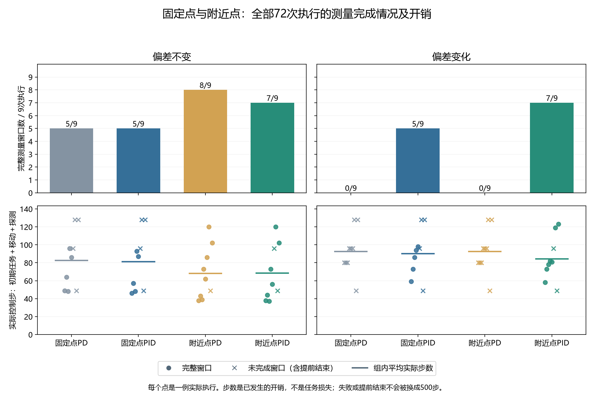

# 附近测量点：执行资格与完整成本

**附近点PID执行资格：QUALIFIED；记录审计通过。新位置的测量模型与任务收益仍未验证。**

固定点是所有任务返回同一位置；附近点根据介入时看到的手部和物体位置选择测量目标。PD使用当前位置偏差和最近位移，PID再累积持续偏差作补偿。所有方法使用同一移动步数上限和精度门槛。

|偏差条件|固定点PD|固定点PID|附近点PD|附近点PID|
|---|---:|---:|---:|---:|
|不变|5/9|5/9|8/9|7/9|
|变化|0/9|5/9|0/9|7/9|

记录审计：PASSED；附近点PID执行资格：QUALIFIED。

原PD与积分PID均保持原增益、64步移动上限、8步探测及相同进入门槛。固定点为(0,0.6,0.25)；附近点的xy来自介入时可见手部位置，z至少0.25且按可见物体高度增加0.12余量，目标裁剪到已登记的内部工作范围。目标在任何移动前保存。

附近点产生独立类型的原始窗口，不能输入旧冷启动或固定点warm模型。完整窗口只证明取得了规定观测，不等于可辨识参数、模型已校准、任务收益或安全保证。

全部72次执行、9个八组单元保留；每组与本单元首组的变化前初始状态、边界状态及全部物理前缀匹配。核对34612条事件和216份完整私有见证。

|任务|种子|条件/目标/控制器|介入步|完整窗口|停止理由|移动步|探测步|总步数|期间任务成功|
|---|---:|---|---:|---|---|---:|---:|---:|---|
|推物|23000|偏差不变/固定点/PD|16|True|COMPLETE_UNQUALIFIED|25|8|49|False|
|推物|23000|偏差不变/固定点/PID|16|True|COMPLETE_UNQUALIFIED|22|8|46|False|
|推物|23000|偏差不变/附近点/PD|16|True|COMPLETE_UNQUALIFIED|14|8|38|False|
|推物|23000|偏差不变/附近点/PID|16|True|COMPLETE_UNQUALIFIED|14|8|38|False|
|推物|23000|偏差变化/固定点/PD|16|False|ANCHOR_NOT_REACHED|64|0|80|False|
|推物|23000|偏差变化/固定点/PID|16|True|COMPLETE_UNQUALIFIED|35|8|59|False|
|推物|23000|偏差变化/附近点/PD|16|False|ANCHOR_NOT_REACHED|64|0|80|False|
|推物|23000|偏差变化/附近点/PID|16|True|COMPLETE_UNQUALIFIED|34|8|58|False|
|到达|23001|偏差不变/固定点/PD|16|True|COMPLETE_UNQUALIFIED|40|8|64|False|
|到达|23001|偏差不变/固定点/PID|16|True|COMPLETE_UNQUALIFIED|33|8|57|False|
|到达|23001|偏差不变/附近点/PD|16|True|COMPLETE_UNQUALIFIED|19|8|43|False|
|到达|23001|偏差不变/附近点/PID|16|True|COMPLETE_UNQUALIFIED|20|8|44|False|
|到达|23001|偏差变化/固定点/PD|16|False|ANCHOR_NOT_REACHED|64|0|80|False|
|到达|23001|偏差变化/固定点/PID|16|True|COMPLETE_UNQUALIFIED|49|8|73|False|
|到达|23001|偏差变化/附近点/PD|16|False|ANCHOR_NOT_REACHED|64|0|80|False|
|到达|23001|偏差变化/附近点/PID|16|True|COMPLETE_UNQUALIFIED|49|8|73|False|
|开门|23002|偏差不变/固定点/PD|16|True|COMPLETE_UNQUALIFIED|24|8|48|False|
|开门|23002|偏差不变/固定点/PID|16|True|COMPLETE_UNQUALIFIED|24|8|48|False|
|开门|23002|偏差不变/附近点/PD|16|True|COMPLETE_UNQUALIFIED|15|8|39|False|
|开门|23002|偏差不变/附近点/PID|16|True|COMPLETE_UNQUALIFIED|13|8|37|False|
|开门|23002|偏差变化/固定点/PD|16|False|ANCHOR_NOT_REACHED|64|0|80|False|
|开门|23002|偏差变化/固定点/PID|16|True|COMPLETE_UNQUALIFIED|62|8|86|False|
|开门|23002|偏差变化/附近点/PD|16|False|ANCHOR_NOT_REACHED|64|0|80|False|
|开门|23002|偏差变化/附近点/PID|16|True|COMPLETE_UNQUALIFIED|54|8|78|False|
|推物|23003|偏差不变/固定点/PD|32|True|COMPLETE_UNQUALIFIED|56|8|96|False|
|推物|23003|偏差不变/固定点/PID|32|True|COMPLETE_UNQUALIFIED|53|8|93|False|
|推物|23003|偏差不变/附近点/PD|32|True|COMPLETE_UNQUALIFIED|33|8|73|False|
|推物|23003|偏差不变/附近点/PID|32|True|COMPLETE_UNQUALIFIED|33|8|73|False|
|推物|23003|偏差变化/固定点/PD|32|False|ANCHOR_NOT_REACHED|64|0|96|False|
|推物|23003|偏差变化/固定点/PID|32|True|COMPLETE_UNQUALIFIED|54|8|94|False|
|推物|23003|偏差变化/附近点/PD|32|False|ANCHOR_NOT_REACHED|64|0|96|False|
|推物|23003|偏差变化/附近点/PID|32|True|COMPLETE_UNQUALIFIED|42|8|82|False|
|到达|23004|偏差不变/固定点/PD|32|True|COMPLETE_UNQUALIFIED|46|8|86|False|
|到达|23004|偏差不变/固定点/PID|32|True|COMPLETE_UNQUALIFIED|47|8|87|False|
|到达|23004|偏差不变/附近点/PD|32|True|COMPLETE_UNQUALIFIED|22|8|62|False|
|到达|23004|偏差不变/附近点/PID|32|True|COMPLETE_UNQUALIFIED|16|8|56|False|
|到达|23004|偏差变化/固定点/PD|32|False|ANCHOR_NOT_REACHED|64|0|96|False|
|到达|23004|偏差变化/固定点/PID|32|True|COMPLETE_UNQUALIFIED|58|8|98|False|
|到达|23004|偏差变化/附近点/PD|32|False|ANCHOR_NOT_REACHED|64|0|96|False|
|到达|23004|偏差变化/附近点/PID|32|True|COMPLETE_UNQUALIFIED|41|8|81|False|
|开门|23005|偏差不变/固定点/PD|32|False|ANCHOR_NOT_REACHED|64|0|96|False|
|开门|23005|偏差不变/固定点/PID|32|False|ANCHOR_NOT_REACHED|64|0|96|False|
|开门|23005|偏差不变/附近点/PD|32|True|COMPLETE_UNQUALIFIED|46|8|86|False|
|开门|23005|偏差不变/附近点/PID|32|False|ANCHOR_NOT_REACHED|64|0|96|False|
|开门|23005|偏差变化/固定点/PD|32|False|ANCHOR_NOT_REACHED|64|0|96|False|
|开门|23005|偏差变化/固定点/PID|32|False|ANCHOR_NOT_REACHED|64|0|96|False|
|开门|23005|偏差变化/附近点/PD|32|False|ANCHOR_NOT_REACHED|64|0|96|False|
|开门|23005|偏差变化/附近点/PID|32|False|ANCHOR_NOT_REACHED|64|0|96|False|
|推物|23006|偏差不变/固定点/PD|64|False|ANCHOR_NOT_REACHED|64|0|128|False|
|推物|23006|偏差不变/固定点/PID|64|False|ANCHOR_NOT_REACHED|64|0|128|False|
|推物|23006|偏差不变/附近点/PD|64|True|COMPLETE_UNQUALIFIED|48|8|120|False|
|推物|23006|偏差不变/附近点/PID|64|True|COMPLETE_UNQUALIFIED|48|8|120|False|
|推物|23006|偏差变化/固定点/PD|64|False|ANCHOR_NOT_REACHED|64|0|128|False|
|推物|23006|偏差变化/固定点/PID|64|False|ANCHOR_NOT_REACHED|64|0|128|False|
|推物|23006|偏差变化/附近点/PD|64|False|ANCHOR_NOT_REACHED|64|0|128|False|
|推物|23006|偏差变化/附近点/PID|64|True|COMPLETE_UNQUALIFIED|47|8|119|False|
|到达|23007|偏差不变/固定点/PD|64|False|ENDED_BEFORE_BOUNDARY|0|0|49|True|
|到达|23007|偏差不变/固定点/PID|64|False|ENDED_BEFORE_BOUNDARY|0|0|49|True|
|到达|23007|偏差不变/附近点/PD|64|False|ENDED_BEFORE_BOUNDARY|0|0|49|True|
|到达|23007|偏差不变/附近点/PID|64|False|ENDED_BEFORE_BOUNDARY|0|0|49|True|
|到达|23007|偏差变化/固定点/PD|64|False|ENDED_BEFORE_BOUNDARY|0|0|49|True|
|到达|23007|偏差变化/固定点/PID|64|False|ENDED_BEFORE_BOUNDARY|0|0|49|True|
|到达|23007|偏差变化/附近点/PD|64|False|ENDED_BEFORE_BOUNDARY|0|0|49|True|
|到达|23007|偏差变化/附近点/PID|64|False|ENDED_BEFORE_BOUNDARY|0|0|49|True|
|开门|23008|偏差不变/固定点/PD|64|False|ANCHOR_NOT_REACHED|64|0|128|False|
|开门|23008|偏差不变/固定点/PID|64|False|ANCHOR_NOT_REACHED|64|0|128|False|
|开门|23008|偏差不变/附近点/PD|64|True|COMPLETE_UNQUALIFIED|30|8|102|False|
|开门|23008|偏差不变/附近点/PID|64|True|COMPLETE_UNQUALIFIED|30|8|102|False|
|开门|23008|偏差变化/固定点/PD|64|False|ANCHOR_NOT_REACHED|64|0|128|False|
|开门|23008|偏差变化/固定点/PID|64|False|ANCHOR_NOT_REACHED|64|0|128|False|
|开门|23008|偏差变化/附近点/PD|64|False|ANCHOR_NOT_REACHED|64|0|128|False|
|开门|23008|偏差变化/附近点/PID|64|True|COMPLETE_UNQUALIFIED|51|8|123|False|

|条件/目标/控制器|完整窗口|总步数|移动步|探测步|
|---|---:|---:|---:|---:|
|偏差不变/固定点/PD|5/9|744|383|40|
|偏差不变/固定点/PID|5/9|732|371|40|
|偏差不变/附近点/PD|8/9|612|227|64|
|偏差不变/附近点/PID|7/9|615|238|56|
|偏差变化/固定点/PD|0/9|833|512|0|
|偏差变化/固定点/PID|5/9|811|450|40|
|偏差变化/附近点/PD|0/9|833|512|0|
|偏差变化/附近点/PID|7/9|759|382|56|

同控制器下，附近点减固定点的窗口计数差：{'UNCHANGED': {'PD': 3, 'PID': 2}, 'CHANGED': {'PD': 0, 'PID': 2}}。这里只描述9个单元；不同介入步使用不同种子，不能比较介入时刻的因果作用。

资格门槛为附近点PID在两种偏差条件下，每种任务至少取得一个完整窗口。所有提前结束、无效准备、未到位或探测越界案例保留。原两个固定点控制和附近点PD对照不要求通过候选资格门槛。

移动结束后、探测前保存积分及补偿参考，不把移动已提供的信息归因于额外探测。新测量范围还需要独立的姿态/历史条件化模型、真实名义校准与留出辨识验证。旧warm模型不会因改变类型或删除门槛而变得适用。

新增控制步5939；受控重置72次、全部重置3672次、仿真帧1865695。API、新校准、策略更新均为0。
策略查询1992次、初始拟合144次。只读审计额外重算策略1992次、拟合144次，无新增物理步骤。
每组承担完整历史名义成本3840控制步、480受控重置、24480全部重置、12259200帧，按9单元摊销426.666667历史控制步；历史实际只采集一次。
采集主体324.672秒；审计主体46.590秒，进程费用另存。

本轮只到测量完成或停止，不继续完整任务。新方法创新性、有效信息、完整成本任务收益、独立变化流、消融及完整论文仍未证明。

冻结提交：`7bf2aa94b5ab35df7bfdcd6e482e052cd83ba57e`；清单：`c796817f1058edf54901c0ff00d9b771847c16325bfa9998c51470baa1d3b123`。

采集进程341.192秒；只读审计进程48.041秒。报告没有新增物理步骤、拟合或API调用。

完整软件检查及仪表化夹具费用保存在outputs/local_reprobe/validation_v1；这些软件费用不冒充全部开发成本。过程中的Gymnasium与MetaWorld提示原样保留。

后续校准与新颖性要求见[研究边界](../docs/research/selected_anchor_calibration_scope_v1_zh.md)。

[冻结协议](../docs/protocols/local_reprobe_execution_qualification_v1.md)；[原始记录与审计](../outputs/local_reprobe/qualification_v1/local_reprobe_20261019T140639Z_7bf2aa94b5ab)。
