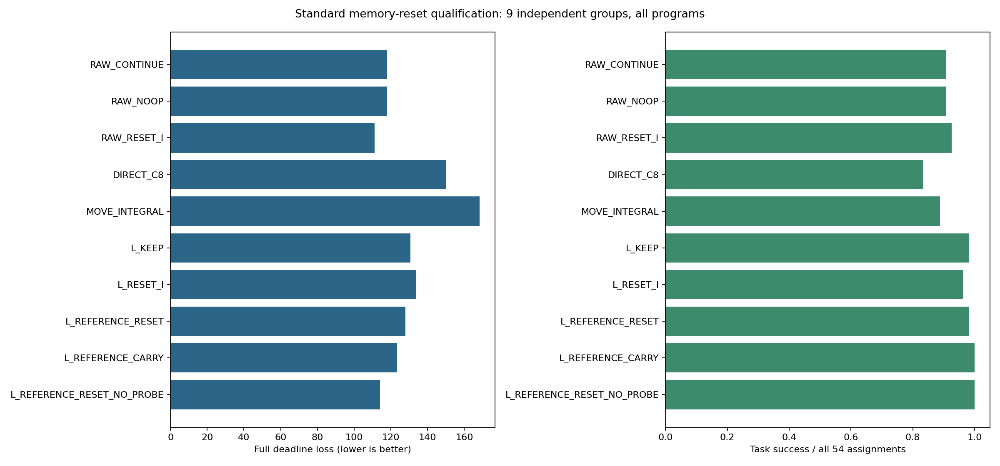

# 任务积分清零与获取收益：独立标准反机制资格 v1

本轮检验是否存在比移动和新测量更廉价的任务积分操作。它是标准强对照资格，不是新学习算法或 CCF A 成果。旧 SS/ARX 负结果、旧人口与原比较不变；本轮零在线 LLM API 调用、零新响应/策略训练。

冻结提交：`814c7dbd2ce721e2f7c5ad252e8e84a46fb74ef1`；运行：`memory_reset_20261022T224151Z_814c7dbd2ce7`；manifest：`9bde4740423055164ccced317633ed953a726046eeb2e02fc28f9e1a044a3c3c`。

## 方法含义与可识别范围

RAW 是原固定策略外的任务 PI 纠正，积分会保存过去误差。RESET_I 只将该积分清零；NOOP 保存并消费一个恒等操作。LOCAL_PID 是真实移动到附近测量位置，KEEP 保留旧纠正/任务积分；REFERENCE 更新移动期间形成的参考偏置，RESET/CARRY 分别清零/保持任务积分。C8 与 MOVE_INTEGRAL 是原初始辨识、积分移动两个完整强参考。

积分重置/保持是标准控制功能，[ROS 官方文档](https://control.ros.org/rolling/doc/api/classcontrol__toolbox_1_1Pid.html)已提供接口；不能声称新颖、无扰切换、稳定或安全。当前预测能力本轮没有新模型资格。任务表现只来自真实完整任务；记录回放不是额外仿真证据。

## 原生软件契约

原生分配90，实际完成90；状态 `COLLECTED_FOR_INDEPENDENT_AUDIT`；契约 `PASSED`。所有早停、缺窗口、零积分操作和失败保留。

独立审计成本/核对数：

```json
{
  "independent_policy_queries": 10093,
  "pi_plans": 10093,
  "pi_changed_command_steps": 9456,
  "pi_send_limit_steps": 3848,
  "pi_integral_limit_steps": 0,
  "control_steps": 11085,
  "memory_transitions": 44,
  "memory_witness_pairs": 44,
  "nonzero_integral_changes": 24,
  "noop_transitions": 16,
  "projected_terminal_wall_duration_pairs": 2,
  "full_noop_trace_pairs": 18,
  "common_prefix_pairs": 72,
  "direct_integral_resets": 16,
  "relocation_steps": 800,
  "probe_steps": 192,
  "post_move_integral_resets": 12,
  "common_pre_probe_pairs": 18,
  "common_post_acquisition_pairs": 18
}
```

## 主要结果：完整54单元、9独立组

主要判断：`NOT_QUALIFIED`。RAW_RESET_I−RAW_CONTINUE 平均截止损失差 **-6.851852步**，95%整组区间 **[-24.722222, +7.111574]**。预定标准为区间上界严格小于零。成功率同时完整报告，未暗加成功率门槛。

|程序|成功/54|平均截止损失↓|实际控制步|移动步|测量步|实际记忆操作|非零积分改变|
|---|---|---|---|---|---|---|---|
|RAW_CONTINUE|49/54|118.055556|6375|0|0|0|0|
|RAW_NOOP|49/54|118.055556|6375|0|0|48|0|
|RAW_RESET_I|50/54|111.203704|6005|0|0|48|48|
|DIRECT_C8|45/54|150.166667|8109|0|0|0|0|
|MOVE_INTEGRAL|48/54|168.296296|9088|1537|0|0|0|
|LOCAL_PID_KEEP|53/54|130.611111|7053|1267|312|0|0|
|LOCAL_PID_RESET_I|52/54|133.666667|7218|1267|312|39|39|
|LOCAL_PID_REFERENCE_RESET|53/54|127.907407|6907|1267|312|0|0|
|LOCAL_PID_REFERENCE_CARRY|54/54|123.370370|6662|1267|312|0|0|
|LOCAL_PID_REFERENCE_RESET_NO_PROBE|54/54|114.166667|6165|1267|0|0|0|



主要比较之外均是预定次要未校正区间，不用它们替换失败主角：

|左−右|平均损失差|整组95%区间|
|---|---|---|
|RAW_RESET_I − RAW_CONTINUE|-6.851852|[-24.722222, +7.111574]|
|LOCAL_PID_RESET_I − LOCAL_PID_KEEP|+3.055556|[-10.055556, +20.777778]|
|LOCAL_PID_REFERENCE_RESET − LOCAL_PID_RESET_I|-5.759259|[-19.593056, +2.555556]|
|LOCAL_PID_REFERENCE_CARRY − LOCAL_PID_REFERENCE_RESET|-4.537037|[-23.537037, +9.407407]|
|LOCAL_PID_REFERENCE_RESET − LOCAL_PID_REFERENCE_RESET_NO_PROBE|+13.740741|[+3.111111, +29.203704]|
|RAW_RESET_I − DIRECT_C8|-38.962963|[-82.351852, +4.592593]|
|RAW_RESET_I − MOVE_INTEGRAL|-57.092593|[-110.383796, +0.203704]|
|RAW_NOOP − RAW_CONTINUE|+0.000000|[+0.000000, +0.000000]|
|DIRECT_C8 − RAW_CONTINUE|+32.111111|[-11.166667, +74.555556]|
|MOVE_INTEGRAL − RAW_CONTINUE|+50.240741|[+0.833333, +94.930093]|
|LOCAL_PID_KEEP − RAW_CONTINUE|+12.555556|[-21.074074, +45.555556]|
|LOCAL_PID_RESET_I − RAW_CONTINUE|+15.611111|[-9.759259, +36.870370]|
|LOCAL_PID_REFERENCE_RESET − RAW_CONTINUE|+9.851852|[-22.666667, +38.092593]|
|LOCAL_PID_REFERENCE_CARRY − RAW_CONTINUE|+5.314815|[-35.537037, +44.705093]|
|LOCAL_PID_REFERENCE_RESET_NO_PROBE − RAW_CONTINUE|-3.888889|[-39.261574, +27.574074]|

## 全部分层与完整失败

以下180格保留全部程序×三任务×两条件×三个时点，每格3独立组。不按长度给轨迹或时间步加额外独立权重。

|程序|任务|条件|时点|成功/3|平均损失|记忆操作|完整窗口|
|---|---|---|---|---|---|---|---|
|RAW_CONTINUE|push-v3|UNCHANGED|16|3/3|64.667|0|0|
|RAW_CONTINUE|push-v3|UNCHANGED|32|2/3|224.000|0|0|
|RAW_CONTINUE|push-v3|UNCHANGED|64|2/3|213.667|0|0|
|RAW_CONTINUE|push-v3|CHANGED|16|2/3|210.333|0|0|
|RAW_CONTINUE|push-v3|CHANGED|32|2/3|237.667|0|0|
|RAW_CONTINUE|push-v3|CHANGED|64|2/3|213.333|0|0|
|RAW_CONTINUE|reach-v3|UNCHANGED|16|3/3|124.667|0|0|
|RAW_CONTINUE|reach-v3|UNCHANGED|32|3/3|36.333|0|0|
|RAW_CONTINUE|reach-v3|UNCHANGED|64|3/3|85.667|0|0|
|RAW_CONTINUE|reach-v3|CHANGED|16|3/3|73.333|0|0|
|RAW_CONTINUE|reach-v3|CHANGED|32|3/3|35.333|0|0|
|RAW_CONTINUE|reach-v3|CHANGED|64|3/3|97.333|0|0|
|RAW_CONTINUE|door-open-v3|UNCHANGED|16|3/3|84.000|0|0|
|RAW_CONTINUE|door-open-v3|UNCHANGED|32|3/3|87.667|0|0|
|RAW_CONTINUE|door-open-v3|UNCHANGED|64|3/3|84.333|0|0|
|RAW_CONTINUE|door-open-v3|CHANGED|16|3/3|87.667|0|0|
|RAW_CONTINUE|door-open-v3|CHANGED|32|3/3|82.333|0|0|
|RAW_CONTINUE|door-open-v3|CHANGED|64|3/3|82.667|0|0|
|RAW_NOOP|push-v3|UNCHANGED|16|3/3|64.667|3|0|
|RAW_NOOP|push-v3|UNCHANGED|32|2/3|224.000|3|0|
|RAW_NOOP|push-v3|UNCHANGED|64|2/3|213.667|3|0|
|RAW_NOOP|push-v3|CHANGED|16|2/3|210.333|3|0|
|RAW_NOOP|push-v3|CHANGED|32|2/3|237.667|3|0|
|RAW_NOOP|push-v3|CHANGED|64|2/3|213.333|3|0|
|RAW_NOOP|reach-v3|UNCHANGED|16|3/3|124.667|3|0|
|RAW_NOOP|reach-v3|UNCHANGED|32|3/3|36.333|2|0|
|RAW_NOOP|reach-v3|UNCHANGED|64|3/3|85.667|1|0|
|RAW_NOOP|reach-v3|CHANGED|16|3/3|73.333|3|0|
|RAW_NOOP|reach-v3|CHANGED|32|3/3|35.333|2|0|
|RAW_NOOP|reach-v3|CHANGED|64|3/3|97.333|1|0|
|RAW_NOOP|door-open-v3|UNCHANGED|16|3/3|84.000|3|0|
|RAW_NOOP|door-open-v3|UNCHANGED|32|3/3|87.667|3|0|
|RAW_NOOP|door-open-v3|UNCHANGED|64|3/3|84.333|3|0|
|RAW_NOOP|door-open-v3|CHANGED|16|3/3|87.667|3|0|
|RAW_NOOP|door-open-v3|CHANGED|32|3/3|82.333|3|0|
|RAW_NOOP|door-open-v3|CHANGED|64|3/3|82.667|3|0|
|RAW_RESET_I|push-v3|UNCHANGED|16|3/3|175.333|3|0|
|RAW_RESET_I|push-v3|UNCHANGED|32|2/3|222.667|3|0|
|RAW_RESET_I|push-v3|UNCHANGED|64|2/3|214.000|3|0|
|RAW_RESET_I|push-v3|CHANGED|16|3/3|68.333|3|0|
|RAW_RESET_I|push-v3|CHANGED|32|2/3|222.000|3|0|
|RAW_RESET_I|push-v3|CHANGED|64|2/3|213.333|3|0|
|RAW_RESET_I|reach-v3|UNCHANGED|16|3/3|77.667|3|0|
|RAW_RESET_I|reach-v3|UNCHANGED|32|3/3|46.667|2|0|
|RAW_RESET_I|reach-v3|UNCHANGED|64|3/3|64.333|1|0|
|RAW_RESET_I|reach-v3|CHANGED|16|3/3|74.000|3|0|
|RAW_RESET_I|reach-v3|CHANGED|32|3/3|37.667|2|0|
|RAW_RESET_I|reach-v3|CHANGED|64|3/3|75.667|1|0|
|RAW_RESET_I|door-open-v3|UNCHANGED|16|3/3|84.000|3|0|
|RAW_RESET_I|door-open-v3|UNCHANGED|32|3/3|88.000|3|0|
|RAW_RESET_I|door-open-v3|UNCHANGED|64|3/3|84.333|3|0|
|RAW_RESET_I|door-open-v3|CHANGED|16|3/3|88.667|3|0|
|RAW_RESET_I|door-open-v3|CHANGED|32|3/3|82.333|3|0|
|RAW_RESET_I|door-open-v3|CHANGED|64|3/3|82.667|3|0|
|DIRECT_C8|push-v3|UNCHANGED|16|3/3|72.333|0|0|
|DIRECT_C8|push-v3|UNCHANGED|32|3/3|70.667|0|0|
|DIRECT_C8|push-v3|UNCHANGED|64|3/3|72.000|0|0|
|DIRECT_C8|push-v3|CHANGED|16|1/3|358.000|0|0|
|DIRECT_C8|push-v3|CHANGED|32|1/3|358.000|0|0|
|DIRECT_C8|push-v3|CHANGED|64|3/3|71.000|0|0|
|DIRECT_C8|reach-v3|UNCHANGED|16|3/3|66.667|0|0|
|DIRECT_C8|reach-v3|UNCHANGED|32|3/3|54.000|0|0|
|DIRECT_C8|reach-v3|UNCHANGED|64|3/3|76.000|0|0|
|DIRECT_C8|reach-v3|CHANGED|16|1/3|355.333|0|0|
|DIRECT_C8|reach-v3|CHANGED|32|1/3|349.333|0|0|
|DIRECT_C8|reach-v3|CHANGED|64|2/3|207.000|0|0|
|DIRECT_C8|door-open-v3|UNCHANGED|16|3/3|87.333|0|0|
|DIRECT_C8|door-open-v3|UNCHANGED|32|3/3|105.333|0|0|
|DIRECT_C8|door-open-v3|UNCHANGED|64|3/3|93.333|0|0|
|DIRECT_C8|door-open-v3|CHANGED|16|3/3|118.000|0|0|
|DIRECT_C8|door-open-v3|CHANGED|32|3/3|98.000|0|0|
|DIRECT_C8|door-open-v3|CHANGED|64|3/3|90.667|0|0|
|MOVE_INTEGRAL|push-v3|UNCHANGED|16|3/3|91.667|0|0|
|MOVE_INTEGRAL|push-v3|UNCHANGED|32|3/3|120.333|0|0|
|MOVE_INTEGRAL|push-v3|UNCHANGED|64|3/3|143.667|0|0|
|MOVE_INTEGRAL|push-v3|CHANGED|16|3/3|104.333|0|0|
|MOVE_INTEGRAL|push-v3|CHANGED|32|3/3|130.333|0|0|
|MOVE_INTEGRAL|push-v3|CHANGED|64|3/3|131.000|0|0|
|MOVE_INTEGRAL|reach-v3|UNCHANGED|16|3/3|93.333|0|0|
|MOVE_INTEGRAL|reach-v3|UNCHANGED|32|3/3|84.333|0|0|
|MOVE_INTEGRAL|reach-v3|UNCHANGED|64|3/3|81.333|0|0|
|MOVE_INTEGRAL|reach-v3|CHANGED|16|1/3|375.000|0|0|
|MOVE_INTEGRAL|reach-v3|CHANGED|32|2/3|237.333|0|0|
|MOVE_INTEGRAL|reach-v3|CHANGED|64|2/3|207.000|0|0|
|MOVE_INTEGRAL|door-open-v3|UNCHANGED|16|2/3|257.667|0|0|
|MOVE_INTEGRAL|door-open-v3|UNCHANGED|32|3/3|157.667|0|0|
|MOVE_INTEGRAL|door-open-v3|UNCHANGED|64|3/3|196.000|0|0|
|MOVE_INTEGRAL|door-open-v3|CHANGED|16|2/3|262.000|0|0|
|MOVE_INTEGRAL|door-open-v3|CHANGED|32|3/3|166.333|0|0|
|MOVE_INTEGRAL|door-open-v3|CHANGED|64|3/3|190.000|0|0|
|LOCAL_PID_KEEP|push-v3|UNCHANGED|16|3/3|102.333|0|3|
|LOCAL_PID_KEEP|push-v3|UNCHANGED|32|3/3|127.667|0|3|
|LOCAL_PID_KEEP|push-v3|UNCHANGED|64|3/3|98.333|0|1|
|LOCAL_PID_KEEP|push-v3|CHANGED|16|3/3|122.000|0|3|
|LOCAL_PID_KEEP|push-v3|CHANGED|32|2/3|249.333|0|3|
|LOCAL_PID_KEEP|push-v3|CHANGED|64|3/3|93.667|0|1|
|LOCAL_PID_KEEP|reach-v3|UNCHANGED|16|3/3|105.000|0|3|
|LOCAL_PID_KEEP|reach-v3|UNCHANGED|32|3/3|95.333|0|1|
|LOCAL_PID_KEEP|reach-v3|UNCHANGED|64|3/3|87.000|0|1|
|LOCAL_PID_KEEP|reach-v3|CHANGED|16|3/3|100.667|0|3|
|LOCAL_PID_KEEP|reach-v3|CHANGED|32|3/3|90.000|0|2|
|LOCAL_PID_KEEP|reach-v3|CHANGED|64|3/3|99.333|0|1|
|LOCAL_PID_KEEP|door-open-v3|UNCHANGED|16|3/3|135.000|0|3|
|LOCAL_PID_KEEP|door-open-v3|UNCHANGED|32|3/3|169.000|0|2|
|LOCAL_PID_KEEP|door-open-v3|UNCHANGED|64|3/3|178.000|0|2|
|LOCAL_PID_KEEP|door-open-v3|CHANGED|16|3/3|157.667|0|3|
|LOCAL_PID_KEEP|door-open-v3|CHANGED|32|3/3|162.333|0|2|
|LOCAL_PID_KEEP|door-open-v3|CHANGED|64|3/3|178.333|0|2|
|LOCAL_PID_RESET_I|push-v3|UNCHANGED|16|3/3|107.000|3|3|
|LOCAL_PID_RESET_I|push-v3|UNCHANGED|32|3/3|127.000|3|3|
|LOCAL_PID_RESET_I|push-v3|UNCHANGED|64|3/3|127.000|1|1|
|LOCAL_PID_RESET_I|push-v3|CHANGED|16|3/3|115.333|3|3|
|LOCAL_PID_RESET_I|push-v3|CHANGED|32|2/3|246.333|3|3|
|LOCAL_PID_RESET_I|push-v3|CHANGED|64|2/3|214.000|1|1|
|LOCAL_PID_RESET_I|reach-v3|UNCHANGED|16|3/3|104.667|3|3|
|LOCAL_PID_RESET_I|reach-v3|UNCHANGED|32|3/3|72.333|1|1|
|LOCAL_PID_RESET_I|reach-v3|UNCHANGED|64|3/3|69.667|1|1|
|LOCAL_PID_RESET_I|reach-v3|CHANGED|16|3/3|101.000|3|3|
|LOCAL_PID_RESET_I|reach-v3|CHANGED|32|3/3|67.000|2|2|
|LOCAL_PID_RESET_I|reach-v3|CHANGED|64|3/3|77.333|1|1|
|LOCAL_PID_RESET_I|door-open-v3|UNCHANGED|16|3/3|141.667|3|3|
|LOCAL_PID_RESET_I|door-open-v3|UNCHANGED|32|3/3|167.667|2|2|
|LOCAL_PID_RESET_I|door-open-v3|UNCHANGED|64|3/3|172.667|2|2|
|LOCAL_PID_RESET_I|door-open-v3|CHANGED|16|3/3|159.667|3|3|
|LOCAL_PID_RESET_I|door-open-v3|CHANGED|32|3/3|161.333|2|2|
|LOCAL_PID_RESET_I|door-open-v3|CHANGED|64|3/3|174.333|2|2|
|LOCAL_PID_REFERENCE_RESET|push-v3|UNCHANGED|16|3/3|106.000|0|3|
|LOCAL_PID_REFERENCE_RESET|push-v3|UNCHANGED|32|3/3|125.333|0|3|
|LOCAL_PID_REFERENCE_RESET|push-v3|UNCHANGED|64|3/3|143.667|0|1|
|LOCAL_PID_REFERENCE_RESET|push-v3|CHANGED|16|3/3|113.333|0|3|
|LOCAL_PID_REFERENCE_RESET|push-v3|CHANGED|32|3/3|124.333|0|3|
|LOCAL_PID_REFERENCE_RESET|push-v3|CHANGED|64|2/3|214.000|0|1|
|LOCAL_PID_REFERENCE_RESET|reach-v3|UNCHANGED|16|3/3|105.667|0|3|
|LOCAL_PID_REFERENCE_RESET|reach-v3|UNCHANGED|32|3/3|72.333|0|1|
|LOCAL_PID_REFERENCE_RESET|reach-v3|UNCHANGED|64|3/3|69.667|0|1|
|LOCAL_PID_REFERENCE_RESET|reach-v3|CHANGED|16|3/3|101.667|0|3|
|LOCAL_PID_REFERENCE_RESET|reach-v3|CHANGED|32|3/3|68.000|0|2|
|LOCAL_PID_REFERENCE_RESET|reach-v3|CHANGED|64|3/3|77.000|0|1|
|LOCAL_PID_REFERENCE_RESET|door-open-v3|UNCHANGED|16|3/3|157.000|0|3|
|LOCAL_PID_REFERENCE_RESET|door-open-v3|UNCHANGED|32|3/3|166.667|0|2|
|LOCAL_PID_REFERENCE_RESET|door-open-v3|UNCHANGED|64|3/3|169.333|0|2|
|LOCAL_PID_REFERENCE_RESET|door-open-v3|CHANGED|16|3/3|158.667|0|3|
|LOCAL_PID_REFERENCE_RESET|door-open-v3|CHANGED|32|3/3|159.333|0|2|
|LOCAL_PID_REFERENCE_RESET|door-open-v3|CHANGED|64|3/3|170.333|0|2|
|LOCAL_PID_REFERENCE_CARRY|push-v3|UNCHANGED|16|3/3|102.667|0|3|
|LOCAL_PID_REFERENCE_CARRY|push-v3|UNCHANGED|32|3/3|126.333|0|3|
|LOCAL_PID_REFERENCE_CARRY|push-v3|UNCHANGED|64|3/3|98.333|0|1|
|LOCAL_PID_REFERENCE_CARRY|push-v3|CHANGED|16|3/3|119.000|0|3|
|LOCAL_PID_REFERENCE_CARRY|push-v3|CHANGED|32|3/3|125.667|0|3|
|LOCAL_PID_REFERENCE_CARRY|push-v3|CHANGED|64|3/3|93.333|0|1|
|LOCAL_PID_REFERENCE_CARRY|reach-v3|UNCHANGED|16|3/3|105.000|0|3|
|LOCAL_PID_REFERENCE_CARRY|reach-v3|UNCHANGED|32|3/3|95.333|0|1|
|LOCAL_PID_REFERENCE_CARRY|reach-v3|UNCHANGED|64|3/3|86.667|0|1|
|LOCAL_PID_REFERENCE_CARRY|reach-v3|CHANGED|16|3/3|100.667|0|3|
|LOCAL_PID_REFERENCE_CARRY|reach-v3|CHANGED|32|3/3|90.000|0|2|
|LOCAL_PID_REFERENCE_CARRY|reach-v3|CHANGED|64|3/3|98.333|0|1|
|LOCAL_PID_REFERENCE_CARRY|door-open-v3|UNCHANGED|16|3/3|142.000|0|3|
|LOCAL_PID_REFERENCE_CARRY|door-open-v3|UNCHANGED|32|3/3|168.000|0|2|
|LOCAL_PID_REFERENCE_CARRY|door-open-v3|UNCHANGED|64|3/3|175.000|0|2|
|LOCAL_PID_REFERENCE_CARRY|door-open-v3|CHANGED|16|3/3|158.667|0|3|
|LOCAL_PID_REFERENCE_CARRY|door-open-v3|CHANGED|32|3/3|160.333|0|2|
|LOCAL_PID_REFERENCE_CARRY|door-open-v3|CHANGED|64|3/3|175.333|0|2|
|LOCAL_PID_REFERENCE_RESET_NO_PROBE|push-v3|UNCHANGED|16|3/3|94.000|0|0|
|LOCAL_PID_REFERENCE_RESET_NO_PROBE|push-v3|UNCHANGED|32|3/3|117.000|0|0|
|LOCAL_PID_REFERENCE_RESET_NO_PROBE|push-v3|UNCHANGED|64|3/3|90.667|0|0|
|LOCAL_PID_REFERENCE_RESET_NO_PROBE|push-v3|CHANGED|16|3/3|102.667|0|0|
|LOCAL_PID_REFERENCE_RESET_NO_PROBE|push-v3|CHANGED|32|3/3|115.667|0|0|
|LOCAL_PID_REFERENCE_RESET_NO_PROBE|push-v3|CHANGED|64|3/3|127.333|0|0|
|LOCAL_PID_REFERENCE_RESET_NO_PROBE|reach-v3|UNCHANGED|16|3/3|96.333|0|0|
|LOCAL_PID_REFERENCE_RESET_NO_PROBE|reach-v3|UNCHANGED|32|3/3|70.333|0|0|
|LOCAL_PID_REFERENCE_RESET_NO_PROBE|reach-v3|UNCHANGED|64|3/3|68.667|0|0|
|LOCAL_PID_REFERENCE_RESET_NO_PROBE|reach-v3|CHANGED|16|3/3|92.667|0|0|
|LOCAL_PID_REFERENCE_RESET_NO_PROBE|reach-v3|CHANGED|32|3/3|59.333|0|0|
|LOCAL_PID_REFERENCE_RESET_NO_PROBE|reach-v3|CHANGED|64|3/3|76.000|0|0|
|LOCAL_PID_REFERENCE_RESET_NO_PROBE|door-open-v3|UNCHANGED|16|3/3|153.333|0|0|
|LOCAL_PID_REFERENCE_RESET_NO_PROBE|door-open-v3|UNCHANGED|32|3/3|161.667|0|0|
|LOCAL_PID_REFERENCE_RESET_NO_PROBE|door-open-v3|UNCHANGED|64|3/3|160.667|0|0|
|LOCAL_PID_REFERENCE_RESET_NO_PROBE|door-open-v3|CHANGED|16|3/3|162.333|0|0|
|LOCAL_PID_REFERENCE_RESET_NO_PROBE|door-open-v3|CHANGED|32|3/3|139.000|0|0|
|LOCAL_PID_REFERENCE_RESET_NO_PROBE|door-open-v3|CHANGED|64|3/3|167.333|0|0|

配对不利/改善是完整已执行程序的描述。按实际采用/拒绝或非零改变分项不能识别这些分支的因果效果。

|左−右|不利/相同/改善|成功→失败|失败→成功|不利总步数|改善总步数|
|---|---|---|---|---|---|
|RAW_RESET_I − RAW_CONTINUE|14/31/9|0|1|389|759|
|LOCAL_PID_RESET_I − LOCAL_PID_KEEP|14/25/15|1|0|494|329|
|LOCAL_PID_REFERENCE_RESET − LOCAL_PID_RESET_I|14/24/16|0|1|111|422|
|LOCAL_PID_REFERENCE_CARRY − LOCAL_PID_REFERENCE_RESET|16/21/17|0|1|327|572|
|LOCAL_PID_REFERENCE_RESET − LOCAL_PID_REFERENCE_RESET_NO_PROBE|35/15/4|1|0|804|62|
|RAW_RESET_I − DIRECT_C8|11/1/42|3|8|1747|3851|
|RAW_RESET_I − MOVE_INTEGRAL|7/1/46|4|6|1944|5027|
|RAW_NOOP − RAW_CONTINUE|0/54/0|0|0|0|0|
|DIRECT_C8 − RAW_CONTINUE|42/2/10|7|3|3391|1657|
|MOVE_INTEGRAL − RAW_CONTINUE|46/0/8|6|5|4908|2195|
|LOCAL_PID_KEEP − RAW_CONTINUE|42/7/5|0|4|2235|1557|
|LOCAL_PID_RESET_I − RAW_CONTINUE|39/8/7|0|3|2091|1248|
|LOCAL_PID_REFERENCE_RESET − RAW_CONTINUE|39/7/8|0|4|2101|1569|
|LOCAL_PID_REFERENCE_CARRY − RAW_CONTINUE|42/6/6|0|5|2224|1937|
|LOCAL_PID_REFERENCE_RESET_NO_PROBE − RAW_CONTINUE|39/6/9|0|5|1828|2038|

原生与QUAL合计 **37个任务失败**，全部列出（失败损失均500）；早成功与未执行操作仍在原分母。

|阶段|组|任务|条件|时点|程序|实际步|窗口|记忆操作/原因|停止原因|
|---|---|---|---|---|---|---|---|---|---|
|software_native|0|push-v3|UNCHANGED|16|RAW_CONTINUE|500|False|False/NOT_ASSIGNED|ENVIRONMENT_ENDED|
|software_native|0|push-v3|UNCHANGED|16|RAW_NOOP|500|False|True/SAVED_MEMORY_PLAN_CONSUMED|ENVIRONMENT_ENDED|
|software_native|1|push-v3|CHANGED|32|RAW_CONTINUE|500|False|False/NOT_ASSIGNED|ENVIRONMENT_ENDED|
|software_native|1|push-v3|CHANGED|32|RAW_NOOP|500|False|True/SAVED_MEMORY_PLAN_CONSUMED|ENVIRONMENT_ENDED|
|qual|1|push-v3|UNCHANGED|32|RAW_CONTINUE|500|False|False/NOT_ASSIGNED|ENVIRONMENT_ENDED|
|qual|1|push-v3|UNCHANGED|32|RAW_NOOP|500|False|True/SAVED_MEMORY_PLAN_CONSUMED|ENVIRONMENT_ENDED|
|qual|1|push-v3|UNCHANGED|32|RAW_RESET_I|500|False|True/SAVED_MEMORY_PLAN_CONSUMED|ENVIRONMENT_ENDED|
|qual|1|push-v3|CHANGED|32|RAW_CONTINUE|500|False|False/NOT_ASSIGNED|ENVIRONMENT_ENDED|
|qual|1|push-v3|CHANGED|32|RAW_NOOP|500|False|True/SAVED_MEMORY_PLAN_CONSUMED|ENVIRONMENT_ENDED|
|qual|1|push-v3|CHANGED|32|RAW_RESET_I|500|False|True/SAVED_MEMORY_PLAN_CONSUMED|ENVIRONMENT_ENDED|
|qual|1|push-v3|CHANGED|32|DIRECT_C8|500|False|False/LEGACY_REFERENCE_ARM|ENVIRONMENT_ENDED|
|qual|1|push-v3|CHANGED|32|LOCAL_PID_KEEP|500|True|False/NOT_ASSIGNED|ENVIRONMENT_ENDED|
|qual|1|push-v3|CHANGED|32|LOCAL_PID_RESET_I|500|True|True/SAVED_MEMORY_PLAN_CONSUMED|ENVIRONMENT_ENDED|
|qual|1|reach-v3|CHANGED|32|DIRECT_C8|500|False|False/LEGACY_REFERENCE_ARM|ENVIRONMENT_ENDED|
|qual|2|push-v3|UNCHANGED|64|RAW_CONTINUE|500|False|False/NOT_ASSIGNED|ENVIRONMENT_ENDED|
|qual|2|push-v3|UNCHANGED|64|RAW_NOOP|500|False|True/SAVED_MEMORY_PLAN_CONSUMED|ENVIRONMENT_ENDED|
|qual|2|push-v3|UNCHANGED|64|RAW_RESET_I|500|False|True/SAVED_MEMORY_PLAN_CONSUMED|ENVIRONMENT_ENDED|
|qual|2|push-v3|CHANGED|64|RAW_CONTINUE|500|False|False/NOT_ASSIGNED|ENVIRONMENT_ENDED|
|qual|2|push-v3|CHANGED|64|RAW_NOOP|500|False|True/SAVED_MEMORY_PLAN_CONSUMED|ENVIRONMENT_ENDED|
|qual|2|push-v3|CHANGED|64|RAW_RESET_I|500|False|True/SAVED_MEMORY_PLAN_CONSUMED|ENVIRONMENT_ENDED|
|qual|2|push-v3|CHANGED|64|LOCAL_PID_RESET_I|500|True|True/SAVED_MEMORY_PLAN_CONSUMED|ENVIRONMENT_ENDED|
|qual|2|push-v3|CHANGED|64|LOCAL_PID_REFERENCE_RESET|500|True|False/NOT_ASSIGNED|ENVIRONMENT_ENDED|
|qual|3|push-v3|CHANGED|16|RAW_CONTINUE|500|False|False/NOT_ASSIGNED|ENVIRONMENT_ENDED|
|qual|3|push-v3|CHANGED|16|RAW_NOOP|500|False|True/SAVED_MEMORY_PLAN_CONSUMED|ENVIRONMENT_ENDED|
|qual|3|push-v3|CHANGED|16|DIRECT_C8|500|False|False/LEGACY_REFERENCE_ARM|ENVIRONMENT_ENDED|
|qual|3|reach-v3|CHANGED|16|DIRECT_C8|500|False|False/LEGACY_REFERENCE_ARM|ENVIRONMENT_ENDED|
|qual|3|reach-v3|CHANGED|16|MOVE_INTEGRAL|500|False|False/LEGACY_REFERENCE_ARM|ENVIRONMENT_ENDED|
|qual|3|door-open-v3|UNCHANGED|16|MOVE_INTEGRAL|500|False|False/LEGACY_REFERENCE_ARM|ENVIRONMENT_ENDED|
|qual|3|door-open-v3|CHANGED|16|MOVE_INTEGRAL|500|False|False/LEGACY_REFERENCE_ARM|ENVIRONMENT_ENDED|
|qual|6|push-v3|CHANGED|16|DIRECT_C8|500|False|False/LEGACY_REFERENCE_ARM|ENVIRONMENT_ENDED|
|qual|6|reach-v3|CHANGED|16|DIRECT_C8|500|False|False/LEGACY_REFERENCE_ARM|ENVIRONMENT_ENDED|
|qual|6|reach-v3|CHANGED|16|MOVE_INTEGRAL|500|False|False/LEGACY_REFERENCE_ARM|ENVIRONMENT_ENDED|
|qual|7|push-v3|CHANGED|32|DIRECT_C8|500|False|False/LEGACY_REFERENCE_ARM|ENVIRONMENT_ENDED|
|qual|7|reach-v3|CHANGED|32|DIRECT_C8|500|False|False/LEGACY_REFERENCE_ARM|ENVIRONMENT_ENDED|
|qual|7|reach-v3|CHANGED|32|MOVE_INTEGRAL|500|False|False/LEGACY_REFERENCE_ARM|ENVIRONMENT_ENDED|
|qual|8|reach-v3|CHANGED|64|DIRECT_C8|500|False|False/LEGACY_REFERENCE_ARM|ENVIRONMENT_ENDED|
|qual|8|reach-v3|CHANGED|64|MOVE_INTEGRAL|500|False|False/LEGACY_REFERENCE_ARM|ENVIRONMENT_ENDED|

未操作与缺失原因按全部分配登记：

|程序|原因|例数|
|---|---|---|
|RAW_NOOP|EARLY_END_BEFORE_BOUNDARY|6|
|RAW_NOOP|SAVED_MEMORY_PLAN_CONSUMED|48|
|RAW_RESET_I|EARLY_END_BEFORE_BOUNDARY|6|
|RAW_RESET_I|SAVED_MEMORY_PLAN_CONSUMED|48|
|LOCAL_PID_RESET_I|EARLY_END_BEFORE_BOUNDARY|6|
|LOCAL_PID_RESET_I|EARLY_END_DURING_ACQUISITION|4|
|LOCAL_PID_RESET_I|INCOMPLETE_ACQUISITION_KEEP|5|
|LOCAL_PID_RESET_I|SAVED_MEMORY_PLAN_CONSUMED|39|

## 判断与后续边界

本次未证明这个固定时点标准积分清零能改善完整损失。封存此版本及负结果，不在该QUAL上调时点、阈值或叠加门控。次要分支即使更好也不替代主比较。

同移动后的清零/参考差仅针对这些已分配完整程序；零移动差与同移动差不能相加成未执行混合策略的收益。输入合法、实际预测能力与任务效果依然独立。此人口不是学习方法自身形成的最终时序历史，不能证明可学习的获取/停止决策。

继续研究须单独定义可训练的完整程序表现与获取后实际采用机制，分开TRAIN/CAL/最终自身历史；完整费用下超过RAW PI、零移动标准参考、DIRECT_C8和积分，补齐变化检测/历史辨识/任务相关获取及状态改变/证据/后继/费用消融。仅换回归器、增加采集或数学恒等式不足以构成贡献；CCF A目标未完成。

## 全部实际费用、来源与限制

|阶段|执行|控制步|全部重置|物理帧|实际C4/C8拟合|审计额外复算|收集秒|审计秒|
|---|---|---|---|---|---|---|---|---|
|software_native|90|11085|4590|2350425|0|0|541.297|80.214|
|qual|540|69957|27540|14119785|216|216|3105.635|428.057|

上限为630执行/315,000控制步/32,130全部重置/17,640,000帧。每例50次工厂重置加一次受控初始重置；工厂与控制帧全部计费。移动、探测、失败罚已经进入一次完整截止损失。审计的额外固定策略查询和优化nfev见各阶段audit.json，均不产生新物理帧。来源费用另列，不把复算说成新响应训练，也不把它藏为零拟合。

历史C8名义：480执行/3,840步/24,480全部重置/12,259,200帧；RAW PI选择DEV：720执行/90,626步/36,720全部重置/18,813,130帧；旧局部获取资格：72执行/5,939步/3,672全部重置/1,865,695帧。旧完整参考资格和诊断是已有研究背景，完整费用见各旧中文报告；不能再作为本轮新独立样本或重复按程序摊销。

冻结模型哈希：`08d2f6a7451e8e6f63aed9bf5bd15ce34158b2c219025547a483f6d925b423ad`。manifest记录全部源码、模型、配置、协议与运行时锁，seed_scope记录嵌套种子扫描来源。原始记录、全部失败/负结果保留；大文件若分片，索引与实际恢复另记。

记录审计共享完整程序解释器进行保存观测重放，同时独立复算PI/PID/清零映射并核对世界见证；统计审计独立整数/Fraction公式且禁用主统计。重放不等于完全独立软件实现，也不把公共见证投影视为物理安全证明。9组样本有限、区间条件于固定来源模型，所有次要区间未多重校正。

开发29项首轮有1个序列化形式断言失败，按journal规范表示修正后重新验证；保留首轮日志，不修改控制/统计方法或旧结果。源重用1921唯一检查与旧六组tensor分开，本轮新29项不能把参数组合/回放字段数算成额外测试或独立样本。
