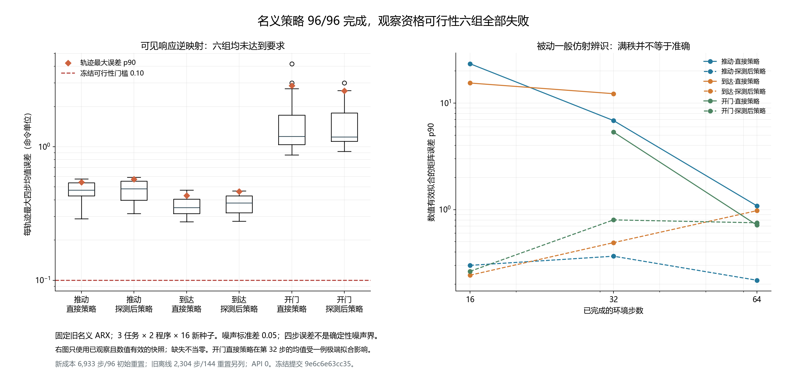

# 名义响应观察与被动辨识：独立可行性验证 v1

本轮已完成一次冻结后的多任务验证，状态为 **`COMPLETED_FEASIBILITY_FAILED`**。96 次固定策略任务全部成功，但响应观察精度的六个分组均未通过预先规定的门槛。原名义 ARX 的逆映射因此不能为真实任务中的响应复用或纠正提供所需的误差依据。所有负结果、缺失快照和原始轨迹均保留。

这项验证承接一般仿射输入支持分析：命令方向被覆盖、拟合矩阵满秩，都不能替代响应估计精度。它没有执行新的纠正控制，也没有新的 API 调用。此前在线 API 实验已经建立实际调用闭环，但 LLM 为 14/16，校准仿射和同数据最近邻均为 16/16；该负收益结论继续保留，见[中文 API 报告](online_calibrated_agent_development_v1.md)。API 闭环成立、观察模型可用、LLM 提高任务表现，是三个分别需要证据的结论。

## 冻结与实验身份

| 项目 | 记录 |
|---|---|
| 运行 | `nominal_observer_20261014T055743Z_9e6c6e63cc35` |
| 实现冻结提交 | `9e6c6e63cc35ca4510e0021821f5a45fb9ad4f58` |
| Manifest ID | `e56e9442c5c01a081262d156158106b5946f0b52c855edf22fb34785bb72df23` |
| 固定观察模型 SHA-256 | `f9f8f8b772e94d0639655b508c0038950b5fca0e85d21f03be0ad1454cf08019` |
| 新任务种子 | 10000–10015；10016–10199 仍保留 |
| 任务 | `push-v3`、`reach-v3`、`door-open-v3` |
| 两种程序 | `POLICY_ONLY`（直接策略）、`PROBE_THEN_POLICY`（十六步探测后策略） |
| 每轨迹预算 | 最多 500 步，探测与任务合计；一次初始环境／执行器重置 |
| 执行器 | 已知零偏置名义条件，xyz 高斯噪声标准差 0.05，夹爪不加噪 |

[协议](../docs/protocols/nominal_observer_qualification_v1.md)和[配置](../configs/nominal_observer/qualification_v1.json)在结果之前冻结。三个任务使用各自安装包中的固定 Sawyer v3 策略，并保存其源码散列。任务观察与随机数状态从探测连续衔接至策略，不在边界重置。

观察模型仅来自原 72 条名义训练轨迹，本轮不重新拟合它。可见位置差为 `delta_t`，采用：

```text
rhat_t = B0^-1 (delta_t - A0 delta_(t-1) - c0)
```

第一步没有可见的上一位移，不假造初始速度；从第二步开始计算。观察输入仅包含可见前后状态、已发送命令和冻结模型。实际加噪动作、当前真实执行器参数、种子、随机数及未来结果不进入观察或被动拟合。这里已知名义命令作为精度比较的标签；截断、动态误差和其他未建模效应仍计入总误差。

## 主要精度门：六组全部失败

按时间将观察样本划为不重叠四步块。每块比较平均 `rhat` 与平均名义命令，取两个分量中的最大绝对差，单位是归一化命令单位。每轨迹得分是最大块误差；每组 16 个轨迹得分的线性插值 p90 必须不大于 **0.10**，且全部轨迹有有效块。六组同时满足才通过。

| 任务 | 程序 | 有效轨迹 | 轨迹最大误差 p90 | 最坏轨迹误差 | 精度门 | 名义任务成功 | 实际步数 |
|---|---|---:|---:|---:|---|---:|---:|
| push-v3 | 直接策略 | 16/16 | 0.5433 | 0.5743 | 失败 | 16/16 | 1,006 |
| push-v3 | 探测后策略 | 16/16 | 0.5705 | 0.5901 | 失败 | 16/16 | 1,247 |
| reach-v3 | 直接策略 | 16/16 | 0.4301 | 0.4735 | 失败 | 16/16 | 757 |
| reach-v3 | 探测后策略 | 16/16 | 0.4627 | 0.4662 | 失败 | 16/16 | 1,014 |
| door-open-v3 | 直接策略 | 16/16 | 2.8665 | 4.1822 | 失败 | 16/16 | 1,336 |
| door-open-v3 | 探测后策略 | 16/16 | 2.6214 | 3.0011 | 失败 | 16/16 | 1,573 |

96 个轨迹的最大块误差都超过 0.10，未出现缺少有效块的轨迹。这是观察精度失败；任务本身的 96/96 成功标签不被改写。任务成功说明固定策略完成了这些名义场景，不能认证未参与控制的观察模型。



[SVG 矢量图](../outputs/nominal_observer/figure_v2/figure.svg)可导出。右图各点只使用当时已观察且数值有效的拟合；相连点可能来自不同数量的尚未结束轨迹，不能解释为同一固定人群的收敛曲线。

## 探测与任务阶段的描述性差别

下表只对“探测后策略”程序按阶段汇总。p90 是块级描述统计，不能替代上面的轨迹级门槛。`MIXED` 是跨越探测和策略边界的四步块；末尾不足四步的样本不补齐。

| 任务 | 阶段 | 完整块数 | 块误差均值 | 块误差 p90 |
|---|---|---:|---:|---:|
| push-v3 | PROBE | 48 | 0.0899 | 0.1437 |
| push-v3 | MIXED | 16 | 0.1332 | 0.1876 |
| push-v3 | POLICY | 235 | 0.2155 | 0.4578 |
| reach-v3 | PROBE | 48 | 0.0867 | 0.1224 |
| reach-v3 | MIXED | 16 | 0.2413 | 0.2774 |
| reach-v3 | POLICY | 178 | 0.2283 | 0.3650 |
| door-open-v3 | PROBE | 48 | 0.0953 | 0.1394 |
| door-open-v3 | MIXED | 16 | 0.1653 | 0.2064 |
| door-open-v3 | POLICY | 319 | 0.5033 | 0.9419 |

小幅初始探测的平均误差较低，但其三个块级 p90 仍大于 0.10。任务阶段误差更大；开门场景最明显。reach 也未通过，不能仅凭这些结果把失败归因于接触。命令幅度、状态、惯性、截断和任务动态在这里没有被分别干预，具体机制仍未确定。不能事后只挑误差较低的阶段重新宣布通过。

## 被动一般仿射辨识：数值有效不等于准确

仅用每轨迹当时已获得的命令和 `rhat`，在固定步数保存标准 OLS `rhat = M [u_x, u_y, 1]`。至少八个样本、秩 3、按 RMS 缩放的条件数不大于 `1e6` 才记为“数值有效”。这些快照在后续执行与恒等矩阵误差标签之前保存，并且从不改变任务动作。

下表的 `a/b` 为“数值有效拟合数／已观察快照数”；误差是矩阵元素相对已知名义恒等映射的最大绝对差。p90 只在该格的有效拟合中计算，缺失和无效不当作零。

| 任务 | 程序 | 第16步有效／观察 | 第16步误差 p90 | 第32步有效／观察 | 第32步误差 p90 | 第64步有效／观察 | 第64步误差 p90 |
|---|---|---:|---:|---:|---:|---:|---:|
| push-v3 | 直接策略 | 16/16 | 23.3991 | 16/16 | 6.8554 | 7/7 | 1.0853 |
| push-v3 | 探测后策略 | 16/16 | 0.3000 | 16/16 | 0.3656 | 16/16 | 0.2175 |
| reach-v3 | 直接策略 | 16/16 | 15.4249 | 15/15 | 12.2520 | 0/0 | 无观察 |
| reach-v3 | 探测后策略 | 16/16 | 0.2426 | 16/16 | 0.4900 | 8/8 | 0.9782 |
| door-open-v3 | 直接策略 | 0/16 | 无有效拟合 | 13/16 | 5.3461 | 16/16 | 0.7156 |
| door-open-v3 | 探测后策略 | 16/16 | 0.2638 | 16/16 | 0.8014 | 16/16 | 0.7527 |

第 8 步六组都观察到 16 个快照，但因只有七个逆观察样本，没有有效拟合。第 128、256 步六组都没有快照，因为任务已经结束；不延长任务以补齐测量。共保存 350 个快照，其中 235 个数值有效。

探测使早期辨识具有更多输入变化，数值误差通常较直接策略小；这不是任务收益的估计。随着进入任务阶段，reach 和 door 的误差也会增加，当前观察模型没有建立稳定的响应辨识依据。

极端例子必须保留：种子 **10003** 的 `door-open-v3 / POLICY_ONLY` 第 32 步拟合满足数值有效条件，缩放条件数为 **19,195.35**，矩阵误差却达到 **1,222.13**。该组有效拟合的均值误差为 **94.8678**，p90 为 **5.3461**；不能只展示 p90 隐去极端值。种子 10002 的 push 直接策略第 16 步条件数仅 **37.66**，矩阵误差仍为 **34.7696**。因此，降低一个数值条件数门槛本身也没有在本轮得到精度认证。

[全部 96 个精度超标案例](../outputs/nominal_observer/diagnostics_v1/failure_cases.md)逐例列出首次超标时间、阶段和保留的任务成功标签。[诊断 JSON](../outputs/nominal_observer/diagnostics_v1/diagnostics.json)还保存全部快照和最大数值误差案例。这些都是同一冻结数据的只读后处理，没有重新拟合旧模型或门槛。

## 成本、衔接与独立审计

| 资源 | 新资格验证 | 原离线资源另列 | 一次计入后的总资源 |
|---|---:|---:|---:|
| 物理环境步 | 6,933 | 2,304 | 9,237 |
| 初始环境重置 | 96 | 144 | 240 |
| API 调用 | 0 | 本轮未新增 | 0 次新增 |

新环境步包括 768 探测步和 6,165 策略步。每轨迹实际最多 109 步，小于冻结的 500 步上限；没有在成功后继续仿真。旧离线资源包括原 72 次训练和 72 次资格探测，完整计入 2,304 步／144 次重置，不能仅收费本轮观察模型实际使用的训练子集。上述合计是本研究阶段的资源归属，不是重新执行原离线实验，也不包含其他历史实验的累计支出。

[独立审计 JSON](../outputs/nominal_observer/analysis_v1/audit.json)从原始可见轨迹重算逆观察、四步均值和 OLS，重放固定策略命令、快照的过去数据前缀、预算及随机数消耗。它核对了 **6,933** 个可见状态转移、**48** 次探测衔接和三个安装策略的源码散列，完整性为 **`PASSED`**。独立审计没有重新仿真动力学，也没有把数值有效升级为概率或确定性资格。

原始记录保存于[运行目录](../outputs/nominal_observer/qualification_v1/nominal_observer_20261014T055743Z_9e6c6e63cc35)，包括 manifest、完整压缩轨迹、执行前保存的快照、summary 和 status；五个文件散列由审计绑定。原生成的 `analysis_v1/report.md` 表格组键含 `|`，显示会错列，保留该原版；数值以审计 JSON 和本报告拆列后的表格为准。第一版图及其原绘图源码也保留，正文使用修复刻度显示后的第二版图；物理数据没有变化。

后处理提交前，全仓库 **671 项测试通过**，编译、`pip check`、暂存秘密扫描及工作区／暂存差异检查通过。573 个冻结输入与原 Git 提交逐一核对，五个原始文件和两版图表的散列一致。[验证记录及测试日志](../outputs/nominal_observer/validation_v1/validation.json)保存本阶段检查证据；这些检查不改变精度门失败结论。

## 结论边界与下一步

本轮只有 **16 个独立任务种子簇**。同一任务／种子的两种程序、各任务以及同轨迹内的多个块存在依赖，不把 1,667 个完整块当作独立样本。已知名义零偏置也不能直接认证未知故障、模型漂移或跨任务泛化。高斯噪声标准差不是确定性的误差上界。

冻结逆观察未通过可行性门，`response_transfer.py` 的物理观察资格和概率保证继续为 **False**。它目前不能依据这批数据驱动响应复用、拒绝或重探测的真实纠正策略。本轮同时排除了“满秩就能可靠辨识”的简化论证，但没有证明其他观察或辨识方法不可能成功。

下一阶段需要先定义独立可检验的响应量、适用域和风险事件，再比较标准被动辨识与主动设计。直接预测可见位移、显式状态依赖或更合适的动态模型是待验证的候选方向，不能据这批结果宣布新算法有效。10000–10015 不用于调门槛或回头认证模型；10016–10199 保持保留，新物理研究须另行冻结协议。原 API 负收益、构造框架结果和所有历史冻结保持不变。

本轮产物是可追溯的多任务可行性负结果。竞争性方法收益、完整响应契约和独立前瞻评估仍未完成，持续 CCF A 研究目标仍在推进。
