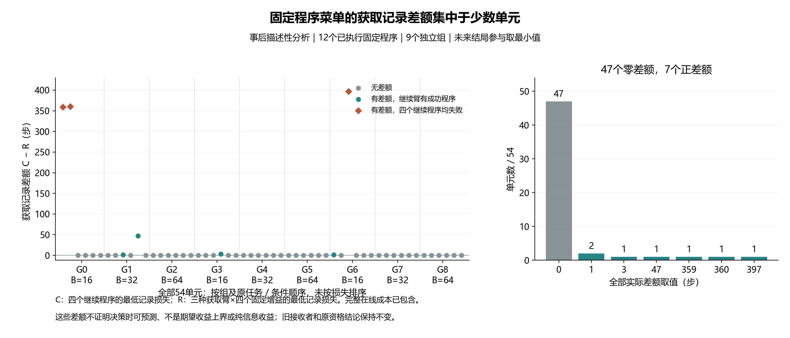

# 固定程序机会普查：结果解释与下一步

**结论：当前有限程序族仍有事后记录差额，但尚未证明这些差额能在决策时预测，或来自新增信息。** 本次全程为事后描述性分析，新增环境、政策／模型查询、拟合、训练、episode种子和在线LLM API均为0；原接收者和资格结论保持封存。

软件先在 `dbae170a956f8cef3ee38376bb9c1f7253de98af` 提交冻结，然后只运行一次真实记录普查。16项纯构造测试通过，旧科学检查按1393份源码及输入哈希复用；独立CSV／标量／Fraction审计核对18,224项，通过。完整登记1,740案例，其中QUAL1,566；99个任务失败全部保留。全部29程序、261组程序行和522个任务／条件／边界／程序格复算，与原表一致。

## 记录机会在哪里

有限菜单为同一初始前缀之后，四个固定PI时间常数×三种获取臂的12个实际完整程序。记C为四个CONTINUE程序中最低记录损失，R为全部12个固定程序中最低记录损失。

|指标|全部54单元，9独立组等权|
|---|---:|
|原固定PI_0125__CONTINUE平均损失|86.370步|
|每单元四个CONTINUE的事后最低记录损失C|86.185步|
|每单元12程序的事后最低记录损失R|64.556步|
|继续臂固定增益选择差额|0.185步|
|获取记录差额C−R|21.630步|
|C−R严格为正|7/54|
|C−R为0|47/54|

所有精确差额取值均保留：0步47例，1步2例，3／47／359／360／397步各1例。验证臂严格优于C为4例，移动臂为4例，其中1例重叠，合计7例；不能把两列直接相加。边界前成功的8例留在分母中，机会为真实的0。

进一步的**补充事后描述**：有3个单元的四种固定CONTINUE程序均失败，它们贡献1,116/1,168步的总获取记录差额，分布于两个独立组。这个分组不是新增资格门，不证明原因，也不允许据此只采这些任务／时点。完整18格、9组、54单元及所有原失败均保留，后续独立评价不缩小到有利子集。

完整原始分析报告见 [全部18格及解释限制](../outputs/occam_opportunity_census_v1/analysis_v1/report_zh.md)，精确分数、全部单元和频数见同目录 `statistics.json`。其SHA为 `0214bd46cb101b982de982ca93e75b228cf218d09bad97abf28b490b660c960a`；原十项主比较统计SHA仍为 `dccede3a2838fb1ef98c20bab5e89080bcd42c8a53629c1ad22d646ae6fb75bc`。

## 这些数字不能证明什么

C和R看过未来结局才取最小值。每程序仅有一次噪声实现，最小值有选择乐观性；它们不是可部署方法的结果、期望收益上界、可学习性或统计显著性证据。不能用64.556步宣称新算法已超过强基线。

固定T程序的获取分支在观测数据返回后没有学习新的T。因此差额可以包含改变物理路径、延迟、积分记忆及反馈的作用，不能把21.630步命名为新增信息的纯收益。新的A方法仍需与改变状态但保持原纠正、同历史被动适应、完整风险／DR及全部任务相关获取参考比较，并用独立自身时序历史验证实际采用与拒绝的后续表现。

原META方法仍未通过完整任务收益资格。当前分析不挑选替代主方法，不调整窗口／模型库／beta／增益，不训练或筛选旧QUAL上的后继方法。最新查新与十二个候选的保留／否决理由见 `docs/research/correction_scope_contribution_review_v10_zh.md` 和对应候选登记。

## 下一项具体交付

先做零新增交互、零拟合的 **TRAIN完整程序标签与公开历史支持审计**，明确哪些已执行完整结局能监督哪个实际后继程序，以及移动前／返回后分别有哪些真正可用输入。

已有TRAIN648来自三获取臂×RANDOM_WINDOW／BLOCK_FIXED两行为×18组，并不是每个入口都有四种固定T完整反事实。两行为首T相同，随机行为在后续窗口可能改变T；其终局不能直接标成“首T一直保持”的终局。不得拿本轮QUAL的12程序菜单回填TRAIN缺失标签。这是下一项审计的已知输入限制，尚未完成该审计或任何新训练。

下一审计的协议、读取器、独立核对和纯构造测试仍须先冻结。之后才能判断标准完整风险／DR参考可获得多少真实支持，是否需要独立新数据，以及候选结构是否有相对该参考可证伪的优势。当前没有已通过新颖性审查的算法，CCF A目标保持未完成。

## 费用与交付

主计算及独立复算工作进程0.731秒，含两次入口检查的父过程1.456秒；绘图、秘密扫描和交付另记。实际CSV六次读取、7,163行、668,450字节；哈希、JSON和父进程元数据费用分别保留在回执中。独立审计禁用了主模块全部十个计算／验证函数；CSV、JSON和SHA工具共享，没有物理重仿真。

本次源数据、统计、报告、图形及校验回执本地提交。旧原始记录、全部负结果和恢复副本继续保留；完整QUAL原始ZIP／分片／三种恢复仍待磁盘空间，不以这次小型普查替代完整数据交付。
