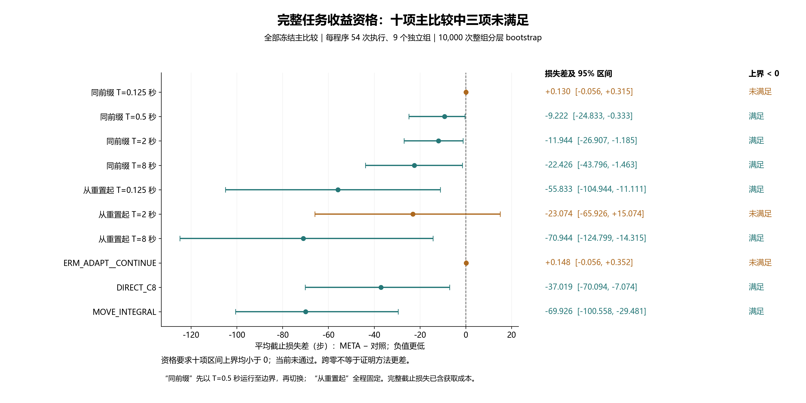

# OCCAM 标准参考：独立资格结果与负结果交付

本轮实际执行和独立审计已经完成：**数值／执行资格通过、预测资格通过、完整任务收益资格未通过**。因此封存当前接收者，不在这批 QUAL 上调整增益、窗口、门控、模型库或样本数。它尚未构成纠正后适用性方向 A 的新方法，也未完成 CCF A 研究目标。

本报告解释既定结果；首窗口分析与成本附录均为**事后描述性分析**。冻结主比较、原报告、完整人口和失败记录保持原样。完整原始数据留在本地；本次提交交付统计、审计、诊断及解释，完整 QUAL 数据分片与三份实际恢复验证仍待磁盘空间满足原协议，不能称为完整数据归档已经完成。

## 来源与方法名

- 科学冻结提交：`7abaec83b0854f099d6f13f308cc8cd552f50e2b`。
- 实验：`occam_reference_qualification_v1_20261028T125131Z_7abaec83b085`。
- Manifest：`19347fbe7b039fabd536c411d74e87a823bd0925cd2bee9e5705329cdb77f78d`。
- 原统计 SHA-256：`dccede3a2838fb1ef98c20bab5e89080bcd42c8a53629c1ad22d646ae6fb75bc`。
- 原始中文报告：[独立资格报告](occam_reference_qualification_v1_zh.md)。原表和两级审计见对应实验目录；交付来源清单见 `outputs/occam_qualification_result_review_v1/review_v1/`。

PI 的 T 是积分控制器的时间参数；0125／0500／2000／8000 分别为 0.125／0.5／2／8 秒。`PI_0125__CONTINUE` 先与其他同前缀程序一样用 T=0.5 秒运行到边界，再固定采用 0.125 秒；`GLOBAL_PI_0125` 从初始重置起即固定 0.125 秒，二者不同。

META 和 ERM 是两套独立训练得到的标准性能模型库：前者按元学习目标训练，后者按经验预测误差训练。ADAPT 在执行中依据真实反馈更新最后一层线性参数；FROZEN 保持这些参数不变。两者的神经网络特征权重在本轮均固定，底层机器人策略也固定。这里确有模型参与实际候选选择与在线线性适应，**没有在线 LLM API 参与**。

CONTINUE 直接继续；VALIDATE8 从当前真实状态执行短验证；MOVE_MEASURE 实际移动并测量，再继续。DIRECT_C8 保留既有校准纠正，MOVE_INTEGRAL 是移动后积分补偿对照。获取动作发生后没有重置来撤销其位移，全部实际费用均保留。

## 完整独立人口与全部程序

NATIVE 174 次、独立 QUAL 1,566 次，共 1,740 次执行，全部完成，未解决／未启动案例为 0。完整任务失败共 99 例，其中 NATIVE 1 例、QUAL 98 例。所有失败继续保留，不作为统计缺失删除。

QUAL 各程序均为 54 例，来自 9 个独立组，三个边界时点各 3 组，覆盖三个任务与不变／变化条件。区间按整组分层 bootstrap 计算，不能把时间步或候选对当作独立样本。9 组不构成充分统计功效的主张。

|程序|成功／54|平均截止损失↓|
|---|---:|---:|
|PI_0125__CONTINUE|51|86.370|
|PI_0500__CONTINUE|50|95.722|
|PI_2000__CONTINUE|50|98.444|
|PI_8000__CONTINUE|49|108.926|
|META_ADAPT__CONTINUE|51|86.500|
|META_FROZEN__CONTINUE|51|86.500|
|ERM_ADAPT__CONTINUE|51|86.352|
|ERM_FROZEN__CONTINUE|51|86.352|
|PI_0125__VALIDATE8|50|94.370|
|PI_0500__VALIDATE8|50|95.722|
|PI_2000__VALIDATE8|50|97.593|
|PI_8000__VALIDATE8|50|94.889|
|META_ADAPT__VALIDATE8|50|94.593|
|META_FROZEN__VALIDATE8|50|94.593|
|ERM_ADAPT__VALIDATE8|50|94.389|
|ERM_FROZEN__VALIDATE8|50|94.389|
|PI_0125__MOVE_MEASURE|52|134.926|
|PI_0500__MOVE_MEASURE|54|116.630|
|PI_2000__MOVE_MEASURE|53|127.093|
|PI_8000__MOVE_MEASURE|52|145.981|
|META_ADAPT__MOVE_MEASURE|54|119.944|
|META_FROZEN__MOVE_MEASURE|54|121.204|
|ERM_ADAPT__MOVE_MEASURE|54|121.926|
|ERM_FROZEN__MOVE_MEASURE|54|121.944|
|GLOBAL_PI_0125|46|142.333|
|GLOBAL_PI_2000|49|109.574|
|GLOBAL_PI_8000|45|157.444|
|DIRECT_C8|48|123.519|
|MOVE_INTEGRAL|49|156.426|

`GLOBAL_PI_0500` 与 `PI_0500__CONTINUE` 是冻结的精确别名，未重复执行或收费。全部 522 个任务×条件×边界×程序格、1,740 例登记、1,566 例 QUAL 和 99 例失败见原 `report_v1` CSV；未选择有利任务或阶段。

## 为什么任务资格未通过

冻结主方法为 META_ADAPT__CONTINUE。它须对十个预定强参考的损失差区间上界**全部严格小于零**。七项满足，以下三项未满足，故整体未通过。

|比较：META − 对照|平均损失差（步）|95% 区间|
|---|---:|---:|
|同前缀 PI_0125__CONTINUE|+0.130|[-0.056, +0.315]|
|GLOBAL_PI_2000|−23.074|[-65.926, +15.074]|
|ERM_ADAPT__CONTINUE|+0.148|[-0.056, +0.352]|

跨零表示当前证据不足以满足既定优越性要求，并不证明方法必然更差。相对 DIRECT_C8 和 MOVE_INTEGRAL 的损失差分别为 −37.019、−69.926 步，不能替代全部强参考要求，也不能在看到结果后改选另一程序为主方法。

简单的“边界后固定切换到 0.125 秒”已经得到 51/54 成功、86.370 步损失，与学习接收者非常接近；这使“好于旧校准对照”不足以说明性能模型或在线学习带来额外价值。META 的 CONTINUE 分支实际进行了 161 次线性参数更新，但 ADAPT 与 FROZEN 的总体成功数、总损失相同；这只说明这些汇总量没有改善，不能由此推断每一步动作或完整轨迹都相同。

MOVE_MEASURE 某些程序达到 54/54 成功，同时承担了更多获取步数。成功率与完整截止损失应同时披露，不能仅凭成功数替换冻结的损失优先标准。这里未新增二次筛选或挑选获胜的次要比较。

## 预测能力与任务价值分别检查

原预测资格检查主方法自己实际访问的事实窗口，相对冻结 TRAIN 常数预测的 MSE 差。可用轨迹为 46/54：push 18/18、reach 10/18、door 18/18；其余 8 条没有可评分窗口，保留缺失原因，不填零。

三个任务的 MSE 差点估计分别为 −0.001531730、−0.001674517、−0.006298733；整组区间为 [−0.003956922, −0.002904652]，冻结预测门通过。但这是条件于自身已观测窗口的预测检查，不能推出未选候选的排序准确、长程表现准确或包含获取成本的任务收益。

## 首窗口诊断：事后描述性分析

独立诊断登记全部 1,566 条 QUAL，NATIVE 174 条另列。从实际同前缀程序建立 1,296 条胶囊记录、162 个共同起点和 216 个完整分层格。136/162 起点具有首窗口，26 个 `ALL_NO_FIRST_WINDOW` 起点保留，不补造响应或结局。

|首窗口模型|四候选 MSE，组等权↓|冻结 TRAIN 常数 MSE↓|首窗口排序错误，组等权↓|首窗口选择差↓|
|---|---:|---:|---:|---:|
|META 初始库|0.000639742|0.004656163|0.360591|0.000932228|
|ERM 初始库|0.000519983|0.004656163|0.297229|0.000905278|

ADAPT 与 FROZEN 的第一次预测来自同一初始库，不能作为两套独立证据。排序在四候选的六对比较中计算，实际结果打平不计入该起点的有效对，预测打平计半错；先在起点、再在组内汇总，再对可用独立组等权。因此 0.360591 不是把所有候选对混在一起得到的原始错误比例。

固定 T 程序的首窗口代价排序与各自完整任务损失排序，组等权错误为 0.337422。它提示局部目标与完整任务目标也可能不一致；与此同时，首窗口本身的预测排序已有错误，所以现有证据不能把失败唯一归因于“预测时域太短”或“模型拟合不好”。首窗口选择差是无量纲 shaped cost 差，不是完整任务遗憾，也不是损失步数。

本诊断只使用共同前缀后的已执行候选轨迹。固定 T 的完整结局属于对应实际固定程序，不能贴给随后可能再改变 T 的自适应程序。这里没有重新拟合、模拟未执行轨迹、选择阈值、计算新资格门或估计因果失败原因。完整向量、26 条缺失、逐组分母和全部 216 格保存在 `outputs/occam_first_window_diagnostic_v1/analysis_v1/`。

诊断耗时 110.558 秒，主计算 54.136 秒；独立记录与 Fraction 算术审计通过，主诊断函数被禁用。JSON、SHA 与准入读取明确共享，没有物理重仿真。新增环境步、重置、物理帧、策略查询、模型前向、后验更新、拟合、训练、种子分配及在线 LLM 调用均为 0。

## 完整资源费用与读取器修复

|阶段|实际执行|控制步|全部重置|物理帧|固定策略查询|神经特征批次|四候选预测|实际线性更新|C4/C8 拟合尝试|
|---|---:|---:|---:|---:|---:|---:|---:|---:|---:|
|NATIVE|174|14,894|8,874|4,511,470|13,104|274|1,096|102|24|
|QUAL|1,566|172,511|79,866|40,795,555|155,567|2,423|9,692|964|216|
|合计|1,740|187,405|88,740|45,307,025|168,671|2,697|10,788|1,066|240|

全部重置包含每例受控初始化及环境工厂的目标初始化重置，不仅是 1,740 次受控重置。总截止损失已含已执行获取过程；失败未执行的额外惩罚步为 0，不能再把失败惩罚计入物理交互。核心 solve／eig 次数属于按固定代码复算的操作计数，不是直接测得的模型耗时；case 总 host wall 也不是隔离的神经网络延迟。

历史共同神经模型来源为 684 次执行、85,789 控制步、34,884 次全部重置、17,870,945 物理帧，以及实际共同训练 9,000 次 AdamW 更新，不能按比较程序数重复累加。单库假设独立费用为 5,000 次更新，其中共享预训练 1,000 次；它仅是资源视图。完整 C8 来源为 3,840 控制步、24,480 次全部重置、12,259,200 物理帧，已包含其 3,072 步训练子集，不能再加一次。关闭的 v2 部分来源费用另保留，未用作本轮训练；更早未知的全生命周期费用不填零，也不声称已得到一个无重复的项目总费用。

成本读取器 v1 在遇到旧格式 case 的缺失 API 字段时失败。全人口核查发现恰好 120 条 legacy case 缺少该 case 级字段，均属于 DIRECT_C8 或 MOVE_INTEGRAL；所有 1,740 例的 accounting 均有显式计数。独立版本 v2 核对父回执哈希、COMPLETE 状态、前后账本、显式 API 和网络尝试计数；它只为内存兼容读取补入已认证 accounting 的值，没有改写原 case，也没有把缺失默认当作零。

v2 的 15 项新纯数组／保存元数据测试通过，冻结于 `d6f1bad4bff34a31d210ae2ec94045bd517b6af9`。此前 25 项成本测试和 2,695 项科学检查按对应源码哈希复用，并非新增或重复通过的物理试验。v2 完整成本分析及独立复算通过，耗时 18.076 秒，原 v1 失败、日志和代码保留。完整 58 行阶段／程序费用及历史来源见 `outputs/occam_qualification_costs_v2/analysis_v1/`。

本轮所有在线 LLM 调用和 tokens 均为 0，平均 API 延迟为 null；这不表示整个历史项目从未使用 API。成本与首窗事后分析新增物理交互、真实模型查询及拟合均为 0。

## 决定、查新边界与后续进入条件

本版本的两套冻结模型库、四个 T、beta=0 和 16 步局部代价接收者封存为完整任务资格负结果。保留全部文件，不围绕这版 QUAL 叠加获取门、调 beta、换库、挑任务、扩样本或把次要比较改作成功证据。

后续仍沿 A 研究“纠正改变后续状态和动作后，模型与探测何时继续适用”。但普通收益预测、信号混合、局部误差告警、分布重加权、内外生变化联合处理和重新测量，都不足以单独建立新颖性。最新查新边界见 `docs/research/correction_scope_contribution_review_v9_zh.md`；标准完整程序风险／DR、同历史被动适应、简单重加权、模型适用范围、Residual RL、OCCAM、GAUGE、Poke and Strike 与条件监测路线仍须作为直接参考，已有软件或论文对照不等于已完成实际强对照部署。

下一个具体机制必须先提出相对这些参考可证伪的区别，分别验证数值合法、当前／候选预测能力和完整任务价值，并独立冻结 TRAIN、CAL 与新方法自身形成时序历史的最终评价。当前首窗口诊断没有授权新采集，也不能在这批 QUAL 上训练或选择后继机制。新的机器人机制、独立任务收益与消融证据仍缺失，CCF A 目标继续保持未完成。

## 交付状态与可复核性

原采集、进程审计、数值／记录审计、独立统计和报告九步流水线全部返回 0；完整准入检查已通过。原报告、十项比较、所有失败和源码哈希保持不变。新增图仅从已审计统计绘制，使用既有隔离 Matplotlib，不安装依赖或修改科学环境。

本阶段提交包含原始小型报告／CSV／统计／审计回执、完整首窗口诊断胶囊分片、完整成本附录、来源与封存回执、绘图代码及 PNG／SVG。大体积原始 QUAL 轨迹仍在本地。提交前的源码核对、秘密扫描、普通／暂存差异检查及实际索引对磁盘字节证明见 `outputs/occam_qualification_result_review_v1/validation_v1/`；提交后另留实际 Git 对象对磁盘字节证明。

第一次交付准备在单文件 4 MiB 上限检查处停止：原种子范围元数据为 11,429,531 字节。失败源码和回执保留；v2 仅增加原元数据的 gzip 副本与大小／哈希索引，并确认解压字节与原文件完全相同。原文件未改写，这个元数据副本也不替代尚未完成的 QUAL 原始轨迹归档。

暂存检查同时识别到 Windows 自动换行转换会改变部分 CSV 的 Git 字节。因此只为已完成阶段补充 `.gitattributes` 精确字节规则，保留原有规则，不修改全局 Git 配置或原 CSV；最终再次核对实际索引对象与磁盘字节。

两次暂存差异检查因生成 SVG 和两份复制操作 JSON 的 Windows 换行而停止，原检查输出均保留。最初将原因解释为 CSV 属性尚未暂存；逐路径核对保存日志后已纠正这一解释，见 `preparation_failure_interpretation_correction.json`。另外两次范围预检分别遗漏新属性文件及两份操作 JSON，也保留了失败源码与回执。

最终对结果目录显式保留 CR-at-EOL，并沿用仓库已有生成 SVG 的 `-diff` 规则；绘图代码仍参与编译和普通差异检查，图形与全部科学结果原字节不变。合计五项交付／范围检查停止记录可追溯，均未重新采集、拟合或调用 API，不能算作机器人任务失败或科学资格变化。

完整 QUAL ZIP、Git 分片、原始字节恢复、实际 Git 恢复和 archive-only 恢复尚未执行。冻结导出器要求至少 `3×实际来源字节+512 MiB` 的可用空间；保留全部副本及 Git 对象的保守建议仍为至少 12 GB。空间条件不满足时保留原始数据并等待，不降低恢复要求或删除旧失败／副本。统计和来源目录可复核，不应被误称为完整原始轨迹已可从 Git 恢复。
